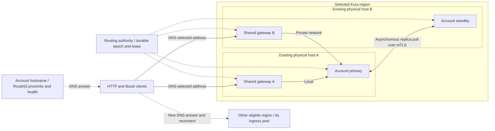

# Kura replicas across physical hosts and traffic failover

**Status:** proposed; high-priority specification, not an implementation or deployment authorization.

**Date:** 2026-09-22.

**Status update (2026-09-25):** spec 95 has shipped. Its account-specific stable hostnames and DNS steering are the existing foundation for this proposal.

**Code baseline:** `ea74dd7235ab9a0aa7285a16750c5dc2221936f4`.

**Scope:** managed public Kura account-region instances, with compatibility requirements for private runner endpoints and self-hosted mesh peers.

## Decision proposed for review

Place each managed region's two replicas on different physical cache hosts and keep one selected primary for public reads and writes. Run a **shared ingress gateway on every existing regional cache host**, initially using the host-network ingress processes. An account has a routing entry, not a gateway deployment. Every healthy gateway can serve every admitted account in its region, forwarding to the selected primary locally or over the regional private network. **The default adds no dedicated ingress machines.** Deliver health-checked DNS failover across these gateways first, while OVH BGP Service remains alpha and unsuitable for production. Qualify shared-IP routing separately, beginning in Chicago; it is a later improvement, not a dependency of the initial DNS-based delivery.

Build on the shipped [spec 95, Per-account cache hostname steered by proximity](https://atlas.tuist.dev/engineering/specs/95): DNS selects a region and a healthy gateway-host address, and the gateway selects the account backend. When a primary process fails but the gateway survives, backend promotion does not require a DNS change. Physical host loss also removes its gateway, so affected clients must re-resolve and reconnect. A later shared regional IP can remove the DNS dependency from host recovery after provider and dataplane qualification. Shared ingress is a required software role; physical separation from cache hosts is optional.

Reserve CPU, memory, public bandwidth, and private-network capacity for both cache and gateway roles under N-1 load. Consider dedicated ingress hardware only if measured contention or a complete fleet cost comparison justifies it. That alternative permits independent hardware choices, but still needs fast private connectivity and resilient upstream addressing. With co-located gateways, public bandwidth remains a cache-host purchasing constraint.

**Regional private networking is a rollout prerequisite:** all participating cache/gateway hosts in a region must join the same OVH vRack, or an equivalent shared regional private network at another provider. Route gateway-to-primary traffic, connection-owner forwarding, intra-region replication, and rebuilds over private interfaces and addresses. This design depends on using private-network capacity for internal transfers while conserving the more constrained public links for client traffic and separately budgeted cross-region traffic. A private pod IP or encrypted tunnel is insufficient evidence: its underlying host-to-host path must also use the private network. Verify each host's enabled private service, sustained throughput, and N-1 headroom; do not infer available bandwidth from a NIC's advertised speed.

Add explicit primary fencing and a planned-handover replication barrier before claiming safe automatic host failover. Retain asynchronous replication and accept possible recent cache misses on an unplanned host loss. Do not claim zero data loss from two asynchronous copies. Accounts with multiple provisioned, policy-eligible regions use spec 95's DNS steering for regional recovery.

The first delivery includes separate-host placement, safe per-replica storage recovery, shared gateways, health-checked gateway DNS, fenced promotion, and migration/client-recovery tests. It does not wait for BGP, ECMP, shared-IP direct return, or bandwidth-aware L4 forwarding. Publish measured DNS-based host and regional recovery bounds rather than applying the later shared-IP target. The existing EU East incident-hardening draft remains separate.

### Relationship to spec 95

**Spec 95 has shipped; implementing it is not a deliverable of this proposal.** The design reference reviewed here is revision 3, read on 2026-09-22, which targets the account's cache box for each region. This proposal initially changes that regional target to health-checked gateway-host addresses, with a qualified shared regional service address as a later upgrade, while preserving the existing `{account_handle}{env_suffix}.cache.tuist.dev` name, delegated Route53 zone, DNS proximity steering, rendering/advertising separation, and single DNSEndpoint writer. Account-specific URLs such as `pinterest.cache.tuist.dev` remain stable even when accounts share an ingress address. This document describes the extension to the shipped behavior; the Atlas text is not modified by this local draft.

For the initial delivery, use account latency aliases pointing to regional weighted gateway-host A records with per-host health checks and `EvaluateTargetHealth` on the aliases. [Route53 documents this health hierarchy](https://docs.aws.amazon.com/Route53/latest/DeveloperGuide/dns-failover-complex-configs.html). Share leaf records/checks across accounts. Start with capacity-based weights and the existing 60-second TTL, then validate detection, resolver caching, address retry, and HTTP/gRPC reconnection with actual clients. A 60-second TTL is not a recovery deadline. Multiple IPs in one health-checked record are not independently tested, and weights do not guarantee even traffic distribution.

The later shared-IP phase replaces regional gateway-host DNS targets with a qualified shared regional service address. Gateway application health must drive route withdrawal; a live BGP session alone does not establish a working proxy. Preserve the account URLs, gateway-to-primary routing, private network, fencing, certificates, and DNS ownership from the initial delivery. DNS-based ingress remains a supported path in regions awaiting production routing support.

Rendering the account's HTTP/gRPC routes and certificates on every regional ingress host precedes advertising it. Keep spec 95's withdraw-before-stop-routing lifecycle and extend its drain if DNS withdrawal is not observed. Existing regional names stay supported, pointing to the same regional ingress pool. A purely managed account still receives one stable URL; mixed self-hosted accounts retain the selection behavior defined by spec 95.

A shared ingress TCP check cannot detect an account with no serving backend. Add fresh per-account-region route readiness to advertisement decisions: attempt local recovery first; if no local serving route remains and another eligible region is confirmed serving, withdraw that account's regional alias. Re-advertise only after recovery and ten minutes of healthy observations. Preserve the final record when no alternate exists and return retryable unavailability. Controller/authority loss can delay this account-specific withdrawal; publish that limitation separately from provider/ingress health checks, and test it explicitly. Fast account-specific DNS failover independent of the controller would require an additional health mechanism and its own cost budget.

Reconcile the five-metro mapping in the reviewed revision of spec 95 with the shipped implementation and current seven-region configuration. Route53 permits only one latency record per AWS region tag for a name; verify a valid mapping and measure proximity for Warsaw, Chicago, and Santiago rather than assigning duplicate nearest-region tags. If distinct suitable tags cannot represent the serving set, revise the DNS policy before rollout. Price the additional leaf/TXT records and queries using the resulting tree; do not copy the original per-account record estimate unchanged.

The initial request path is `client → DNS-selected regional gateway host → account's regional Kura primary`. The gateway sends client responses using its own public link; a remote primary is reached privately. In the later phase, the path becomes `client → shared regional IP → initial L4 forwarder → selected TCP/TLS gateway → regional primary`, with direct public return from the selected gateway. All inter-host legs use the regional private network. Neither phase adds a central WAN proxy or balances backend reads across asynchronous copies: each account-region keeps one movable primary.

## Motivation and evidence boundary

The [2026-09-21 discussion](https://tuist-company.slack.com/archives/C07PFFP6WBH/p1790006414006699) supplied with this task establishes the intent: primary and standby on different nodes, with traffic rerouted promptly after host loss. It also identifies network egress and replica synchronization latency as the cost of moving the standby off-box. The [meeting notes](https://notes.granola.ai/t/4079e8f2-5e48-4e38-bdaa-693724c82d1c-009c2hma) are supplementary; this specification does not depend on access to them.

The supplied September 22 incident evidence is treated as an incident record, not as measurements repeated for this document:

- The sole Warsaw node, `tuist-tuist-ovh-fleet-eu-east-nh9pb-p4qn2` (`57.128.235.80`), hosted both replicas for 22 instances on `scw-local-nvme` volumes.
- Repeated loss of control-plane connectivity triggered default 300-second NoExecute evictions. Replacements remained constrained to that host by local storage and stalled on DNS-dependent bootstrap.
- Temporary DNS bypass, Cilium recovery, rollout pause, and indefinite node-loss tolerations restored 44 pods and all 22 public readiness endpoints.
- Host gateway RTT was approximately 0.15 ms and Cloudflare RTT approximately 1 ms, versus approximately 316 ms to the API. Traceroute and retransmissions implicated the Warsaw-to-Frankfurt path. The precise provider root cause is unconfirmed.

Another Warsaw host covers a failed motherboard, disk, or host OS. It may share the same upstream path, rack, provider, DNS dependencies, and distant Kubernetes API. Indefinite tolerations preserve running workloads during a partition; they neither move local volumes nor supply a reachable public address after hardware failure.

## Failure domains and recovery contract

These are proposed release targets, not current guarantees or measured results. Measure from fault injection (`t0`) to the start of a sustained successful sequence of authenticated reads and writes of a small retained test corpus through the existing public hostname. Confirm that sequence with ten consecutive successes at one request/second; its recovery timestamp is the first success in that sequence, not the end of the confirmation window. Record isolated earlier successes separately. Large interrupted transfers have their own deadline and restart semantics.

| Fault | Target and preconditions | What is not promised |
| --- | --- | --- |
| Primary process lost, gateway survives | Recovery through that surviving gateway within **30 seconds** when a warm sibling, lease authority, and gateway-to-sibling path remain healthy. No DNS edit or replacement boot on the critical path. | In-flight streams may reset; asynchronously unreplicated entries may miss. This is not a physical-host recovery bound. |
| Physical cache/gateway host lost — initial DNS phase | Health checks remove its address from healthy DNS selection. Survivors provide combined N-1 capacity and a safely promoted primary. Publish measured detection, cached-answer, retry, and reconnect bounds per supported client before rollout. | No universal 30- or 60-second host-recovery guarantee; TTL does not invalidate cached addresses or live connections. |
| Physical host lost — later shared-IP phase | Target **30 seconds** through the stable regional address when surviving forwarding, gateway, warm sibling, lease authority, and private paths remain healthy. Qualify simultaneous cache/gateway loss. | In-flight streams may reset and unreplicated entries may miss. This stronger target is not an initial-release gate. |
| One gateway/forwarder lost — later shared-IP phase | Shared-IP routing reaches survivors without a DNS change. Measure application-health withdrawal, convergence, connection-owner forwarding, and reconnection. Survivors support combined cache/ingress N-1 load. | BGP/ECMP alone does not preserve flows. Losing the TCP/TLS endpoint requires reconnecting. DNS fallback remains subject to cached answers. |
| Planned primary handover | Zero handover-induced misses for retained acknowledged objects; routing interruption at cutover at most **5 seconds**, permitting bounded retry. Preparation is bounded separately below. | A sampled zero lag before cutover does not satisfy this requirement. |
| Warsaw/provider path fails for the region | Spec 95 steers the same stable hostname to another already serving, admitted region. Record separate RTOs for new resolves and existing HTTP/gRPC clients in phase 5. | No universal 60-second recovery, equal hit rate, regional read-after-write, or zero WAN replication loss. A single-region account has no automatic alternate. |
| Kubernetes API/lease authority inaccessible to all gateways/replicas | No new primary grants; expire serving authorization and return retryable errors. Page within **30 seconds**. | This phase does not provide write availability through a global control-plane outage. It deliberately avoids autonomous competing promotions. |
| One host lost; spare host already available | Start one bounded replica rebuild within **5 minutes** of permanent-loss determination. Provisional objective: restore redundancy for a 50 GiB admitted corpus within **30 minutes**, with at least 50 MiB/s reserved useful rebuild throughput. | Provider procurement time or restoration without schedulable storage/egress capacity. Larger volumes require an explicit size/rate-derived objective. |

Use required anti-affinity on a stable physical-host identity. For today's bare metal, hostname can be used only after verifying one Kubernetes Node corresponds to one physical server. Future VMs must carry a provider-verified physical-host label; distinct VM names are insufficient. Prefer separate racks/power/network failure domains where their labels are reliable. Record unavailable/unknown rack diversity as such rather than inventing a topology label. A region/provider/uplink outage remains a separate failure class.

## Architecture and ownership

The diagram shows the initial DNS-based delivery; shared-IP forwarding is a later phase.

Initially, each client connection uses one DNS-selected gateway address. In the later shared-IP phase, a qualified forwarding layer selects the gateway and preserves its connection owner across forwarding changes when that owner survives. Every ingress has the same authoritative account-to-primary route generation and separate HTTP/gRPC upstream pools. Point upstreams at reachable private pod addresses or authenticated internal node endpoints, with pod UID/incarnation validation; never resolve the account's public hostname as its own upstream. No additional gateway tier is required between the ingress machines and Kura. Existing primary-selected Services remain compatibility outputs of the same authority, not a competing election.

Account for correlated failures: losing one host removes its cache replicas, gateway, and forwarding capacity together. Reserve resources for all roles, stage configurations, and roll one host at a time with N-1 headroom. Prefer verified rack/power diversity. Multiple machines on one provider do not remove that provider or regional fabric as shared failure domains. Routing authority availability and the short-lease tradeoff below remain separate dependencies.

| Owner | Responsibility |
| --- | --- |
| Server | Account entitlement, allowed regions/data locations, desired replica policy, eligible serving-region set, ingress capacity admission, endpoint catalog. Include changed placement/routing policy in manifest revision calculation. Do not independently elect primaries. |
| Kura controller/routing authority | Placement reconciliation, one fenced primary per account-region, durable handover state, route publication, per-replica rebuild, observed health. Run redundant controller processes with serialized decisions and an isolated fast health/lease path. |
| Platform | Shared gateways on regional cache hosts, certificates, private connectivity, combined N-1 headroom, and health-checked DNS with measured client recovery. Later, qualify shared-IP routing, withdrawal, and forwarding per provider. Gateway lifecycle is independent of an individual account instance. |
| Runtime | Enforce serving authorization on HTTP and gRPC mutations, report incarnation and applied replication positions, execute drain/barrier, preserve auth and peer mTLS. |
| external-dns | Sole DNS provider writer for the controller/platform-owned record intent. The server does not race it by editing records. |

### Front door and protocol contract

1. Preserve spec 95's shipped stable account hostname and every supported regional hostname. Initially publish the health-checked gateway-host set instead of `instanceNodeIP(primary)`; publish a shared regional address only after the later phase is qualified. A backend promotion/rebuild leaves ingress addresses unchanged; sustained loss of the account's regional serving path follows the advertisement policy above. Publish only working address families; an unusable AAAA record is a separate outage.
2. Terminate public TLS and route account Host/SNI directly on the regional ingress machines, initially retaining the existing ingress protocol behavior. Make the existing account `cache.tuist.dev` certificates available on the new gateways and retain spec 95's delegated-zone DNS-01 issuance and renewal path; the `*.kura.tuist.dev` certificate does not cover these names. Verify HTTP/1.1 and HTTP/2 ALPN, gRPC trailers/status, ByteStream reads/writes, REAPI, Remote Asset, and BEP. Preserve separate HTTP 4000 and gRPC 4001 upstream pools and the existing runtime capability gate.
3. Gateway-to-runtime traffic crossing providers or untrusted networks must be authenticated and encrypted. Reuse a verified encrypted cluster transport if available; otherwise add an authenticated tunnel or upstream TLS adapter. Plain HTTP ClusterIP behavior is not proof of encrypted cross-provider transport. Qualify MTU, Cilium identities/policy, and asymmetric routing for both hosts.
4. Preserve Kura's token validation and account/project authorization. The gateway must strip externally supplied routing/fencing headers and inject only its own authenticated metadata. Do not share peer CA material with clients, bypass verification, or treat a successful `/up` as authorization readiness. Test token refresh and an uncached token during server unavailability; do not assume all auth modes are offline-verifiable.
5. Stream without full-body buffering. Retain measured HTTP/2 window/memory limits, backpressure, upload size limits, range responses, and timeout configuration. Safe GET retry is bounded and only before response bytes escape; a truncated response is surfaced to the client. Never transparently replay arbitrary POST, multipart completion, BEP, or a partially delivered ByteStream mutation. Content-addressed retries still need digest and completion checks. Do not splice bytes from different versions into a successful response.
6. Preserve the distinct public peer plane: SNI passthrough with per-account/instance mTLS to the replication gateway. Its hostname should use the regional ingress pool with a separate peer route while preserving peer DNS ownership and mTLS, not public wildcard TLS. Do not create recursive peer/client proxy paths. Preserve the old peer address for its longer cache window during migration.
7. Probe gateway health independently of any one account's backend. A single tenant's failed primary must not eject a gateway serving every other tenant. Backend serving probes include runtime incarnation, lease validity, and HTTP/gRPC listener capability; external authenticated synthetics establish the full path.
8. Admit a regional host only after verifying its membership in the region's shared private network and its private reachability to every participating host. Bind internal forwarding, replica, and rebuild paths to that network, including any overlay underlay and return path. Private-path failure must make the affected path unavailable and trigger bounded recovery; do not silently fall back to public host addresses and consume the public bandwidth budget. Private networking is required for both phases. Shared public-IP routing is a separate requirement of the later phase only.

### Later phase: shared-IP routing and provider qualification

Proceed with the DNS-based delivery while OVH support remains alpha. Independently qualify shared regional IP routing on the existing Chicago hosts. [Vultr documents Reserved IP with BGP/ECMP and bare-metal peering](https://docs.vultr.com/high-availability-on-vultr-with-floating-ip-and-bgp); account enablement, application-health withdrawal, private paths, convergence, and costs require qualification. Keep gateway routing, fencing, and shaping portable while recording upstream requirements separately for each provider. Do not promise this architecture across all seven regions before those requirements are met. Dedicated ingress hardware does not make an unsupported public IP movable.

**Provider decision gate (reviewed 2026-09-25):** OVH is the primary hosting target, followed by Vultr. Scaleway is optional; moving EU West to OVH is an alternative to evaluate, not a migration authorized by this specification. Chicago is an implementation qualification, not evidence that the main OVH fleet can adopt the same design.

[OVH's BGP Service documentation](https://docs.ovhcloud.com/en/guides/network/bgp-service/bgp-service-config) supports ECMP through vRack, but currently labels the service alpha and explicitly excludes production use. It excludes US and APAC regions and requires eligible hardware and same-region peering. [The published region list](https://labs.ovhcloud.com/en/bgp-service/) includes Warsaw and French locations; Singapore is future availability, while the configured US locations are not covered. Before selecting this as the production-wide default, obtain confirmation of production support, availability for each actual location and server model, routing/return-path behavior, and pricing. Moving EU West from Scaleway to OVH reduces provider variation but does not resolve these OVH availability constraints. While these constraints remain, deliver and measure DNS-based resilience on OVH. A hosting change or deferred shared-IP rollout can be evaluated separately; vRack membership alone is not sufficient for public ECMP.

BGP/ECMP selects paths but does not by itself preserve connections when the next-hop set changes. Qualify connection-aware forwarding before claiming continuity for surviving TCP/TLS endpoints; [GitHub's GLB design](https://github.com/github/glb-director) documents this distinction. A dead endpoint loses its connections and clients must reconnect. Include this work in the Chicago gate rather than treating a routing daemon alone as equivalent to Unimog. DNS fallback regions publish their measured client recovery separately.

### Later phase: selecting the gateway with public-egress headroom

This section applies only to the later shared-IP phase. Initial DNS weights provide coarse capacity distribution; they do not select gateways using instantaneous spare bandwidth. Host and tenant ceilings, N-1 capacity, and backpressure remain initial-release requirements.

There are three separate choices. Spec 95's DNS policy selects the region. The provider's ECMP hash selects the initial forwarding host for the connection; it does not measure spare public bandwidth. Our regional L4 forwarding layer selects the TCP/TLS gateway for a new connection before termination, potentially forwarding its packets over the private network to another host. These software roles run on the existing hosts and do not imply another hardware tier.

Make bandwidth-aware gateway selection part of qualification, rather than an assumed property of BGP. Each host reports recent public transmit rate, queued output and shaping backlog, enabled public-link budget, and gateway CPU/connection pressure. Account for other public traffic, capacity already committed to serving guarantees, safety reserve, and monthly transfer limits separately. A regional control loop publishes versioned capacity weights to all forwarders. Bias new connections toward healthy gateways with more usable public-egress headroom; use randomized weighted distribution, bounded adjustments, and hysteresis rather than sending every new flow to the same momentarily idle host. Stale telemetry cannot establish spare capacity: fall back to conservative configured weights and retain local admission/shaping limits.

Weight changes apply to new connections without moving established connections away from their owner. The selected forwarding implementation must preserve ownership across weight generations and forwarder loss; a freshly recomputed weighted hash alone is insufficient. Host-level selection occurs before account authentication, so tenant floors and aggregate account-region ceilings remain enforced separately after authentication. Headroom measurements estimate future demand; they cannot reserve the unknown eventual bandwidth of every new connection. Local queues, admission limits, and shaping enforce the actual budgets when demand grows or measurements lag.

**Direct public return from the selected gateway is required for this egress-distribution design.** If ECMP first sends a connection to host A but the forwarding layer chooses gateway B, B terminates TCP/TLS, reads from the account primary locally or over the private fabric, and sends client responses through B's public interface. Returning responses through A would retain A's public-egress bottleneck. [GitHub documents this direct-server-return pattern](https://github.blog/engineering/infrastructure/glb-director-open-source-load-balancer/). Qualify permission to transmit the shared source IP from every eligible gateway, routing, source validation, firewalls, and actual interface counters with the provider. If the provider requires return through A, do not claim that choosing B distributes public egress. Client uploads still traverse the initial host's public receive path; this design chiefly addresses download egress.

For example, with two 3 Gbps public links, A transmitting 2.7 Gbps and B transmitting 0.5 Gbps, new connections should favor B even when their first packets arrive at A. B can fetch objects from a primary on A over the private network and return them publicly itself. Existing HTTP/2 connections on A remain there, and their future streams can increase A's load. Apply backpressure and bounded admission; qualify graceful connection draining/reconnection where needed without aborting active transfers merely to rebalance. If every gateway is at capacity, throttle or reject new work within the retry contract rather than exceed host or tenant ceilings.

[Cloudflare's Unimog design](https://blog.cloudflare.com/unimog-cloudflares-edge-load-balancer/) provides a precedent for adjusting connection distribution using measured server load, but its published control loop targets CPU utilization. Public-egress headroom is our proposed control signal and requires its own qualification. This adds a forwarding dataplane and load-control work beyond the existing ingress-nginx process; no available capacity or connection-preservation claim is established merely by enabling BGP.

### Primary state machine and partitions

Add an explicit per-account-region serving lease and monotonically increasing epoch, persisted with compare-and-swap through the Kubernetes API. An HA controller owns grants; runtimes do not elect themselves from ring size. Bind every grant to the instance UID, pod UID, runtime incarnation, and physical-host identity. Never reset epochs when a controller restarts or reuse an old grant after volume recovery. Use a dedicated lease/route resource or a durable record with equivalent semantics; a Service selector and its resourceVersion alone are not a runtime fencing protocol.

Provisional timing: probes every 2 seconds, 1-second deadlines, three failures to suspect; lease lifetime 15 seconds, renewal every 5 seconds, at most 2 seconds safety allowance for timing uncertainty; route publication budget 3 seconds. Detection and expiration run concurrently. The 30-second target must be confirmed by the sustained-success observation and demonstrated for all 22-instance simultaneous failures, not inferred by adding nominal timers. Cache and metrics sampling must not serialize or starve this path. The two-second safety allowance is a proposed budget to prove, not an assumption that arbitrary clock drift or an unbounded commit can be made safe in two seconds.

States are `Serving(epoch, holder)`, `Suspect`, `Fencing`, `Promoting`, `ServingDegraded`, and `Rebuilding`; planned handover has an additional `Quiescing` state. Persist transitions and reasons so controller failover resumes instead of repeating a destructive step.

- **Suspect:** independently observe the failing data path and runtime. NodeReady is corroboration, not the sole signal. Stop routing new requests to a known dead backend; preserve volumes and pause rollouts.
- **Fence:** explicitly revoke and receive the old runtime's stopped-serving acknowledgment, or wait for its maximum grant lifetime plus safety allowance. Failure to probe is not evidence of death. A disconnected old primary must reject new public requests when its grant expires, including over previously established HTTP/2 channels.
- **Promote:** after fencing, grant a higher epoch to a fresh, serving candidate. Require supported fencing capability and identity-matched evidence. Emergency promotion can use a warm but lagging candidate under the declared asynchronous-loss policy. Publish its route only after it acknowledges the grant. Keep the decision sticky; a recovered lower-ordinal pod does not automatically take traffic back.
- **Rejoin:** the old holder resumes as an unfenced-data recovery source/standby, never as a public primary with its cached lease. Retain useful data and reconcile it through existing version/tombstone rules. Expired-epoch public writes must not reappear through peer replication.

Enforcement must cover admission **and final mutation publication**, including uploads already running at expiry. The implementation must define a bounded commit critical section and a safety interval before issuing the next grant, account for process suspension and clock movement, and revalidate after a pause. If it cannot prove the bound, promotion requires positive external fencing (for example confirmed host power-off), and the 30-second partition target is withheld. Merely attaching an epoch to requests, renewing a Kubernetes Lease, or holding the current file lock does not fence independent disks. Failure-injection tests below are a release gate for this design choice.

The fence governs public serving, not ordinary authenticated peer replication into a standby. Audit all public mutation paths and old direct/NodePort callers so none bypass it. Compatibility mode for old runtimes must remain explicitly non-HA; mixing one unfenced public writer into an HA instance is prohibited.

Partition behavior is deliberate:

| Partition | Required outcome |
| --- | --- |
| Primary cannot reach sibling; primary still reaches authority/gateway | Keep current primary; report degraded replication and increased loss exposure. Do not promote because of replica-link loss alone. Block planned handover. |
| Gateway cannot reach primary; primary still reaches clients on an old address | Old holder must fence before standby activation. Cached-IP traffic receives retryable failure after expiry; it must not keep acknowledging writes. |
| Warsaw hosts lose API reachability; alternate region retains it | Warsaw grants expire. Account-aware advertisement withdrawal can steer new resolutions to the eligible alternate's independently fenced primary; TCP-only ingress checks cannot detect this by themselves. Do not evict/rebuild both Warsaw volumes as a connectivity response. |
| All controllers/API unavailable | No grants or promotions. Existing grants run only to expiry. This intentionally reduces write availability versus today's indefinitely cached peer view; monitor it and obtain explicit review acceptance. |
| Asymmetric gateway visibility or stale watches | Gateways use the same committed route generation. A stale gateway can cause a bounded retry, not authorize an old writer. Never use per-gateway independent primary elections. |

## Replication and consistency

Keep the current fast local commit plus asynchronous pull path for normal writes. The cache can regenerate content, so making every upload await a second physical host is not the recommended first change. Synchronous replication would add network latency and couple write availability to the sibling, and would still require fencing. If review requires zero acknowledged-write loss on host death, this decision must change; do not market an asynchronous lag target as an RPO guarantee.

The contract is:

- **Stable primary:** read-after-write at that regional endpoint for successfully committed, retained entries, subject to normal eviction/deletion and existing version semantics. No promise of global linearizability across independently writable regions.
- **Planned handover:** no additional read-after-write gap for retained acknowledged entries. A failed barrier aborts/pauses the handover; a shutdown deadline must not silently turn it into a successful handover.
- **Unplanned host loss:** service recovers on the surviving copy. The unreplicated tail may be missing; its size is not bounded when the link has been partitioned. Provisional healthy-operation objective: p99 applied replica lag at most 1 second, with sustained lag over 5 seconds alerting. Publish both observed lag and sample age; missing evidence means unknown, not zero.
- **Cross-region failover:** best-effort cache recovery, possibly cold. It cannot inherit the planned local-handover guarantee. Authentication, tenant isolation, digest correctness, and applicable deletion/version rules remain mandatory.

### Planned deployment and handover protocol

1. Before rolling anything, verify both physical placements, ingress availability, spare capacity, peer identity/capability, and a complete initial catch-up. Do not roll the healthy survivor while already degraded. Honor operator `OnDelete`/partition pauses.
2. Roll the standby first; do not let ordinal ordering accidentally roll the selected primary first. The replacement keeps or rebuilds its own local volume and catches up. Require fresh evidence from its current incarnation, not a retained status from its predecessor.
3. Enter `Quiescing` on the old primary. Route reads there while rejecting/briefly queueing new mutations with a bounded retry response. Complete admitted HTTP and gRPC mutations within a proposed 300-second preparation budget; on deadline cancel safely and abort the handover while the old primary remains usable. Do not acknowledge an incomplete upload.
4. Once all public mutations settle, record the old source's final `(incarnation, committed feed head)` and applicable tombstone/version frontier. Require the **named destination** to prove it has durably applied all required records and bodies through that position. Bootstrap completion, a cursor from another incarnation, no live consumers, a trimmed feed gap, or a listing-only cursor is not proof. Include inline values, segment bodies, action-cache references, and namespace deletion records. If capacity admission skipped needed retained data, report barrier failure explicitly.
5. Fence the old holder, issue the next grant, and publish the new route as one ordered transaction sequence. Observe both HTTP and gRPC traffic reaching the new holder before deleting the old pod. Keep the peer listener available for completion; transfer the replication gateway role without leaving the peer Service pinned to a deleted pod.
6. Old reads/streams may finish within their bounded drain budget. New writes go only to the new holder. Roll the former primary only after the new holder serves and the data barrier is recorded. Resume the rollout health soak; a failed barrier or replication pressure resets it.

An implementation may avoid the write pause using forwarding or a replicated commit barrier, but must prove the same behavior. Do not preserve today's overlapping public writers and call a pre-cutover lag sample a strict guarantee. Availability during preparation and stream retries must be measured independently from the five-second cutover budget.

## Placement, capacity, and storage recovery

Introduce an explicit policy with at least `ColocatedLegacy` and `SeparateHostsRequired`. The server admits the latter only with two eligible physical hosts and an independently available front door. Reconcile it into required anti-affinity and publish conditions such as `HostRedundant`, `GatewayAvailable`, `ReplicationHealthy`, and `ServingDegraded` with observation timestamps and actual host identities. These names are proposed API, not existing fields.

For a one-host fleet, keep the legacy instance serving and mark host redundancy unavailable. A request for HA remains pending admission; it must not evict the current pair or silently relax required anti-affinity. For a two-host fleet after one loss, promote the survivor and leave a replacement Pending until a distinct host is available. Never place both copies on the survivor and report HA. A third host or equivalent reserved landing capacity is needed to restore two-host redundancy without waiting for replacement hardware.

Capacity admission must simulate loss of **each** host, not only normal scheduling. The surviving placement must sustain the displaced primary workload in CPU, memory, disk I/O, gateway capacity, and network egress while staying within tenant floors/ceilings and the node cap. Two already allocated replicas mean spreading does not intrinsically double logical data storage, but sparse fleets need another whole server, and rebuilding requires transient storage/network headroom. Reserve space for all local quotas, metadata, feed retention, and OS usage; aggregate replica requests alone are insufficient proof.

Separate **routing recovery** from **replica reconstruction**:

1. A transient NotReady/API/DNS event changes health and possibly routing. It does not delete PVCs or initiate fleet-wide storage replacement. Keep local data for reattachment when the same physical host returns.
2. A permanently lost host becomes a rebuild candidate only after independent evidence or explicit operator declaration, old-holder fencing, and verification that another replica serves. Missing a Node object is not proof that its disk is destroyed.
3. Replace only the lost replica. Persist its pod/PVC/PV UIDs, host identity, source replica, generation, and progress; use UID/resource-version preconditions. Do not reuse an ordinal against a still-running old process without fencing.
4. Prefer quarantining the old volume reference and creating a new volume generation. If the StatefulSet claim naming prevents this, specify a safe one-ordinal claim-replacement workflow with old PV retention before any deletion. The current instance-wide `reconcileStaleDataStorage` path must not run for an HA instance's single lost host. Storage-class migration is a separate, explicit rolling operation, not an accidental full reset.
5. Schedule on a distinct host, verify quota enforcement and space, bootstrap from a live peer, then catch up under bounded egress. Serialize rebuilds per instance and limit concurrent rebuilds per source/destination host; default one bulk rebuild per host until benchmarks justify more. Failures retain the healthy copy and resume from persisted state.
6. Restore `HostRedundant` only after placement and catch-up evidence; restore `ReplicationHealthy` only after continuous forward sync is healthy. Delay old PV/data garbage collection at least 24 hours after the replacement is verified and the old host is fenced. Destruction requires an explicit recorded cleanup decision under the operational policy; automatic promotion itself never deletes volumes.

Retain the existing explicit evacuation workflow for planned retirement, strengthening it with actual anti-affinity/capacity admission and the handover barrier. Do not make a simple cordon imply data destruction. Avoid simultaneous migration, resize, rollout, and evacuation state machines acting on one replica; one persisted maintenance owner must serialize them.

## Regional DNS failover and client behavior

Use spec 95's stable managed hostname and DNS proximity/health steering. The server supplies only already provisioned regions belonging to the same account, permitted by its region/data-location policy and with admitted failover capacity. Regional ingress forwards to a local primary; it does not proxy to a remote region to hide regional failure. DNS sends subsequent resolutions to that alternate region's own ingress pool. Regional primaries remain independently writable under the existing eventual replication contract; this does not elect a global account primary.

No eligible alternate means retryable unavailability/local build behavior according to the client. Never provision a region or introduce a new data location as an implicit incident response. Account-specific serving failure withdraws an advertisement under the policy above; gateway failure is handled by DNS leaf health checks initially and qualified route withdrawal in the later shared-IP phase. Health recovery and account readvertisement need hysteresis, and DNS can still return unhealthy endpoints when all alternatives fail. Neither DNS nor a process-liveness check establishes a data consistency guarantee.

A persisted hostname benefits from this only when the client re-resolves it and reconnects. Test failure-triggered DNS refresh, address retry, pooled HTTP/2 channels, GOAWAY, and actual SDK/Bazel retry deadlines. Do not send an HTTP redirect and assume gRPC follows it. A client with an indefinitely cached IP can remain stuck after ingress or region loss. A primary-process failure can leave its gateway connection endpoint alive while routing changes. Physical host loss can also kill that endpoint. Initially, clients recover through DNS re-resolution and reconnection; the later shared-IP phase removes the DNS dependency but still requires reconnection when the endpoint dies.

Keep first-party failure-triggered refresh with single-flight requests, jitter, and bounded retry as defense in depth. For purely managed accounts, refresh still returns the one logical hostname, not a new multi-region URL catalog. Mixed self-hosted accounts retain their multi-entry probe flow and require explicit serving-status checks. Endpoint overrides and custom self-hosted endpoints are not silently replaced.

Existing regional URLs remain valid during migration but do not automatically gain the stable global name's cross-region behavior. Move persisted configurations to the stable name before claiming regional recovery for those clients. Preserve spec 95's rendering during drain and observed DNS withdrawal gate. Publish a client/version matrix with measured ingress-host and regional RTOs; infrastructure health convergence alone is not evidence that a hung request or a running build recovered.

## Options and tradeoffs

| Option | Benefits | Limitations / disposition |
| --- | --- | --- |
| Dedicated shared regional ingress hosts | Isolates proxy capacity and permits independent hardware choices. | Optional when measured contention or net fleet savings justifies extra machines. Requires the same stable-address qualification; physical separation does not fix upstream routing restrictions. |
| Shared host-network gateways + health-checked DNS | Reuses hardware and public ports; deployable without provider BGP support. | **Recommended initial delivery while OVH BGP is alpha.** Measure DNS/client recovery, retain private networking, fenced promotion, N-1 capacity, and bandwidth ceilings. |
| Shared gateways + qualified regional shared IP | Removes host-address DNS changes from regional host recovery. | Later improvement, initially qualified in Chicago. Requires production provider support, withdrawal, connection-aware forwarding, and direct-return/bandwidth qualification. |
| Dedicated ingress per account | Isolates proxy resources and changes. | Optional only if justified by isolation or measured scale; multiplies fixed infrastructure. The recommended pool is per region, shared across accounts. |
| Regional shared-IP implementation: BGP/ECMP, qualified HA VIP, or managed L4 service | Preserves regional addressing after gateway loss, with different distribution and connection semantics. | Required only for the later DNS-independent host-failure contract, independent of hardware placement. Prefer BGP qualification first; accept alternatives only with measured behavior and costs. Host-address DNS is the initial delivery with a separate measured recovery contract. |
| Central or remote-region proxy frontend | Could reuse another region's infrastructure. | Not selected: adds a WAN data hop and bandwidth cost, conflicts with spec 95's proximity/local-path motivation, and cannot repair a broken inter-region path. |
| Regional DNS steering without local host redundancy | Escapes a failed region for accounts with another copy. | Complementary, not sufficient: adds WAN lag/misses and does not give local DNS-independent backend recovery. |
| Public round-robin across both replicas | Distributes backend traffic. | Reject for this proposal: asynchronous copies can miss a just-acknowledged write. Keep one movable regional primary with explicit fencing. |
| Synchronous replica acknowledgment | Could bound acknowledged-write loss with correct durability and fencing. | Defer unless zero-loss is required; adds latency and refusal when the replica link fails. |

### Documented bare-metal precedents

These are published engineering designs, not claims that their exact historical deployments are unchanged today or that a particular cache competitor uses this topology.

| Operator and source | Documented pattern | Relevance to Kura |
| --- | --- | --- |
| [GitHub, Introducing GLB (2016)](https://github.blog/engineering/infrastructure/introducing-glb/) | Software load balancing on bare metal, using commodity machines to scale a shared traffic layer. | Demonstrates an independently operated ingress tier; its network environment and traffic scale do not establish our cost or sizing. |
| [Dropbox, Edge network (2018)](https://dropbox.tech/infrastructure/dropbox-traffic-infrastructure-edge-network) | Linux edge servers, L4 distribution and multiple nginx L7 proxies, with discovered upstreams and HTTP/2/gRPC handling. | A close bulk-transfer example of separating ingress from services. Its owned network/BGP design is more extensive than a pair of rented servers. |
| [Cloudflare, Unimog (2020)](https://blog.cloudflare.com/unimog-cloudflares-edge-load-balancer/) | Distributed software L4 balancing; every server can act as a balancer instead of dedicating a special hardware tier. | Shows that shared ingress is a well-established pattern, while dedicated physical roles remain an operational/economic choice rather than a universal rule. |

Operating our own regional ingress is sensible if private connectivity, N-1 throughput, automated routes/certificates, rolling upgrades, and failure drills are part of the implementation. Start with the existing proxy/protocol behavior and provider networking. These precedents do not justify building a custom packet balancer or assuming ECMP/BGP is available on rented bare metal.

### Machine counts and monthly budget

The following is the previously reviewed **configuration snapshot**, not a live inventory or invoice, from [`values-managed-production.yaml`](../helm/tuist/values-managed-production.yaml). Preserve existing cache capacity, raise one-host regions to two hosts, and run gateways on those same machines. **The recommended baseline adds zero dedicated ingress hosts.** Recheck current counts before ordering or rollout.

| Region | Configured hosts | Minimum combined cache/gateway hosts | New dedicated ingress hosts | Extra hosts |
| --- | ---: | ---: | ---: | ---: |
| EU West / Paris | 3 | 3 | 0 | 0 |
| EU East / Warsaw | 1 | 2 | 0 | 1 |
| US East / Vint Hill | 4 | 4 | 0 | 0 |
| US West / Hillsboro | 2 | 2 | 0 | 0 |
| US Central / Chicago | 2 | 2 | 0 | 0 |
| AP Southeast / Singapore | 1 | 2 | 0 | 1 |
| SA West / Santiago | 1 | 2 | 0 | 1 |
| **Total** | **14** | **17** | **0** | **3** |

This is a topology floor with the configured fleet retained, not proof of capacity or provider routing support. Chicago needs no additional host for the later shared-IP qualification if its existing two have sufficient headroom. Two hosts permit serving after one fails but require replacement capacity to restore redundancy. Raising the floor to three per region while retaining larger fleets gives **22 combined hosts**, **8 more than configured**; reserve landing capacity for a rebuild and gateway resources.

For region `r`, steady-state net monthly change is `new_total_host_rental_r - current_total_host_rental_r + change_in_network/IP/routing/DNS/support_charges_r`. Gateway software reuses hosts but consumes resources and may require private-network options, routing services, or higher capacity. Actual additional rental is the sum of qualified second-host quotes for Warsaw, Singapore, and Santiago. No uniform worldwide price is established here.

For arithmetic only, assuming **€250/month per added combined host** gives **€750/month** for the three-host increment, or **€2,000/month** for the eight-host increment under a three-host floor. These are illustrative hardware-only scenarios, excluding network/routing charges, taxes, setup, and migration overlap. Regions already meeting the host floor add no hardware rental for ingress unless measurements require more capacity.

### Dedicated ingress as an optional cost comparison

The earlier alternative adds two dedicated ingress hosts per region: **17 cache + 14 ingress = 31 hosts**, or **17 more than the recorded fleet**. With hypothetical €150/month ingress hosts and €250/month added cache hosts, that alternative adds **€2,850/month** before network charges or cache-hardware savings. This is a comparison, not the recommendation or expected invoice.

A physical split may eventually save money if cheaper RAM/NVMe cache hosts with fast private connectivity offset dedicated ingress rental and network costs. It may also help when proxy CPU, public bandwidth, or deployment isolation becomes a measured constraint. Evaluate complete fleets with equivalent N-1 capacity. Co-located gateways continue to use public ports on cache hosts, so the recommended baseline cannot assume public bandwidth stops mattering when choosing those hosts. Reusing hosts also does not reduce their bundled-bandwidth invoices.

### Bandwidth economics and N-1 sizing

Measure **usable, guaranteed public Gbps and included monthly transfer per euro**, not NIC link speed. For example, [Scaleway lists a 10 Gbps bandwidth option at €449.99/month](https://www.scaleway.com/en/pricing/dedibox-options/), on eligible servers with Business support required. Two such options alone add €899.98/month before server/support rental; [the eligibility matrix](https://www.scaleway.com/en/dedibox/network/bandwidth/) must be checked for the actual server models. These price examples were reviewed on 2026-09-22 and require a fresh quote. [Hetzner's 10G uplink documentation](https://docs.hetzner.com/robot/dedicated-server/network/10g-uplink/) includes 20 TB of outgoing traffic before overage, illustrating why a fast port is not an unmetered transfer contract.

For identical combined cache/gateway hosts (or dedicated ingress hosts in that alternative), let `P` be the admitted regional peak public Gbps, `B` the measured per-machine capacity capped at its guaranteed public rate, and `u` the allowed sustained utilization (initial sizing assumption `0.7`). Require `(X - 1) × u × B >= P`, hence `X >= max(2, 1 + ceil(P / (u × B)))`. Validate connection skew, TLS CPU, requests/s, HTTP/2 memory, private NICs, and switch capacity independently; neither ECMP nor DNS weights guarantees even bandwidth distribution. A conservative two-host pool sizes **each** host for the entire peak. Planned maintenance while another host has failed requires an additional reserve or pausing maintenance.

Two 3 Gbps ingress hosts with 30% reserve provide **2.1 Gbps after one fails**, not 6 Gbps of resilient capacity. A 5 Gbps admitted peak needs at least four such hosts under this calculation, or two qualified 10 Gbps hosts. Choose by total cost and operations. US East's four configured 3 Gbps cache-host budgets do not prove a 12 Gbps observed peak, but replacing their ingress with two 3 Gbps machines must not silently reduce admitted guarantees. Measure both actual traffic and reserved tenant floors before purchase.

Forwarding to another host helps only when the Kura-to-gateway transfer uses a sufficiently fast, economical private fabric. A response through a remote gateway crosses the primary private NIC before leaving the gateway public NIC. A 1 Gbps backend path remains a bottleneck behind 10 Gbps public ingress. A public-IP tunnel may consume both hosts' public link budgets; encryption alone does not make it a private path. Prove routing and tariffs for the actual hosts. The selected account primary remains limited by its runtime, disk, and backend NIC; more gateways do not shard that backend.

The repository's Singapore configuration records a 1 Gbps public budget and 25 TiB/month quota; Santiago records 10 TB/month despite a 25 Gbps NIC. Treat these as inventory clues to verify against contracts. At continuous use over 30 days, 1 Gbps transfers about 324 TB; peak Gbps and monthly volume need separate admission and cost controls. Avoid claiming RAM-optimized hosts can shed existing bundled public-bandwidth charges immediately: savings appear only when future configurations or contracts actually become cheaper.

### Transfer, shaping, and qualification

Let `W` be useful locally originated write bytes/s, `I` useful imported region bytes/s, `H` client download bytes/s, and `B_rebuild` useful rebuild bytes. Moving the sibling off-host adds approximately `W + I` useful replica payload bytes/s across hosts, plus descriptors, encryption, retries, and refresh traffic. Existing cross-region replication remains governed by its current topology; the ingress pool does not add a second inter-region transfer mesh. The fraction of client traffic forwarded between hosts adds a private backend leg (up to `W + H` before overhead when all requests use a remote gateway); local gateway-to-primary traffic stays on-host. Classify its actual billing independently from public client transfer, replication, and rebuilds, and never bill internal copies as public cache egress.

Audit [`bandwidth.rs`](../../kura/src/bandwidth.rs) and the [egress tree](../egress-tree-agent/AGENTS.md). Preserve one aggregate account-region ceiling across gateways with bounded grants whose sum does not exceed the entitlement; the same per-node class ID is not a distributed limiter. Include draining old-primary reads when transferring grants. Enforce each host public NIC cap on host-network gateway output as well as other public traffic; existing pod shaping does not automatically cover that output. Budget private proxy, replica, and rebuild traffic separately. Validate tenant floors, classification, accounting, and work-conserving behavior during promotion and gateway loss.

ECMP hashes flows rather than measuring remaining public bandwidth. A gateway forwarding an HTTP request to another primary still owns the client connection and its public response path. The initial delivery uses coarse DNS capacity weights. In the later phase, qualify bandwidth-aware selection and direct return before claiming dynamic steering toward spare public capacity across hosts. Do not rely on BGP churn or primary movement to redistribute existing HTTP/2 traffic. N-1 sizing and enforced ceilings remain necessary under skew.

Qualification compares the baseline and proposed topology under identical load/corpus, including N-1 serving plus a rebuild. Report CPU seconds/useful byte, memory/admission pressure, disk occupancy/write amplification/retention, public and private wire bytes, and monthly-volume projections. Proposed gates: no more than 10% sustained goodput regression, no more than 10 ms extra p95 small-object latency for the representative EU East client cohort, no regression in admitted tenant floors, and no exceeded memory/disk/network budget. Failing a gate blocks rollout. Price only configurations that pass; the smallest machine count is not automatically the cheapest safe deployment.

## Incremental delivery, migration, and rollback

| Phase | Deliverable and exit gate | Rollback |
| --- | --- | --- |
| 0. Establish baseline | Inventory physical hosts/racks, gateway/DNS ownership, pod/PV mapping, current client versions, region policies, and per-host N-1 capacity. Reproduce host/path failures in isolated staging. Verify every participating host belongs to the same regional vRack or equivalent private network, with measured pairwise private throughput, overlay/return paths, and interface counters. Confirm regional price/transfer quotes, DNS topology, and combined N-1 sizing. Missing private connectivity blocks rollout. | Read-only inventory; no production changes. |
| 1. Make recovery and serving safe | Add per-replica storage recovery, durable route/epoch state, runtime fencing capability, named handover barrier, and independent fast health loop behind flags. Update API/CRD, server manifest revisions, and observability together. | Disable activation while still legacy; retain additive schemas/wire fields. Never roll an HA instance back to code that deletes both volumes on a missing node. |
| 2. Introduce regional gateways and DNS failover | Reuse host-network gateways and publish health-checked gateway-host records beneath spec 95 regional selection. Validate TLS/auth, both protocols, private paths, shaping, per-account readiness, and DNS ownership. Measure failed-gateway recovery with real clients, including stale DNS and long-lived HTTP/2. Enable one test account at a time; BGP support is not a gate. | Restore prior DNS intent only while old gateways and fenced routes work; keep both entrances throughout resolver/client drainage. |
| 3. Spread one instance | Admit two hosts and reserve landing capacity. Move/rebuild standby first; do not expect anti-affinity to move a bound PVC. Observe applied barrier/catch-up, switch traffic through the new entrance, then complete placement migration without simultaneous primary rebuild. | Pause movement and continue on the current healthy primary. A placement-policy rollback does not require moving data back or destroying the new standby. |
| 4. Qualify and expand DNS-based host resilience | Run the initial-phase acceptance matrix, soak at least 24 hours under representative load, then expand in bounded account batches with automatic pause on error/lag/capacity thresholds. Publish measured host-recovery bounds for supported clients. Shared-IP-only tests do not block this phase. | Keep the gateways, leases, and volume-safe controller. Disable faulty automatic promotions/rebuilds; manual fenced routing is the recovery path. |
| 5. Regional DNS failover | Extend shipped spec 95 with gateway targets and account serving-readiness gates for eligible alternate regions with reserved capacity. Verify persisted managed URLs use the stable account hostname. Test shared path loss, account failure behind healthy ingress, DNS caching, long-lived clients, and return hysteresis; publish measured RTOs. | Freeze placement changes while retaining working advertisements and rendering. Never tear down a region still receiving traffic. |
| 6. Later shared-IP improvement | Qualify BGP/ECMP first in Chicago independently of phases 0–5. Before production adoption in each region, prove provider support, application-health withdrawal, connection ownership, direct return, bandwidth-aware selection, and the stronger recovery target. Preserve existing account URLs and reuse the initial gateways, private network, fencing, and shaping. | Restore health-checked gateway-host DNS while both entry paths remain available and retain the same fenced backend routes. Drain cached shared-IP clients before retiring that address. |

Keep old client ingress reachable for **at least 24 hours after DNS cutover**, and longer while logs show traffic or long-running jobs still use it. TTL 60 seconds is not a proof of drainage. Have old ingress forward to the same selected route where possible; reject unknown hosts at TLS rather than returning cache-like 404s. For peer DNS, also respect at least two old 300-second TTLs and observe active peer connections. Do not remove an old physical host while it is still needed for either plane.

The critical rollback floor is the first runtime/controller pair supporting fencing and non-destructive single-replica recovery. Below that floor, rollback requires an explicit maintenance migration out of HA mode; a normal image rollback cannot safely resurrect unfenced writers. Preserve old/new protocol compatibility for one release skew and record the minimum supported runtime in the instance's observed capabilities. A rollback cannot recover unreplicated or evicted cache data.

This document adds no data collection or storage. Implementation that persists new account-associated route history, health samples, or recovery records must update [`server/data-export.md`](../../server/data-export.md), applicable schemas, and retention/export behavior in its own change.

## Observability and operational decisions

Keep availability, redundancy, and consistency evidence distinct. Export per-instance primary identity/epoch, physical placements, lease remaining/renewal failures, route generation and each gateway's observed generation, promotion reason/stage/duration, and fencing failures. Restrict high-cardinality event details to logs; never log tokens or private key material.

Add or reuse metrics for replica applied cursor/byte/time lag and sample age, feed incarnation/gaps, named-barrier result/duration, bootstrap mode, drain timeouts, peer-role gaps, and last successful cross-region forward read. A watermark's age on an idle region is not link health. Existing rollout aggregates retain old reports after failed probes; stale timestamps must not count as healthy promotion evidence.

Track per-account DNS aliases, gateway-host DNS leaf health, TTL, advertisement readiness, actual DNS withdrawal, external HTTP and authenticated gRPC synthetics from inside and outside each provider, gateway upstream resets/timeouts, client retries/misses, per-path goodput, and N-1 resource reserve. Alert separately on loss of one replica, loss of all serving paths, lease-authority outage, persistent replication lag, divergent gateway routes, and unsafe/destructive recovery attempts. Page within 30 seconds for no serving path or fence failure; warn/page according to duration and remaining reserve for degraded redundancy. Record exact fault, detection, fence, first success, stable recovery, and redundancy-restored timestamps. Add shared-IP advertisements/withdrawals, routing convergence, and connection-owner forwarding failures when qualifying the later phase.

Runbooks must explain: keeping a survivor serving during NotReady events; proving permanent host loss; fencing before force deletion; authorizing/quarantining old volume cleanup; refusing a rollout without a caught-up sibling; restoring gateway capacity; and remaining on a fallback region while Warsaw recovers. Automatic recovery means bounded routing/promotion/rebuild state transitions, not permission to erase every claim on an unreachable node.

## Failure-injection acceptance matrix

All rows apply to the initial delivery unless marked **Later shared-IP phase**. Run shared-IP-specific tests before claiming that phase's guarantees; they do not block the DNS-based release.

Run in an isolated two-host environment with a gateway and cache replica on each host, a third landing host, and an optional alternate provider/region. Never use production tenants as fault targets. Exercise all 22-instance concurrent transitions as a minimum scale case. Use real HTTP clients, supported CLI/CAS proxy/Gradle versions, and actual Bazel builds with persistent channels; retain a fixed-URL legacy client. Seed uniquely identifiable retained artifacts, keep continuous reads/writes and large streams running, and verify digests, authorization, acknowledgment times, misses, and resource budgets. Prove each injected fault actually occurred.

| Injection | Acceptance evidence |
| --- | --- |
| Kill primary process, then independently power off its host | With the gateway alive, target primary-process recovery within 30 s without DNS changes or replacement boot. For host loss, keep the account hostname and measure actual DNS health detection, cached-address lifetime, retries, and reconnect through surviving gateways. Record unreplicated-tail misses separately; no healthy PVC deletion. |
| Delete the failed Node object while standby is healthy | Only that replica enters persisted reconstruction; survivor pod/PVC/PV UIDs stay unchanged. Old instance-wide stale-storage path cannot run. |
| **Later shared-IP phase:** kill a gateway/forwarder, interrupt its network, then independently power off its host | Shared IP stays reachable through survivors without a DNS edit. Measure health withdrawal, routing convergence, survival of connections whose endpoint remains alive, and retries when it dies. Verify combined N-1 cache/proxy/network capacity. Test DNS fallback separately with cached answers; one failed account does not evict fleet ingress. |
| Block primary-to-sibling sync while leaving client/API paths healthy | No gratuitous promotion; writes continue under asynchronous-loss policy; lag becomes visible, planned rollout pauses, bounded feed overflow and later catch-up do not corrupt data. |
| Partition primary from API while old public connections remain open | Grant expiry stops public mutation acknowledgment; survivor activates only after fence interval; no overlap, including multipart completion and gRPC streams. |
| Pause old runtime immediately before commit; promote; resume it | Expired epoch cannot publish or acknowledge a new public mutation, nor inject that rejected write through replication. If this cannot be proven, block automatic partition promotion. |
| Delay/drop/reorder route watches and restart controller leader during promotion | Monotonic epochs, one holder, idempotent transitions, bounded stale-gateway retry, no duplicate rebuild or reset to an old selector. |
| Lose Kubernetes API for the whole fleet | No competing grants or PVC deletion; serving expires as specified, retryable errors and timely alert; recovery revalidates holder/incarnation before opening traffic. |
| Fail DNS/bootstrap dependencies; keep warm replicas running | No mass restart/rebuild induced by the controller; cold replacements stay unready and cannot win promotion from cached status. Test API/JWT/peer-view failures separately. |
| Reproduce the shared Warsaw path failure with delay/loss/retransmission, then complete cutoff | Two local hosts alone are reported insufficient; eligible alternate serves the stable name after DNS steering and client reconnection in phase 5, with measured per-client RTO; single-region accounts get explicit unavailability. Correlate external/internal probes without claiming a provider root cause. |
| Planned roll during continuous writes, saturated replica link, and long uploads | Standby-first ordering, named final barrier, no handover-induced miss of retained acknowledged data; preparation timeout aborts cleanly; measured cutover gap within 5 s; no dual public writers. |
| Force feed trim/incarnation change, disk-full/ENOSPC, or destination admission rejection during handover | Barrier fails rather than treating skipped/unknown data as complete; old primary retained; no false `HostRedundant`/caught-up condition. |
| Rebuild/evacuate under N-1 load; restart controller at each delete/create boundary | Exactly one lost replica rebuilt; healthy copy/peer plane preserved; bounded resources, persisted progress, UID preconditions; second destructive operation held. |
| One-host and full two-host fleets; concurrent resize/rollout/evacuation | HA admission fails visibly without evicting working replicas; no automatic affinity relaxation; no endless rebuild onto the same host. |
| Cache old DNS beyond TTL; keep Bazel and CAS channels open through cutover | Both old and new entrances work during migration; controlled reconnect follows retirement; no default-backend 404 masquerading as a legitimate miss. |
| Mixed HTTP and gRPC, partial/reset uploads, trailer errors, large ByteStream and range reads | Correct status/digest/length; no unsafe mutation replay, connection-pool protocol mixing, secret leakage, or unbounded buffering. |
| Wrong tenant token, expired/uncached token, forged routing header, untrusted peer certificate | Existing authorization boundaries hold across normal, degraded, and fallback paths; private CIDRs stay private; peer TLS cannot be bypassed by gateway routing. |
| Regional DNS failover and recovery under ongoing writes; alternate at capacity | Only approved same-account serving regions advertise; every ingress uses its region's fenced primary. Measure DNS/client recovery and readvertisement hysteresis; missing WAN data is reported as misses; capacity admission blocks unsafe expansion. |
| All account backends unavailable while regional ingress TCP remains healthy | Local recovery attempted; only that account's regional advertisement withdrawn when an eligible alternate serves. Test controller loss separately, preserve the final record, and report coarse-check limitations. |
| Saturate one ingress host, then remove another during traffic and rebuild | No multiplied tenant entitlement, private/public misclassification, or unmetered transfer assumption; surviving public and backend fabric meet the admitted floors and observed skew. |
| **Later shared-IP phase:** skew public egress toward A while B has headroom; change capacity weights and interrupt telemetry | New connections increasingly terminate on B, including flows initially delivered to A. Captures prove B returns directly over its public interface using the shared IP. Weight updates and forwarder loss preserve surviving connection owners. Stale measurements retain conservative admission/shaping; all-host saturation stays within host and tenant ceilings, including long-lived HTTP/2 traffic. |
| Forward client traffic between hosts while replicating/rebuilding, then disconnect the private interface with public connectivity intact | Interface counters or packet captures show internal transfers use private interfaces in both directions, including overlay traffic. Client responses consume public egress at the serving gateway only for that client leg. Private-path loss causes bounded recovery or explicit unavailability, never silent public-path fallback. Remaining private capacity meets the admitted N-1 budget. |
| Roll back each migration phase with long-running old clients and one lost host | Stable entrance retained, lease enforcement retained above rollback floor, no both-volume deletion or unexpected primary restart. |

Unit/contract tests should cover policy rendering/admission, epoch CAS, identity matching, transition persistence, per-replica cleanup, and backward-compatible peer/status fields. Network, timing, streaming, and fencing claims require the integration/fault tests; source inspection and unit tests alone do not establish them. Store raw timings and resource traces alongside the implementation review, not only a pass/fail summary.

## Unresolved decisions and review gates

| Decision | Recommended default | Evidence / owner needed before implementation rollout |
| --- | --- | --- |
| Loss and consistency contract | Asynchronous crash failover may lose recent cache hits; strict barrier for planned handover. | Product/runtime review must accept unbounded loss exposure during a prolonged replica partition, or choose synchronous acknowledgment and re-budget performance. |
| Regional ingress placement and addressing | Shared gateways on existing cache hosts with health-checked DNS first; shared-IP qualification later in Chicago. | Initial gate: private paths, N-1 capacity, DNS health/ownership, and measured client recovery. Later gate: production provider routing support, withdrawal, connection handling, direct return, and costs. Dedicated machines require measured justification. |
| Shared regional private network | Every participating host joins the same vRack or equivalent; internal forwarding, replication, and rebuilds use private bandwidth. | Infrastructure verifies membership, actual enabled link capacity, pairwise throughput, overlay/return paths, billing, and no public fallback. Block regional rollout until this is proven. |
| Extension to shipped spec 95 | Account names initially select health-checked gateway-host leaves; fresh account readiness controls advertisement. Shared regional addresses are a later upgrade. | Controller/platform must prove record ownership, health propagation, seven-region tag mapping, certificates, drain ordering, and behavior during authority loss. |
| Fencing enforcement details | Durable controller-owned epochs and short leases, fail closed on lost authority. | Runtime/controller design must prove commit-time enforcement, pause/clock safety, and lease issuance bounds. If proof requires external fencing, revise the partition RTO explicitly. |
| Control-plane outage tradeoff | No unfenced autonomous serving/promotion after lease expiry. | Explicit infrastructure/product acceptance of the availability reduction; an independent routing quorum is a separate architectural expansion if this is unacceptable. |
| Host/rack inventory and spare capacity | Two distinct physical hosts; third landing capacity to restore redundancy promptly. | Verified provider inventory/labels and N-1 simulation, including the simultaneous failure of the Warsaw host's 22 primaries. |
| Traffic and billing budgets | Bounded replica/rebuild budgets, public tenant floors preserved. | Infrastructure/billing decision on cross-host shaping and regional versus account aggregate rates; measured four-resource comparison. |
| Cross-region eligibility | Only already provisioned permitted regions, DNS proximity/health steering and admitted capacity. | Product/server policy on data locations, target reserve, and acceptable increased latency/miss rate. |
| Delivery thresholds | Initial: 30 s primary-process target through surviving gateways, performance gates, and measured DNS/client host and region RTOs. Later: qualify the 30 s shared-IP host-loss target separately. | Staging fault results and supported-client matrix; revise openly if measured network or commit bounds cannot meet them. |

## Validation performed for this specification

Inspected controller placement, role/Service selection, DNS/TLS and protocol routing, runtime serving and pull/drain behavior, storage evacuation and missing-node cleanup, platform gateway/policy values, server endpoint selection, and first-party client caching at the baseline above. Read Atlas spec 95 revision 3, the configured public fleet sizes, provider list-price/network pages, Route53 health hierarchy documentation, and the linked operator engineering accounts on the document date. Price scenarios use explicit assumptions; actual invoices, regional quotes, and traffic peaks remain unverified. The Slack/incident details are supplied context; private meeting notes and live production state were not required or independently verified.

This change contains only this specification and its intent-index link. Relative document/source links and whitespace are checked locally. No runtime tests, fault injections, benchmarks, live cluster changes, server orders, provider/Slack messages, or deployment were performed. All recovery timings, cost assumptions, and release tests above remain proposals to validate in implementation work.
