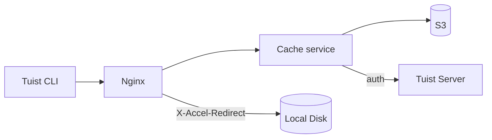
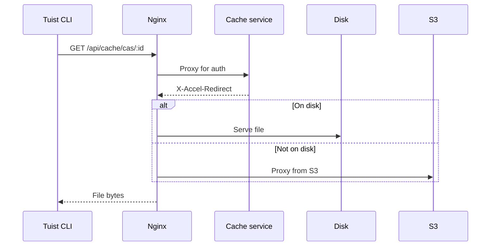
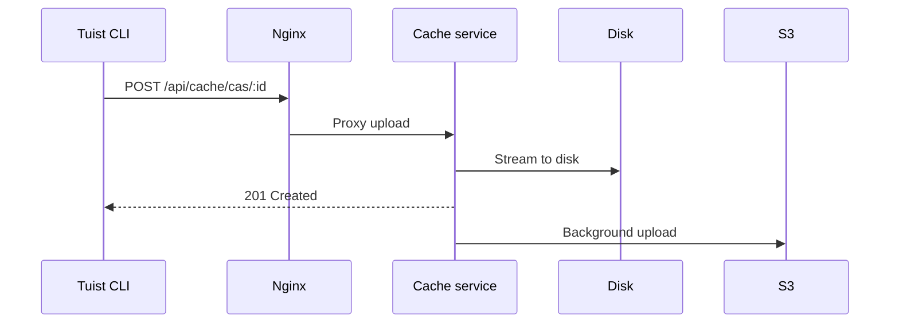

---
{
  "title": "Arquitectura",
  "titleTemplate": ":title | Caché | Guías | Tuist",
  "description": "Conoce la arquitectura del servicio de caché de Tuist."
}
---

# Arquitectura de la caché {#cache-architecture}

> [!NOTE]
> Esta página ofrece una visión técnica de la arquitectura del servicio de caché de Tuist. Está dirigida principalmente a **usuarios que alojan el servicio por su cuenta** y **colaboradores** que necesitan comprender el funcionamiento interno del servicio. Los usuarios generales que solo desean utilizar la caché no necesitan leerla.

El servicio de caché de Tuist es un servicio independiente que proporciona almacenamiento direccionable por contenido (CAS) para artefactos de compilación y un almacén clave-valor para los metadatos de la caché.

## Visión general {#overview}

El servicio utiliza una arquitectura de almacenamiento de dos niveles más metadatos locales en SQLite:

- **Disco local**: Almacenamiento principal para aciertos de caché de baja latencia
- **S3**: Almacenamiento duradero que conserva los artefactos y permite su recuperación tras la expulsión
- **SQLite**: Metadatos locales para el seguimiento del acceso a los artefactos, la limpieza de huérfanos, las tareas en segundo plano y los datos de la caché clave-valor

## Componentes {#components}

### Nginx {#nginx}

Nginx actúa como punto de entrada y gestiona la entrega eficiente de archivos mediante `X-Accel-Redirect`:

- **Descargas**: El servicio de caché valida la autenticación y luego devuelve una cabecera `X-Accel-Redirect`. Nginx sirve el archivo directamente desde el disco o lo reenvía desde S3.
- **Cargas**: Nginx reenvía las solicitudes al servicio de caché, que transmite los datos al disco.

### Almacenamiento direccionable por contenido {#cas}

Los artefactos se almacenan en el disco local en una estructura de directorios fragmentada:

- **Ruta**: `{account}/{project}/cas/{shard1}/{shard2}/{artifact_id}`
- **Fragmentación**: Los primeros cuatro caracteres del ID del artefacto crean una fragmentación de dos niveles (por ejemplo, `ABCD1234` → `AB/CD/ABCD1234`)

### Metadatos de SQLite {#sqlite}

El servicio de caché utiliza dos bases de datos SQLite:

- **Base de datos principal de metadatos**: Almacena `cache_artifacts`, cursores de escaneo de huérfanos, trabajos de Oban y otros metadatos del servicio.
- **Base de datos clave-valor**: Almacena `key_value_entries` y `key_value_entry_hashes` en un archivo SQLite dedicado.

El almacén clave-valor se separa en su propia base de datos para poder usar el auto-vacuum incremental de SQLite sin afectar a los metadatos de los artefactos ni al estado de limpieza de huérfanos.

### Integración con S3 {#s3}

S3 proporciona almacenamiento duradero:

- **Cargas en segundo plano**: Tras escribir en el disco, los artefactos se ponen en cola para subirlos a S3 mediante un worker en segundo plano que se ejecuta cada minuto
- **Hidratación bajo demanda**: Cuando falta un artefacto local, la solicitud se atiende inmediatamente mediante una URL firmada de S3 mientras el artefacto se pone en cola para su descarga en segundo plano al disco local

### Expulsión del disco {#eviction}

El servicio gestiona el espacio en disco mediante varios procesos en segundo plano:

- **Expulsión del disco CAS** utiliza semántica LRU respaldada por `cache_artifacts`
- Cuando el uso del disco supera el 85 %, los artefactos más antiguos se eliminan hasta que el uso baja al 70 %
- Los artefactos permanecen en S3 después de la expulsión local
- **Expulsión KV** elimina las entradas clave-valor antiguas según su retención y también puede reducir la base de datos KV dedicada cuando supera el presupuesto de tamaño configurado

### Limpieza de huérfanos {#orphan-cleanup}

El servicio también ejecuta un worker de limpieza de huérfanos para los artefactos del disco:

- Escanea el árbol de almacenamiento en busca de archivos que existen en el disco pero no tienen una fila correspondiente en `cache_artifacts`.
- Esto puede ocurrir si un archivo se escribe en el disco, pero la escritura de metadatos se pierde antes de que se complete el vaciado del búfer de SQLite.
- Se ignoran los archivos más recientes que una ventana de seguridad para evitar conflictos con cargas en curso.
- Si se elimina un huérfano y luego se solicita de nuevo, el siguiente fallo de caché provoca que se vuelva a cargar, por lo que el sistema se autorepara.

### Autenticación {#authentication}

La caché delega la autenticación en el servidor de Tuist llamando al extremo `/api/projects` y almacenando en caché los resultados (10 minutos en caso de éxito, 3 segundos en caso de fallo).

## Flujos de solicitudes {#request-flows}

### Descarga {#download-flow}

### Carga {#upload-flow}

## Extremos de API {#api-endpoints}

| Extremo | Método | Descripción |
|----------|--------|-------------|
| `/up` | GET | Comprobación de estado |
| `/metrics` | GET | Métricas de Prometheus |
| `/api/cache/cas/:id` | GET | Descargar artefacto CAS |
| `/api/cache/cas/:id` | POST | Cargar artefacto CAS |
| `/api/cache/keyvalue/:cas_id` | GET | Obtener entrada clave-valor |
| `/api/cache/keyvalue` | PUT | Almacenar entrada clave-valor |
| `/api/cache/module/:id` | HEAD | Comprobar si existe el artefacto del módulo |
| `/api/cache/module/:id` | GET | Descargar artefacto del módulo |
| `/api/cache/module/start` | POST | Iniciar carga multiparte |
| `/api/cache/module/part` | POST | Cargar parte |
| `/api/cache/module/complete` | POST | Completar carga multiparte |
