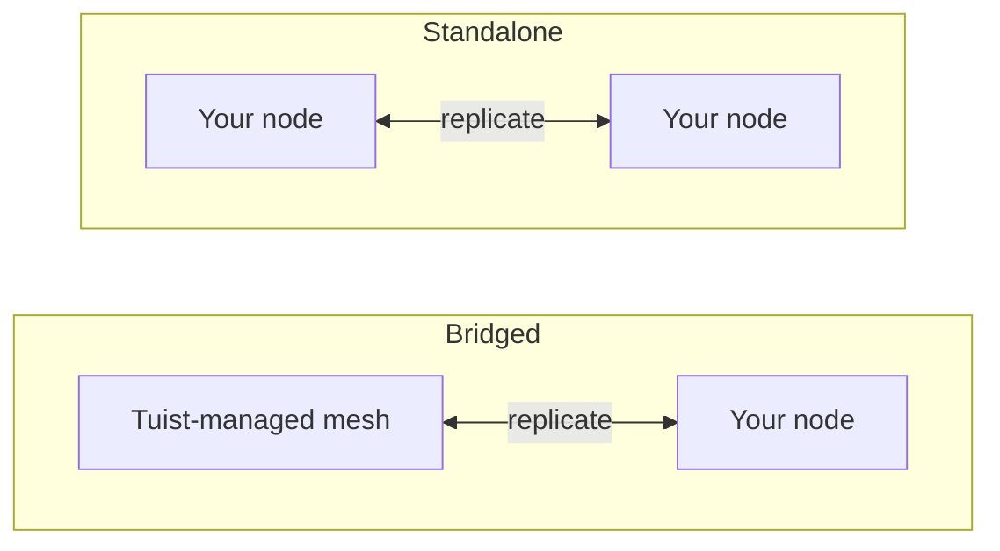

---
{
  "title": "Autoalojamiento",
  "titleTemplate": ":title | Caché | Guías | Tuist",
  "description": "Aprende a autoalojar nodos de caché de Tuist y replicarlos con la malla alojada por Tuist."
}
---

# Caché autoalojada {#self-host-cache}

La caché de Tuist funciona como una **malla de nodos** que replican artefactos entre sí. Puedes ejecutar tus propios nodos de caché en tu infraestructura para que la caché esté junto a tus desarrolladores y CI, reduciendo la distancia de red que de otro modo reduciría la velocidad que la caché pretende ofrecer.

Un nodo autoalojado es un único contenedor (`ghcr.io/tuist/kura`) que almacena artefactos en el disco local y, cuando se une a una malla de pares, se comunica con el resto de esa malla a través del puerto interno de pares. Tuist actúa como el **plano de control**: autentica el tráfico, aprovisiona capacidad de caché gestionada y mide el uso. Nunca accede directamente a tus nodos.

> [!NOTE]
> Alojar nodos de caché por tu cuenta requiere un **plan Enterprise**.
>
> Los nodos se conectan al servidor de Tuist alojado (`https://tuist.dev`) o a un servidor de Tuist autoalojado. Alojar el propio servidor de Tuist requiere una licencia de servidor independiente. Consulta la <.localized_link href="/guides/server/self-host/server">guía de autoalojamiento del servidor</.localized_link>.

## Dos topologías {#topologies}

Hay dos formas de ejecutar nodos autoalojados, y cuál obtienes depende totalmente de si tu cuenta también ejecuta una región de caché **gestionada por Tuist**.

### Conectada: malla alojada por Tuist + tus nodos {#topology-bridged}

Tu cuenta ejecuta al menos una región de caché gestionada por Tuist, y tus nodos autoalojados **se unen a esa malla**. Las escrituras en tus nodos se propagan continuamente a la malla gestionada, y un nodo se calienta desde la caché existente de la malla gestionada cuando se une. Esto coloca una caché de baja latencia junto a tus runners (que realizan la mayoría de las escrituras), mientras que sus escrituras alimentan la caché compartida. Ten en cuenta que los nuevos artefactos escritos en otras partes de la malla gestionada **después** de que un nodo se haya unido aún no se propagan continuamente de vuelta a él; es una mejora planificada.

Esta es la opción adecuada cuando quieres la velocidad de una caché local sin renunciar a la caché gestionada compartida y siempre disponible.

### Independiente: solo tus nodos {#topology-standalone}

Tu cuenta **no** ejecuta ninguna región de caché gestionada. Tus nodos forman su propia malla aislada en tu infraestructura. Tuist sigue sabiendo que tus nodos existen (por lo que el uso se mide), pero **no se intercambian datos con ninguna malla gestionada por Tuist**, porque no existe ninguna. La pertenencia a pares y la replicación ocurren completamente dentro de tus propios nodos.



La diferencia clave en la configuración es que la topología **conectada** utiliza **inscripción**, donde el nodo genera su par de claves al arrancar y Tuist emite su certificado de malla, mientras que la topología **independiente** no tiene ningún certificado de malla emitido por Tuist. Un único nodo independiente puede ejecutarse con TLS de pares desactivado; una malla independiente de varios nodos utiliza material TLS de pares que tú proporcionas.

## Configurar el endpoint de la CLI {#cli-endpoint}

La caché gestionada de Tuist usa `https://<account>.cache.tuist.dev`. Con un servidor de Tuist autoalojado, la CLI recupera la URL de la caché desde la configuración `TUIST_CACHE_ENDPOINTS` del servidor. Establécela en la URL de tu servidor de caché principal o balanceador de carga. Si contiene varias URL, se usa la primera.

Al conectar nodos de caché privados/personalizados al **servidor de Tuist alojado**, configura un endpoint explícito en los shells de desarrollo y en CI:

```sh
export TUIST_CACHE_ENDPOINT=https://cache.example.com
```

Esta anulación tiene prioridad en cualquier tipo de servidor y es opcional para un servidor de Tuist autoalojado. Para el demonio de caché de Xcode, vuelve a ejecutar `tuist setup cache` después de configurarlo para que LaunchAgent reciba el entorno actualizado. Para varios nodos, usa tu balanceador de carga o nombre de enrutamiento DNS.

## Requisitos previos {#prerequisites}


- Docker y Docker Compose (o cualquier runtime de contenedores)
- Un servidor de Tuist en ejecución (alojado o autoalojado)
- Disco para la caché. Un nodo conectado extrae la malla **completa** de la cuenta en la primera unión, así que dimensiona el volumen de datos en consecuencia.

## Proporcionar un cliente del plano de control {#control-plane-client}

Un nodo usa una credencial de cliente del plano de control para autenticar solicitudes de caché (introspección de tokens), informar al panel y entregar el uso. **No** es así como se enrutan los clientes a tus nodos en un servidor de Tuist autoalojado (consulta [Cómo llegan los clientes a tus nodos](#routing)).

Para un despliegue completamente autoalojado, genera un **ID de cliente UUID** y un secreto aleatorio, luego configura el mismo par en el servidor de Tuist y en cada nodo Kura:

```bash
KURA_CONTROL_PLANE_CLIENT_ID="$(uuidgen | tr '[:upper:]' '[:lower:]')"
KURA_CONTROL_PLANE_CLIENT_SECRET="$(openssl rand -base64 32)"
```

Establece esos valores como `KURA_CONTROL_PLANE_CLIENT_ID` y `KURA_CONTROL_PLANE_CLIENT_SECRET` en el entorno del servidor de Tuist, luego usa los mismos valores en la configuración de Kura a continuación. Los latidos de registro incluyen `KURA_TENANT_ID`, la identidad permanente de caché de la cuenta, para que el servidor pueda asociar el nodo a la cuenta correcta incluso después de un cambio de nombre de la cuenta.

> [!WARNING]
> El ID de cliente debe ser un UUID sin el prefijo `kura_`. Los IDs que no son UUID hacen que la introspección de tokens falle con HTTP `400`, incluso cuando las credenciales coinciden en ambos servicios.

Si te estás conectando al servidor `tuist.dev` alojado, o si quieres una credencial por cuenta que se pueda rotar desde la interfaz, abre la página **Caché** de la cuenta, elige **Generar credencial** y copia el `client_id` más el `secret` de un solo uso. En el servidor alojado, generar una credencial para nodos autoalojados requiere un plan Enterprise.

## Elegir el inquilino permanente {#permanent-tenant}

`KURA_TENANT_ID` es una identidad permanente de almacenamiento y de pares, derivada inicialmente del identificador original de la cuenta. Para una cuenta que nunca ha cambiado de nombre, coincide con el identificador actual. **Mantén su valor original después de cambiar el nombre de la cuenta**, incluso al añadir nodos de reemplazo u otro nodo a la misma malla. Por ejemplo, cambiar el nombre de `original` a `renamed` deja `KURA_TENANT_ID=original` en cada nodo. Cambiarlo selecciona un espacio de nombres de claves de objeto diferente; cambiar el nombre de la cuenta no migra artefactos almacenados ni la identidad de pares.

Reemplaza `<permanent-kura-tenant>` en los ejemplos siguientes con este valor. Reutiliza el inquilino de un nodo correctamente configurado existente, o el `tenant_id` devuelto por la inscripción. Un operador de un servidor de Tuist autoalojado puede inspeccionar el campo de base de datos `kura_tenant_id` de la cuenta. No infieras el valor a partir de la URL de una cuenta renombrada.

Con una credencial de plano de control válida a nivel de despliegue, el registro y el descubrimiento de pares devuelven **409 Conflict** con `error: "tenant_mismatch"` y `expected_tenant_id` si el nodo proporciona un identificador actual o retenido que difiere de su inquilino permanente. No registran el nodo ni sustituyen silenciosamente una identidad de almacenamiento diferente. Las credenciales no válidas y los inquilinos desconocidos siguen devolviendo **401 Unauthorized** sin revelar un inquilino. Si un nodo ya ha escrito datos con un inquilino diferente, revisa su configuración e historial de almacenamiento antes de cambiarlo; la respuesta de error no realiza una migración de almacenamiento.

## Cómo llegan los clientes a tus nodos {#routing}

Configura la URL de caché [arriba](#cli-endpoint) para que las máquinas de los desarrolladores y la CI puedan llegar a tus nodos. Para informar de la dirección y la disponibilidad de cada nodo en el panel, establece `KURA_REGISTRATION_URL` y `KURA_ADVERTISED_HTTP_URL` en el nodo.

## Configuración puenteada {#bridged-setup}

El nodo se inscribe al arrancar: genera un par de claves localmente (la clave privada nunca sale de tu infraestructura), envía una solicitud de firma de certificado y recibe su certificado firmado, la CA de la cuenta y la dirección de la puerta de enlace de la malla gestionada. **No proporcionas ningún material TLS**. La inscripción lo escribe en el volumen montado.

```yaml
# docker-compose.yml
services:
  kura:
    image: ghcr.io/tuist/kura:<version>
    restart: unless-stopped
    ports:
      - "4000:4000"   # HTTP cache: your developers and CI point here
      - "7443:7443"   # mesh peer port
    environment:
      # Enroll and join the managed mesh
      KURA_ENROLL_ON_BOOT: "1"
      KURA_CONTROL_PLANE_URL: "https://tuist.dev"
      KURA_CONTROL_PLANE_CLIENT_ID: "<client_id>"
      KURA_CONTROL_PLANE_CLIENT_SECRET: "<secret>"
      KURA_TENANT_ID: "<permanent-kura-tenant>"

      # Report the node’s address and readiness to the dashboard
      KURA_REGISTRATION_URL: "https://tuist.dev/_internal/kura/mesh/registrations"
      KURA_ADVERTISED_HTTP_URL: "https://kura.acme.internal"   # where your CLI/CI reach the cache
      KURA_NODE_URL: "https://kura.acme.internal:7443"         # this node's peer identity on your network
      KURA_REGION: "office"

      # Ports and storage. KURA_PORT serves both the HTTP cache API and REAPI
      # gRPC (h2c) on one listener. Enrollment writes the TLS files into
      # KURA_INTERNAL_TLS_* on first boot.
      KURA_PORT: "4000"
      KURA_INTERNAL_PORT: "7443"
      KURA_INTERNAL_TLS_CA_CERT_PATH: "/tls/ca.pem"
      KURA_INTERNAL_TLS_CERT_PATH: "/tls/tls.crt"
      KURA_INTERNAL_TLS_KEY_PATH: "/tls/tls.key"
      KURA_DATA_DIR: "/var/cache/kura"
      KURA_TMP_DIR: "/var/cache/kura/tmp"
      KURA_OTEL_SERVICE_NAME: "kura-acme"
      KURA_OTEL_DEPLOYMENT_ENVIRONMENT: "onprem"

      # Authenticate the HTTP cache API. The Tuist hook ships in the image at
      # this path; it introspects each token against the control plane using the
      # control-plane client above, so only valid Tuist tokens for this account
      # can read or write. No JWT verifier secret is involved.
      KURA_AUTH_ENABLED: "1"
      KURA_AUTH_TUIST_URL: "https://tuist.dev"
    volumes:
      - kura-tls:/tls            # empty; enrollment populates it
      - kura-data:/var/cache/kura
volumes:
  kura-tls: {}
  kura-data: {}
```

Lo que proporcionas: el cliente del plano de control, las dos direcciones (`KURA_NODE_URL`, `KURA_ADVERTISED_HTTP_URL`) en tu red y dos volúmenes vacíos con escritura habilitada. Todo lo demás (el par de claves, el certificado, la CA de la cuenta y la dirección de la malla gestionada) se aprovisiona automáticamente al arrancar.

## Configuración independiente {#standalone-setup}

Al no haber una región gestionada, no existe una CA de malla emitida por Tuist, por lo que la inscripción no se aplica (el extremo de inscripción devuelve `503 ca_unavailable`). El nodo utiliza tu servidor de Tuist para la autenticación de tokens, los latidos de registro en el panel y el informe de uso.

```yaml
# docker-compose.yml for a single node connected to a self-hosted Tuist server
services:
  kura:
    image: ghcr.io/tuist/kura:<version>
    restart: unless-stopped
    ports:
      - "4000:4000"
      - "7443:7443"
    environment:
      KURA_TENANT_ID: "<permanent-kura-tenant>"
      KURA_NODE_URL: "http://kura-1.acme.internal:7443"
      KURA_PEERS: ""   # single node: disable static peer discovery
      KURA_REGION: "office"

      # Authenticate cache requests against the self-hosted Tuist server.
      # Use the same values configured on the Tuist server, or a per-account
      # credential from the Cache page.
      KURA_CONTROL_PLANE_CLIENT_ID: "<client_id>"
      KURA_CONTROL_PLANE_CLIENT_SECRET: "<secret>"
      KURA_AUTH_ENABLED: "1"
      KURA_AUTH_TUIST_URL: "https://tuist.acme.internal"

      # Register the client-facing cache URL with the Tuist server.
      KURA_REGISTRATION_URL: "https://tuist.acme.internal/_internal/kura/mesh/registrations"
      KURA_ADVERTISED_HTTP_URL: "https://kura.acme.internal"

      KURA_PORT: "4000"
      KURA_INTERNAL_PORT: "7443"
      KURA_DATA_DIR: "/var/cache/kura"
      KURA_TMP_DIR: "/var/cache/kura/tmp"
      KURA_OTEL_SERVICE_NAME: "kura-acme"
      KURA_OTEL_DEPLOYMENT_ENVIRONMENT: "onprem"
    volumes:
      - kura-data:/var/cache/kura
volumes:
  kura-data: {}
```

Para un solo nodo, deja la TLS de pares sin configurar y establece `KURA_PEERS` como una cadena vacía. Cuando `KURA_PEERS` no está configurado, Kura inicializa el descubrimiento estático de pares desde `KURA_NODE_URL` y comprueba periódicamente el extremo `/_internal/status` de esa URL. Con la TLS de pares desactivada, `KURA_NODE_URL` debe usar el esquema `http://` incluso cuando el nodo sea accesible a través de un nombre de red privada.

`KURA_CONTROL_PLANE_URL` no es necesario en este ejemplo porque tanto la autorización como el informador de uso utilizan `KURA_AUTH_TUIST_URL` como URL base de Tuist. `KURA_ADVERTISED_HTTP_URL` identifica la dirección orientada al cliente del nodo en el panel. Establece `TUIST_CACHE_ENDPOINTS=https://kura.acme.internal` en el servidor de Tuist para que la CLI utilice esa dirección para las solicitudes de caché.

### Kubernetes con Helm {#standalone-helm}

Si tu servidor de Tuist autoalojado se ejecuta en Kubernetes, instala Kura con el gráfico independiente de Kura y pasa la misma configuración del plano de control a través de `extraEnv`. El gráfico del servidor de Tuist no instala este gráfico de Kura como subgráfico.

Primero, configura el gráfico del servidor de Tuist con la credencial de Kura a nivel de despliegue:

```yaml
# tuist-values.yaml
server:
  extraEnv:
    - name: KURA_CONTROL_PLANE_CLIENT_ID
      valueFrom:
        secretKeyRef:
          name: kura-control-plane
          key: client-id
    - name: KURA_CONTROL_PLANE_CLIENT_SECRET
      valueFrom:
        secretKeyRef:
          name: kura-control-plane
          key: client-secret
```

Luego instala Kura en el mismo espacio de nombres con el mismo Secret:

```yaml
# kura-values.yaml
replicaCount: 1

config:
  tenantId: "<permanent-kura-tenant>"
  region: "office"

ingress:
  enabled: true
  className: nginx
  hosts:
    - host: kura.acme.internal
      paths:
        - path: /
          pathType: Prefix
  tls:
    - hosts:
        - kura.acme.internal
      secretName: kura-tls

extraEnv:
  - name: KURA_CONTROL_PLANE_CLIENT_ID
    valueFrom:
      secretKeyRef:
        name: kura-control-plane
        key: client-id
  - name: KURA_CONTROL_PLANE_CLIENT_SECRET
    valueFrom:
      secretKeyRef:
        name: kura-control-plane
        key: client-secret
  - name: KURA_AUTH_ENABLED
    value: "1"
  - name: KURA_AUTH_TUIST_URL
    value: "https://tuist.acme.internal"
  - name: KURA_REGISTRATION_URL
    value: "https://tuist.acme.internal/_internal/kura/mesh/registrations"
  - name: KURA_ADVERTISED_HTTP_URL
    value: "https://kura.acme.internal"
```

```bash
kubectl create namespace tuist
kubectl -n tuist create secret generic kura-control-plane \
  --from-literal=client-id="<client_id>" \
  --from-literal=client-secret="<secret>"

helm upgrade --install kura oci://ghcr.io/tuist/charts/kura \
  --namespace tuist \
  -f kura-values.yaml
```

Si Kura se ejecuta en un espacio de nombres diferente al del servidor de Tuist, crea o sincroniza el Secret `kura-control-plane` en ambos espacios de nombres.

Deja `extension.enabled` sin configurar cuando uses el hook de Tuist incluido en la imagen; ese valor del gráfico sirve para montar un hook personalizado desde un ConfigMap. El gráfico renderiza `KURA_NODE_URL`, `KURA_PEERS`, el servicio headless, la persistencia y las sondas por ti. Con `replicaCount: 1`, la URL de par generada es el nombre DNS estable del propio pod, por lo que sigue siendo accesible dentro del clúster y no produce la advertencia de nodo único descrita anteriormente. Para varias réplicas, el gráfico genera la lista de pares desde el DNS de StatefulSet; habilita `peerTls` y proporciona un Secret TLS cuando quieras mTLS en el plano interno de pares.

Para ejecutar más de un nodo independiente, añade tu **propia TLS de pares** montada en `/tls` (una CA más un certificado hoja y una clave por nodo, compartiendo una CA para que los nodos confíen entre sí), cambia `KURA_NODE_URL` a `https://...:<KURA_INTERNAL_PORT>` y añade `KURA_PEERS`:

```yaml
environment:
  KURA_NODE_URL: "https://kura-1.acme.internal:7443"
  KURA_PEERS: "https://kura-2.acme.internal:7443,https://kura-3.acme.internal:7443"
  KURA_INTERNAL_TLS_CA_CERT_PATH: "/tls/ca.pem"
  KURA_INTERNAL_TLS_CERT_PATH: "/tls/tls.crt"
  KURA_INTERNAL_TLS_KEY_PATH: "/tls/tls.key"
volumes:
  - ./tls:/tls:ro
```

## Qué requiere cada topología {#requirements-summary}

| Tú proporcionas | Puenteado | Independiente |
|---|---|---|
| Cliente del plano de control (`client_id` / `secret`) | Sí | Sí |
| `KURA_NODE_URL` | Sí | Sí |
| `KURA_ADVERTISED_HTTP_URL` | Sí | Para el registro en el panel; el enrutamiento es separado (ver abajo) |
| Enrutamiento a la CLI | Automático (registro) | Automático desde latidos de registro listos |
| Volumen de datos + temporal | Sí | Sí |
| `KURA_ENROLL_ON_BOOT` | Sí | No (devolvería `ca_unavailable`) |
| TLS de pares (CA `/tls` + hoja) | No, la inscripción lo escribe | Solo para una malla de varios nodos |
| `KURA_PEERS` (lista de pares) | No, la inscripción inicializa la puerta de enlace | Vacío para un nodo; URLs de pares para más de un nodo |

## Configuración requerida {#required-config}

Estas variables configuran cada nodo, independientemente de la topología (TLS de pares es la excepción mencionada abajo):

| Variable | Descripción |
|---|---|
| `KURA_TENANT_ID` | El inquilino permanente de Kura de tu cuenta. Mantén su valor original después de renombrar la cuenta; consulta [Elegir el inquilino permanente](#permanent-tenant). |
| `KURA_NODE_URL` | La URL de par de este nodo en tu red. |
| `KURA_PEERS` | Lista estática de descubrimiento de pares. Establécela como una cadena vacía para un nodo independiente único; establece URLs de pares accesibles para una malla de varios nodos. |
| `KURA_REGION` | Una etiqueta de región de formato libre (por ejemplo, `office`, `ci`). |
| `KURA_PORT` / `KURA_INTERNAL_PORT` | Puerto de caché (API de caché HTTP y REAPI gRPC alojados juntos en un mismo listener) y puerto de par de la malla (`4000` / `7443`). |
| `KURA_DATA_DIR` / `KURA_TMP_DIR` | Almacenamiento de artefactos en disco y directorio temporal. |
| `KURA_INTERNAL_TLS_CA_CERT_PATH` / `KURA_INTERNAL_TLS_CERT_PATH` / `KURA_INTERNAL_TLS_KEY_PATH` | Archivos TLS de pares. Escritos por la inscripción (puenteado) o proporcionados por ti (independiente de varios nodos). No necesarios para un solo nodo; omítelos y usa una `http://` `KURA_NODE_URL`. |
| `KURA_OTEL_SERVICE_NAME` / `KURA_OTEL_DEPLOYMENT_ENVIRONMENT` | Nombre del servicio y etiqueta de entorno para telemetría. |

Los nodos puenteados además establecen `KURA_ENROLL_ON_BOOT`, `KURA_CONTROL_PLANE_URL` y las credenciales del cliente del plano de control. `KURA_REGISTRATION_URL` y `KURA_ADVERTISED_HTTP_URL` registran un nodo para que aparezca en la página de **Caché** y para que los clientes CLI habilitados para Kura puedan enrutar hacia él (consulta [Cómo los clientes alcanzan tus nodos](#routing)).

## Almacenamiento y expulsión {#storage}

Un nodo almacena artefactos bajo `KURA_DATA_DIR` hasta un presupuesto de almacenamiento CAS, que puedes establecer con una variable opcional:

| Variable | Descripción |
|---|---|
| `KURA_CAS_CAPACITY_BYTES` | El presupuesto de almacenamiento CAS del nodo en bytes. Debe ser un entero positivo. Cuando no está establecido, el presupuesto es el 50% del tamaño del sistema de archivos que contiene `KURA_DATA_DIR`. |

Tanto si lo estableces como si no, el presupuesto está limitado al 80% del sistema de archivos que contiene `KURA_DATA_DIR`, de modo que la rotación, que escribe un nuevo segmento antes de expulsar el más antiguo, no pueda llenar el disco. El presupuesto se redondea a segmentos completos de 512 MiB, con un mínimo de 2,5 GiB. El nodo registra el presupuesto resuelto al inicio (`resolved CAS segment ring limits`).

La expulsión es automática. Los artefactos se almacenan en un anillo de segmentos y, una vez alcanzado el presupuesto, se expulsa el segmento más antiguo. Los artefactos leídos de segmentos más antiguos se promocionan al actual, por lo que se conservan los artefactos de uso frecuente y la expulsión se comporta de forma similar a least-recently-used.

Coloca `KURA_DATA_DIR` en un volumen dedicado. Tanto el presupuesto predeterminado como el límite son porcentajes del tamaño total del sistema de archivos, no de su espacio libre, por lo que otros datos en el mismo sistema de archivos pueden dejar menos espacio del que asume el presupuesto.

## Autenticación de solicitudes de caché {#cache-auth}

Por defecto, un nodo sirve su API de caché HTTP a cualquiera que pueda alcanzarlo en tu red. Para exigir que quienes llamen presenten un token válido de Tuist, de modo que solo los miembros autenticados de tu organización puedan leer y escribir, apunta el nodo a tu servidor de Tuist. La configuración independiente anterior hace esto.

| Variable | Valor |
|---|---|
| `KURA_AUTH_ENABLED` | `1` |
| `KURA_AUTH_TUIST_URL` | La URL de tu servidor de Tuist |

La autorización reutiliza el cliente del plano de control que ya has configurado (`KURA_CONTROL_PLANE_CLIENT_ID` / `KURA_CONTROL_PLANE_CLIENT_SECRET`) para introspeccionar tokens, por lo que no se necesita ninguna credencial adicional. Un nodo autoalojado ejecuta **solo introspección**: nunca posee el secreto simétrico del verificador JWT de Guardian, que podría generar tokens para cualquier inquilino y nunca se comparte, por lo que cada solicitud se autoriza contra tu servidor. Un nodo que no puede alcanzarlo deniega en lugar de servir, y no hay ninguna configuración que cambie eso. Los nodos gestionados por Tuist ejecutan la misma autorización; la única diferencia es que también poseen la clave de verificación, lo que les permite resolver la mayoría de las solicitudes solo con el token.

## Redes {#networking}

Un nodo realiza conexiones **salientes** dependiendo de qué integraciones habilites:

- tu servidor de Tuist para la introspección de tokens (`KURA_AUTH_TUIST_URL`), latidos de registro (`KURA_REGISTRATION_URL`), uso (`KURA_CONTROL_PLANE_URL` o `KURA_AUTH_TUIST_URL`) e inscripción en la topología puenteada, y
- en la topología puenteada, la puerta de enlace de pares de la malla gestionada, para la replicación.

Tus desarrolladores y CI alcanzan la `KURA_ADVERTISED_HTTP_URL` del nodo (y, para una malla de varios nodos, los nodos se alcanzan entre sí en el puerto de pares). Estas direcciones solo necesitan ser accesibles **dentro de tu red**. No necesitan estar expuestas a internet público.

## Cómo se comporta {#behavior}

- **Puenteado.** Al arrancar, el nodo se inscribe, extrae la caché completa de la malla gestionada y pasa a ser un miembro sirviente del anillo. La extracción inicial ocurre una vez y puede tardar un tiempo a través de una WAN, dimensionada según tu caché. A partir de entonces, las escrituras en el nodo se propagan continuamente a la malla gestionada. Los nuevos artefactos escritos en otra parte de la malla gestionada después de que el nodo se une aún no se propagan continuamente a él (una mejora planificada), por lo que trata la extracción al unirse como una instantánea en lugar de un espejo en vivo.
- **Independiente.** El o los nodos se ejecutan como una malla aislada en tu infraestructura. La replicación, si la hay, ocurre solo entre tus propios nodos. Cuando está configurado, el rol de Tuist se limita al plano de control: visibilidad en el panel, publicidad del endpoint de caché, medición de uso e introspección de tokens. Nunca aprovisiona, actualiza, empareja con ni accede a tus nodos.

## Verificar {#verify}

```bash
curl --fail-with-body http://localhost:4000/ready   # 200 once the node has joined and is serving
curl --fail-with-body http://localhost:4000/up      # liveness + mesh membership
```

Un nodo puenteado informa `state: joining` mientras extrae la malla y `state: serving` una vez que se ha puesto al día. Tu nodo también aparece bajo **Nodos registrados** en la página de **Caché** de la cuenta una vez que comienzan los latidos de registro.

Para verificar la caché remota, ejecuta `tuist cache` con objetivos cacheables no almacenados en caché y confirma las cargas exitosas en los registros de Kura. Un estado de salida cero por sí solo no confirma que los artefactos se hayan almacenado.

## Actualización {#upgrading}

```bash
docker compose pull
docker compose up -d
```

Los nodos están diseñados para ejecutarse lado a lado con una diferencia de versión, por lo que una actualización progresiva en varios nodos es segura.
