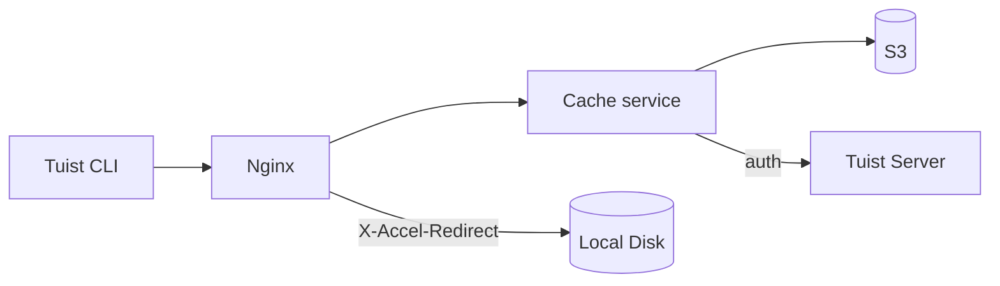
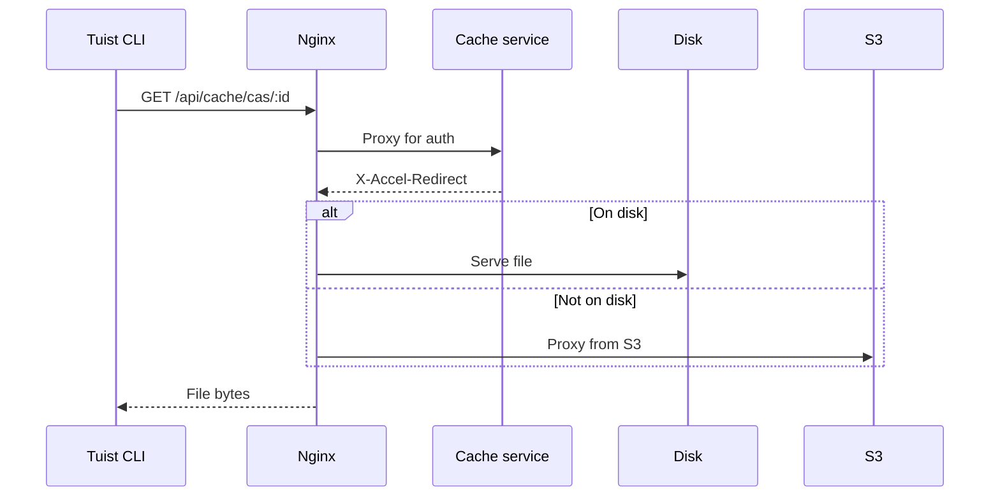
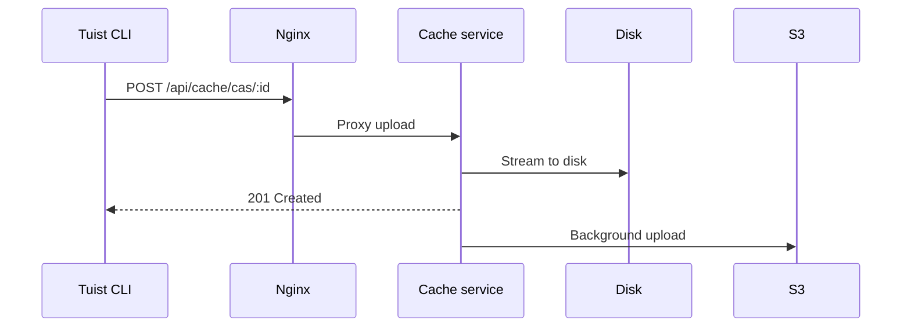

---
{
  "title": "アーキテクチャ",
  "titleTemplate": ":title | キャッシュ | ガイド | Tuist",
  "description": "Tuistキャッシュサービスのアーキテクチャについて学びます。"
}
---

# キャッシュアーキテクチャ {#cache-architecture}

> [!NOTE]
> このページでは、Tuist キャッシュサービスのアーキテクチャに関する技術的な概要を説明します。主に、サービスの内部動作を理解する必要がある**セルフホスティングユーザー**と**コントリビューター**を対象としています。キャッシュを利用するだけの一般ユーザーは、このページを読む必要はありません。

Tuist キャッシュサービスは、ビルド成果物向けのコンテンツアドレサブルストレージ（CAS）と、キャッシュメタデータ用のキーバリューストアを提供するスタンドアロンサービスです。

## 概要 {#overview}

このサービスは、2層のストレージアーキテクチャとローカルのSQLiteメタデータを使用します。

- **ローカルディスク**: 低レイテンシなキャッシュヒットのためのプライマリストレージ
- **S3**: 成果物を永続化し、エビクション後の復旧を可能にする耐久性のあるストレージ
- **SQLite**: 成果物のアクセス追跡、オーファンクリーンアップ、バックグラウンドジョブ、およびキーバリューキャッシュデータのためのローカルメタデータ

## コンポーネント {#components}

### Nginx {#nginx}

Nginx はエントリーポイントとして機能し、`X-Accel-Redirect`を使用して効率的なファイル配信を処理します。

- **ダウンロード**: キャッシュサービスが認証を検証し、`X-Accel-Redirect`ヘッダーを返します。Nginx はファイルをディスクから直接提供するか、S3 からプロキシします。
- **アップロード**: Nginx はリクエストをキャッシュサービスにプロキシし、キャッシュサービスがデータをディスクにストリーミングします。

### コンテンツアドレサブルストレージ {#cas}

成果物は、シャーディングされたディレクトリ構造でローカルディスクに保存されます。

- **パス**: `{account}/{project}/cas/{shard1}/{shard2}/{artifact_id}`
- **シャーディング**: 成果物IDの最初の4文字が2レベルのシャードを作成します（例: `ABCD1234` → `AB/CD/ABCD1234`）

### SQLite メタデータ {#sqlite}

キャッシュサービスは2つのSQLiteデータベースを使用します。

- **プライマリメタデータDB**: `cache_artifacts`、オーファンスキャンカーソル、Oban ジョブ、およびその他のサービスメタデータを保存します。
- **キーバリューDB**: 専用のSQLiteファイルに`key_value_entries`と`key_value_entry_hashes`を保存します。

キーバリューストアは独自のデータベースに分割されており、これにより、成果物メタデータやオーファンクリーンアップの状態に影響を与えることなく、SQLite の増分自動バキュームを使用できます。

### S3 統合 {#s3}

S3 は耐久性のあるストレージを提供します。

- **バックグラウンドアップロード**: ディスクへの書き込み後、毎分実行されるバックグラウンドワーカーを介して、成果物が S3 へのアップロード用にキューに入れられます
- **オンデマンドハイドレーション**: ローカルの成果物が欠落している場合、リクエストは署名付き S3 URL を介して即座に処理され、その間に成果物はローカルディスクへのバックグラウンドダウンロード用にキューに入れられます

### ディスクエビクション {#eviction}

このサービスは、複数のバックグラウンドプロセスを使用してディスク容量を管理します。

- **CAS ディスクエビクション**は、`cache_artifacts`によって支えられた LRU セマンティクスを使用します
- ディスク使用量が85%を超えると、使用量が70%に下がるまで最も古い成果物が削除されます
- ローカルでのエビクション後も、成果物は S3 に残ります
- **KV エビクション**は、保持期間に基づいて古いキーバリューエントリを削除し、構成されたサイズ予算を超えて成長した場合、専用の KV データベースを縮小することもできます

### オーファンクリーンアップ {#orphan-cleanup}

このサービスは、ディスク上の成果物に対するオーファンクリーンアップワーカーも実行します。

- ディスク上に存在するが、対応する`cache_artifacts`行がないファイルをストレージツリーからスキャンします。
- これは、ファイルがディスクに書き込まれたものの、SQLite バッフラッシュが完了する前にメタデータの書き込みが失われた場合に発生することがあります。
- 進行中のアップロードとの競合を避けるため、安全ウィンドウより新しいファイルは無視されます。
- オーファンが削除され、後で再びリクエストされた場合、次のキャッシュミスによってそれが再度アップロードされるため、システムは自己修復します。

### 認証 {#authentication}

キャッシュは、`/api/projects`エンドポイントを呼び出し、結果をキャッシュすることで（成功時は10分、失敗時は3秒）、認証を Tuist サーバーに委譲します。

## リクエストフロー {#request-flows}

### ダウンロード {#download-flow}

### アップロード {#upload-flow}

## API エンドポイント {#api-endpoints}

| エンドポイント | メソッド | 説明 |
|----------|--------|-------------|
| `/up` | GET | ヘルスチェック |
| `/metrics` | GET | Prometheus メトリクス |
| `/api/cache/cas/:id` | GET | CAS 成果物のダウンロード |
| `/api/cache/cas/:id` | POST | CAS 成果物のアップロード |
| `/api/cache/keyvalue/:cas_id` | GET | キーバリューエントリの取得 |
| `/api/cache/keyvalue` | PUT | キーバリューエントリの保存 |
| `/api/cache/module/:id` | HEAD | モジュール成果物の存在確認 |
| `/api/cache/module/:id` | GET | モジュール成果物のダウンロード |
| `/api/cache/module/start` | POST | マルチパートアップロードの開始 |
| `/api/cache/module/part` | POST | パートのアップロード |
| `/api/cache/module/complete` | POST | マルチパートアップロードの完了 |
