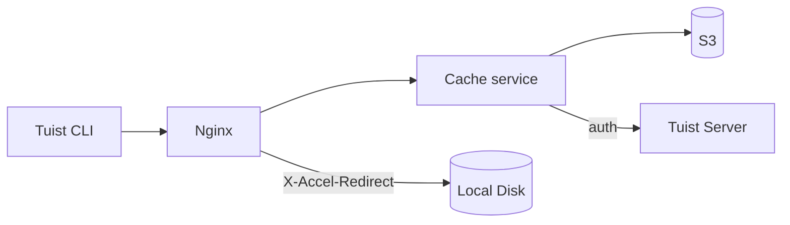
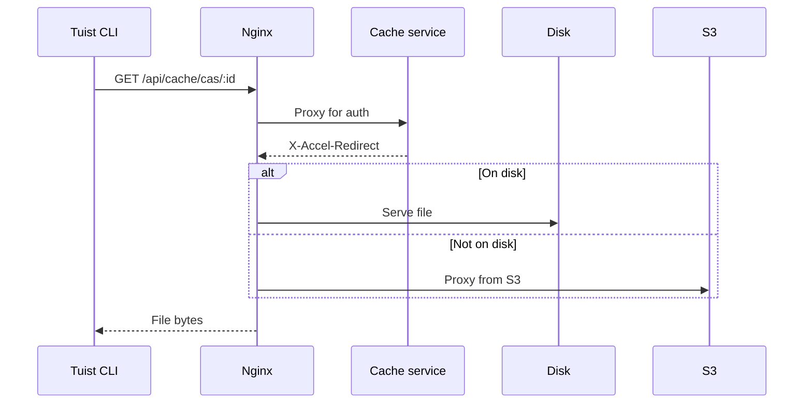
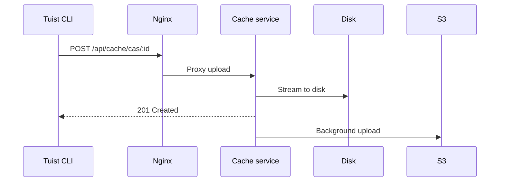

---
{
  "title": "アーキテクチャ",
  "titleTemplate": ":title | Cache | Guides | Tuist",
  "description": "Tuistキャッシュサービスのアーキテクチャについて学びます。"
}
---

# キャッシュアーキテクチャ {#cache-architecture}

> [!NOTE]
> このページでは、Tuistキャッシュサービスのアーキテクチャについて技術的な概要を説明します。主に、サービスの内部動作を理解する必要がある**セルフホスティングユーザー**と**コントリビューター**を対象としています。キャッシュを利用したいだけの一般ユーザーは、これを読む必要はありません。

Tuistキャッシュサービスは、ビルド成果物用のContent Addressable Storage（CAS）とキャッシュメタデータ用のキーバリューストアを提供するスタンドアロンサービスです。

## 概要 {#overview}

このサービスは、2層のストレージアーキテクチャとローカルのSQLiteメタデータを使用します。

- **ローカルディスク**：低レイテンシーなキャッシュヒットのためのプライマリストレージ
- **S3**：成果物を永続化し、エビクション後の復旧を可能にする耐久性のあるストレージ
- **SQLite**：成果物のアクセストラッキング、孤立ファイルのクリーンアップ、バックグラウンドジョブ、およびキーバリューキャッシュデータのためのローカルメタデータ

## コンポーネント {#components}

### Nginx {#nginx}

Nginxはエントリーポイントとして機能し、`X-Accel-Redirect`を使用して効率的なファイル配信を行います。

- **ダウンロード**：キャッシュサービスが認証を検証し、`X-Accel-Redirect`ヘッダーを返します。Nginxはディスクから直接ファイルを配信するか、S3からプロキシします。
- **アップロード**：Nginxはリクエストをキャッシュサービスにプロキシし、キャッシュサービスがデータをディスクにストリーミングします。

### Content Addressable Storage {#cas}

成果物は、シャード化されたディレクトリ構造でローカルディスクに保存されます。

- **パス**：`{account}/{project}/cas/{shard1}/{shard2}/{artifact_id}`
- **シャーディング**：成果物IDの最初の4文字で2レベルのシャードを作成します（例：`ABCD1234` → `AB/CD/ABCD1234`）

### SQLiteメタデータ {#sqlite}

キャッシュサービスは2つのSQLiteデータベースを使用します。

- **プライマリメタデータDB**：`cache_artifacts`、孤立ファイルスキャンのカーソル、Obanジョブ、その他のサービスメタデータを保存します。
- **キーバリューDB**：`key_value_entries`と`key_value_entry_hashes`を専用のSQLiteファイルに保存します。

キーバリューストアは独自のデータベースに分割されており、成果物メタデータや孤立ファイルのクリーンアップ状態に影響を与えることなく、SQLiteの増分自動バキュームを使用できます。

### S3統合 {#s3}

S3は耐久性のあるストレージを提供します。

- **バックグラウンドアップロード**：ディスクへの書き込み後、毎分実行されるバックグラウンドワーカー経由でS3へのアップロードがキューに入れられます。
- **オンデマンドハイドレーション**：ローカルの成果物が欠落している場合、プレサイン付きS3 URLを介してリクエストに即座に対応し、その間に成果物のローカルディスクへのバックグラウンドダウンロードがキューに入れられます。

### ディスクエビクション {#eviction}

このサービスは複数のバックグラウンドプロセスを使用してディスク容量を管理します。

- **CASディスクエビクション**は、`cache_artifacts`に基づくLRUセマンティクスを使用します。
- ディスク使用率が85%を超えると、使用率が70%に下がるまで最も古い成果物が削除されます。
- ローカルでのエビクション後も、成果物はS3に残ります。
- **KVエビクション**は保持期間に基づいて古いキーバリューエントリを削除し、設定されたサイズ予算を超えて成長した場合、専用のKVデータベースを縮小することもできます。

### 孤立ファイルのクリーンアップ {#orphan-cleanup}

このサービスは、ディスク上の成果物に対して孤立ファイルのクリーンアップワーカーも実行します。

- ディスク上に存在するものの、対応する`cache_artifacts`行がないファイルをストレージツリーからスキャンします。
- これは、ファイルがディスクに書き込まれたものの、SQLiteバッファのフラッシュが完了する前にメタデータの書き込みが失われた場合に発生する可能性があります。
- 安全ウィンドウより新しいファイルは、進行中のアップロードとの競合を避けるために無視されます。
- 孤立ファイルが削除され、その後再びリクエストされた場合、次のキャッシュミスによって再度アップロードされるため、システムは自己修復します。

### 認証 {#authentication}

キャッシュは、`/api/projects`エンドポイントを呼び出し、結果をキャッシュすることで（成功時は10分、失敗時は3秒）、認証をTuistサーバーに委譲します。

## リクエストフロー {#request-flows}

### ダウンロード {#download-flow}

### アップロード {#upload-flow}

## APIエンドポイント {#api-endpoints}

| エンドポイント | メソッド | 説明 |
|----------|--------|-------------|
| `/up` | GET | ヘルスチェック |
| `/metrics` | GET | Prometheusメトリクス |
| `/api/cache/cas/:id` | GET | CAS成果物のダウンロード |
| `/api/cache/cas/:id` | POST | CAS成果物のアップロード |
| `/api/cache/keyvalue/:cas_id` | GET | キーバリューエントリの取得 |
| `/api/cache/keyvalue` | PUT | キーバリューエントリの保存 |
| `/api/cache/module/:id` | HEAD | モジュール成果物の存在確認 |
| `/api/cache/module/:id` | GET | モジュール成果物のダウンロード |
| `/api/cache/module/start` | POST | マルチパートアップロードの開始 |
| `/api/cache/module/part` | POST | パートのアップロード |
| `/api/cache/module/complete` | POST | マルチパートアップロードの完了 |
