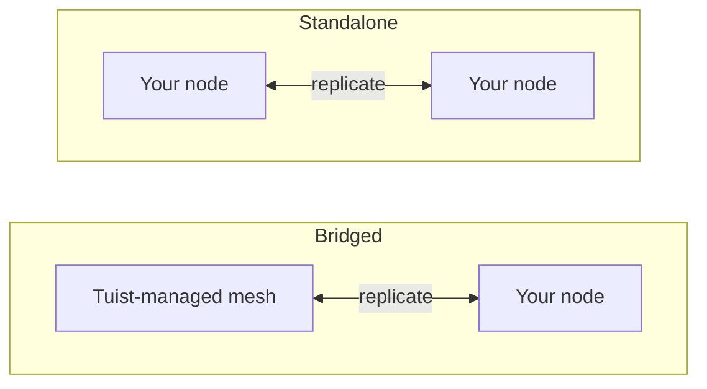

---
{
  "title": "セルフホスティング",
  "titleTemplate": ":title | キャッシュ | ガイド | Tuist",
  "description": "Tuistキャッシュノードをセルフホストし、Tuistがホストするメッシュとレプリケートする方法を学びます。"
}
---

# セルフホストキャッシュ {#self-host-cache}

Tuistのキャッシュは、アーティファクトを相互にレプリケートする**ノードメッシュ**として動作します。インフラストラクチャ上で独自のキャッシュノードを実行することで、キャッシュを開発者やCIの近くに配置し、キャッシングが提供する速度を損なうネットワーク距離を短縮できます。

セルフホストノードは単一のコンテナ（`ghcr.io/tuist/kura`）であり、ローカルディスクにアーティファクトを保存し、ピアメッシュに参加すると内部ピアポートを介してメッシュの他の部分と通信します。Tuistは**コントロールプレーン**として機能し、トラフィックの認証、管理されたキャッシュ容量のプロビジョニング、使用量の計測を行います。Tuistがあなたのノードに直接アクセスすることはありません。

> [!NOTE]
> キャッシュノードのセルフホスティングには、**Enterpriseプラン**が必要です。
>
> ノードは、ホスト型Tuistサーバー（`https://tuist.dev`）またはセルフホスト型Tuistサーバーのいずれかに接続します。Tuistサーバー自体のセルフホスティングには、別途サーバーライセンスが必要です。<.localized_link href="/guides/server/self-host/server">サーバーのセルフホスティングガイド</.localized_link>を参照してください。

## 2つのトポロジー {#topologies}

セルフホストノードを実行する方法は2つあり、どちらになるかは、アカウントが**Tuist管理**のキャッシュリージョンも実行しているかどうかによって決まります。

### ブリッジ型: Tuistホスト型メッシュ + あなたのノード {#topology-bridged}

アカウントは少なくとも1つのTuist管理キャッシュリージョンを実行しており、セルフホストノードがその**メッシュに参加**します。ノードへの書き込みは管理メッシュへ継続的に伝播され、ノードは参加時に管理メッシュの既存キャッシュからウォームアップされます。これにより、低遅延のキャッシュをランナー（書き込みの大部分を担当）の近くに配置しつつ、その書き込みを共有キャッシュに反映できます。なお、ノード参加**後**に管理メッシュの他の場所で書き込まれた新しいアーティファクトは、まだそのノードへ継続的に伝播されません。これは将来の強化予定事項です。

オンプレミスキャッシュの速度を活かしつつ、共有され常に稼働している管理キャッシュを手放したくない場合に適しています。

### スタンドアロン型: あなたのノードのみ {#topology-standalone}

アカウントは管理キャッシュリージョンを**実行していません**。ノードはインフラストラクチャ上で独自の孤立したメッシュを形成します。Tuistはノードの存在を認識しているため（使用量が計測されます）が、**Tuist管理メッシュとのデータ交換は一切行われません**。そのようなメッシュが存在しないためです。ピアメンバーシップとレプリケーションは、すべてあなたのノード内で行われます。



設定上の主な違いは、**ブリッジ型**トポロジーでは**エンロールメント**を使用し、ノードが起動時にキーペアを生成してTuistがメッシュ証明書を発行する一方、**スタンドアロン型**トポロジーにはTuist発行のメッシュ証明書がないことです。単一のスタンドアロンノードはピアTLSを無効にして実行できます。マルチノードのスタンドアロンメッシュでは、あなたが提供するピアTLS材料を使用します。

## CLIエンドポイントの設定 {#cli-endpoint}

Tuistの管理キャッシュは`https://<account>.cache.tuist.dev`を使用します。セルフホスト型Tuistサーバーの場合、CLIはサーバーの`TUIST_CACHE_ENDPOINTS`設定からキャッシュURLを取得します。これをメインのキャッシュサーバーまたはロードバランサーのURLに設定してください。複数のURLが含まれる場合は、最初のURLが使用されます。

プライベート/カスタムキャッシュノードを**ホスト型Tuistサーバー**に接続する場合、開発者シェルおよびCIで明示的なエンドポイントを設定します:

```sh
export TUIST_CACHE_ENDPOINT=https://cache.example.com
```

このオーバーライドはどちらのサーバータイプでも優先され、セルフホスト型Tuistサーバーではオプションです。Xcodeキャッシュデーモンについては、設定後に`tuist setup cache`を再実行して、LaunchAgentが更新された環境を受け取るようにしてください。複数のノードの場合は、ロードバランサーまたはDNSルーティング名を使用してください。

## 前提条件 {#prerequisites}


- DockerおよびDocker Compose（または任意のコンテナランタイム）
- 稼働中のTuistサーバー（ホスト型またはセルフホスト型）
- キャッシュ用のディスク。ブリッジ型ノードは初回参加時にアカウントの**全体**メッシュをプルするため、それに応じてデータボリュームのサイズを設定してください。

## コントロールプレーンクライアントの提供 {#control-plane-client}

ノードはコントロールプレーンクライアント資格情報を使用して、キャッシュリクエスト（トークンイントロスペクション）の認証、ダッシュボードへの報告、使用量の送信を行います。これは、セルフホスト型Tuistサーバー上でクライアントがあなたのノードにルーティングされる方法では**ありません**（[クライアントがノードに到達する方法](#routing)を参照）。

完全なセルフホストデプロイメントの場合、**UUIDクライアントID**とランダムなシークレットを生成し、同じペアをTuistサーバーと各Kuraノードで設定します:

```bash
KURA_CONTROL_PLANE_CLIENT_ID="$(uuidgen | tr '[:upper:]' '[:lower:]')"
KURA_CONTROL_PLANE_CLIENT_SECRET="$(openssl rand -base64 32)"
```

これらの値をTuistサーバー環境で`KURA_CONTROL_PLANE_CLIENT_ID`および`KURA_CONTROL_PLANE_CLIENT_SECRET`として設定し、以下のKura設定で同じ値を使用します。登録ハートビートには`KURA_TENANT_ID`（アカウントの永続的なキャッシュ識別子）が含まれるため、サーバーはアカウント名変更後でもノードを正しいアカウントに関連付けることができます。

> [!WARNING]
> クライアントIDは、`kura_`プレフィックスのないUUIDである必要があります。非UUIDのIDの場合、両方のサービスで資格情報が一致していても、HTTP `400`でトークンイントロスペクションが失敗します。

ホスト型`tuist.dev`サーバーに接続する場合、またはUIから回転可能なアカウントごとの資格情報を希望する場合は、アカウントの**キャッシュ**ページを開き、**資格情報の生成**を選択して、`client_id`と一回限りの`secret`をコピーしてください。ホスト型サーバーでは、セルフホストノード用資格情報の生成にはEnterpriseプランが必要です。

## 永続的なテナントの選択 {#permanent-tenant}

`KURA_TENANT_ID`は永続的なストレージおよびピア識別子であり、最初はアカウントの元のハンドルから派生します。名前変更されていないアカウントの場合、現在のハンドルと一致します。**アカウント名変更後も元の値を保持してください**。これには、置き換えノードの追加や同じメッシュへの別のノードの追加も含まれます。例えば、`original`を`renamed`に改名しても、すべてのノードで`KURA_TENANT_ID=original`のままとなります。これを変更すると異なるオブジェクトキー命名空間が選択されます。アカウント名の変更は、保存されたアーティファクトやピア識別子を移行しません。

以下の例にある`<permanent-kura-tenant>`をこの値に置き換えてください。既存の正しく設定されたノードのテナント、またはエンロールメントによって返された`tenant_id`を再利用してください。セルフホスト型Tuistサーバーのオペレーターは、アカウントの`kura_tenant_id`データベースフィールドを確認できます。改名されたアカウントのURLから値を推測しないでください。

有効なデプロイメントレベルのコントロールプレーン資格情報がある場合、ノードが永続的なテナントと異なる現在または保持されたハンドルを提供すると、登録およびピア検出は`error: "tenant_mismatch"`と`expected_tenant_id`を含む**409 Conflict**を返します。これらはノードを登録せず、別のストレージ識別子を暗黙的に置き換えません。不正な資格情報や不明なテナントの場合でも、テナントを開示せずに**401 Unauthorized**を返します。ノードがすでに異なるテナントでデータを書き込んでいる場合は、変更前にその設定とストレージ履歴を確認してください。エラーレスポンスはストレージ移行を実行しません。

## クライアントがノードに到達する方法 {#routing}

開発者マシンとCIがノードに到達できるように、[上記](#cli-endpoint)のキャッシュURLを設定してください。ダッシュボードで各ノードのアドレスと準備状況を報告するには、ノードで`KURA_REGISTRATION_URL`と`KURA_ADVERTISED_HTTP_URL`を設定します。

## ブリッジドセットアップ {#bridged-setup}

ノードは起動時にエンロールされます。ローカルでキーペアを生成し（秘密鍵はインフラストラクチャ外に出ません）、証明書署名要求を送信して、署名付き証明書、アカウントCA、および管理メッシュのゲートウェイアドレスを受け取ります。**TLS素材を提供する必要はありません**。エンロールメントにより、これらはマウントされたボリュームに書き込まれます。

```yaml
# docker-compose.yml
services:
  kura:
    image: ghcr.io/tuist/kura:<version>
    restart: unless-stopped
    ports:
      - "4000:4000"   # HTTP cache: your developers and CI point here
      - "7443:7443"   # mesh peer port
    environment:
      # Enroll and join the managed mesh
      KURA_ENROLL_ON_BOOT: "1"
      KURA_CONTROL_PLANE_URL: "https://tuist.dev"
      KURA_CONTROL_PLANE_CLIENT_ID: "<client_id>"
      KURA_CONTROL_PLANE_CLIENT_SECRET: "<secret>"
      KURA_TENANT_ID: "<permanent-kura-tenant>"

      # Report the node’s address and readiness to the dashboard
      KURA_REGISTRATION_URL: "https://tuist.dev/_internal/kura/mesh/registrations"
      KURA_ADVERTISED_HTTP_URL: "https://kura.acme.internal"   # where your CLI/CI reach the cache
      KURA_NODE_URL: "https://kura.acme.internal:7443"         # this node's peer identity on your network
      KURA_REGION: "office"

      # Ports and storage. KURA_PORT serves both the HTTP cache API and REAPI
      # gRPC (h2c) on one listener. Enrollment writes the TLS files into
      # KURA_INTERNAL_TLS_* on first boot.
      KURA_PORT: "4000"
      KURA_INTERNAL_PORT: "7443"
      KURA_INTERNAL_TLS_CA_CERT_PATH: "/tls/ca.pem"
      KURA_INTERNAL_TLS_CERT_PATH: "/tls/tls.crt"
      KURA_INTERNAL_TLS_KEY_PATH: "/tls/tls.key"
      KURA_DATA_DIR: "/var/cache/kura"
      KURA_TMP_DIR: "/var/cache/kura/tmp"
      KURA_OTEL_SERVICE_NAME: "kura-acme"
      KURA_OTEL_DEPLOYMENT_ENVIRONMENT: "onprem"

      # Authenticate the HTTP cache API. The Tuist hook ships in the image at
      # this path; it introspects each token against the control plane using the
      # control-plane client above, so only valid Tuist tokens for this account
      # can read or write. No JWT verifier secret is involved.
      KURA_AUTH_ENABLED: "1"
      KURA_AUTH_TUIST_URL: "https://tuist.dev"
    volumes:
      - kura-tls:/tls            # empty; enrollment populates it
      - kura-data:/var/cache/kura
volumes:
  kura-tls: {}
  kura-data: {}
```

提供すべきもの：コントロールプレーンクライアント、ネットワーク上の2つのアドレス（`KURA_NODE_URL`、`KURA_ADVERTISED_HTTP_URL`）、および2つの空の書き込み可能ボリュームです。その他すべて（キーペア、証明書、アカウントCA、管理メッシュのアドレス）は起動時に自動的にプロビジョニングされます。

## スタンドアロンセットアップ {#standalone-setup}

管理対象リージョンがない場合、Tuist発行のメッシュCAが存在しないため、エンロールメントは適用されません（エンロールエンドポイントは`503 ca_unavailable`を返します）。ノードは、トークン認証、ダッシュボード登録ハートビート、および使用量レポートのためにTuistサーバーを使用します。

```yaml
# docker-compose.yml for a single node connected to a self-hosted Tuist server
services:
  kura:
    image: ghcr.io/tuist/kura:<version>
    restart: unless-stopped
    ports:
      - "4000:4000"
      - "7443:7443"
    environment:
      KURA_TENANT_ID: "<permanent-kura-tenant>"
      KURA_NODE_URL: "http://kura-1.acme.internal:7443"
      KURA_PEERS: ""   # single node: disable static peer discovery
      KURA_REGION: "office"

      # Authenticate cache requests against the self-hosted Tuist server.
      # Use the same values configured on the Tuist server, or a per-account
      # credential from the Cache page.
      KURA_CONTROL_PLANE_CLIENT_ID: "<client_id>"
      KURA_CONTROL_PLANE_CLIENT_SECRET: "<secret>"
      KURA_AUTH_ENABLED: "1"
      KURA_AUTH_TUIST_URL: "https://tuist.acme.internal"

      # Register the client-facing cache URL with the Tuist server.
      KURA_REGISTRATION_URL: "https://tuist.acme.internal/_internal/kura/mesh/registrations"
      KURA_ADVERTISED_HTTP_URL: "https://kura.acme.internal"

      KURA_PORT: "4000"
      KURA_INTERNAL_PORT: "7443"
      KURA_DATA_DIR: "/var/cache/kura"
      KURA_TMP_DIR: "/var/cache/kura/tmp"
      KURA_OTEL_SERVICE_NAME: "kura-acme"
      KURA_OTEL_DEPLOYMENT_ENVIRONMENT: "onprem"
    volumes:
      - kura-data:/var/cache/kura
volumes:
  kura-data: {}
```

単一ノードの場合、ピアTLSを設定せず、`KURA_PEERS`を空の文字列に設定してください。`KURA_PEERS`が未設定の場合、Kuraは`KURA_NODE_URL`から静的ピア検出をシードし、そのURLの`/_internal/status`エンドポイントを定期的にチェックします。ピアTLSが無効になっている場合、ノードがプライベートネットワーク名経由で到達可能であっても、`KURA_NODE_URL`は`http://`スキームを使用する必要があります。

この例では`KURA_CONTROL_PLANE_URL`は必要ありません。認証と使用量レポーターの両方がTuistベースURLとして`KURA_AUTH_TUIST_URL`を使用するためです。`KURA_ADVERTISED_HTTP_URL`はダッシュボード内のノードのクライアント向けアドレスを識別します。CLIがキャッシュリクエストにそのアドレスを使用するように、Tuistサーバーで`TUIST_CACHE_ENDPOINTS=https://kura.acme.internal`を設定してください。

### Helmを使用したKubernetes {#standalone-helm}

セルフホスト型TuistサーバーがKubernetes上で実行されている場合は、スタンドアロンKuraチャートを使用してKuraをインストールし、同じコントロールプレーン設定を`extraEnv`経由で渡してください。TuistサーバーチャートはこのKuraチャートをサブチャートとしてインストールしません。

まず、デプロイメントレベルのKura資格情報を使用してTuistサーバーチャートを構成します。

```yaml
# tuist-values.yaml
server:
  extraEnv:
    - name: KURA_CONTROL_PLANE_CLIENT_ID
      valueFrom:
        secretKeyRef:
          name: kura-control-plane
          key: client-id
    - name: KURA_CONTROL_PLANE_CLIENT_SECRET
      valueFrom:
        secretKeyRef:
          name: kura-control-plane
          key: client-secret
```

次に、同じSecretを使用して同じ名前空間にKuraをインストールします。

```yaml
# kura-values.yaml
replicaCount: 1

config:
  tenantId: "<permanent-kura-tenant>"
  region: "office"

ingress:
  enabled: true
  className: nginx
  hosts:
    - host: kura.acme.internal
      paths:
        - path: /
          pathType: Prefix
  tls:
    - hosts:
        - kura.acme.internal
      secretName: kura-tls

extraEnv:
  - name: KURA_CONTROL_PLANE_CLIENT_ID
    valueFrom:
      secretKeyRef:
        name: kura-control-plane
        key: client-id
  - name: KURA_CONTROL_PLANE_CLIENT_SECRET
    valueFrom:
      secretKeyRef:
        name: kura-control-plane
        key: client-secret
  - name: KURA_AUTH_ENABLED
    value: "1"
  - name: KURA_AUTH_TUIST_URL
    value: "https://tuist.acme.internal"
  - name: KURA_REGISTRATION_URL
    value: "https://tuist.acme.internal/_internal/kura/mesh/registrations"
  - name: KURA_ADVERTISED_HTTP_URL
    value: "https://kura.acme.internal"
```

```bash
kubectl create namespace tuist
kubectl -n tuist create secret generic kura-control-plane \
  --from-literal=client-id="<client_id>" \
  --from-literal=client-secret="<secret>"

helm upgrade --install kura oci://ghcr.io/tuist/charts/kura \
  --namespace tuist \
  -f kura-values.yaml
```

KuraがTuistサーバーとは異なる名前空間で実行される場合は、`kura-control-plane` Secretを作成するか、両方の名前空間に同期してください。

イメージにバンドルされたTuistフックを使用する場合は、`extension.enabled`を未設定のままにしてください。そのチャート値はConfigMapからカスタムフックをマウントするためのものです。チャートは`KURA_NODE_URL`、`KURA_PEERS`、ヘッドレスサービス、永続化、およびプローブをレンダリングします。`replicaCount: 1`の場合、生成されたピアURLはPod自体の安定したDNS名となるため、クラスター内で到達可能であり、前述の単一ノード警告が発生しません。複数のレプリカの場合、チャートはStatefulSet DNSからピアリストを生成します。内部ピアプレーンでmTLSを使用したい場合は、`peerTls`を有効にしてTLS Secretを提供してください。

複数のスタンドアロンノードを実行するには、`/tls`にマウントされた**独自のピアTLS**（ノード同士が信頼し合うためにCAを共有する、CA plus 各ノードのリーフ証明書とキー）を追加し、`KURA_NODE_URL`を`https://...:<KURA_INTERNAL_PORT>`に変更して、`KURA_PEERS`を追加します。

```yaml
environment:
  KURA_NODE_URL: "https://kura-1.acme.internal:7443"
  KURA_PEERS: "https://kura-2.acme.internal:7443,https://kura-3.acme.internal:7443"
  KURA_INTERNAL_TLS_CA_CERT_PATH: "/tls/ca.pem"
  KURA_INTERNAL_TLS_CERT_PATH: "/tls/tls.crt"
  KURA_INTERNAL_TLS_KEY_PATH: "/tls/tls.key"
volumes:
  - ./tls:/tls:ro
```

## 各トポロジーに必要なもの {#requirements-summary}

| 提供項目 | ブリッジド | スタンドアロン |
|---|---|---|
| コントロールプレーンクライアント（`client_id` / `secret`） | はい | はい |
| `KURA_NODE_URL` | はい | はい |
| `KURA_ADVERTISED_HTTP_URL` | はい | ダッシュボード登録用。ルーティングは別個です（下記参照） |
| CLIへのルーティング | 自動（登録時） | 準備完了の登録ハートビートから自動 |
| データ + 一時ボリューム | はい | はい |
| `KURA_ENROLL_ON_BOOT` | はい | いいえ（`ca_unavailable`を返します） |
| ピアTLS（`/tls` CA + リーフ） | いいえ、エンロールメントが書き込みます | マルチノードメッシュの場合のみ |
| `KURA_PEERS`（ピアリスト） | いいえ、エンロールメントがゲートウェイをシードします | 単一ノードの場合は空文字列。複数ノードの場合は到達可能なピアURL。 |

## 必須構成 {#required-config}

これらの変数は、トポロジーに関係なくすべてのノードを構成します（ピアTLSは後述の例外です）。

| 変数 | 説明 |
|---|---|
| `KURA_TENANT_ID` | アカウントの永続的なKuraテナント。アカウント名を変更しても元の値を維持してください。[永続テナントを選択](#permanent-tenant)を参照。 |
| `KURA_NODE_URL` | ネットワーク上でのこのノードのピアURL。 |
| `KURA_PEERS` | 静的ピア検出リスト。単一のスタンドアロンノードの場合は空文字列に設定し、マルチノードメッシュの場合は到達可能なピアURLを設定します。 |
| `KURA_REGION` | 自由形式のリージョンラベル（例: `office`、`ci`）。 |
| `KURA_PORT` / `KURA_INTERNAL_PORT` | キャッシュポート（HTTPキャッシュAPIとREAPI gRPCが1つのリスナーで共存）およびメッシュピアポート（`4000` / `7443`）。 |
| `KURA_DATA_DIR` / `KURA_TMP_DIR` | ディスク上のアーティファクトストレージとスクラッチディレクトリ。 |
| `KURA_INTERNAL_TLS_CA_CERT_PATH` / `KURA_INTERNAL_TLS_CERT_PATH` / `KURA_INTERNAL_TLS_KEY_PATH` | ピアTLSファイル。エンロールメントによって書き込まれる（ブリッジド）、またはユーザーが提供する（マルチノードスタンドアロン）。単一ノードでは不要です。これらを省略し、`http://` `KURA_NODE_URL`を使用してください。 |
| `KURA_OTEL_SERVICE_NAME` / `KURA_OTEL_DEPLOYMENT_ENVIRONMENT` | テレメトリ用のサービス名と環境ラベル。 |

ブリッジドノードでは、さらに`KURA_ENROLL_ON_BOOT`、`KURA_CONTROL_PLANE_URL`、およびコントロールプレーンクライアント資格情報を設定します。`KURA_REGISTRATION_URL`と`KURA_ADVERTISED_HTTP_URL`は、ノードを登録して**キャッシュ**ページに表示させ、Kura対応のCLIクライアントがルーティングされるようにします（[クライアントがノードに到達する方法](#routing)を参照）。

## ストレージとエビクション {#storage}

ノードは`KURA_DATA_DIR`の下に、CASストレージ予算までアーティファクトを保存します。これはオプションの変数で設定できます。

| 変数 | 説明 |
|---|---|
| `KURA_CAS_CAPACITY_BYTES` | ノードのCASストレージ予算（バイト単位）。正の整数である必要があります。未設定の場合、予算は`KURA_DATA_DIR`を保持するファイルシステムのサイズの50%になります。 |

設定の有無にかかわらず、予算は`KURA_DATA_DIR`を保持するファイルシステムの80%を上限とします。これにより、最も古いセグメントをエビクトする前に新しいセグメントを書き込むローテーション処理によってディスクがいっぱいになるのを防ぎます。予算は512 MiBセグメントの整数倍に丸められ、最小値は2.5 GiBです。ノードは起動時に解決された予算をログに記録します（`resolved CAS segment ring limits`）。

エビクションは自動です。アーティファクトはセグメントのリングに保存され、予算に達すると最も古いセグメントがエビクトされます。古いセグメントから読み取られたアーティファクトは現在のセグメントに昇格するため、頻繁に使用されるアーティファクトは保持され、エビクションの動作はLRU（Least Recently Used）に近くなります。

`KURA_DATA_DIR`を専用のボリュームに配置してください。デフォルトの予算と上限の両方は、ファイルシステムの空き容量ではなく総サイズに対する割合であるため、同じファイルシステム上の他のデータによって、予算が想定するよりも少ない容量しか残らない可能性があります。

## キャッシュリクエストの認証 {#cache-auth}

デフォルトでは、ノードはネットワーク上で到達可能なあらゆるものに対してHTTPキャッシュAPIを提供します。組織の認証済みメンバーのみが読み書きできるようにするために、呼び出し側が有効なTuistトークンを提示することを要求するには、ノードをTuistサーバーに向けます。上記のスタンドアロンセットアップではこれを行います。

| 変数 | 値 |
|---|---|
| `KURA_AUTH_ENABLED` | `1` |
| `KURA_AUTH_TUIST_URL` | TuistサーバーのURL |

承認は、すでに設定したコントロールプレーンクライアント（`KURA_CONTROL_PLANE_CLIENT_ID` / `KURA_CONTROL_PLANE_CLIENT_SECRET`）を再利用してトークンをイントロスペクトするため、追加の資格情報は不要です。セルフホスト型ノードは**イントロスペクションのみ**を実行します。任意のテナントのトークンを発行できる対称Guardian JWT検証シークレットを保持することはなく、共有されることもないため、すべてのリクエストはサーバーに対して承認されます。到達できないノードは提供せず拒否し、これを変更する設定はありません。Tuist管理ノードも同じ承認を実行しますが、違いは検証キーも保持しているため、トークンだけでほとんどのリクエストを解決できる点です。

## ネットワーキング {#networking}

ノードは、有効にする統合に応じて**アウトバウンド**接続を行います。

- トークンイントロスペクション（`KURA_AUTH_TUIST_URL`）、登録ハートビート（`KURA_REGISTRATION_URL`）、使用量（`KURA_CONTROL_PLANE_URL`または`KURA_AUTH_TUIST_URL`）、およびブリッジドトポロジーでのエンロールメントのためのTuistサーバー、および
- ブリッジドトポロジーでは、レプリケーションのための管理メッシュのピアゲートウェイ。

開発者とCIは、ノードの`KURA_ADVERTISED_HTTP_URL`に到達します（マルチノードメッシュの場合、ノードはピアポートで相互に到達します）。これらのアドレスは**ネットワーク内**で到達可能であればよく、パブリックインターネットに公開する必要はありません。

## 動作方法 {#behavior}

- **ブリッジド。** 起動時、ノードはエンロールし、管理メッシュの全キャッシュを取得して、リングの提供メンバーに移行します。初期取得は1回のみ発生し、WAN経由ではキャッシュのサイズに応じて時間がかかることがあります。その後、ノードへの書き込みは管理メッシュに継続的に伝播します。ノード参加後に管理メッシュの他の場所で書き込まれた新しいアーティファクトは、まだ継続的には伝播しません（計画されている機能強化）。そのため、参加時の取得はライブミラーではなくスナップショットとして扱ってください。
- **スタンドアロン。** ノードはインフラストラクチャ上で孤立したメッシュとして実行されます。レプリケーション（ある場合）は独自のノード間でのみ発生します。構成されている場合、Tuistの役割はコントロールプレーン（ダッシュボードでの可視性、キャッシュエンドポイントの広告、使用量の計測、トークンイントロスペクション）に限定されます。プロビジョニング、アップグレード、ピアリング、またはノードへの直接アクセスは行いません。

## 確認 {#verify}

```bash
curl --fail-with-body http://localhost:4000/ready   # 200 once the node has joined and is serving
curl --fail-with-body http://localhost:4000/up      # liveness + mesh membership
```

ブリッジドノードは、メッシュを取得している間は`state: joining`を報告し、追いつくと`state: serving`を報告します。登録ハートビートが開始されると、ノードはアカウントの**キャッシュ**ページの**登録済みノード**にも表示されます。

リモートキャッシングを確認するには、キャッシュされていないキャッシュ可能なターゲットで`tuist cache`を実行し、Kuraログでアップロードが成功したことを確認してください。終了ステータスがゼロであることだけでは、アーティファクトが保存されたことは確認できません。

## アップグレード {#upgrading}

```bash
docker compose pull
docker compose up -d
```

ノードは1つのバージョン差を許容して並行実行できるように設計されているため、複数ノードでのローリングアップグレードは安全です。
