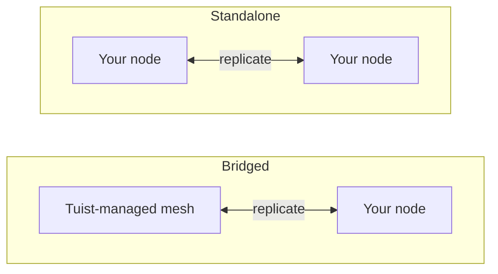

---
{
  "title": "セルフホスティング",
  "titleTemplate": ":title | Cache | Guides | Tuist",
  "description": "Tuistキャッシュノードをセルフホストし、Tuistがホストするメッシュとレプリケートする方法を学びます。"
}
---

# セルフホストキャッシュ {#self-host-cache}

Tuist のキャッシュは、アーティファクトを相互にレプリケートする**ノードメッシュ**として動作します。インフラストラクチャ上に独自のキャッシュノードを実行することで、キャッシュを開発者や CI の近くに配置し、キャッシングが本来提供する速度を損なうネットワーク距離を短縮できます。

セルフホストノードは単一のコンテナ（`ghcr.io/tuist/kura`）で、ローカルディスクにアーティファクトを保存し、ピアメッシュに参加すると内部ピアポートを通じてメッシュの他のノードと通信します。Tuist は**コントロールプレーン**として機能し、トラフィックの認証、管理されたキャッシュ容量のプロビジョニング、使用量の計測を行います。Tuist があなたのノード内に直接アクセスすることはありません。

> [!NOTE]
> キャッシュノードのセルフホスティングには**Enterprise プラン**が必要です。
>
> ノードは、ホスト型 Tuist サーバー（`https://tuist.dev`）またはセルフホスト型 Tuist サーバーのいずれかに接続します。Tuist サーバー自体のセルフホスティングには別のサーバーライセンスが必要です。<.localized_link href="/guides/server/self-host/server">サーバーのセルフホスティングガイド</.localized_link>をご覧ください。

## 2 つのトポロジー {#topologies}

セルフホストノードを実行する方法は 2 つあり、どちらになるかは、アカウントが**Tuist 管理**のキャッシュリージョンも実行しているかどうかによって決まります。

### ブリッジ型: Tuist ホスト型メッシュ + あなたのノード {#topology-bridged}

アカウントは少なくとも 1 つの Tuist 管理キャッシュリージョンを実行しており、セルフホストノードが**そのメッシュに参加**します。ノードへの書き込みは管理メッシュへ継続的に伝播され、ノードは参加時に管理メッシュの既存キャッシュからウォームアップされます。これにより、低遅延のキャッシュをランナー（書き込みの大部分を担当）の近くに配置しつつ、その書き込みを共有キャッシュに反映できます。なお、ノード参加**後**に管理メッシュの他の場所で書き込まれた新しいアーティファクトは、まだそのノードへ継続的に伝播されません。これは今後実装予定の機能です。

オンプレミスキャッシュの速度を活かしながら、共有され常に稼働している管理キャッシュを手放したくない場合に適しています。

### スタンドアロン: あなた自身のノードのみ {#topology-standalone}

アカウントは管理されたキャッシュリージョンを**実行していません**。ノードはインフラストラクチャ上で独自の孤立したメッシュを形成します。Tuist はノードの存在を認識しているため（使用量が計測されます）が、**Tuist 管理メッシュとのデータ交換は一切行われません**。そのようなメッシュが存在しないためです。ピアメンバーシップとレプリケーションはすべてあなた自身のノード内で行われます。



設定上の主な違いは、**ブリッジ型**トポロジーでは**エンロールメント**を使用し、ノードが起動時にキーペアを生成して Tuist がメッシュ証明書を発行する一方、**スタンドアロン**トポロジーでは Tuist 発行のメッシュ証明書が存在しないことです。単一のスタンドアロンノードはピア TLS を無効にして実行できます。複数ノードのスタンドアロンメッシュでは、あなたが用意したピア TLS 資料を使用します。

## CLI エンドポイントの設定 {#cli-endpoint}

Tuist の管理キャッシュは `https://<account>.cache.tuist.dev` を使用します。セルフホスト型 Tuist サーバーの場合、CLI はサーバーの `TUIST_CACHE_ENDPOINTS` 設定からキャッシュ URL を取得します。これをメインのキャッシュサーバーまたはロードバランサーの URL に設定してください。複数の URL が含まれている場合は、最初の URL が使用されます。

プライベート/カスタムキャッシュノードを**ホスト型 Tuist サーバー**に接続する場合、開発者シェルおよび CI で明示的なエンドポイントを設定します:

```sh
export TUIST_CACHE_ENDPOINT=https://cache.example.com
```

このオーバーライドはどちらのサーバータイプでも優先され、セルフホスト型 Tuist サーバーではオプションです。Xcode キャッシュデーモンについては、設定後に `tuist setup cache` を再実行して、LaunchAgent が更新された環境を受け取るようにしてください。複数ノードの場合は、ロードバランサーまたは DNS ルーティング名を使用してください。

## 前提条件 {#prerequisites}


- Docker および Docker Compose（または任意のコンテナランタイム）
- 稼働中の Tuist サーバー（ホスト型またはセルフホスト型）
- キャッシュ用のディスク。ブリッジ型ノードは初回参加時にアカウントの**全体**メッシュをプルするため、それに応じてデータボリュームのサイズを確保してください。

## コントロールプレーンクライアントの提供 {#control-plane-client}

ノードはコントロールプレーンクライアント資格情報を使用して、キャッシュリクエストの認証（トークンイントロスペクション）、ダッシュボードへの報告、使用量の送信を行います。これは、セルフホスト型 Tuist サーバー上でクライアントがあなたのノードにルーティングされる方法では**ありません**（[クライアントがノードに到達する方法](#routing)を参照）。

完全なセルフホストデプロイメントの場合、**UUID クライアント ID**とランダムなシークレットを生成し、Tuist サーバーと各 Kura ノードの両方で同じペアを設定します:

```bash
KURA_CONTROL_PLANE_CLIENT_ID="$(uuidgen | tr '[:upper:]' '[:lower:]')"
KURA_CONTROL_PLANE_CLIENT_SECRET="$(openssl rand -base64 32)"
```

これらの値を Tuist サーバー環境で `KURA_CONTROL_PLANE_CLIENT_ID` および `KURA_CONTROL_PLANE_CLIENT_SECRET` として設定し、以下の Kura 設定でも同じ値を使用します。登録ハートビートには `KURA_TENANT_ID`（アカウントの永続的なキャッシュ識別子）が含まれるため、サーバーはアカウント名変更後でもノードを正しいアカウントに関連付けることができます。

> [!WARNING]
> クライアント ID は `kura_` プレフィックスのない UUID でなければなりません。UUID 以外の ID は、両方のサービスで資格情報が一致していても、HTTP `400` でトークンイントロスペクションが失敗します。

ホスト型 `tuist.dev` サーバーに接続する場合、または UI から回転可能なアカウントごとの資格情報を希望する場合は、アカウントの **Cache** ページを開き、**Generate credential** を選択して、`client_id` と一回限りの `secret` をコピーしてください。ホスト型サーバーでは、セルフホストノード用資格情報の生成には Enterprise プランが必要です。

## 永続テナントの選択 {#permanent-tenant}

`KURA_TENANT_ID` は永続的なストレージおよびピア識別子で、最初はアカウントの元のハンドルから派生します。一度も名前変更されていないアカウントの場合、現在のハンドルと一致します。**アカウント名変更後も元の値を維持**してください。置き換えノードの追加や同一メッシュへの別のノード追加の場合も同様です。例えば、`original` を `renamed` に改名しても、すべてのノードで `KURA_TENANT_ID=original` のままになります。これを変更すると異なるオブジェクトキー名前空間が選択されます。アカウント名の改名は、保存されたアーティファクトやピア識別子を移行しません。

以下の例にある `<permanent-kura-tenant>` をこの値に置き換えてください。既存の正しく設定されたノードのテナント、またはエンロールメントによって返された `tenant_id` を再利用してください。セルフホスト型 Tuist サーバーの運用者は、アカウントの `kura_tenant_id` データベースフィールドを確認できます。改名後のアカウントの URL から値を推測しないでください。

有効なデプロイメントレベルのコントロールプレーン資格情報がある場合、ノードが永続テナントと異なる現在または保持されたハンドルを提供すると、登録およびピア検出は `error: "tenant_mismatch"` および `expected_tenant_id` を伴う **409 Conflict** を返します。これらはノードを登録せず、別のストレージ識別子を暗黙的に置き換えません。無効な資格情報や不明なテナントの場合でも、テナントを開示することなく **401 Unauthorized** が返されます。ノードがすでに異なるテナントでデータを書き込んでいる場合は、変更前にその構成とストレージ履歴を確認してください。エラーレスポンスはストレージ移行を実行しません。

## クライアントがノードに到達する方法 {#routing}

開発者マシンと CI がノードに到達できるように、[上記](#cli-endpoint)のキャッシュ URL を設定してください。ダッシュボードで各ノードのアドレスと準備状況を報告するには、ノードで `KURA_REGISTRATION_URL` と `KURA_ADVERTISED_HTTP_URL` を設定します。

## ブリッジドセットアップ {#bridged-setup}

ノードは起動時にエンロールします。ローカルでキーペアを生成し（秘密鍵はインフラストラクチャ外に出ません）、証明書署名要求を送信して、署名済み証明書、アカウント CA、および管理メッシュのゲートウェイアドレスを受け取ります。**TLS 素材は一切提供しません**。エンロールメントにより、これらのファイルはマウントされたボリュームに書き込まれます。

```yaml
# docker-compose.yml
services:
  kura:
    image: ghcr.io/tuist/kura:<version>
    restart: unless-stopped
    ports:
      - "4000:4000"   # HTTP cache: your developers and CI point here
      - "7443:7443"   # mesh peer port
    environment:
      # Enroll and join the managed mesh
      KURA_ENROLL_ON_BOOT: "1"
      KURA_CONTROL_PLANE_URL: "https://tuist.dev"
      KURA_CONTROL_PLANE_CLIENT_ID: "<client_id>"
      KURA_CONTROL_PLANE_CLIENT_SECRET: "<secret>"
      KURA_TENANT_ID: "<permanent-kura-tenant>"

      # Report the node’s address and readiness to the dashboard
      KURA_REGISTRATION_URL: "https://tuist.dev/_internal/kura/mesh/registrations"
      KURA_ADVERTISED_HTTP_URL: "https://kura.acme.internal"   # where your CLI/CI reach the cache
      KURA_NODE_URL: "https://kura.acme.internal:7443"         # this node's peer identity on your network
      KURA_REGION: "office"

      # Ports and storage. KURA_PORT serves both the HTTP cache API and REAPI
      # gRPC (h2c) on one listener. Enrollment writes the TLS files into
      # KURA_INTERNAL_TLS_* on first boot.
      KURA_PORT: "4000"
      KURA_INTERNAL_PORT: "7443"
      KURA_INTERNAL_TLS_CA_CERT_PATH: "/tls/ca.pem"
      KURA_INTERNAL_TLS_CERT_PATH: "/tls/tls.crt"
      KURA_INTERNAL_TLS_KEY_PATH: "/tls/tls.key"
      KURA_DATA_DIR: "/var/cache/kura"
      KURA_TMP_DIR: "/var/cache/kura/tmp"
      KURA_OTEL_SERVICE_NAME: "kura-acme"
      KURA_OTEL_DEPLOYMENT_ENVIRONMENT: "onprem"

      # Authenticate the HTTP cache API. The Tuist hook ships in the image at
      # this path; it introspects each token against the control plane using the
      # control-plane client above, so only valid Tuist tokens for this account
      # can read or write. No JWT verifier secret is involved.
      KURA_AUTH_ENABLED: "1"
      KURA_AUTH_TUIST_URL: "https://tuist.dev"
    volumes:
      - kura-tls:/tls            # empty; enrollment populates it
      - kura-data:/var/cache/kura
volumes:
  kura-tls: {}
  kura-data: {}
```

あなたが提供するのは、コントロールプレーンクライアント、ネットワーク上の 2 つのアドレス（`KURA_NODE_URL`、`KURA_ADVERTISED_HTTP_URL`）、および 2 つの空の書き込み可能ボリュームです。その他すべて（キーペア、証明書、アカウント CA、管理メッシュのアドレス）は起動時に自動的にプロビジョニングされます。

## スタンドアロンセットアップ {#standalone-setup}

管理対象リージョンがないため、Tuist 発行のメッシュ CA は存在せず、エンロールメントは適用されません（エンロールエンドポイントは `503 ca_unavailable` を返します）。ノードは、トークン認証、ダッシュボード登録ハートビート、および使用量レポートのために Tuist サーバーを使用します。

```yaml
# docker-compose.yml for a single node connected to a self-hosted Tuist server
services:
  kura:
    image: ghcr.io/tuist/kura:<version>
    restart: unless-stopped
    ports:
      - "4000:4000"
      - "7443:7443"
    environment:
      KURA_TENANT_ID: "<permanent-kura-tenant>"
      KURA_NODE_URL: "http://kura-1.acme.internal:7443"
      KURA_PEERS: ""   # single node: disable static peer discovery
      KURA_REGION: "office"

      # Authenticate cache requests against the self-hosted Tuist server.
      # Use the same values configured on the Tuist server, or a per-account
      # credential from the Cache page.
      KURA_CONTROL_PLANE_CLIENT_ID: "<client_id>"
      KURA_CONTROL_PLANE_CLIENT_SECRET: "<secret>"
      KURA_AUTH_ENABLED: "1"
      KURA_AUTH_TUIST_URL: "https://tuist.acme.internal"

      # Register the client-facing cache URL with the Tuist server.
      KURA_REGISTRATION_URL: "https://tuist.acme.internal/_internal/kura/mesh/registrations"
      KURA_ADVERTISED_HTTP_URL: "https://kura.acme.internal"

      KURA_PORT: "4000"
      KURA_INTERNAL_PORT: "7443"
      KURA_DATA_DIR: "/var/cache/kura"
      KURA_TMP_DIR: "/var/cache/kura/tmp"
      KURA_OTEL_SERVICE_NAME: "kura-acme"
      KURA_OTEL_DEPLOYMENT_ENVIRONMENT: "onprem"
    volumes:
      - kura-data:/var/cache/kura
volumes:
  kura-data: {}
```

単一ノードの場合、ピア TLS を未設定のままにし、`KURA_PEERS` を空文字列に設定します。`KURA_PEERS` が未設定の場合、Kura は `KURA_NODE_URL` から静的ピア検出をシードし、その URL の `/_internal/status` エンドポイントを定期的にチェックします。ピア TLS が無効な場合、ノードがプライベートネットワーク名経由で到達可能であっても、`KURA_NODE_URL` は `http://` スキームを使用する必要があります。

この例では `KURA_CONTROL_PLANE_URL` は不要です。これは、承認と使用量レポーターの両方が Tuist ベース URL として `KURA_AUTH_TUIST_URL` を使用するためです。`KURA_ADVERTISED_HTTP_URL` は、ダッシュボード内のノードのクライアント向けアドレスを識別します。CLI がキャッシュリクエストにそのアドレスを使用するように、Tuist サーバーで `TUIST_CACHE_ENDPOINTS=https://kura.acme.internal` を設定してください。

### Helm を使用した Kubernetes {#standalone-helm}

セルフホスト型 Tuist サーバーが Kubernetes で実行されている場合は、スタンドアロン Kura チャートを使用して Kura をインストールし、同じコントロールプレーン設定を `extraEnv` を介して渡します。Tuist サーバーチャートはこの Kura チャートをサブチャートとしてインストールしません。

まず、デプロイメントレベルの Kura 資格情報を使用して Tuist サーバーチャートを構成します。

```yaml
# tuist-values.yaml
server:
  extraEnv:
    - name: KURA_CONTROL_PLANE_CLIENT_ID
      valueFrom:
        secretKeyRef:
          name: kura-control-plane
          key: client-id
    - name: KURA_CONTROL_PLANE_CLIENT_SECRET
      valueFrom:
        secretKeyRef:
          name: kura-control-plane
          key: client-secret
```

次に、同じ Secret を使用して同じ名前空間に Kura をインストールします。

```yaml
# kura-values.yaml
replicaCount: 1

config:
  tenantId: "<permanent-kura-tenant>"
  region: "office"

ingress:
  enabled: true
  className: nginx
  hosts:
    - host: kura.acme.internal
      paths:
        - path: /
          pathType: Prefix
  tls:
    - hosts:
        - kura.acme.internal
      secretName: kura-tls

extraEnv:
  - name: KURA_CONTROL_PLANE_CLIENT_ID
    valueFrom:
      secretKeyRef:
        name: kura-control-plane
        key: client-id
  - name: KURA_CONTROL_PLANE_CLIENT_SECRET
    valueFrom:
      secretKeyRef:
        name: kura-control-plane
        key: client-secret
  - name: KURA_AUTH_ENABLED
    value: "1"
  - name: KURA_AUTH_TUIST_URL
    value: "https://tuist.acme.internal"
  - name: KURA_REGISTRATION_URL
    value: "https://tuist.acme.internal/_internal/kura/mesh/registrations"
  - name: KURA_ADVERTISED_HTTP_URL
    value: "https://kura.acme.internal"
```

```bash
kubectl create namespace tuist
kubectl -n tuist create secret generic kura-control-plane \
  --from-literal=client-id="<client_id>" \
  --from-literal=client-secret="<secret>"

helm upgrade --install kura oci://ghcr.io/tuist/charts/kura \
  --namespace tuist \
  -f kura-values.yaml
```

Kura が Tuist サーバーとは異なる名前空間で実行される場合は、`kura-control-plane` Secret を作成するか、両方の名前空間に同期します。

イメージに含まれる Tuist フックを使用する場合は、`extension.enabled` を未設定のままにしてください。そのチャート値は ConfigMap からカスタムフックをマウントするためのものです。チャートは `KURA_NODE_URL`、`KURA_PEERS`、ヘッドレスサービス、永続化、およびプローブをレンダリングします。`replicaCount: 1` の場合、生成されたピア URL はポッド独自の安定した DNS 名になるため、クラスター内で到達可能な状態が維持され、前述の単一ノード警告が発生しません。複数のレプリカの場合、チャートは StatefulSet DNS からピアリストを生成します。内部ピアプレーンで mTLS を使用する場合は、`peerTls` を有効にして TLS Secret を提供してください。

複数のスタンドアロンノードを実行するには、`/tls` にマウントされた**独自のピア TLS**（CA と、ノードごとのリーフ証明書およびキー。ノード同士が信頼し合うために CA を共有）を追加し、`KURA_NODE_URL` を `https://...:<KURA_INTERNAL_PORT>` に切り替え、`KURA_PEERS` を追加します。

```yaml
environment:
  KURA_NODE_URL: "https://kura-1.acme.internal:7443"
  KURA_PEERS: "https://kura-2.acme.internal:7443,https://kura-3.acme.internal:7443"
  KURA_INTERNAL_TLS_CA_CERT_PATH: "/tls/ca.pem"
  KURA_INTERNAL_TLS_CERT_PATH: "/tls/tls.crt"
  KURA_INTERNAL_TLS_KEY_PATH: "/tls/tls.key"
volumes:
  - ./tls:/tls:ro
```

## 各トポロジーに必要なもの {#requirements-summary}

| あなたが提供 | ブリッジド | スタンドアロン |
|---|---|---|
| コントロールプレーンクライアント（`client_id` / `secret`） | はい | はい |
| `KURA_NODE_URL` | はい | はい |
| `KURA_ADVERTISED_HTTP_URL` | はい | ダッシュボード登録用。ルーティングは別扱い（下記参照） |
| CLI へのルーティング | 自動（登録時） | 準備完了の登録ハートビートから自動 |
| データ + 一時ボリューム | はい | はい |
| `KURA_ENROLL_ON_BOOT` | はい | いいえ（`ca_unavailable` を返す） |
| ピア TLS（`/tls` CA + リーフ） | いいえ、エンロールメントが書き込む | マルチノードメッシュのみ |
| `KURA_PEERS`（ピアリスト） | いいえ、エンロールメントがゲートウェイをシードします | 単一ノードの場合は空文字列。複数ノードの場合は到達可能なピア URL。 |

## 必要な構成 {#required-config}

これらの変数はトポロジーに関係なくすべてのノードを構成します（ピア TLS は後述の例外です）。

| 変数 | 説明 |
|---|---|
| `KURA_TENANT_ID` | アカウントの永続的な Kura テナント。アカウント名を変更した後も元の値を維持してください。[永続テナントを選択する](#permanent-tenant)を参照してください。 |
| `KURA_NODE_URL` | このノードのネットワーク上のピア URL。 |
| `KURA_PEERS` | 静的なピア検出リスト。単一のスタンドアロンノードの場合は空文字列に設定し、マルチノードメッシュの場合は到達可能なピア URL を設定します。 |
| `KURA_REGION` | 自由形式のリージョンラベル（例: `office`、`ci`）。 |
| `KURA_PORT` / `KURA_INTERNAL_PORT` | キャッシュポート（HTTP キャッシュ API と REAPI gRPC が 1 つのリスナーでホスト）およびメッシュピアポート（`4000` / `7443`）。 |
| `KURA_DATA_DIR` / `KURA_TMP_DIR` | ディスク上のアーティファクトストレージとスクラッチディレクトリ。 |
| `KURA_INTERNAL_TLS_CA_CERT_PATH` / `KURA_INTERNAL_TLS_CERT_PATH` / `KURA_INTERNAL_TLS_KEY_PATH` | ピア TLS ファイル。エンロールメントによって書き込まれる（ブリッジド）、またはユーザーが提供する（マルチノードスタンドアロン）。単一ノードでは不要です。これらを省略し、`http://` の `KURA_NODE_URL` を使用してください。 |
| `KURA_OTEL_SERVICE_NAME` / `KURA_OTEL_DEPLOYMENT_ENVIRONMENT` | テレメトリ用のサービス名と環境ラベル。 |

ブリッジドノードはさらに `KURA_ENROLL_ON_BOOT`、`KURA_CONTROL_PLANE_URL`、およびコントロールプレーンクライアントの資格情報を設定します。`KURA_REGISTRATION_URL` と `KURA_ADVERTISED_HTTP_URL` はノードを登録し、**キャッシュ**ページに表示されるようにし、Kura 対応の CLI クライアントがそのノードにルーティングされるようにします（[クライアントがノードに到達する方法](#routing)を参照）。

## ストレージとエビクション {#storage}

ノードは `KURA_DATA_DIR` の下にアーティファクトを保存しますが、CAS ストレージ予算までとなります。これはオプションの変数で設定できます。

| 変数 | 説明 |
|---|---|
| `KURA_CAS_CAPACITY_BYTES` | ノードの CAS ストレージ予算（バイト単位）。正の整数である必要があります。未設定の場合、予算は `KURA_DATA_DIR` を保持するファイルシステムのサイズの 50% です。 |

設定の有無にかかわらず、予算は `KURA_DATA_DIR` を保持するファイルシステムの 80% に制限されます。これにより、最も古いセグメントを削除する前に新しいセグメントを書き込むローテーション処理によってディスクがいっぱいになることを防ぎます。予算は 512 MiB セグメント単位に丸められ、最小値は 2.5 GiB です。ノードは起動時に解決された予算をログに記録します（`resolved CAS segment ring limits`）。

エビクションは自動的に行われます。アーティファクトはセグメントのリングに保存され、予算に達すると最も古いセグメントが削除されます。古いセグメントから読み取られたアーティファクトは現在のセグメントに昇格するため、頻繁に使用されるアーティファクトは保持され、エビクションは LRU（Least Recently Used）に近い動作をします。

`KURA_DATA_DIR` を専用ボリュームに配置してください。デフォルトの予算と上限のどちらも、空き容量ではなくファイルシステムの総サイズの割合であるため、同じファイルシステム上の他のデータがあると、予算が想定するよりも少ない容量しか残らない可能性があります。

## キャッシュリクエストの認証 {#cache-auth}

デフォルトでは、ノードはネットワーク上で到達可能なあらゆるものに対して HTTP キャッシュ API を提供します。組織の認証済みメンバーのみが読み書きできるように、呼び出し側が有効な Tuist トークンを提示することを要求するには、ノードを Tuist サーバーに向けます。上記のスタンドアロンセットアップではこれを行います。

| 変数 | 値 |
|---|---|
| `KURA_AUTH_ENABLED` | `1` |
| `KURA_AUTH_TUIST_URL` | Tuist サーバーの URL |

認可は、すでに設定しているコントロールプレーンクライアント（`KURA_CONTROL_PLANE_CLIENT_ID` / `KURA_CONTROL_PLANE_CLIENT_SECRET`）を再利用してトークンをイントロスペクトするため、追加の資格情報は必要ありません。セルフホスト型ノードは**イントロスペクションのみ**を実行します。任意のテナント向けのトークンを発行できる対称 Guardian JWT 検証シークレットを保持することはなく、共有されることもないため、すべてのリクエストはサーバーに対して認可されます。サーバーに到達できないノードは提供ではなく拒否を行い、これを変更する設定はありません。Tuist 管理ノードも同じ認可を実行しますが、違いは検証キーも保持しているため、トークンだけでほとんどのリクエストを解決できる点です。

## ネットワーク {#networking}

ノードは、有効にする統合に応じて**アウトバウンド**接続を行います。

- トークンのイントロスペクション（`KURA_AUTH_TUIST_URL`）、登録ハートビート（`KURA_REGISTRATION_URL`）、使用量（`KURA_CONTROL_PLANE_URL` または `KURA_AUTH_TUIST_URL`）、およびブリッジドトポロジーでのエンロールメントのための Tuist サーバー、および
- ブリッジドトポロジーでは、レプリケーションのための管理メッシュのピアゲートウェイ。

開発者と CI はノードの `KURA_ADVERTISED_HTTP_URL` に到達します（マルチノードメッシュの場合、ノードはピアポート上で相互に到達します）。これらのアドレスは**ネットワーク内**で到達可能であればよく、パブリックインターネットに公開する必要はありません。

## 動作方法 {#behavior}

- **ブリッジド。** 起動時、ノードはエンロールし、管理メッシュの全キャッシュを取得して、リングのサービングメンバーに移行します。初期取得は一度だけ行われ、WAN 経由ではキャッシュのサイズに応じて時間がかかることがあります。それ以降、ノードへの書き込みは管理メッシュに継続的に伝播します。ノード参加後に管理メッシュの他の場所で書き込まれた新しいアーティファクトはまだ継続的には伝播されないため（計画されている機能強化）、参加時の取得はライブミラーではなくスナップショットとして扱ってください。
- **スタンドアロン。** ノードはインフラストラクチャ上で孤立したメッシュとして実行されます。レプリケーションがある場合でも、独自のノード間でのみ発生します。構成されている場合、Tuist の役割はコントロールプレーンに限定されます。ダッシュボードでの可視性、キャッシュエンドポイントの広告、使用量の計測、トークンのイントロスペクションです。プロビジョニング、アップグレード、ピアリング、またはノードへの直接アクセスは一切行いません。

## 確認 {#verify}

```bash
curl --fail-with-body http://localhost:4000/ready   # 200 once the node has joined and is serving
curl --fail-with-body http://localhost:4000/up      # liveness + mesh membership
```

ブリッジドノードは、メッシュを取得している間は `state: joining` を報告し、追いつくと `state: serving` を報告します。登録ハートビートが始まると、ノードはアカウントの **キャッシュ**ページの **登録済みノード**にも表示されます。

リモートキャッシングを確認するには、キャッシュされていないキャッシュ可能なターゲットで `tuist cache` を実行し、Kura ログでアップロードが成功したことを確認してください。終了ステータスがゼロであるだけでは、アーティファクトが保存されたことは確認できません。

## アップグレード {#upgrading}

```bash
docker compose pull
docker compose up -d
```

ノードは1つのバージョン差を許容して並行実行できるよう設計されているため、複数ノードでのローリングアップグレードは安全です。
