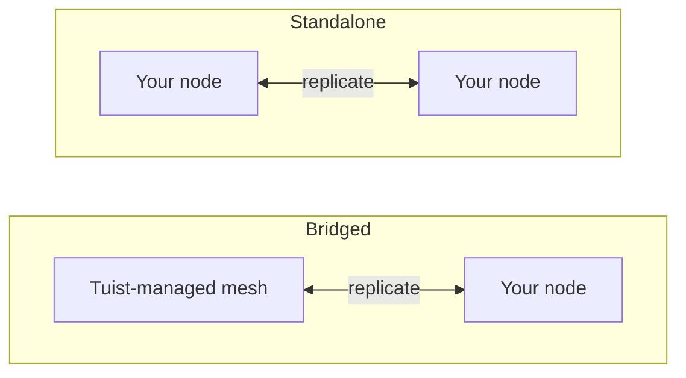

---
{
  "title": "セルフホスティング",
  "titleTemplate": ":title | キャッシュ | ガイド | Tuist",
  "description": "Tuistキャッシュノードをセルフホストし、Tuistがホストするメッシュとレプリケートする方法を学びます。"
}
---

# セルフホストキャッシュ {#self-host-cache}

Tuist のキャッシュは、アーティファクトを相互にレプリケートする **ノードメッシュ** として動作します。インフラストラクチャ上に独自のキャッシュノードを実行することで、開発者や CI の近くにキャッシュを配置し、キャッシングが本来提供する速度を損なうネットワーク距離を短縮できます。

セルフホストノードは単一のコンテナ（`ghcr.io/tuist/kura`）で、ローカルディスクにアーティファクトを保存し、ピアメッシュに参加すると内部ピアポートを介してメッシュの他のノードと通信します。Tuist は **コントロールプレーン** として機能し、トラフィックの認証、マネージドキャッシュ容量のプロビジョニング、使用量の計測を行います。Tuist があなたのノードに直接アクセスすることはありません。

> [!NOTE]
> キャッシュノードのセルフホスティングには **Enterprise プラン** が必要です。
>
> ノードは、ホスト型 Tuist サーバー（`https://tuist.dev`）またはセルフホスト型 Tuist サーバーのいずれかに接続します。Tuist サーバー自体をセルフホストするには、別のサーバーライセンスが必要です。<.localized_link href="/guides/server/self-host/server">サーバーのセルフホスティングガイド</.localized_link> を参照してください。

## 2 つのトポロジー {#topologies}

セルフホストノードを実行する方法は 2 つあり、どちらになるかは、アカウントが **Tuist マネージド** のキャッシュリージョンも実行しているかどうかによって決まります。

### ブリッジ型: Tuist ホスト型メッシュ + あなたのノード {#topology-bridged}

アカウントが少なくとも 1 つの Tuist マネージドキャッシュリージョンを実行しており、セルフホストノードが **そのメッシュに参加** します。ノードへの書き込みはマネージドメッシュに継続的に伝播され、参加時にノードはマネージドメッシュの既存キャッシュからウォームアップされます。これにより、低レイテンシのキャッシュをランナー（書き込みの大部分を担当）の近くに配置しつつ、その書き込みを共有キャッシュに反映できます。なお、ノード参加 **後** にマネージドメッシュの他の場所で書き込まれた新しいアーティファクトは、まだそのノードに継続的に伝播されません。これは今後の機能強化として計画されています。

オンプレミスキャッシュの速度を活かしながら、共有された常時稼働のマネージドキャッシュを手放したくない場合に適しています。

### スタンドアロン型: あなた自身のノードのみ {#topology-standalone}

アカウントはマネージドキャッシュリージョンを **一切** 実行していません。ノードはインフラストラクチャ上で独自の分離されたメッシュを形成します。Tuist はノードの存在を認識しているため（使用量が計測されます）、**Tuist マネージドメッシュとのデータ交換は一切行われません**。そのようなメッシュが存在しないためです。ピアメンバーシップとレプリケーションは、すべてあなた自身のノード内で行われます。



設定上の主な違いは、**ブリッジ型** トポロジーでは **エンロールメント** を使用し、ノードが起動時にキーペアを生成して Tuist がメッシュ証明書を発行するのに対し、**スタンドアロン型** トポロジーには Tuist 発行のメッシュ証明書がない点です。単一のスタンドアロンノードはピア TLS を無効にして実行できます。複数ノードのスタンドアロンメッシュでは、あなたが用意したピア TLS 資料を使用します。

## CLI エンドポイントの設定 {#cli-endpoint}

Tuist のマネージドキャッシュは `https://<account>.cache.tuist.dev` を使用します。セルフホスト型 Tuist サーバーの場合、CLI はサーバーの `TUIST_CACHE_ENDPOINTS` 設定からキャッシュ URL を取得します。これをメインのキャッシュサーバーまたはロードバランサーの URL に設定してください。複数の URL が含まれている場合は、最初の URL が使用されます。

プライベート/カスタムキャッシュノードを **ホスト型 Tuist サーバー** に接続する場合、開発者シェルと CI で明示的なエンドポイントを構成してください:

```sh
export TUIST_CACHE_ENDPOINT=https://cache.example.com
```

このオーバーライドはどちらのサーバータイプでも優先され、セルフホスト型 Tuist サーバーではオプションです。Xcode キャッシュデーモンについては、設定後に `tuist setup cache` を再実行して、LaunchAgent が更新された環境を受け取るようにしてください。複数ノードの場合は、ロードバランサーまたは DNS ルーティング名を使用してください。

## 前提条件 {#prerequisites}


- Docker および Docker Compose（または任意のコンテナランタイム）
- 稼働中の Tuist サーバー（ホスト型またはセルフホスト型）
- キャッシュ用のディスク。ブリッジ型ノードは初回参加時にアカウントの **全体** メッシュをプルするため、それに応じてデータボリュームのサイズを確保してください。

## コントロールプレーンクライアントの提供 {#control-plane-client}

ノードはコントロールプレーンクライアント認証情報を使用して、キャッシュリクエスト（トークンイントロスペクション）の認証、ダッシュボードへのレポート、使用量データの送信を行います。これは、セルフホスト型 Tuist サーバー上でクライアントがノードにルーティングされる方法 **ではありません**（[クライアントがノードに到達する方法](#routing) を参照）。

完全なセルフホストデプロイメントの場合、**UUID クライアント ID** とランダムなシークレットを生成し、Tuist サーバーと各 Kura ノードで同じペアを設定します:

```bash
KURA_CONTROL_PLANE_CLIENT_ID="$(uuidgen | tr '[:upper:]' '[:lower:]')"
KURA_CONTROL_PLANE_CLIENT_SECRET="$(openssl rand -base64 32)"
```

これらの値を Tuist サーバー環境で `KURA_CONTROL_PLANE_CLIENT_ID` および `KURA_CONTROL_PLANE_CLIENT_SECRET` として設定し、以下の Kura 設定で同じ値を使用してください。登録ハートビートには `KURA_TENANT_ID`（アカウントの永続的なキャッシュ識別子）が含まれるため、サーバーはアカウント名変更後でもノードを正しいアカウントに関連付けることができます。

> [!WARNING]
> クライアント ID は `kura_` プレフィックスのない UUID である必要があります。非 UUID の ID は、両方のサービスで認証情報が一致している場合でも、HTTP `400` でトークンイントロスペクションが失敗します。

ホスト型 `tuist.dev` サーバーに接続する場合、または UI から回転可能なアカウントごとの認証情報が必要な場合は、アカウントの **キャッシュ** ページを開き、**認証情報の生成** を選択して、`client_id` と使い捨ての `secret` をコピーしてください。ホスト型サーバーでは、セルフホストノード用認証情報の生成に Enterprise プランが必要です。

## 永続テナントの選択 {#permanent-tenant}

`KURA_TENANT_ID` は永続的なストレージおよびピア識別子で、最初はアカウントの元のハンドルから派生します。一度も名前変更されていないアカウントの場合、現在のハンドルと一致します。**アカウント名変更後も元の値を維持してください**。これは、置き換えノードを追加する場合や、同じメッシュに別のノードを追加する場合も含みます。例えば、`original` を `renamed` に改名しても、すべてのノードで `KURA_TENANT_ID=original` のままになります。これを変更すると異なるオブジェクトキー命名空間が選択されます。アカウント名の改名は、保存されたアーティファクトやピア識別子を移行しません。

以下の例にある `<permanent-kura-tenant>` をこの値に置き換えてください。既存の正しく構成されたノードからテナントを再利用するか、エンロールメントによって返された `tenant_id` を使用してください。セルフホスト型 Tuist サーバーのオペレーターは、アカウントの `kura_tenant_id` データベースフィールドを確認できます。改名後のアカウントの URL から値を推測しないでください。

有効なデプロイメントレベルのコントロールプレーン認証情報がある場合、ノードが永続テナントと異なる現在または保持されたハンドルを提供すると、登録およびピア検出は `error: "tenant_mismatch"` および `expected_tenant_id` を伴う **409 Conflict** を返します。ノードは登録されず、別のストレージ識別子に静かに置き換えられることもありません。無効な認証情報や不明なテナントの場合、テナントを開示せずに **401 Unauthorized** が返されます。ノードがすでに異なるテナントでデータを書き込んでいる場合は、変更する前にその構成とストレージ履歴を確認してください。エラーレスポンスはストレージ移行を実行しません。

## クライアントがノードに到達する方法 {#routing}

開発者マシンと CI がノードに到達できるように、[上記](#cli-endpoint) のキャッシュ URL を構成してください。ダッシュボードで各ノードのアドレスと準備状況を報告するには、ノードで `KURA_REGISTRATION_URL` と `KURA_ADVERTISED_HTTP_URL` を設定します。

## ブリッジドセットアップ {#bridged-setup}

ノードは起動時にエンロールします。ローカルでキーペアを生成し（秘密鍵はインフラストラクチャ外に出ません）、証明書署名要求を送信して、署名済み証明書、アカウント CA、および管理メッシュのゲートウェイアドレスを受け取ります。**TLS 資料は一切提供しません**。エンロールメントにより、これらはマウントされたボリュームに書き込まれます。

```yaml
# docker-compose.yml
services:
  kura:
    image: ghcr.io/tuist/kura:<version>
    restart: unless-stopped
    ports:
      - "4000:4000"   # HTTP cache: your developers and CI point here
      - "7443:7443"   # mesh peer port
    environment:
      # Enroll and join the managed mesh
      KURA_ENROLL_ON_BOOT: "1"
      KURA_CONTROL_PLANE_URL: "https://tuist.dev"
      KURA_CONTROL_PLANE_CLIENT_ID: "<client_id>"
      KURA_CONTROL_PLANE_CLIENT_SECRET: "<secret>"
      KURA_TENANT_ID: "<permanent-kura-tenant>"

      # Report the node’s address and readiness to the dashboard
      KURA_REGISTRATION_URL: "https://tuist.dev/_internal/kura/mesh/registrations"
      KURA_ADVERTISED_HTTP_URL: "https://kura.acme.internal"   # where your CLI/CI reach the cache
      KURA_NODE_URL: "https://kura.acme.internal:7443"         # this node's peer identity on your network
      KURA_REGION: "office"

      # Ports and storage. KURA_PORT serves both the HTTP cache API and REAPI
      # gRPC (h2c) on one listener. Enrollment writes the TLS files into
      # KURA_INTERNAL_TLS_* on first boot.
      KURA_PORT: "4000"
      KURA_INTERNAL_PORT: "7443"
      KURA_INTERNAL_TLS_CA_CERT_PATH: "/tls/ca.pem"
      KURA_INTERNAL_TLS_CERT_PATH: "/tls/tls.crt"
      KURA_INTERNAL_TLS_KEY_PATH: "/tls/tls.key"
      KURA_DATA_DIR: "/var/cache/kura"
      KURA_TMP_DIR: "/var/cache/kura/tmp"
      KURA_OTEL_SERVICE_NAME: "kura-acme"
      KURA_OTEL_DEPLOYMENT_ENVIRONMENT: "onprem"

      # Authenticate the HTTP cache API. The Tuist hook ships in the image at
      # this path; it introspects each token against the control plane using the
      # control-plane client above, so only valid Tuist tokens for this account
      # can read or write. No JWT verifier secret is involved.
      KURA_AUTH_ENABLED: "1"
      KURA_AUTH_TUIST_URL: "https://tuist.dev"
    volumes:
      - kura-tls:/tls            # empty; enrollment populates it
      - kura-data:/var/cache/kura
volumes:
  kura-tls: {}
  kura-data: {}
```

あなたが提供するのは、コントロールプレーンクライアント、ネットワーク上の 2 つのアドレス（`KURA_NODE_URL`、`KURA_ADVERTISED_HTTP_URL`）、および 2 つの空の書き込み可能ボリュームです。その他すべて（キーペア、証明書、アカウント CA、および管理メッシュのアドレス）は起動時に自動的にプロビジョニングされます。

## スタンドアロンセットアップ {#standalone-setup}

管理リージョンがないため、Tuist 発行のメッシュ CA は存在せず、エンロールメントは適用されません（エンロールエンドポイントは `503 ca_unavailable` を返します）。ノードは、トークン認証、ダッシュボード登録ハートビート、および使用量レポートのために Tuist サーバーを使用します。

```yaml
# docker-compose.yml for a single node connected to a self-hosted Tuist server
services:
  kura:
    image: ghcr.io/tuist/kura:<version>
    restart: unless-stopped
    ports:
      - "4000:4000"
      - "7443:7443"
    environment:
      KURA_TENANT_ID: "<permanent-kura-tenant>"
      KURA_NODE_URL: "http://kura-1.acme.internal:7443"
      KURA_PEERS: ""   # single node: disable static peer discovery
      KURA_REGION: "office"

      # Authenticate cache requests against the self-hosted Tuist server.
      # Use the same values configured on the Tuist server, or a per-account
      # credential from the Cache page.
      KURA_CONTROL_PLANE_CLIENT_ID: "<client_id>"
      KURA_CONTROL_PLANE_CLIENT_SECRET: "<secret>"
      KURA_AUTH_ENABLED: "1"
      KURA_AUTH_TUIST_URL: "https://tuist.acme.internal"

      # Register the client-facing cache URL with the Tuist server.
      KURA_REGISTRATION_URL: "https://tuist.acme.internal/_internal/kura/mesh/registrations"
      KURA_ADVERTISED_HTTP_URL: "https://kura.acme.internal"

      KURA_PORT: "4000"
      KURA_INTERNAL_PORT: "7443"
      KURA_DATA_DIR: "/var/cache/kura"
      KURA_TMP_DIR: "/var/cache/kura/tmp"
      KURA_OTEL_SERVICE_NAME: "kura-acme"
      KURA_OTEL_DEPLOYMENT_ENVIRONMENT: "onprem"
    volumes:
      - kura-data:/var/cache/kura
volumes:
  kura-data: {}
```

単一ノードの場合、ピア TLS を未設定のままにし、`KURA_PEERS` を空の文字列に設定します。`KURA_PEERS` が未設定の場合、Kura は `KURA_NODE_URL` から静的ピア検出をシードし、その URL の `/_internal/status` エンドポイントを定期的にチェックします。ピア TLS が無効な場合、ノードがプライベートネットワーク名経由で到達可能であっても、`KURA_NODE_URL` は `http://` スキームを使用する必要があります。

この例では `KURA_CONTROL_PLANE_URL` は必要ありません。認可と使用量レポーターの両方が Tuist ベース URL として `KURA_AUTH_TUIST_URL` を使用するためです。`KURA_ADVERTISED_HTTP_URL` はダッシュボード内のノードのクライアント向けアドレスを識別します。CLI がキャッシュリクエストにそのアドレスを使用するように、Tuist サーバーで `TUIST_CACHE_ENDPOINTS=https://kura.acme.internal` を設定します。

### Helm を使用した Kubernetes {#standalone-helm}

セルフホスト型 Tuist サーバーが Kubernetes で実行されている場合は、スタンドアロン Kura チャートを使用して Kura をインストールし、同じコントロールプレーン設定を `extraEnv` を介して渡します。Tuist サーバーチャートはこの Kura チャートをサブチャートとしてインストールしません。

まず、デプロイメントレベルの Kura 認証情報で Tuist サーバーチャートを構成します。

```yaml
# tuist-values.yaml
server:
  extraEnv:
    - name: KURA_CONTROL_PLANE_CLIENT_ID
      valueFrom:
        secretKeyRef:
          name: kura-control-plane
          key: client-id
    - name: KURA_CONTROL_PLANE_CLIENT_SECRET
      valueFrom:
        secretKeyRef:
          name: kura-control-plane
          key: client-secret
```

次に、同じ Secret を使用して同じ名前空間に Kura をインストールします。

```yaml
# kura-values.yaml
replicaCount: 1

config:
  tenantId: "<permanent-kura-tenant>"
  region: "office"

ingress:
  enabled: true
  className: nginx
  hosts:
    - host: kura.acme.internal
      paths:
        - path: /
          pathType: Prefix
  tls:
    - hosts:
        - kura.acme.internal
      secretName: kura-tls

extraEnv:
  - name: KURA_CONTROL_PLANE_CLIENT_ID
    valueFrom:
      secretKeyRef:
        name: kura-control-plane
        key: client-id
  - name: KURA_CONTROL_PLANE_CLIENT_SECRET
    valueFrom:
      secretKeyRef:
        name: kura-control-plane
        key: client-secret
  - name: KURA_AUTH_ENABLED
    value: "1"
  - name: KURA_AUTH_TUIST_URL
    value: "https://tuist.acme.internal"
  - name: KURA_REGISTRATION_URL
    value: "https://tuist.acme.internal/_internal/kura/mesh/registrations"
  - name: KURA_ADVERTISED_HTTP_URL
    value: "https://kura.acme.internal"
```

```bash
kubectl create namespace tuist
kubectl -n tuist create secret generic kura-control-plane \
  --from-literal=client-id="<client_id>" \
  --from-literal=client-secret="<secret>"

helm upgrade --install kura oci://ghcr.io/tuist/charts/kura \
  --namespace tuist \
  -f kura-values.yaml
```

Kura が Tuist サーバーとは異なる名前空間で実行されている場合は、`kura-control-plane` Secret を作成するか、両方の名前空間に同期します。

イメージに含まれる Tuist フックを使用する場合は、`extension.enabled` を未設定のままにしてください。そのチャート値は ConfigMap からカスタムフックをマウントするためのものです。チャートは `KURA_NODE_URL`、`KURA_PEERS`、ヘッドレスサービス、永続化、およびプローブをレンダリングします。`replicaCount: 1` の場合、生成されるピア URL はポッド自体の安定した DNS 名であるため、クラスター内で到達可能であり、前述の単一ノード警告が発生しません。複数のレプリカの場合、チャートは StatefulSet DNS からピアリストを生成します。内部ピアプレーンで mTLS を使用する場合は、`peerTls` を有効にして TLS Secret を提供します。

複数のスタンドアロンノードを実行するには、`/tls` にマウントされた**独自のピア TLS**（CA と、ノードごとにリーフ証明書とキーを追加し、ノード同士が信頼し合うように CA を共有）を追加し、`KURA_NODE_URL` を `https://...:<KURA_INTERNAL_PORT>` に切り替え、`KURA_PEERS` を追加します。

```yaml
environment:
  KURA_NODE_URL: "https://kura-1.acme.internal:7443"
  KURA_PEERS: "https://kura-2.acme.internal:7443,https://kura-3.acme.internal:7443"
  KURA_INTERNAL_TLS_CA_CERT_PATH: "/tls/ca.pem"
  KURA_INTERNAL_TLS_CERT_PATH: "/tls/tls.crt"
  KURA_INTERNAL_TLS_KEY_PATH: "/tls/tls.key"
volumes:
  - ./tls:/tls:ro
```

## 各トポロジーに必要なもの {#requirements-summary}

| あなたが提供 | ブリッジド | スタンドアロン |
|---|---|---|
| コントロールプレーンクライアント（`client_id` / `secret`） | はい | はい |
| `KURA_NODE_URL` | はい | はい |
| `KURA_ADVERTISED_HTTP_URL` | はい | ダッシュボード登録用。ルーティングは別個です（下記参照） |
| CLI へのルーティング | 自動（登録） | 準備完了の登録ハートビートから自動 |
| データ + 一時ボリューム | はい | はい |
| `KURA_ENROLL_ON_BOOT` | はい | いいえ（`ca_unavailable` を返します） |
| ピア TLS（`/tls` CA + リーフ） | いいえ、エンロールメントが書き込みます | マルチノードメッシュの場合のみ |
| `KURA_PEERS`（ピアリスト） | いいえ、エンロールメントがゲートウェイをシードします | 単一ノードの場合は空文字列。複数ノードの場合は到達可能なピア URL を設定します。 |

## 必要な構成 {#required-config}

これらの変数はトポロジーに関係なくすべてのノードを構成します（ピア TLS は後述の例外です）。

| 変数 | 説明 |
|---|---|
| `KURA_TENANT_ID` | アカウントの永続的な Kura テナント。アカウント名を変更しても元の値を維持してください。[永続テナントを選択する](#permanent-tenant)を参照してください。 |
| `KURA_NODE_URL` | ネットワーク上でのこのノードのピア URL。 |
| `KURA_PEERS` | 静的なピア検出リスト。単一のスタンドアロンノードの場合は空文字列に設定し、マルチノードメッシュの場合は到達可能なピア URL を設定します。 |
| `KURA_REGION` | 自由形式のリージョンラベル（例: `office`、`ci`）。 |
| `KURA_PORT` / `KURA_INTERNAL_PORT` | キャッシュポート（HTTP キャッシュ API と REAPI gRPC が 1 つのリスナーで共同ホスト）およびメッシュピアポート（`4000` / `7443`）。 |
| `KURA_DATA_DIR` / `KURA_TMP_DIR` | ディスク上のアーティファクトストレージとスクラッチディレクトリ。 |
| `KURA_INTERNAL_TLS_CA_CERT_PATH` / `KURA_INTERNAL_TLS_CERT_PATH` / `KURA_INTERNAL_TLS_KEY_PATH` | ピア TLS ファイル。エンロールメントによって書き込まれる（ブリッジド）、またはユーザーが提供する（マルチノードスタンドアロン）。単一ノードでは不要です。それらを省略し、`http://` の `KURA_NODE_URL` を使用します。 |
| `KURA_OTEL_SERVICE_NAME` / `KURA_OTEL_DEPLOYMENT_ENVIRONMENT` | テレメトリ用のサービス名と環境ラベル。 |

ブリッジドノードはさらに `KURA_ENROLL_ON_BOOT`、`KURA_CONTROL_PLANE_URL`、およびコントロールプレーンクライアント認証情報を設定します。`KURA_REGISTRATION_URL` と `KURA_ADVERTISED_HTTP_URL` は、ノードが **Cache** ページに表示され、Kura 対応の CLI クライアントがそこにルーティングされるようにノードを登録します（[クライアントがノードに到達する方法](#routing)を参照）。

## ストレージとエビクション {#storage}

ノードは `KURA_DATA_DIR` の下に、CAS ストレージ予算までアーティファクトを保存します。これはオプションの変数で設定できます。

| 変数 | 説明 |
|---|---|
| `KURA_CAS_CAPACITY_BYTES` | ノードの CAS ストレージ予算（バイト単位）。正の整数である必要があります。未設定の場合、予算は `KURA_DATA_DIR` を保持するファイルシステムのサイズの 50% です。 |

設定の有無にかかわらず、予算は `KURA_DATA_DIR` を保持するファイルシステムの 80% に制限されます。これにより、最も古いセグメントを削除する前に新しいセグメントを書き込むローテーションによってディスクがいっぱいになるのを防ぎます。予算は 512 MiB セグメント単位に丸められ、最小値は 2.5 GiB です。ノードは起動時に解決された予算をログに記録します（`resolved CAS segment ring limits`）。

エビクションは自動です。アーティファクトはセグメントのリングに保存され、予算に達すると最も古いセグメントが削除されます。古いセグメントから読み取られたアーティファクトは現在のセグメントに昇格するため、頻繁に使用されるアーティファクトは保持され、エビクションは LRU（Least Recently Used）に近い動作をします。

`KURA_DATA_DIR` を専用ボリュームに配置してください。デフォルトの予算と上限はいずれもファイルシステムの空き容量ではなく総サイズの割合であるため、同じファイルシステム上の他のデータがあると、予算が想定するよりも少ない容量しか残らない可能性があります。

## キャッシュリクエストの認証 {#cache-auth}

デフォルトでは、ノードはネットワーク上で到達可能なあらゆるものに対して HTTP キャッシュ API を提供します。組織の認証済みメンバーのみが読み書きできるように、呼び出し側が有効な Tuist トークンを提示することを要求するには、ノードを Tuist サーバーに向けます。上記のスタンドアロンセットアップではこれを行います。

| 変数 | 値 |
|---|---|
| `KURA_AUTH_ENABLED` | `1` |
| `KURA_AUTH_TUIST_URL` | Tuist サーバーの URL |

承認は、トークンをイントロスペクトするためにすでに設定したコントロールプレーンクライアント（`KURA_CONTROL_PLANE_CLIENT_ID` / `KURA_CONTROL_PLANE_CLIENT_SECRET`）を再利用するため、追加の認証情報は不要です。セルフホスト型ノードは**イントロスペクションのみ**を実行します。任意のテナントのトークンを発行でき、決して共有されない対称 Guardian JWT 検証シークレットを保持しないため、すべてのリクエストはサーバーに対して承認されます。サーバーに到達できないノードは、提供ではなく拒否を行い、これを変更する設定はありません。Tuist 管理ノードも同じ承認を実行します。唯一の違いは、検証キーも保持しているため、トークンだけでほとんどのリクエストを解決できる点です。

## ネットワーキング {#networking}

ノードは、有効にする統合に応じて**アウトバウンド**接続を行います。

- トークンイントロスペクション（`KURA_AUTH_TUIST_URL`）、登録ハートビート（`KURA_REGISTRATION_URL`）、使用量（`KURA_CONTROL_PLANE_URL` または `KURA_AUTH_TUIST_URL`）、およびブリッジドトポロジーでのエンロールメントのための Tuist サーバー、および
- ブリッジドトポロジーでは、レプリケーションのための管理メッシュのピアゲートウェイ。

開発者と CI はノードの `KURA_ADVERTISED_HTTP_URL` に到達します（マルチノードメッシュの場合、ノードはピアポートで相互に到達します）。これらのアドレスは**ネットワーク内**で到達可能であれば十分です。パブリックインターネットに公開する必要はありません。

## 動作方法 {#behavior}

- **ブリッジド。** 起動時、ノードはエンロールし、管理メッシュの全キャッシュを取得して、リングの提供メンバーに移行します。初期取得は一度だけ行われ、WAN 経由ではキャッシュのサイズに応じて時間がかかる場合があります。その後、ノードへの書き込みは管理メッシュに継続的に伝播します。ノード参加後に管理メッシュの他の場所で書き込まれた新しいアーティファクトは、まだ継続的には伝播しません（計画されている機能強化のため）。そのため、参加時の取得はライブミラーではなくスナップショットとして扱ってください。
- **スタンドアロン。** ノードはインフラストラクチャ上で孤立したメッシュとして実行されます。レプリケーション（ある場合）は独自のノード間でのみ発生します。構成されている場合、Tuist の役割はコントロールプレーンに限定されます。ダッシュボードでの可視性、キャッシュエンドポイントの広告、使用量の計測、およびトークンイントロスペクションです。ノードのプロビジョニング、アップグレード、ピアリング、またはノードへの直接アクセスは行いません。

## 確認 {#verify}

```bash
curl --fail-with-body http://localhost:4000/ready   # 200 once the node has joined and is serving
curl --fail-with-body http://localhost:4000/up      # liveness + mesh membership
```

ブリッジドノードは、メッシュを取得している間は `state: joining` を報告し、追いつくと `state: serving` を報告します。登録ハートビートが始まると、ノードはアカウントの **Cache** ページの **Registered nodes** にも表示されます。

リモートキャッシングを確認するには、キャッシュされていないキャッシュ可能なターゲットで `tuist cache` を実行し、Kura ログでアップロードが成功したことを確認します。終了ステータスがゼロであることだけでは、アーティファクトが保存されたことは確認できません。

## アップグレード {#upgrading}

```bash
docker compose pull
docker compose up -d
```

ノードは1つのバージョンのずれを許容して並行実行できるよう設計されているため、複数ノードでのローリングアップグレードは安全です。
