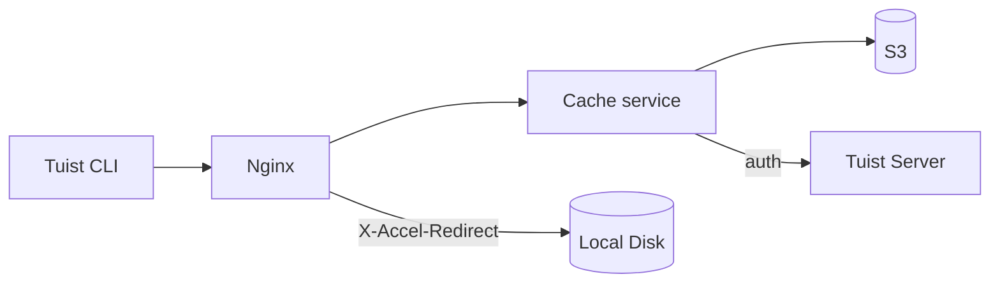
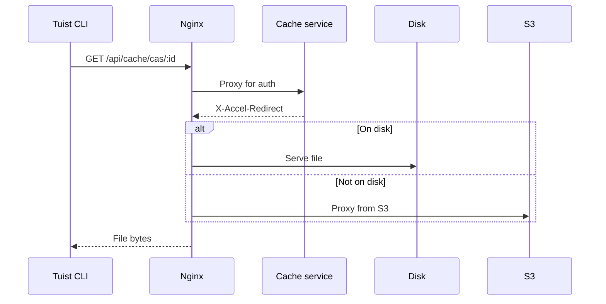
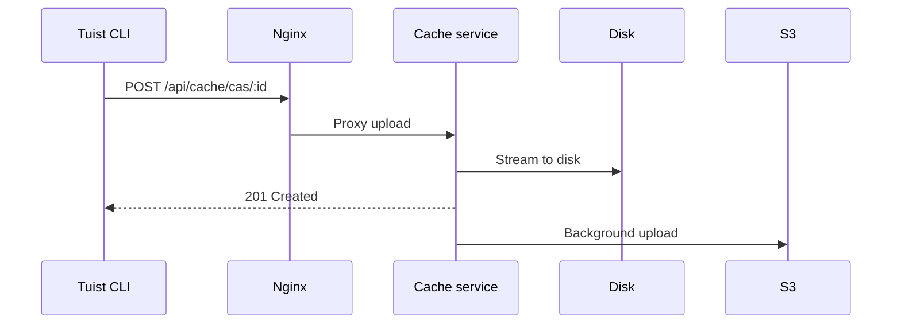

---
{
  "title": "არქიტექტურა",
  "titleTemplate": ":title | კეში | სახელმძღვანელოები | Tuist",
  "description": "გაიგეთ მეტი Tuist-ის ქეშის სერვისის არქიტექტურის შესახებ."
}
---

# ქეშის არქიტექტურა {#cache-architecture}

> [!NOTE]
> ეს გვერდი აღწერს Tuist ქეშის სერვისის არქიტექტურის ტექნიკურ მიმოხილვას. ის ძირითადად განკუთვნილია **თვითმასპინძელი მომხმარებლებისთვის** და **კონტრიბუტორებისთვის**, ვისაც სჭირდება სერვისის შიდა მუშაობის გაგება. ჩვეულებრივ მომხმარებლებს, რომლებიც მხოლოდ ქეშის გამოყენება სურთ, ამის წაკითხვა არ სჭირდებათ.

Tuist ქეშის სერვისი არის დამოუკიდებელი სერვისი, რომელიც უზრუნველყოფს ბილდის არტიფაქტებისთვის შინაარსზე დაფუძნებულ საცავს (CAS) და გასაღები-მნიშვნელობის საცავს ქეშის მეტამონაცემებისთვის.

## მიმოხილვა {#overview}

სერვისი იყენებს ორდონიან საცავის არქიტექტურას პლიუს ადგილობრივ SQLite მეტამონაცემებს:

- **ადგილობრივი დისკი**: ძირითადი საცავი დაბალი ლატენტობის ქეშში არსებული მონაცემებისთვის
- **S3**: გამძლე საცავი, რომელიც ინახავს არტიფაქტებს და საშუალებას აძლევს აღდგენას ევიქციის შემდეგ
- **SQLite**: ადგილობრივი მეტამონაცემები არტიფაქტებზე წვდომის თვალყურის დევნისთვის, ობობების გასუფთავებისთვის, ფონური სამუშაოებისთვის და გასაღები-მნიშვნელობის ქეშის მონაცემებისთვის

## კომპონენტები {#components}

### Nginx {#nginx}

Nginx ემსახურება როგორც შესასვლელი წერტილი და უზრუნველყოფს ფაილების ეფექტურ მიწოდებას `X-Accel-Redirect`-ის გამოყენებით:

- **ჩამოტვირთვები**: ქეშის სერვისი ამოწმებს ავთენტიკაციას, შემდეგ აბრუნებს `X-Accel-Redirect` ჰედერს. Nginx უშუალოდ ემსახურება ფაილს დისკიდან ან პროქსირებს S3-დან.
- **ატვირთვები**: Nginx პროქსირებს მოთხოვნებს ქეშის სერვისზე, რომელიც ნაკადურად წერს მონაცემებს დისკზე.

### შინაარსზე დაფუძნებული საცავი {#cas}

არტიფაქტები ინახება ადგილობრივ დისკზე დაშლილი დირექტორიების სტრუქტურაში:

- **გზა**: `{account}/{project}/cas/{shard1}/{shard2}/{artifact_id}`
- **დაშლა**: არტიფაქტის ID-ის პირველი ოთხი სიმბოლო ქმნის ორდონიან დაშლას (მაგ., `ABCD1234` → `AB/CD/ABCD1234`)

### SQLite მეტამონაცემები {#sqlite}

ქეშის სერვისი იყენებს ორ SQLite მონაცემთა ბაზას:

- **ძირითადი მეტამონაცემების ბაზა**: ინახავს `cache_artifacts`, ობობების სკანირების კურსორებს, Oban სამუშაოებს და სხვა სერვისის მეტამონაცემებს.
- **გასაღები-მნიშვნელობის ბაზა**: ინახავს `key_value_entries` და `key_value_entry_hashes` ცალკეულ SQLite ფაილში.

გასაღები-მნიშვნელობის საცავი გამოყოფილია საკუთარ ბაზაში, რათა შეძლოს SQLite ინკრემენტული ავტო-ვაკუუმის გამოყენება არტიფაქტების მეტამონაცემებზე და ობობების გასუფთავების მდგომარეობაზე გავლენის გარეშე.

### S3 ინტეგრაცია {#s3}

S3 უზრუნველყოფს გამძლე საცავს:

- **ფონური ატვირთვები**: დისკზე ჩაწერის შემდეგ, არტიფაქტები რიგში დგებიან S3-ზე ატვირთვისთვის ფონური სამუშაოს მეშვეობით, რომელიც ყოველ წუთში მუშაობს
- **მოთხოვნისამებრ ჰიდრატაცია**: როდესაც ადგილობრივი არტიფაქტი არ არის, მოთხოვნა უმალვე ემსახურება ხელმოწერილი S3 URL-ის მეშვეობით, ხოლო არტიფაქტი რიგში დგება ადგილობრივ დისკზე ფონური ჩამოტვირთვისთვის

### დისკის ევიქცია {#eviction}

სერვისი მართავს დისკის სივრცეს რამდენიმე ფონური პროცესის გამოყენებით:

- **CAS დისკის ევიქცია** იყენებს LRU სემანტიკას, რომელსაც უზრუნველყოფს `cache_artifacts`
- როდესაც დისკის გამოყენება აღემატება 85%-ს, უძველესი არტიფაქტები იშლება, სანამ გამოყენება 70%-მდე არ ჩამოვა
- არტიფაქტები რჩებიან S3-ში ადგილობრივი ევიქციის შემდეგ
- **KV ევიქცია** შლის ძველ გასაღები-მნიშვნელობის ჩანაწერებს შენახვის პოლიტიკის მიხედვით და ასევე შეუძლია შეამციროს ცალკეული KV ბაზა, როდესაც ის გადააჭარბებს მის კონფიგურირებულ ზომის ბიუჯეტს

### ობობების გასუფთავება {#orphan-cleanup}

სერვისი ასევე აწარმოებს ობობების გასუფთავების სამუშაოს დისკის არტიფაქტებისთვის:

- ის სკანირებს საცავის ხეს ფაილებისთვის, რომლებიც არსებობენ დისკზე, მაგრამ არ აქვთ შესაბამისი `cache_artifacts` ჩანაწერი.
- ეს შეიძლება მოხდეს, თუ ფაილი ჩაიწერა დისკზე, მაგრამ მეტამონაცემების ჩაწერა დაიკარგა SQLite ბუფერის გასუფთავების დასრულებამდე.
- უსაფრთხოების ფანჯარაზე ახალი ფაილები იგნორირდება, რათა თავიდან იქნას აცილებული კონკურენცია მიმდინარე ატვირთვებთან.
- თუ ობობა წაიშლება და მოგვიანებით კვლავ მოითხოვენ, შემდეგი ქეშში არყოფნა გამოიწვევს მის ხელახლა ატვირთვას, რითაც სისტემა თვითაღდგენას ახდენს.

### ავთენტიკაცია {#authentication}

ქეში ავთენტიკაციას ანიჭებს Tuist სერვერს `/api/projects` endpoint-ის გამოძახებით და შედეგების ქეშში შენახვით (10 წუთი წარმატებისთვის, 3 წამი შეცდომისთვის).

## მოთხოვნების ნაკადები {#request-flows}

### ჩამოტვირთვა {#download-flow}

### ატვირთვა {#upload-flow}

## API ბოლოწერტილები {#api-endpoints}

| ბოლოწერტილი | მეთოდი | აღწერა |
|----------|--------|-------------|
| `/up` | GET | ჯანმრთელობის შემოწმება |
| `/metrics` | GET | Prometheus მეტრიკები |
| `/api/cache/cas/:id` | GET | CAS არტიფაქტის ჩამოტვირთვა |
| `/api/cache/cas/:id` | POST | CAS არტიფაქტის ატვირთვა |
| `/api/cache/keyvalue/:cas_id` | GET | გასაღები-მნიშვნელობის ჩანაწერის მიღება |
| `/api/cache/keyvalue` | PUT | გასაღები-მნიშვნელობის ჩანაწერის შენახვა |
| `/api/cache/module/:id` | HEAD | შემოწმება, არსებობს თუ არა მოდულის არტიფაქტი |
| `/api/cache/module/:id` | GET | მოდულის არტიფაქტის ჩამოტვირთვა |
| `/api/cache/module/start` | POST | მრავალნაწილიანი ატვირთვის დაწყება |
| `/api/cache/module/part` | POST | ნაწილის ატვირთვა |
| `/api/cache/module/complete` | POST | მრავალნაწილიანი ატვირთვის დასრულება |
