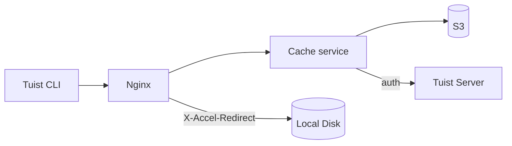
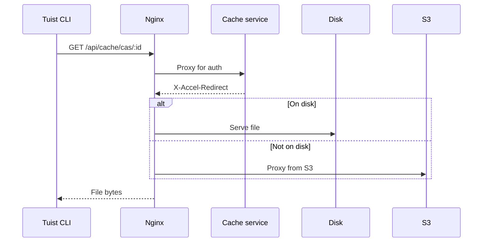
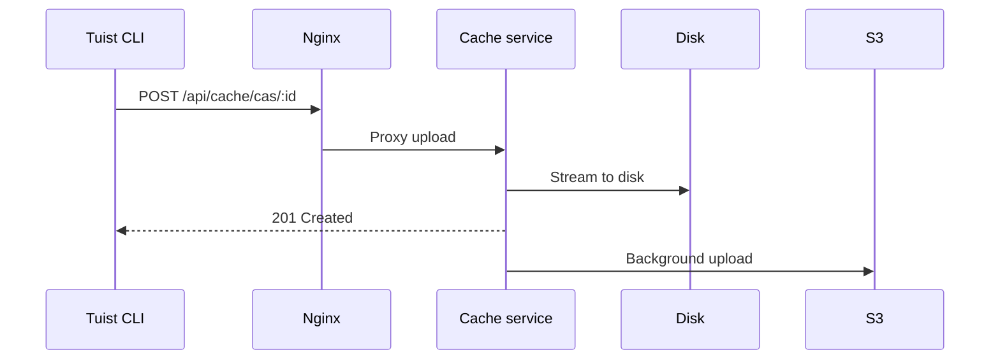

---
{
  "title": "არქიტექტურა",
  "titleTemplate": ":title | კეში | სახელმძღვანელოები | Tuist",
  "description": "გაიგეთ მეტი Tuist-ის ქეშის სერვისის არქიტექტურის შესახებ."
}
---

# ქეშის არქიტექტურა {#cache-architecture}

> [!NOTE]
> ეს გვერდი წარმოადგენს Tuist-ის ქეშის სერვისის არქიტექტურის ტექნიკურ მიმოხილვას. ის ძირითადად განკუთვნილია **თვითმასპინძელი მომხმარებლებისთვის** და **წვლილის შემტანებისთვის**, ვისაც სჭირდება სერვისის შიდა მუშაობის გაგება. ჩვეულებრივ მომხმარებლებს, რომლებიც მხოლოდ ქეშის გამოყენებას აპირებენ, ამის წაკითხვა არ სჭირდებათ.

Tuist-ის ქეშის სერვისი არის დამოუკიდებელი სერვისი, რომელიც უზრუნველყოფს ბილდის არტიფაქტებისთვის კონტენტზე დაფუძნებულ საცავს (CAS) და საკვანძო-მნიშვნელობის საცავს ქეშის მეტამონაცემებისთვის.

## მიმოხილვა {#overview}

სერვისი იყენებს ორდონიანი შენახვის არქიტექტურას პლიუს ლოკალურ SQLite მეტამონაცემებს:

- **ლოკალური დისკი**: ძირითადი საცავი დაბალი ლატენტობის ქეშში არყოფნის თავიდან ასაცილებლად
- **S3**: გამძლე საცავი, რომელიც ინახავს არტიფაქტებს და საშუალებას იძლევა აღდგენის ევიქციის შემდეგ
- **SQLite**: ლოკალური მეტამონაცემები არტიფაქტებზე წვდომის თვალყურის დევნების, ობიექტების გასუფთავების, ფონური სამუშაოების და საკვანძო-მნიშვნელობის ქეშის მონაცემებისთვის

## კომპონენტები {#components}

### Nginx {#nginx}

Nginx ემსახურება როგორც შესვლის წერტილი და უზრუნველყოფს ფაილების ეფექტურ მიწოდებას `X-Accel-Redirect`-ის გამოყენებით:

- **ჩამოტვირთვები**: ქეშის სერვისი ამოწმებს ავთენტიკაციას, შემდეგ აბრუნებს `X-Accel-Redirect` ჰედერს. Nginx პირდაპირ დისკიდან აწვდის ფაილს ან S3-დან პროქსირებს.
- **ატვირთვები**: Nginx პროქსირებს მოთხოვნებს ქეშის სერვისზე, რომელიც მონაცემებს დისკზე ნაკადავად წერს.

### კონტენტზე დაფუძნებული საცავი {#cas}

არტიფაქტები ინახება ლოკალურ დისკზე დაშლილი დირექტორიული სტრუქტურით:

- **გზა**: `{account}/{project}/cas/{shard1}/{shard2}/{artifact_id}`
- **დაშლა**: არტიფაქტის ID-ის პირველი ოთხი სიმბოლო ქმნის ორდონიან დაშლას (მაგ., `ABCD1234` → `AB/CD/ABCD1234`)

### SQLite მეტამონაცემები {#sqlite}

ქეშის სერვისი იყენებს ორ SQLite მონაცემთა ბაზას:

- **ძირითადი მეტამონაცემების ბაზა**: ინახავს `cache_artifacts`-ს, ობიექტების სკანირების კურსორებს, Oban სამუშაოებს და სხვა სერვისის მეტამონაცემებს.
- **საკვანძო-მნიშვნელობის ბაზა**: ინახავს `key_value_entries`-ს და `key_value_entry_hashes`-ს ცალკეულ SQLite ფაილში.

საკვანძო-მნიშვნელობის საცავი გამოყოფილია საკუთარ ბაზაში, რათა შეძლოს SQLite ინკრემენტული ავტო-ვაკუუმის გამოყენება არტიფაქტების მეტამონაცემებისა და ობიექტების გასუფთავების მდგომარეობაზე ზემოქმედების გარეშე.

### S3 ინტეგრაცია {#s3}

S3 უზრუნველყოფს გამძლე შენახვას:

- **ფონური ატვირთვები**: დისკზე ჩაწერის შემდეგ, არტიფაქტები რიგში დგებიან S3-ზე ატვირთვისთვის ფონური სამუშაოს მეშვეობით, რომელიც ყოველ წუთს მუშაობს
- **მოთხოვნით ჰიდრატაცია**: როდესაც ლოკალური არტიფაქტი არ არის, მოთხოვნა მყისიერად ემსახურება ხელმოწერილი S3 URL-ის მეშვეობით, ხოლო არტიფაქტი რიგში დგება ლოკალურ დისკზე ფონური ჩამოტვირთვისთვის

### დისკის ევიქცია {#eviction}

სერვისი მართავს დისკის სივრცეს მრავალი ფონური პროცესის გამოყენებით:

- **CAS დისკის ევიქცია** იყენებს LRU სემანტიკას, რომელიც ეყრდნობა `cache_artifacts`-ს
- როდესაც დისკის გამოყენება 85%-ს აღემატება, უძველესი არტიფაქტები იშლება, სანამ გამოყენება 70%-მდე არ დაეცემა
- არტიფაქტები რჩება S3-ში ლოკალური ევიქციის შემდეგ
- **KV ევიქცია** შლის ძველ საკვანძო-მნიშვნელობის ჩანაწერებს შენახვის პოლიტიკის მიხედვით და ასევე შეუძლია შეამციროს ცალკეული KV ბაზა, როდესაც ის გადააჭარბებს მის კონფიგურირებულ ზომის ლიმიტს

### ობიექტების გასუფთავება {#orphan-cleanup}

სერვისი ასევე აწარმოებს ობიექტების გასუფთავების ფონურ სამუშაოს დისკის არტიფაქტებისთვის:

- ის სკანირებს შენახვის ხეს ფაილებისთვის, რომლებიც არსებობენ დისკზე, მაგრამ არ აქვთ შესაბამისი `cache_artifacts` ჩანაწერი.
- ეს შეიძლება მოხდეს, თუ ფაილი ჩაიწერა დისკზე, მაგრამ მეტამონაცემების ჩაწერა დაიკარგა SQLite ბუფერის გასუფთავების დასრულებამდე.
- უსაფრთხოების ფანჯარაზე ახალი ფაილები იგნორირდება, რათა თავიდან აიცილოს კონკურენცია მიმდინარე ატვირთვებთან.
- თუ ობიექტი წაიშალა და მოგვიანებით კვლავ მოითხოვეს, შემდეგი ქეშში არყოფნა გამოიწვევს მის ხელახლა ატვირთვას, რითაც სისტემა თვითაღდგენას ახდენს.

### ავთენტიკაცია {#authentication}

ქეში ავთენტიკაციას ანიჭებს Tuist სერვერს `/api/projects` ბოლოწერტილის გამოძახებით და შედეგების ქეშში შენახვით (10 წუთი წარმატებისთვის, 3 წამი შეცდომისთვის).

## მოთხოვნების ნაკადები {#request-flows}

### ჩამოტვირთვა {#download-flow}

### ატვირთვა {#upload-flow}

## API ბოლოწერტილები {#api-endpoints}

| ბოლოწერტილი | მეთოდი | აღწერა |
|----------|--------|-------------|
| `/up` | GET | ჯანმრთელობის შემოწმება |
| `/metrics` | GET | Prometheus მეტრიკები |
| `/api/cache/cas/:id` | GET | CAS არტიფაქტის ჩამოტვირთვა |
| `/api/cache/cas/:id` | POST | CAS არტიფაქტის ატვირთვა |
| `/api/cache/keyvalue/:cas_id` | GET | საკვანძო-მნიშვნელობის ჩანაწერის მიღება |
| `/api/cache/keyvalue` | PUT | საკვანძო-მნიშვნელობის ჩანაწერის შენახვა |
| `/api/cache/module/:id` | HEAD | შემოწმება, არსებობს თუ არა მოდულის არტიფაქტი |
| `/api/cache/module/:id` | GET | მოდულის არტიფაქტის ჩამოტვირთვა |
| `/api/cache/module/start` | POST | მრავალნაწილიანი ატვირთვის დაწყება |
| `/api/cache/module/part` | POST | ნაწილის ატვირთვა |
| `/api/cache/module/complete` | POST | მრავალნაწილიანი ატვირთვის დასრულება |
