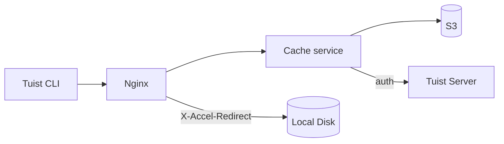
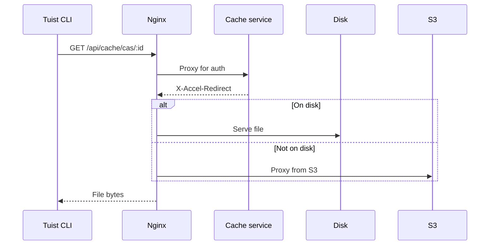
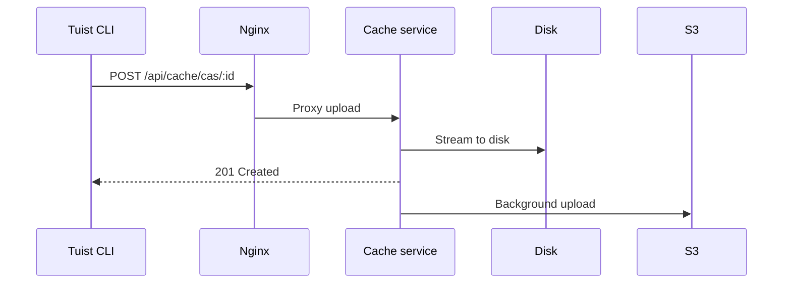

---
{
  "title": "არქიტექტურა",
  "titleTemplate": ":title | ქეში | სახელმძღვანელოები | Tuist",
  "description": "შეიტყვეთ მეტი Tuist-ის ქეშის სერვისის არქიტექტურის შესახებ."
}
---

# ქეშის არქიტექტურა {#cache-architecture}

> [!NOTE]
> ეს გვერდი ტექნიკურად აღწერს Tuist-ის ქეშის სერვისის არქიტექტურას. ის ძირითადად განკუთვნილია **თვითმასპინძელი მომხმარებლებისთვის** და **მოწყობის მონაწილეებისთვის**, ვისაც სჭირდება სერვისის შიდა მუშაობის გაგება. ჩვეულებრივ მომხმარებლებს, რომლებიც მხოლოდ ქეშის გამოყენება სურთ, ამის წაკითხვა არ სჭირდებათ.

Tuist-ის ქეშის სერვისი დამოუკიდებელი სერვისია, რომელიც უზრუნველყოფს ბილდის არტეფაქტებისთვის კონტენტზე მიმართულ საცავს (CAS) და გასაღები-მნიშვნელობის საცავს ქეშის მეტამონაცემებისთვის.

## მიმოხილვა {#overview}

სერვისი იყენებს ორდონიან საცავის არქიტექტურას და ადგილობრივ SQLite მეტამონაცემებს:

- **ადგილობრივი დისკი**: პირველადი საცავი დაბალი ლატენტური ქეშში არყოფნისთვის
- **S3**: გამძლე საცავი, რომელიც ინახავს არტეფაქტებს და საშუალებას იძლევა აღდგენის ევიქციის შემდეგ
- **SQLite**: ადგილობრივი მეტამონაცემები არტეფაქტებზე წვდომის თვალყურის დევნისთვის, ობიექტების გასუფთავებისთვის, ფონური სამუშაოებისთვის და გასაღები-მნიშვნელობის ქეშის მონაცემებისთვის

## კომპონენტები {#components}

### Nginx {#nginx}

Nginx ემსახურება როგორც შესვლის წერტილი და უზრუნველყოფს ფაილების ეფექტურ მიწოდებას `X-Accel-Redirect`-ის გამოყენებით:

- **ჩამოტვირთვები**: ქეშის სერვისი ამოწმებს ავთენტიკაციას, შემდეგ აბრუნებს `X-Accel-Redirect` ჰედერს. Nginx პირდაპირ ემსახურება ფაილს დისკიდან ან პროქსირებს S3-დან.
- **ატვირთვები**: Nginx პროქსირებს მოთხოვნებს ქეშის სერვისთან, რომელიც ნაკადად გადასცემს მონაცემებს დისკზე.

### კონტენტზე მიმართული საცავი {#cas}

არტეფაქტები ინახება ადგილობრივ დისკზე დაშლილი დირექტორიების სტრუქტურაში:

- **გზა**: `{account}/{project}/cas/{shard1}/{shard2}/{artifact_id}`
- **დაშლა**: არტეფაქტის ID-ის პირველი ოთხი სიმბოლო ქმნის ორდონიან დაშლას (მაგ., `ABCD1234` → `AB/CD/ABCD1234`)

### SQLite მეტამონაცემები {#sqlite}

ქეშის სერვისი იყენებს ორ SQLite მონაცემთა ბაზას:

- **ძირითადი მეტამონაცემების ბაზა**: ინახავს `cache_artifacts`, ობიექტების სკანირების კურსორებს, Oban სამუშაოებს და სხვა სერვისის მეტამონაცემებს.
- **გასაღები-მნიშვნელობის ბაზა**: ინახავს `key_value_entries` და `key_value_entry_hashes` ცალკეულ SQLite ფაილში.

გასაღები-მნიშვნელობის საცავი გამოყოფილია საკუთარ ბაზაში, რათა შეძლოს SQLite-ის ინკრემენტული ავტო-ვაკუუმის გამოყენება არტეფაქტების მეტამონაცემებისა და ობიექტების გასუფთავების მდგომარეობაზე გავლენის გარეშე.

### S3 ინტეგრაცია {#s3}

S3 უზრუნველყოფს გამძლე საცავს:

- **ფონური ატვირთვები**: დისკზე ჩაწერის შემდეგ, არტეფაქტები ეყენებიან რიგში S3-ზე ატვირთვისთვის ფონური სამუშაოს მეშვეობით, რომელიც ყოველ წუთში მუშაობს
- **მოთხოვნისამებრ ჰიდრატაცია**: როდესაც ადგილობრივი არტეფაქტი არ არის, მოთხოვნა მყისიერად ემსახურება წინასწარ ხელმოწერილი S3 URL-ის მეშვეობით, ხოლო არტეფაქტი ეყენება რიგში ადგილობრივ დისკზე ფონური ჩამოტვირთვისთვის

### დისკის ევიქცია {#eviction}

სერვისი მართავს დისკის სივრცეს რამდენიმე ფონური პროცესის გამოყენებით:

- **CAS დისკის ევიქცია** იყენებს LRU სემანტიკას, რომელიც ეყრდნობა `cache_artifacts`-ს
- როდესაც დისკის გამოყენება აღემატება 85%-ს, უძველესი არტეფაქტები იშლება, სანამ გამოყენება არ ჩამოვა 70%-მდე
- არტეფაქტები რჩებიან S3-ში ადგილობრივი ევიქციის შემდეგ
- **KV ევიქცია** შლის ძველ გასაღები-მნიშვნელობის ჩანაწერებს შენახვის პოლიტიკის მიხედვით და ასევე შეუძლია შეამციროს ცალკეული KV ბაზა, როდესაც ის აღემატება კონფიგურირებულ ზომის ლიმიტს

### ობიექტების გასუფთავება {#orphan-cleanup}

სერვისი ასევე აწარმოებს ობიექტების გასუფთავების ფონურ სამუშაოს დისკის არტეფაქტებისთვის:

- ის სკანირებს საცავის ხეს ფაილებისთვის, რომლებიც არსებობენ დისკზე, მაგრამ არ აქვთ შესაბამისი `cache_artifacts` ჩანაწერი.
- ეს შეიძლება მოხდეს, თუ ფაილი ჩაიწერა დისკზე, მაგრამ მეტამონაცემების ჩაწერა დაიკარგა SQLite ბუფერის გასუფთავების დასრულებამდე.
- უსაფრთხოების ფანჯარაზე უფრო ახალი ფაილები იგნორირდება, რათა თავიდან ავიცილოთ კონკურენცია მიმდინარე ატვირთვებთან.
- თუ ობიექტი წაიშალა და მოგვიანებით კვლავ მოითხოვეს, შემდეგი ქეშში არყოფნა გამოიწვევს მის ხელახლა ატვირთვას, რითაც სისტემა თვითაღდგენას ახდენს.

### ავთენტიკაცია {#authentication}

ქეში ავთენტიკაციას ანიჭებს Tuist სერვერს `/api/projects` endpoint-ის გამოძახებით და შედეგების ქეშირებით (10 წუთი წარმატებისთვის, 3 წამი შეცდომისთვის).

## მოთხოვნების ნაკადები {#request-flows}

### ჩამოტვირთვა {#download-flow}

### ატვირთვა {#upload-flow}

## API წერტილები {#api-endpoints}

| წერტილი | მეთოდი | აღწერა |
|----------|--------|-------------|
| `/up` | GET | ჯანმრთელობის შემოწმება |
| `/metrics` | GET | Prometheus მეტრიკები |
| `/api/cache/cas/:id` | GET | CAS არტეფაქტის ჩამოტვირთვა |
| `/api/cache/cas/:id` | POST | CAS არტეფაქტის ატვირთვა |
| `/api/cache/keyvalue/:cas_id` | GET | გასაღები-მნიშვნელობის ჩანაწერის მიღება |
| `/api/cache/keyvalue` | PUT | გასაღები-მნიშვნელობის ჩანაწერის შენახვა |
| `/api/cache/module/:id` | HEAD | შემოწმება, არსებობს თუ არა მოდულის არტეფაქტი |
| `/api/cache/module/:id` | GET | მოდულის არტეფაქტის ჩამოტვირთვა |
| `/api/cache/module/start` | POST | მრავალნაწილიანი ატვირთვის დაწყება |
| `/api/cache/module/part` | POST | ნაწილის ატვირთვა |
| `/api/cache/module/complete` | POST | მრავალნაწილიანი ატვირთვის დასრულება |
