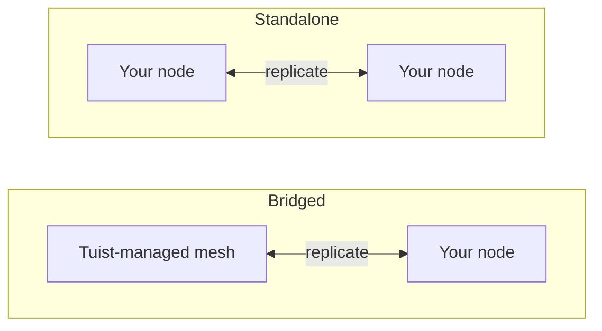

---
{
  "title": "თავად განთავსება",
  "titleTemplate": ":title | Cache | Guides | Tuist",
  "description": "გაიგეთ, როგორ განათავსოთ Tuist-ის ქეშის კვანძები საკუთარ ინფრასტრუქტურაში და შეუერთდეთ Tuist-ის მიერ მართულ mesh-ქსელს."
}
---

# კეშის საკუთარი ინფრასტრუქტურაზე განთავსება {#self-host-cache}

Tuist-ის კეში მუშაობს როგორც **კვანძების ქსელი**, რომლებიც ერთმანეთთან არეპლიცირებენ არტიფაქტებს. შეგიძლიათ გაუშვათ საკუთარი კეშის კვანძები თქვენს ინფრასტრუქტურაზე, რათა კეში იყოს თქვენი დეველოპერებისა და CI-ის გვერდით, რაც ამცირებს ქსელურ მანძილს, რომელიც სხვა შემთხვევაში შეამცირებდა იმ სიჩქარეს, რომლის უზრუნველყოფაც კეშირებას უნდა.

საკუთარ ინფრასტრუქტურაზე განთავსებული კვანძი არის ერთი კონტეინერი (`ghcr.io/tuist/kura`), რომელიც ინახავს არტიფაქტებს ლოკალურ დისკზე და, როდესაც ის უერთდება პირის ქსელს, ელაპარაკება ამ ქსელის დანარჩენ ნაწილს შიდა პირის პორტის მეშვეობით. Tuist მოქმედებს როგორც **მართვის სიბრტყე**: ის ახდენს ტრაფიკის ავთენტიკაციას, უზრუნველყოფს მართული კეშის ტევადობას და ზომავს გამოყენებას. ის არასდროს უშვებს ხელს თქვენს კვანძებში.

> [!NOTE]
> კეშის კვანძების საკუთარ ინფრასტრუქტურაზე განთავსება მოითხოვს **Enterprise გეგმას**.
>
> კვანძები უერთდებიან ან ჰოსტინგულ Tuist სერვერს (`https://tuist.dev`) ან საკუთარ ინფრასტრუქტურაზე განთავსებულ Tuist სერვერს. Tuist სერვერის საკუთარ ინფრასტრუქტურაზე განთავსება მოითხოვს ცალკე სერვერის ლიცენზიას. იხილეთ <.localized_link href="/guides/server/self-host/server">სერვერის საკუთარ ინფრასტრუქტურაზე განთავსების სახელმძღვანელო</.localized_link>.

## ორი ტოპოლოგია {#topologies}

საკუთარ ინფრასტრუქტურაზე განთავსებული კვანძების გაშვების ორი გზა არსებობს და რომელს მიიღებთ, მთლიანად დამოკიდებულია იმაზე, მუშაობს თუ არა თქვენს ანგარიშზე ასევე **Tuist-ის მიერ მართული** კეშის რეგიონი.

### ხიდური: Tuist-ის მიერ ჰოსტინგული ქსელი + თქვენი კვანძები {#topology-bridged}

თქვენს ანგარიშზე მუშაობს მინიმუმ ერთი Tuist-ის მიერ მართული კეშის რეგიონი და თქვენი საკუთარ ინფრასტრუქტურაზე განთავსებული კვანძები **უერთდებიან ამ ქსელს**. თქვენს კვანძებზე ჩაწერები მუდმივად ვრცელდება მართულ ქსელში და კვანძი თბება მართული ქსელის არსებული კეშიდან, როდესაც ის უერთდება. ეს უზრუნველყოფს დაბალი ლატენტობის კეშს თქვენს რანერებთან (რომლებიც ასრულებენ ჩაწერების უმეტესობას), ხოლო მათი ჩაწერები კვებავს საერთო კეშს. გაითვალისწინეთ, რომ ახალი არტიფაქტები, რომლებიც ჩაიწერება მართული ქსელის სხვა ნაწილში **მას შემდეგ**, რაც კვანძი უკვე შეუერთდა, ჯერ კიდევ არ ვრცელდება მუდმივად მისკენ; ეს დაგეგმილი გაუმჯობესებაა.

ეს არის სწორი არჩევანი, როდესაც გსურთ on-prem კეშის სიჩქარე, მაგრამ არ გსურთ უარი თქვათ საერთო, მუდმივად ჩართულ მართულ კეშზე.

### დამოუკიდებელი: მხოლოდ თქვენი კვანძები {#topology-standalone}

თქვენს ანგარიშზე **არ** მუშაობს მართული კეშის რეგიონი. თქვენი კვანძები ქმნიან საკუთარ იზოლირებულ ქსელს თქვენს ინფრასტრუქტურაზე. Tuist-მა კვლავ იცის, რომ თქვენი კვანძები არსებობენ (ასე რომ, გამოყენება იზომება), მაგრამ **მონაცემები არ იცვლება Tuist-ის მიერ მართულ ქსელთან**, რადგან ასეთი არ არსებობს. პირის წევრობა და რეპლიკაცია ხდება მთლიანად თქვენს კვანძებში.



კონფიგურაციის მთავარი განსხვავება ის არის, რომ **ხიდური** ტოპოლოგია იყენებს **რეგისტრაციას**, სადაც კვანძი ბუტის დროს ქმნის თავის გასაღებო წყვილს და Tuist გასცემს მის ქსელურ სერტიფიკატს, ხოლო **დამოუკიდებელ** ტოპოლოგიას არ აქვს Tuist-ის მიერ გაცემული ქსელური სერტიფიკატი. ერთი დამოუკიდებელი კვანძი შეიძლება მუშაობდეს გამორთული პირის TLS-ით; მრავალკვანძიანი დამოუკიდებელი ქსელი იყენებს თქვენს მიერ მოწოდებულ პირის TLS მასალას.

## CLI ბოლოწერტილის კონფიგურაცია {#cli-endpoint}

Tuist-ის მართული კეში იყენებს `https://<account>.cache.tuist.dev`. საკუთარ ინფრასტრუქტურაზე განთავსებული Tuist სერვერით, CLI იღებს კეშის URL-ს სერვერის `TUIST_CACHE_ENDPOINTS` პარამეტრიდან. დააყენეთ ის თქვენი მთავარი კეშის სერვერის ან დატვირთვის ბალანსერის URL-ზე. თუ ის შეიცავს რამდენიმე URL-ს, გამოიყენება პირველი.

როდესაც კერძო/მორგებულ კეშის კვანძებს უერთებთ **ჰოსტინგულ Tuist სერვერთან**, კონფიგურირეთ ცალსახა ბოლოწერტილი დეველოპერის გარსებში და CI-ში:

```sh
export TUIST_CACHE_ENDPOINT=https://cache.example.com
```

ეს გადაფარვა აქვს უპირატესობა ნებისმიერი ტიპის სერვერზე და არის არასავალდებულო საკუთარ ინფრასტრუქტურაზე განთავსებული Tuist სერვერისთვის. Xcode კეშის დემონისთვის, ხელახლა გაუშვით `tuist setup cache` მისი დაყენების შემდეგ, რათა LaunchAgent-მა მიიღოს განახლებული გარემო. რამდენიმე კვანძისთვის, გამოიყენეთ თქვენი დატვირთვის ბალანსერი ან DNS მარშრუტიზაციის სახელი.

## წინაპირობები {#prerequisites}


- Docker და Docker Compose (ან ნებისმიერი კონტეინერის გარემო)
- მოქმედი Tuist სერვერი (ჰოსტინგული ან საკუთარ ინფრასტრუქტურაზე განთავსებული)
- დისკი კეშისთვის. ხიდური კვანძი იღებს ანგარიშის **მთელ** ქსელს პირველი შეერთებისას, ასე რომ, შესაბამისად გაზარდეთ მონაცემთა ტომის ზომა.

## მართვის სიბრტყის კლიენტის უზრუნველყოფა {#control-plane-client}

კვანძი იყენებს მართვის სიბრტყის კლიენტის სარწმუნოებებს კეშის მოთხოვნების ავთენტიკაციისთვის (ტოკენის ინტროსპექცია), სადაშბორდოზე ანგარიშგებისთვის და გამოყენების მიწოდებისთვის. ეს **არ** არის ის გზა, რომლითაც კლიენტები მიემართებიან თქვენს კვანძებთან საკუთარ ინფრასტრუქტურაზე განთავსებულ Tuist სერვერზე (იხილეთ [როგორ აღწევენ კლიენტები თქვენს კვანძებთან](#routing)).

სრულად საკუთარ ინფრასტრუქტურაზე განთავსებული განლაგებისთვის, შექმენით **UUID კლიენტის ID** და შემთხვევითი საიდუმლო, შემდეგ კი კონფიგურირეთ იგივე წყვილი Tuist სერვერზე და თითოეულ Kura კვანძზე:

```bash
KURA_CONTROL_PLANE_CLIENT_ID="$(uuidgen | tr '[:upper:]' '[:lower:]')"
KURA_CONTROL_PLANE_CLIENT_SECRET="$(openssl rand -base64 32)"
```

დააყენეთ ეს მნიშვნელობები როგორც `KURA_CONTROL_PLANE_CLIENT_ID` და `KURA_CONTROL_PLANE_CLIENT_SECRET` Tuist სერვერის გარემოში, შემდეგ კი გამოიყენეთ იგივე მნიშვნელობები ქვემოთ მოცემულ Kura კონფიგურაციაში. რეგისტრაციის პულსები მოიცავს `KURA_TENANT_ID`-ს, ანგარიშის მუდმივ კეშის იდენტობას, რათა სერვერმა მიამაგროს კვანძი სწორ ანგარიშს მაშინაც კი, თუ ანგარიში გადაერქვა.

> [!WARNING]
> კლიენტის ID უნდა იყოს UUID `kura_` პრეფიქსის გარეშე. არა-UUID ID-ები იწვევენ ტოკენის ინტროსპექციის შეცდომას HTTP `400`-ით, მაშინაც კი, თუ სარწმუნოებები ემთხვევა ორივე სერვისზე.

თუ უერთდებით ჰოსტინგულ `tuist.dev` სერვერს, ან თუ გსურთ ანგარიშის მიხედვით სარწმუნოება, რომლის როტაციაც შესაძლებელია UI-დან, გახსენით ანგარიშის **კეში** გვერდი, აირჩიეთ **სარწმუნოების გენერირება** და დააკოპირეთ `client_id` პლუს ერთჯერადი `secret`. ჰოსტინგულ სერვერზე, საკუთარ ინფრასტრუქტურაზე განთავსებული კვანძის სარწმუნოების გენერირება მოითხოვს Enterprise გეგმას.

## აირჩიეთ მუდმივი მომხმარებელი {#permanent-tenant}

`KURA_TENANT_ID` არის მუდმივი საცავისა და პირის იდენტობა, თავდაპირველად მიღებული ანგარიშის თავდაპირველი სახელიდან. ანგარიშისთვის, რომელსაც არასდროს შეუცვლია სახელი, ის ემთხვევა მიმდინარე სახელს. **შეინარჩუნეთ მისი თავდაპირველი მნიშვნელობა ანგარიშის სახელის შეცვლის შემდეგ**, მათ შორის, როდესაც ამატებთ ჩამანაცვლებელ კვანძებს ან სხვა კვანძს იმავე ქსელში. მაგალითად, `original`-ის `renamed`-ად გადაკეთება ტოვებს `KURA_TENANT_ID=original`-ს ყოველ კვანძზე. მისი შეცვლა ირჩევს სხვა ობიექტ-გასაღების სივრცეს; ანგარიშის სახელის შეცვლა არ ახდენს შენახული არტიფაქტების ან პირის იდენტობის მიგრაციას.

ჩაანაცვლეთ `<permanent-kura-tenant>` ქვემოთ მოცემულ მაგალითებში ამ მნიშვნელობით. გამოიყენეთ მომხმარებელი არსებული სწორად კონფიგურირებული კვანძიდან, ან `tenant_id` დაბრუნებული რეგისტრაციის მიერ. საკუთარ ინფრასტრუქტურაზე განთავსებული Tuist სერვერის ოპერატორს შეუძლია შეამოწმოს ანგარიშის `kura_tenant_id` მონაცემთა ბაზის ველი. არ გამოიტანოთ მნიშვნელობა გადაკეთებული ანგარიშის URL-დან.

მოქმედი განლაგების დონის კონტროლის სიბრტყის ავტორიზაციის მონაცემებით, რეგისტრაცია და პირთა აღმოჩენა აბრუნებს **409 Conflict**-ს `error: "tenant_mismatch"`-ით და `expected_tenant_id`-ით, თუ კვანძი წარადგენს მიმდინარე ან შენახულ სახელს, რომელიც განსხვავდება მისი მუდმივი მომხმარებლისგან. ისინი არ აკეთებენ კვანძის რეგისტრაციას ან ფარულად არ ცვლიან საცავის იდენტობას. არასწორი ავტორიზაციის მონაცემები და უცნობი მომხმარებლები მაინც აბრუნებენ **401 Unauthorized**-ს მომხმარებლის გამჟღავნების გარეშე. თუ კვანძმა უკვე ჩაწერა მონაცემები სხვა მომხმარებლით, გადახედეთ მის კონფიგურაციას და საცავის ისტორიას შეცვლამდე; შეცდომის პასუხი არ ასრულებს საცავის მიგრაციას.

## როგორ აღწევს კლიენტები თქვენს კვანძებამდე {#routing}

დააკონფიგურირეთ ქეშის URL [ზემოთ](#cli-endpoint), რათა დეველოპერების მანქანებმა და CI-მ შეძლონ თქვენს კვანძებთან დაკავშირება. დაფისზე თითოეული კვანძის მისამართისა და მზაობის შესატყობინებლად, დააყენეთ `KURA_REGISTRATION_URL` და `KURA_ADVERTISED_HTTP_URL` კვანძზე.

## დაკავშირებული კონფიგურაცია {#bridged-setup}

კვანძი რეგისტრირდება გაშვებისას: ის ადგილობრივად ქმნის გასაღების წყვილს (პირადი გასაღები არასდროს ტოვებს თქვენს ინფრასტრუქტურას), აგზავნის სერთიფიკატის ხელმოწერის მოთხოვნას და იღებს ხელმოწერილ სერთიფიკატს, ანგარიშის CA-ს და მართვადი ქსელის შლეიფის მისამართს. **თქვენ არ უნდა მოაწოდოთ TLS მასალა**. რეგისტრაცია ჩაწერს მას მიმაგრებულ ტომში.

```yaml
# docker-compose.yml
services:
  kura:
    image: ghcr.io/tuist/kura:<version>
    restart: unless-stopped
    ports:
      - "4000:4000"   # HTTP cache: your developers and CI point here
      - "7443:7443"   # mesh peer port
    environment:
      # Enroll and join the managed mesh
      KURA_ENROLL_ON_BOOT: "1"
      KURA_CONTROL_PLANE_URL: "https://tuist.dev"
      KURA_CONTROL_PLANE_CLIENT_ID: "<client_id>"
      KURA_CONTROL_PLANE_CLIENT_SECRET: "<secret>"
      KURA_TENANT_ID: "<permanent-kura-tenant>"

      # Report the node’s address and readiness to the dashboard
      KURA_REGISTRATION_URL: "https://tuist.dev/_internal/kura/mesh/registrations"
      KURA_ADVERTISED_HTTP_URL: "https://kura.acme.internal"   # where your CLI/CI reach the cache
      KURA_NODE_URL: "https://kura.acme.internal:7443"         # this node's peer identity on your network
      KURA_REGION: "office"

      # Ports and storage. KURA_PORT serves both the HTTP cache API and REAPI
      # gRPC (h2c) on one listener. Enrollment writes the TLS files into
      # KURA_INTERNAL_TLS_* on first boot.
      KURA_PORT: "4000"
      KURA_INTERNAL_PORT: "7443"
      KURA_INTERNAL_TLS_CA_CERT_PATH: "/tls/ca.pem"
      KURA_INTERNAL_TLS_CERT_PATH: "/tls/tls.crt"
      KURA_INTERNAL_TLS_KEY_PATH: "/tls/tls.key"
      KURA_DATA_DIR: "/var/cache/kura"
      KURA_TMP_DIR: "/var/cache/kura/tmp"
      KURA_OTEL_SERVICE_NAME: "kura-acme"
      KURA_OTEL_DEPLOYMENT_ENVIRONMENT: "onprem"

      # Authenticate the HTTP cache API. The Tuist hook ships in the image at
      # this path; it introspects each token against the control plane using the
      # control-plane client above, so only valid Tuist tokens for this account
      # can read or write. No JWT verifier secret is involved.
      KURA_AUTH_ENABLED: "1"
      KURA_AUTH_TUIST_URL: "https://tuist.dev"
    volumes:
      - kura-tls:/tls            # empty; enrollment populates it
      - kura-data:/var/cache/kura
volumes:
  kura-tls: {}
  kura-data: {}
```

რასაც თქვენ უზრუნველყოფთ: კონტროლის სიბრტყის კლიენტი, ორი მისამართი (`KURA_NODE_URL`, `KURA_ADVERTISED_HTTP_URL`) თქვენს ქსელში და ორი ცარიელი ჩაწერადი ტომი. ყველაფერი სხვა (გასაღების წყვილი, სერთიფიკატი, ანგარიშის CA და მართვადი ქსელის მისამართი) ავტომატურად ნაწილდება გაშვებისას.

## დამოუკიდებელი კონფიგურაცია {#standalone-setup}

მართვადი რეგიონის არარსებობის შემთხვევაში არ არსებობს Tuist-ის მიერ გამოცემული ქსელის CA, ამიტომ რეგისტრაცია არ მოქმედებს (რეგისტრაციის ბოლოწერტილი აბრუნებს `503 ca_unavailable`). კვანძი იყენებს თქვენს Tuist სერვერს ტოკენის ავტორიზაციისთვის, დაფის რეგისტრაციის პულსაციებისთვის და გამოყენების შესატყობინებლად.

```yaml
# docker-compose.yml for a single node connected to a self-hosted Tuist server
services:
  kura:
    image: ghcr.io/tuist/kura:<version>
    restart: unless-stopped
    ports:
      - "4000:4000"
      - "7443:7443"
    environment:
      KURA_TENANT_ID: "<permanent-kura-tenant>"
      KURA_NODE_URL: "http://kura-1.acme.internal:7443"
      KURA_PEERS: ""   # single node: disable static peer discovery
      KURA_REGION: "office"

      # Authenticate cache requests against the self-hosted Tuist server.
      # Use the same values configured on the Tuist server, or a per-account
      # credential from the Cache page.
      KURA_CONTROL_PLANE_CLIENT_ID: "<client_id>"
      KURA_CONTROL_PLANE_CLIENT_SECRET: "<secret>"
      KURA_AUTH_ENABLED: "1"
      KURA_AUTH_TUIST_URL: "https://tuist.acme.internal"

      # Register the client-facing cache URL with the Tuist server.
      KURA_REGISTRATION_URL: "https://tuist.acme.internal/_internal/kura/mesh/registrations"
      KURA_ADVERTISED_HTTP_URL: "https://kura.acme.internal"

      KURA_PORT: "4000"
      KURA_INTERNAL_PORT: "7443"
      KURA_DATA_DIR: "/var/cache/kura"
      KURA_TMP_DIR: "/var/cache/kura/tmp"
      KURA_OTEL_SERVICE_NAME: "kura-acme"
      KURA_OTEL_DEPLOYMENT_ENVIRONMENT: "onprem"
    volumes:
      - kura-data:/var/cache/kura
volumes:
  kura-data: {}
```

ერთი კვანძისთვის, დატოვეთ პირთა TLS დაუყენებელი და დააყენეთ `KURA_PEERS` ცარიელ სტრიქონად. როდესაც `KURA_PEERS` დაუყენებელია, Kura იწყებს სტატიკურ პირთა აღმოჩენას `KURA_NODE_URL`-დან და პერიოდულად ამოწმებს ამ URL-ის `/_internal/status` ბოლოწერტილს. პირთა TLS-ის გათიშვისას, `KURA_NODE_URL` უნდა იყენებდეს `http://` სქემას მაშინაც კი, თუ კვანძი ხელმისაწვდომია პირადი ქსელის სახელით.

`KURA_CONTROL_PLANE_URL` არ არის საჭირო ამ მაგალითში, რადგან ავტორიზაცია და გამოყენების შემტყობინებელი ორივე იყენებს `KURA_AUTH_TUIST_URL`-ს როგორც Tuist-ის საბაზისო URL-ს. `KURA_ADVERTISED_HTTP_URL` განსაზღვრავს კვანძის კლიენტისთვის ხელმისაწვდომ მისამართს დაფაზე. დააყენეთ `TUIST_CACHE_ENDPOINTS=https://kura.acme.internal` Tuist სერვერზე, რათა CLI იყენებდეს ამ მისამართს ქეშის მოთხოვნებისთვის.

### Kubernetes Helm-ით {#standalone-helm}

თუ თქვენი საკუთარ ინფრასტრუქტურაზე განთავსებული Tuist სერვერი მუშაობს Kubernetes-ზე, დააინსტალირეთ Kura დამოუკიდებელი Kura დიაგრამით და გადაეცით იგივე კონტროლის სიბრტყის პარამეტრები `extraEnv`-ის მეშვეობით. Tuist სერვერის დიაგრამა არ აინსტალირებს ამ Kura დიაგრამას როგორც ქვედიაგრამას.

ჯერ, დააკონფიგურირეთ Tuist სერვერის დიაგრამა განლაგების დონის Kura ავტორიზაციის მონაცემებით:

```yaml
# tuist-values.yaml
server:
  extraEnv:
    - name: KURA_CONTROL_PLANE_CLIENT_ID
      valueFrom:
        secretKeyRef:
          name: kura-control-plane
          key: client-id
    - name: KURA_CONTROL_PLANE_CLIENT_SECRET
      valueFrom:
        secretKeyRef:
          name: kura-control-plane
          key: client-secret
```

შემდეგ დააინსტალირეთ Kura იმავე სივრცეში იგივე Secret-ით:

```yaml
# kura-values.yaml
replicaCount: 1

config:
  tenantId: "<permanent-kura-tenant>"
  region: "office"

ingress:
  enabled: true
  className: nginx
  hosts:
    - host: kura.acme.internal
      paths:
        - path: /
          pathType: Prefix
  tls:
    - hosts:
        - kura.acme.internal
      secretName: kura-tls

extraEnv:
  - name: KURA_CONTROL_PLANE_CLIENT_ID
    valueFrom:
      secretKeyRef:
        name: kura-control-plane
        key: client-id
  - name: KURA_CONTROL_PLANE_CLIENT_SECRET
    valueFrom:
      secretKeyRef:
        name: kura-control-plane
        key: client-secret
  - name: KURA_AUTH_ENABLED
    value: "1"
  - name: KURA_AUTH_TUIST_URL
    value: "https://tuist.acme.internal"
  - name: KURA_REGISTRATION_URL
    value: "https://tuist.acme.internal/_internal/kura/mesh/registrations"
  - name: KURA_ADVERTISED_HTTP_URL
    value: "https://kura.acme.internal"
```

```bash
kubectl create namespace tuist
kubectl -n tuist create secret generic kura-control-plane \
  --from-literal=client-id="<client_id>" \
  --from-literal=client-secret="<secret>"

helm upgrade --install kura oci://ghcr.io/tuist/charts/kura \
  --namespace tuist \
  -f kura-values.yaml
```

თუ Kura მუშაობს სხვა სივრცეში ვიდრე Tuist სერვერი, შექმენით ან გაასინქრონეთ `kura-control-plane` Secret ორივე სივრცეში.

დატოვეთ `extension.enabled` დაუყენებელი, როდესაც იყენებთ გამოსახულებიდან ჩაშენებულ Tuist hook-ს; ეს დიაგრამის მნიშვნელობა განკუთვნილია ConfigMap-იდან მორგებული hook-ის დასამაგრებლად. დიაგრამა აგენერირებს `KURA_NODE_URL`-ს, `KURA_PEERS`-ს, headless სერვისს, მუდმივობას და ზონდებს თქვენთვის. `replicaCount: 1`-ით, გენერირებული პირის URL არის pod-ის საკუთარი სტაბილური DNS სახელი, ამიტომ ის რჩება ხელმისაწვდომი კლასტერის შიგნით და არ იწვევს ზემოთ აღწერილ ერთი კვანძის გაფრთხილებას. მრავალი რეპლიკისთვის, დიაგრამა აგენერირებს პირთა სიას StatefulSet DNS-დან; ჩართეთ `peerTls` და მოაწოდეთ TLS Secret, როდესაც გსურთ mTLS შიდა პირთა სიბრტყეზე.

ერთზე მეტი დამოუკიდებელი კვანძის გასაშვებად, დაამატეთ თქვენი **საკუთარი პირთა TLS**, რომელიც მიმაგრებულია `/tls`-ზე (CA პლიუს leaf სერთიფიკატი და გასაღები თითოეული კვანძისთვის, იზიარებენ CA-ს, რათა კვანძებმა ერთმანეთი ენდონ), შეცვალეთ `KURA_NODE_URL` `https://...:<KURA_INTERNAL_PORT>`-ზე და დაამატეთ `KURA_PEERS`:

```yaml
environment:
  KURA_NODE_URL: "https://kura-1.acme.internal:7443"
  KURA_PEERS: "https://kura-2.acme.internal:7443,https://kura-3.acme.internal:7443"
  KURA_INTERNAL_TLS_CA_CERT_PATH: "/tls/ca.pem"
  KURA_INTERNAL_TLS_CERT_PATH: "/tls/tls.crt"
  KURA_INTERNAL_TLS_KEY_PATH: "/tls/tls.key"
volumes:
  - ./tls:/tls:ro
```

## რა სჭირდება თითოეულ ტოპოლოგიას {#requirements-summary}

| თქვენ უზრუნველყოფთ | დაკავშირებული | დამოუკიდებელი |
|---|---|---|
| კონტროლის სიბრტყის კლიენტი (`client_id` / `secret`) | კი | კი |
| `KURA_NODE_URL` | კი | კი |
| `KURA_ADVERTISED_HTTP_URL` | კი | დაფის რეგისტრაციისთვის; მარშრუტიზაცია ცალკეა (იხილეთ ქვემოთ) |
| მარშრუტიზაცია CLI-მდე | ავტომატური (რეგისტრაცია) | ავტომატური მზა რეგისტრაციის პულსაციებიდან |
| მონაცემები + დროებითი ტომი | კი | კი |
| `KURA_ENROLL_ON_BOOT` | კი | არა (დააბრუნებდა `ca_unavailable`-ს) |
| პირთა TLS (`/tls` CA + leaf) | არა, რეგისტრაცია წერს მას | მხოლოდ მრავალკვანძიანი ქსელისთვის |
| `KURA_PEERS` (პირთა სია) | არა, რეგისტრაცია ავსებს შлюზს | ცარიელი ერთი კვანძისთვის; პირთა URL-ები ერთზე მეტი კვანძისთვის |

## სავალდებულო კონფიგურაცია {#required-config}

ეს ცვლადები აკონფიგურირებენ თითოეულ კვანძს, ტოპოლოგიის მიუხედავად (პირთა TLS არის გამონაკლისი, რომელიც ქვემოთაა აღნიშნული):

| ცვლადი | აღწერა |
|---|---|
| `KURA_TENANT_ID` | თქვენი ანგარიშის მუდმივი Kura მომხმარებელი. შეინახეთ მისი საწყისი მნიშვნელობა ანგარიშის სახელის შეცვლის შემდეგ; იხილეთ [მუდმივი მომხმარებლის არჩევა](#permanent-tenant). |
| `KURA_NODE_URL` | ამ კვანძის პირთა URL თქვენს ქსელში. |
| `KURA_PEERS` | სტატიკური პირთა აღმოჩენის სია. დააყენეთ ის ცარიელ სტრიქონად ერთი დამოუკიდებელი კვანძისთვის; დააყენეთ ხელმისაწვდომი პირთა URL-ები მრავალკვანძიანი ქსელისთვის. |
| `KURA_REGION` | თავისუფალი ფორმატის რეგიონის ნიშნული (მაგ. `office`, `ci`). |
| `KURA_PORT` / `KURA_INTERNAL_PORT` | ქეშის პორტი (HTTP ქეშის API და REAPI gRPC ერთსა და იმავე მოსმენზე) და ქსელის პირთა პორტი (`4000` / `7443`). |
| `KURA_DATA_DIR` / `KURA_TMP_DIR` | დისკზე არტიფაქტების შენახვა და სამუშაო დირექტორია. |
| `KURA_INTERNAL_TLS_CA_CERT_PATH` / `KURA_INTERNAL_TLS_CERT_PATH` / `KURA_INTERNAL_TLS_KEY_PATH` | პირთა TLS ფაილები. იწერება რეგისტრაციის მიერ (დაკავშირებული) ან მოწოდებულია თქვენგან (მრავალკვანძიანი დამოუკიდებელი). არ არის საჭირო ერთი კვანძისთვის; გამოტოვეთ ისინი და გამოიყენეთ `http://` `KURA_NODE_URL`. |
| `KURA_OTEL_SERVICE_NAME` / `KURA_OTEL_DEPLOYMENT_ENVIRONMENT` | სერვისის სახელი და გარემოს ნიშნული ტელემეტრიისთვის. |

დაკავშირებულ კვანძებზე დამატებით დაყენებულია `KURA_ENROLL_ON_BOOT`, `KURA_CONTROL_PLANE_URL` და კონტროლის სიბრტყის კლიენტის სერთიფიკატები. `KURA_REGISTRATION_URL` და `KURA_ADVERTISED_HTTP_URL` რეგისტრირებენ კვანძს, რათა ის გამოჩნდეს **ქეშის** გვერდზე და რათა Kura-ჩართული CLI კლიენტები მიიმართონ მასთან (იხილეთ [როგორ აღწევს კლიენტები თქვენს კვანძებთან](#routing)).

## შენახვა და გასუფთავება {#storage}

კვანძი ინახავს არტიფაქტებს `KURA_DATA_DIR`-ქვეშ CAS შენახვის ბიუჯეტამდე, რომლის დაყენებაც შესაძლებელია ოფციონალური ცვლადით:

| ცვლადი | აღწერა |
|---|---|
| `KURA_CAS_CAPACITY_BYTES` | კვანძის CAS შენახვის ბიუჯეტი ბაიტებში. უნდა იყოს დადებითი მთელი რიცხვი. როცა არ არის დაყენებული, ბიუჯეტი არის `KURA_DATA_DIR`-ის შემცველი ფაილური სისტემის ზომის 50%. |

მიუხედავად იმისა, დააყენებთ თუ არა, ბიუჯეტი შეზღუდულია `KURA_DATA_DIR`-ის შემცველი ფაილური სისტემის 80%-ით, რათა როტაციამ, რომელიც წერს ახალ სეგმენტს უძველესის გასუფთავებამდე, ვერ შეავსოს დისკი. ბიუჯეტი მრგვალდება მთელ 512 MiB სეგმენტებამდე, მინიმუმ 2.5 GiB. კვანძი იწერს გადაწყვეტილ ბიუჯეტს გაშვებისას (`resolved CAS segment ring limits`).

გასუფთავება ავტომატურია. არტიფაქტები ინახება სეგმენტების რგოლში და ბიუჯეტის მიღწევისას უძველესი სეგმენტი გასუფთავდება. უძველესი სეგმენტებიდან წაკითხული არტიფაქტები გადადიან მიმდინარეში, ასე რომ ხშირად გამოყენებული არტიფაქტები ინახება და გასუფთავება მოქმედებს უახლესად გამოყენებულის მსგავსად.

მოათავსეთ `KURA_DATA_DIR` გამოყოფილ ტომზე. როგორც ნაგულისხმევი ბიუჯეტი, ასევე ზღვარი არის ფაილური სისტემის მთლიანი ზომის პროცენტები, არა თავისუფალი ადგილის, ამიტომ იმავე ფაილურ სისტემაზე სხვა მონაცემებმა შეიძლება დატოვონ ნაკლები ადგილი, ვიდრე ბიუჯეტი ვარაუდობს.

## ქეშის მოთხოვნების ავთენტიკაცია {#cache-auth}

ნაგულისხმევად კვანძი ემსახურება თავის HTTP ქეშის API-ს ყველას, ვისაც შეუძლია მასთან მიღწევა თქვენს ქსელში. იმისთვის, რომ მოითხოვოთ, რომ გამომძახებლებმა წარადგინონ მოქმედი Tuist ტოკენი, რათა მხოლოდ თქვენი ორგანიზაციის ავთენტიფიცირებულმა წევრებმა შეძლონ კითხვა და ჩაწერა, მიმართეთ კვანძი თქვენს Tuist სერვერთან. ზემოთ მოყვანილი დამოუკიდებელი კონფიგურაცია ამას აკეთებს.

| ცვლადი | მნიშვნელობა |
|---|---|
| `KURA_AUTH_ENABLED` | `1` |
| `KURA_AUTH_TUIST_URL` | თქვენი Tuist სერვერის URL |

ავტორიზაცია ხელახლა იყენებს კონტროლის სიბრტყის კლიენტს, რომელიც უკვე დააყენეთ (`KURA_CONTROL_PLANE_CLIENT_ID` / `KURA_CONTROL_PLANE_CLIENT_SECRET`) ტოკენების ინტროსპექციისთვის, ამიტომ დამატებითი სერთიფიკატი არ არის საჭირო. თვითმასპინძელი კვანძი მუშაობს **მხოლოდ ინტროსპექციის** რეჟიმში: ის არასდროს ინახავს სიმეტრიულ Guardian JWT ვერიფიკატორის საიდუმლოს, რომელსაც შეუძლია შექმნას ტოკენები ნებისმიერი მომხმარებლისთვის და არასდროს არის გაზიარებული, ამიტომ ყოველი მოთხოვნა ავტორიზებულია თქვენს სერვერთან. კვანძი, რომელსაც არ შეუძლია მასთან მიღწევა, უარყოფს ნაცვლად ემსახუროს და არ არსებობს პარამეტრი, რომელიც ამას ცვლის. Tuist-ის მიერ მართული კვანძები ასრულებენ იმავე ავტორიზაციას; ერთადერთი განსხვავებაა, რომ ისინი ასევე ინახავენ ვერიფიკაციის გასაღებს, რაც საშუალებას აძლევს მათ გადაწყვიტონ უმეტესი მოთხოვნა მხოლოდ ტოკენიდან.

## ქსელი {#networking}

კვანძი აკეთებს **გამავალ** კავშირებს იმის მიხედვით, თუ რომელ ინტეგრაციებს ჩართავთ:

- თქვენი Tuist სერვერი ტოკენის ინტროსპექციისთვის (`KURA_AUTH_TUIST_URL`), რეგისტრაციის პულსაციებისთვის (`KURA_REGISTRATION_URL`), გამოყენებისთვის (`KURA_CONTROL_PLANE_URL` ან `KURA_AUTH_TUIST_URL`), და რეგისტრაცია დაკავშირებულ ტოპოლოგიაში, და
- დაკავშირებულ ტოპოლოგიაში, მართული ქსელის პირთა შлюზი, რეპლიკაციისთვის.

თქვენი დეველოპერები და CI აღწევენ კვანძის `KURA_ADVERTISED_HTTP_URL`-ს (და, მრავალკვანძიანი ქსელისთვის, კვანძები ერთმანეთს აღწევენ პირთა პორტზე). ამ ადრესებს მხოლოდ **თქვენს ქსელში** უნდა ჰქონდეთ ხელმისაწვდომობა. მათ არ სჭირდებათ საჯარო ინტერნეტში გამოტანა.

## როგორ მოქმედებს {#behavior}

- **დაკავშირებული.** გაშვებისას კვანძი რეგისტრირდება, იღებს მართული ქსელის სრულ ქეშს და გადადის რგოლის მომსახურე წევრად. საწყისი მიღება ხდება ერთხელ და შეიძლება დროს მოითხოვდეს WAN-ზე, თქვენი ქეშის ზომის მიხედვით. ამის შემდეგ, კვანძზე ჩაწერები უწყვეტად ვრცელდება მართულ ქსელში. ახალი არტიფაქტები, რომლებიც დაიწერა სხვაგან მართულ ქსელში კვანძის შეერთების შემდეგ, ჯერ კიდევ არ ვრცელდება უწყვეტად მასთან (დაგეგმილი გაუმჯობესება), ამიტომ შეერთების დროს მიღება განიხილეთ როგორც სნეპშოტი და არა ცოცხალი სარკე.
- **დამოუკიდებელი.** კვანძ(ებ)ი მუშაობენ როგორც იზოლირებული ქსელი თქვენს ინფრასტრუქტურაზე. რეპლიკაცია, თუ არსებობს, ხდება მხოლოდ თქვენს საკუთარ კვანძებს შორის. როცა კონფიგურირებულია, Tuist-ის როლი შეზღუდულია კონტროლის სიბრტყით: დაფის ხილვადობა, ქეშის ბოლოწერტილის რეკლამირება, გამოყენების გაზომვა და ტოკენის ინტროსპექცია. ის არასდროს ამზადებს, ანახლებს, უერთდება ან აღწევს თქვენს კვანძებში.

## შემოწმება {#verify}

```bash
curl --fail-with-body http://localhost:4000/ready   # 200 once the node has joined and is serving
curl --fail-with-body http://localhost:4000/up      # liveness + mesh membership
```

დაკავშირებული კვანძი აცხადებს `state: joining`-ს, სანამ ქსელს იღებს და `state: serving`-ს, როცა აწეწება. თქვენი კვანძი ასევე ჩანს **რეგისტრირებული კვანძების** ქვეშ ანგარიშის **ქეშის** გვერდზე, როცა რეგისტრაციის პულსაციები იწყება.

შორეული ქეშირების შესამოწმებლად, გაუშვით `tuist cache` არაქეშირებული, ქეშირებადი მიზნებით და დაადასტურეთ წარმატებული ატვირთვები Kura ლოგებში. ნულოვანი გასვლის სტატუსი მხოლოდ არ ადასტურებს, რომ არტიფაქტები შეინახა.

## განახლება {#upgrading}

```bash
docker compose pull
docker compose up -d
```

კვანძები შექმნილია ერთი ვერსიის სხვაობის ფარგლებში გვერდიგვერდ მუშაობისთვის, ამიტომ რამდენიმე კვანძზე თანმიმდევრული განახლება უსაფრთხოა.
