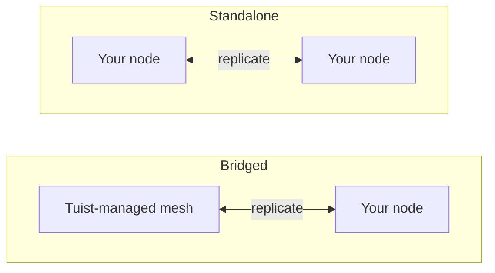

---
{
  "title": "საკუთარ სერვერზე განთავსება",
  "titleTemplate": ":title | კეში | სახელმძღვანელოები | Tuist",
  "description": "შეიტყვეთ, როგორ განათავსოთ Tuist-ის ქეშის კვანძები საკუთარ სერვერზე და რეპლიცირება მოახდინოთ Tuist-ის მიერ მართულ ბადესთან."
}
---

# საკუთარ სერვერზე განთავსებული ქეში {#self-host-cache}

Tuist-ის ქეში მუშაობს როგორც **კვანძების ბადე**, რომლებიც ერთმანეთს არტიფაქტებს ანაცვლებენ. შეგიძლიათ გაუშვათ საკუთარი ქეშის კვანძები თქვენს ინფრასტრუქტურაზე, რათა ქეში იყოს თქვენს დეველოპერებთან და CI-თან ახლოს, რითაც შემცირდება ქსელური მანძილი, რომელიც წინააღმდეგ შემთხვევაში შეამცირებდა იმ სიჩქარეს, რომლის უზრუნველყოფაც ქეშირებას ევალება.

საკუთარ სერვერზე განთავსებული კვანძი არის ერთი კონტეინერი (`ghcr.io/tuist/kura`), რომელიც ინახავს არტიფაქტებს ლოკალურ დისკზე და, როდესაც ის უერთდება პირების ბადეს, საუბრობს ამ ბადის დანარჩენ ნაწილთან შიდა პირის პორტის მეშვეობით. Tuist მოქმედებს როგორც **მართვის სიბრტყე**: ის ახდენს ტრაფიკის ავთენტიკაციას, უზრუნველყოფს მართული ქეშის სიმძლავრეს და ზომავს გამოყენებას. ის არასდროს ერევა თქვენს კვანძებში.

> [!NOTE]
> ქეშის კვანძების საკუთარ სერვერზე განთავსება მოითხოვს **Enterprise გეგმას**.
>
> კვანძები უერთდებიან ან განთავსებულ Tuist სერვერს (`https://tuist.dev`) ან საკუთარ სერვერზე განთავსებულ Tuist სერვერს. Tuist სერვერის საკუთარ სერვერზე განთავსება მოითხოვს ცალკე სერვერის ლიცენზიას. იხილეთ <.localized_link href="/guides/server/self-host/server">სერვერის საკუთარ სერვერზე განთავსების სახელმძღვანელო</.localized_link>.

## ორი ტოპოლოგია {#topologies}

არსებობს საკუთარ სერვერზე განთავსებული კვანძების გაშვების ორი გზა და რომელს მიიღებთ, მთლიანად დამოკიდებულია იმაზე, მუშაობს თუ არა თქვენს ანგარიშზე ასევე **Tuist-ის მიერ მართული** ქეშის რეგიონი.

### ხიდური: Tuist-ის მიერ განთავსებული ბადე + თქვენი კვანძები {#topology-bridged}

თქვენს ანგარიშზე მუშაობს მინიმუმ ერთი Tuist-ის მიერ მართული ქეშის რეგიონი და თქვენი საკუთარ სერვერზე განთავსებული კვანძები **უერთდებიან ამ ბადეს**. თქვენს კვანძებზე ჩაწერები მუდმივად ვრცელდება მართულ ბადეში და კვანძი თბება მართული ბადის არსებული ქეშიდან, როდესაც ის უერთდება. ეს უზრუნველყოფს დაბალი ლატენტურობის ქეშს თქვენს რანერებთან (რომლებიც ასრულებენ ჩაწერების უმეტესობას), ხოლო მათი ჩაწერები კვებავს საერთო ქეშს. გაითვალისწინეთ, რომ ახალი არტიფაქტები, რომლებიც ჩაიწერა მართული ბადის სხვა ადგილას კვანძის შეერთების **შემდეგ**, ჯერ არ ვრცელდება მუდმივად მასზე; ეს დაგეგმილი გაუმჯობესებაა.

ეს არის სწორი არჩევანი, როდესაც გსურთ on-prem ქეშის სიჩქარე, მაგრამ არ გსურთ უარი თქვათ საერთო, მუდმივად ჩართულ მართულ ქეშზე.

### დამოუკიდებელი: მხოლოდ თქვენი კვანძები {#topology-standalone}

თქვენს ანგარიშზე **არ** მუშაობს მართული ქეშის რეგიონი. თქვენი კვანძები ქმნიან საკუთარ იზოლირებულ ბადეს თქვენს ინფრასტრუქტურაზე. Tuist-მა მაინც იცის, რომ თქვენი კვანძები არსებობენ (ასე რომ, გამოყენება იზომება), მაგრამ **მონაცემები არ იცვლება Tuist-ის მიერ მართულ ბადესთან**, რადგან ასეთი არ არსებობს. პირის წევრობა და რეპლიკაცია ხდება მთლიანად თქვენს კვანძებში.



კონფიგურაციაში ძირითადი განსხვავება ის არის, რომ **ხიდური** ტოპოლოგია იყენებს **რეგისტრაციას**, სადაც კვანძი ქმნის თავის გასაღებთა წყვილს გაშვებისას და Tuist გასცემს მის ბადის სერტიფიკატს, ხოლო **დამოუკიდებელ** ტოპოლოგიას არ აქვს Tuist-ის მიერ გაცემული ბადის სერტიფიკატი. ერთი დამოუკიდებელი კვანძი შეიძლება მუშაობდეს გამორთული პირის TLS-ით; მრავალკვანძიანი დამოუკიდებელი ბადე იყენებს თქვენს მიერ მოწოდებულ პირის TLS მასალას.

## CLI ბოლოწერტილის კონფიგურაცია {#cli-endpoint}

Tuist-ის მართული ქეში იყენებს `https://<account>.cache.tuist.dev`. საკუთარ სერვერზე განთავსებული Tuist სერვერით, CLI იღებს ქეშის URL-ს სერვერის `TUIST_CACHE_ENDPOINTS` პარამეტრიდან. დააყენეთ ის თქვენი ძირითადი ქეშის სერვერის ან დატვირთვის ბალანსერის URL-ზე. თუ ის შეიცავს რამდენიმე URL-ს, გამოიყენება პირველი.

პირადი/მორგებული ქეშის კვანძების **განთავსებულ Tuist სერვერთან** დაკავშირებისას, დააკონფიგურირეთ ცალსახა ბოლოწერტილი დეველოპერის გარსებში და CI-ში:

```sh
export TUIST_CACHE_ENDPOINT=https://cache.example.com
```

ეს გადაფარვა აქვს უპირატესობა ნებისმიერი ტიპის სერვერზე და არის არასავალდებულო საკუთარ სერვერზე განთავსებული Tuist სერვერისთვის. Xcode ქეშის დემონისთვის, ხელახლა გაუშვით `tuist setup cache` მისი დაყენების შემდეგ, რათა LaunchAgent-მა მიიღოს განახლებული გარემო. რამდენიმე კვანძისთვის, გამოიყენეთ თქვენი დატვირთვის ბალანსერი ან DNS მარშრუტიზაციის სახელი.

## წინაპირობები {#prerequisites}


- Docker და Docker Compose (ან ნებისმიერი კონტეინერის რანტაიმი)
- მოქმედი Tuist სერვერი (განთავსებული ან საკუთარ სერვერზე განთავსებული)
- დისკი ქეშისთვის. ხიდური კვანძი ქაჩავს ანგარიშის **მთელ** ბადეს პირველი შეერთებისას, ასე რომ, შესაბამისად გაზარდეთ მონაცემთა ტომის ზომა.

## მართვის სიბრტყის კლიენტის მიწოდება {#control-plane-client}

კვანძი იყენებს მართვის სიბრტყის კლიენტის სარწმუნოებებს ქეშის მოთხოვნების ავთენტიკაციისთვის (ტოკენის ინტროსპექცია), საინფორმაციო დაფაზე ანგარიშგებისთვის და გამოყენების მიწოდებისთვის. ეს **არ არის** ის გზა, რომლითაც კლიენტები მიემართებიან თქვენს კვანძებთან საკუთარ სერვერზე განთავსებულ Tuist სერვერზე (იხილეთ [როგორ აღწევენ კლიენტები თქვენს კვანძებამდე](#routing)).

სრულად საკუთარ სერვერზე განთავსებული განლაგებისთვის, შექმენით **UUID კლიენტის ID** და შემთხვევითი საიდუმლო, შემდეგ დააკონფიგურირეთ იგივე წყვილი Tuist სერვერზე და თითოეულ Kura კვანძზე:

```bash
KURA_CONTROL_PLANE_CLIENT_ID="$(uuidgen | tr '[:upper:]' '[:lower:]')"
KURA_CONTROL_PLANE_CLIENT_SECRET="$(openssl rand -base64 32)"
```

დააყენეთ ეს მნიშვნელობები როგორც `KURA_CONTROL_PLANE_CLIENT_ID` და `KURA_CONTROL_PLANE_CLIENT_SECRET` Tuist სერვერის გარემოში, შემდეგ გამოიყენეთ იგივე მნიშვნელობები ქვემოთ მოცემულ Kura კონფიგურაციაში. რეგისტრაციის გულისცემები შეიცავს `KURA_TENANT_ID`-ს, ანგარიშის მუდმივ ქეშის იდენტურობას, რათა სერვერმა მიამაგროს კვანძი სწორ ანგარიშს მაშინაც კი, თუ ანგარიშს ეცვლება სახელი.

> [!WARNING]
> კლიენტის ID უნდა იყოს UUID `kura_` პრეფიქსის გარეშე. არა-UUID ID-ები იწვევენ ტოკენის ინტროსპექციის შეცდომას HTTP `400`-ით, მაშინაც კი, თუ სარწმუნოებები ემთხვევა ორივე სერვისზე.

თუ უკავშირდებით განთავსებულ `tuist.dev` სერვერს, ან თუ გსურთ ანგარიშის მიხედვით სარწმუნო, რომლის როტაციაც შესაძლებელია UI-დან, გახსენით ანგარიშის **ქეში** გვერდი, აირჩიეთ **სარწმუნოს შექმნა** და დააკოპირეთ `client_id` და ერთჯერადი `secret`. განთავსებულ სერვერზე, საკუთარ სერვერზე განთავსებული კვანძის სარწმუნოს შექმნა მოითხოვს Enterprise გეგმას.

## მუდმივი არენდატორის არჩევა {#permanent-tenant}

`KURA_TENANT_ID` არის მუდმივი შენახვის და პირის იდენტურობა, თავდაპირველად მიღებული ანგარიშის თავდაპირველი სახელიდან. ანგარიშისთვის, რომელსაც არასდროს შეცვლია სახელი, ის ემთხვევა მიმდინარე სახელს. **შეინარჩუნეთ მისი თავდაპირველი მნიშვნელობა ანგარიშის სახელის შეცვლის შემდეგ**, მათ შორის, როდესაც ამატებთ ჩამნაცვლებელ კვანძებს ან სხვა კვანძს იმავე ბადეში. მაგალითად, `original`-ის `renamed`-ად გადასახელება ტოვებს `KURA_TENANT_ID=original`-ს ყოველ კვანძზე. მისი შეცვლა ირჩევს სხვა ობიექტ-გასაღების სივრცეს; ანგარიშის სახელის შეცვლა არ გადაიტანს შენახულ არტიფაქტებს ან პირის იდენტურობას.

ჩაანაცვლეთ `<permanent-kura-tenant>` ქვემოთ მოცემულ მაგალითებში ამ მნიშვნელობით. გამოიყენეთ არენდატორი არსებული სწორად კონფიგურირებული კვანძიდან, ან `tenant_id`, რომელიც დაბრუნდა რეგისტრაციისას. საკუთარ სერვერზე განთავსებული Tuist სერვერის ოპერატორს შეუძლია შეამოწმოს ანგარიშის `kura_tenant_id` მონაცემთა ბაზის ველი. არ გამოიყვანოთ მნიშვნელობა გადასახელებული ანგარიშის URL-დან.

მოქმედი განლაგების დონის სამართავი სიბრტყის რწმუნებით, რეგისტრაცია და პირთა აღმოჩენა აბრუნებს **409 კონფლიქტს** `error: "tenant_mismatch"`-ით და `expected_tenant_id`-ით, თუ კვანძი წარადგენს მიმდინარე ან შენარჩუნებულ სახელს, რომელიც განსხვავდება მისი მუდმივი არენდატორისგან. ისინი არ აკეთებენ კვანძის რეგისტრაციას და არ ცვლიან ფარულად შენახვის იდენტურობას. არასწორი რწმუნებები და უცნობი არენდატორები მაინც აბრუნებენ **401 არაავტორიზებული**-ს არენდატორის გამჟღავნების გარეშე. თუ კვანძმა უკვე ჩაწერა მონაცემები სხვა არენდატორით, გადახედეთ მის კონფიგურაციას და შენახვის ისტორიას შეცვლამდე; შეცდომის პასუხი არ ასრულებს შენახვის მიგრაციას.

## როგორ აღწევს კლიენტები თქვენს კვანძებთან {#routing}

დააკონფიგურირეთ ქეშის URL [ზემოთ](#cli-endpoint), რათა დეველოპერის მანქანებმა და CI-მ შეძლონ თქვენს კვანძებთან მიღწევა. სათითაო დაფაში თითოეული კვანძის მისამართისა და მზაობის შესატყობინებლად, დააყენეთ `KURA_REGISTRATION_URL` და `KURA_ADVERTISED_HTTP_URL` კვანძზე.

## ხიდური განლაგება {#bridged-setup}

კვანძი რეგისტრირდება გაშვებისას: ის ადგილობრივად ქმნის გასაღებების წყვილს (პირადი გასაღები არასდროს ტოვებს თქვენს ინფრასტრუქტურას), აგზავნის სერთიფიკატის ხელმოწერის მოთხოვნას და იღებს ხელმოწერილ სერთიფიკატს, ანგარიშის CA-ს და მართვადი ბადის შლეიზის მისამართს. **თქვენ არ უნდა მოამარაგოთ TLS მასალა**. რეგისტრაცია ჩაწერს მას მიმაგრებულ ტომში.

```yaml
# docker-compose.yml
services:
  kura:
    image: ghcr.io/tuist/kura:<version>
    restart: unless-stopped
    ports:
      - "4000:4000"   # HTTP cache: your developers and CI point here
      - "7443:7443"   # mesh peer port
    environment:
      # Enroll and join the managed mesh
      KURA_ENROLL_ON_BOOT: "1"
      KURA_CONTROL_PLANE_URL: "https://tuist.dev"
      KURA_CONTROL_PLANE_CLIENT_ID: "<client_id>"
      KURA_CONTROL_PLANE_CLIENT_SECRET: "<secret>"
      KURA_TENANT_ID: "<permanent-kura-tenant>"

      # Report the node’s address and readiness to the dashboard
      KURA_REGISTRATION_URL: "https://tuist.dev/_internal/kura/mesh/registrations"
      KURA_ADVERTISED_HTTP_URL: "https://kura.acme.internal"   # where your CLI/CI reach the cache
      KURA_NODE_URL: "https://kura.acme.internal:7443"         # this node's peer identity on your network
      KURA_REGION: "office"

      # Ports and storage. KURA_PORT serves both the HTTP cache API and REAPI
      # gRPC (h2c) on one listener. Enrollment writes the TLS files into
      # KURA_INTERNAL_TLS_* on first boot.
      KURA_PORT: "4000"
      KURA_INTERNAL_PORT: "7443"
      KURA_INTERNAL_TLS_CA_CERT_PATH: "/tls/ca.pem"
      KURA_INTERNAL_TLS_CERT_PATH: "/tls/tls.crt"
      KURA_INTERNAL_TLS_KEY_PATH: "/tls/tls.key"
      KURA_DATA_DIR: "/var/cache/kura"
      KURA_TMP_DIR: "/var/cache/kura/tmp"
      KURA_OTEL_SERVICE_NAME: "kura-acme"
      KURA_OTEL_DEPLOYMENT_ENVIRONMENT: "onprem"

      # Authenticate the HTTP cache API. The Tuist hook ships in the image at
      # this path; it introspects each token against the control plane using the
      # control-plane client above, so only valid Tuist tokens for this account
      # can read or write. No JWT verifier secret is involved.
      KURA_AUTH_ENABLED: "1"
      KURA_AUTH_TUIST_URL: "https://tuist.dev"
    volumes:
      - kura-tls:/tls            # empty; enrollment populates it
      - kura-data:/var/cache/kura
volumes:
  kura-tls: {}
  kura-data: {}
```

რას უზრუნველყოფთ თქვენ: სამართავი სიბრტყის კლიენტს, ორ მისამართს (`KURA_NODE_URL`, `KURA_ADVERTISED_HTTP_URL`) თქვენს ქსელში და ორ ცარიელ ჩასაწერ ტომს. ყველაფერი დანარჩენი (გასაღებების წყვილი, სერთიფიკატი, ანგარიშის CA და მართვადი ბადის მისამართი) ავტომატურად ნაწილდება გაშვებისას.

## დამოუკიდებელი განლაგება {#standalone-setup}

მართვადი რეგიონის არარსებობის შემთხვევაში არ არსებობს Tuist-ის მიერ გაცემული ბადის CA, ამიტომ რეგისტრაცია არ ვრცელდება (რეგისტრაციის ბოლოწერტილი აბრუნებს `503 ca_unavailable`). კვანძი იყენებს თქვენს Tuist სერვერს ნიშნის ავთენტიკაციისთვის, სათითაო დაფაზე რეგისტრაციის პულსაციებისთვის და გამოყენების ანგარიშგებისთვის.

```yaml
# docker-compose.yml for a single node connected to a self-hosted Tuist server
services:
  kura:
    image: ghcr.io/tuist/kura:<version>
    restart: unless-stopped
    ports:
      - "4000:4000"
      - "7443:7443"
    environment:
      KURA_TENANT_ID: "<permanent-kura-tenant>"
      KURA_NODE_URL: "http://kura-1.acme.internal:7443"
      KURA_PEERS: ""   # single node: disable static peer discovery
      KURA_REGION: "office"

      # Authenticate cache requests against the self-hosted Tuist server.
      # Use the same values configured on the Tuist server, or a per-account
      # credential from the Cache page.
      KURA_CONTROL_PLANE_CLIENT_ID: "<client_id>"
      KURA_CONTROL_PLANE_CLIENT_SECRET: "<secret>"
      KURA_AUTH_ENABLED: "1"
      KURA_AUTH_TUIST_URL: "https://tuist.acme.internal"

      # Register the client-facing cache URL with the Tuist server.
      KURA_REGISTRATION_URL: "https://tuist.acme.internal/_internal/kura/mesh/registrations"
      KURA_ADVERTISED_HTTP_URL: "https://kura.acme.internal"

      KURA_PORT: "4000"
      KURA_INTERNAL_PORT: "7443"
      KURA_DATA_DIR: "/var/cache/kura"
      KURA_TMP_DIR: "/var/cache/kura/tmp"
      KURA_OTEL_SERVICE_NAME: "kura-acme"
      KURA_OTEL_DEPLOYMENT_ENVIRONMENT: "onprem"
    volumes:
      - kura-data:/var/cache/kura
volumes:
  kura-data: {}
```

ერთი კვანძისთვის, დატოვეთ პირთა TLS დაუყენებელი და დააყენეთ `KURA_PEERS` ცარიელ სტრიქონად. როდესაც `KURA_PEERS` დაუყენებელია, Kura იწყებს სტატიკურ პირთა აღმოჩენას `KURA_NODE_URL`-დან და პერიოდულად ამოწმებს ამ URL-ის `/_internal/status` ბოლოწერტილს. პირთა TLS-ის გათიშვისას, `KURA_NODE_URL` უნდა იყენებდეს `http://` სქემას მაშინაც კი, როცა კვანძი ხელმისაწვდომია პირადი ქსელის სახელით.

`KURA_CONTROL_PLANE_URL` არ არის საჭირო ამ მაგალითში, რადგან ავტორიზაცია და გამოყენების ანგარიშგება ორივე იყენებს `KURA_AUTH_TUIST_URL`-ს, როგორც Tuist-ის საბაზისო URL-ს. `KURA_ADVERTISED_HTTP_URL` განსაზღვრავს კვანძის კლიენტისთვის ხელმისაწვდომ მისამართს სათითაო დაფაში. დააყენეთ `TUIST_CACHE_ENDPOINTS=https://kura.acme.internal` Tuist სერვერზე, რათა CLI-მ გამოიყენოს ეს მისამართი ქეშის მოთხოვნებისთვის.

### Kubernetes Helm-ით {#standalone-helm}

თუ თქვენი საკუთარ სერვერზე განთავსებული Tuist სერვერი მუშაობს Kubernetes-ზე, დააინსტალირეთ Kura დამოუკიდებელი Kura ჩარტით და გადასცით იგივე სამართავი სიბრტყის პარამეტრები `extraEnv`-ის მეშვეობით. Tuist სერვერის ჩარტი არ აინსტალირებს ამ Kura ჩარტს, როგორც ქვეჩარტს.

ჯერ, დააკონფიგურირეთ Tuist სერვერის ჩარტი განლაგების დონის Kura რწმუნებით:

```yaml
# tuist-values.yaml
server:
  extraEnv:
    - name: KURA_CONTROL_PLANE_CLIENT_ID
      valueFrom:
        secretKeyRef:
          name: kura-control-plane
          key: client-id
    - name: KURA_CONTROL_PLANE_CLIENT_SECRET
      valueFrom:
        secretKeyRef:
          name: kura-control-plane
          key: client-secret
```

შემდეგ დააინსტალირეთ Kura იმავე სივრცეში იმავე Secret-ით:

```yaml
# kura-values.yaml
replicaCount: 1

config:
  tenantId: "<permanent-kura-tenant>"
  region: "office"

ingress:
  enabled: true
  className: nginx
  hosts:
    - host: kura.acme.internal
      paths:
        - path: /
          pathType: Prefix
  tls:
    - hosts:
        - kura.acme.internal
      secretName: kura-tls

extraEnv:
  - name: KURA_CONTROL_PLANE_CLIENT_ID
    valueFrom:
      secretKeyRef:
        name: kura-control-plane
        key: client-id
  - name: KURA_CONTROL_PLANE_CLIENT_SECRET
    valueFrom:
      secretKeyRef:
        name: kura-control-plane
        key: client-secret
  - name: KURA_AUTH_ENABLED
    value: "1"
  - name: KURA_AUTH_TUIST_URL
    value: "https://tuist.acme.internal"
  - name: KURA_REGISTRATION_URL
    value: "https://tuist.acme.internal/_internal/kura/mesh/registrations"
  - name: KURA_ADVERTISED_HTTP_URL
    value: "https://kura.acme.internal"
```

```bash
kubectl create namespace tuist
kubectl -n tuist create secret generic kura-control-plane \
  --from-literal=client-id="<client_id>" \
  --from-literal=client-secret="<secret>"

helm upgrade --install kura oci://ghcr.io/tuist/charts/kura \
  --namespace tuist \
  -f kura-values.yaml
```

თუ Kura მუშაობს სხვა სივრცეში, ვიდრე Tuist სერვერი, შექმენით ან სინქრონიზეთ `kura-control-plane` Secret ორივე სივრცეში.

დატოვეთ `extension.enabled` დაუყენებელი, როდესაც იყენებთ გამოსახულებაში ჩაშენებულ Tuist ჰუკს; ეს ჩარტის მნიშვნელობა განკუთვნილია ConfigMap-იდან მორგებული ჰუკის დასამაგრებლად. ჩარტი ქმნის `KURA_NODE_URL`-ს, `KURA_PEERS`-ს, headless სერვისს, პერსისტენტობას და პრობებს თქვენთვის. `replicaCount: 1`-ით, გენერირებული პირის URL არის pod-ის საკუთარი სტაბილური DNS სახელი, ამიტომ ის რჩება ხელმისაწვდომი კლასტერის შიგნით და არ წარმოქმნის ზემოთ აღწერილ ერთკვანძიან გაფრთხილებას. მრავალი რეპლიკისთვის, ჩარტი ქმნის პირთა სიას StatefulSet DNS-იდან; ჩართეთ `peerTls` და მოამარაგეთ TLS Secret, თუ გსურთ mTLS შიდა პირთა სიბრტყეზე.

ერთზე მეტი დამოუკიდებელი კვანძის გასაშვებად, დაამატეთ თქვენი **საკუთარი პირთა TLS**, დამაგრებული `/tls`-ზე (CA პლიუს ფოთლის სერთიფიკატი და გასაღები თითო კვანძზე, იზიარებენ CA-ს, რათა კვანძებმა ერთმანეთი ენდონ), გადაიყვანეთ `KURA_NODE_URL` `https://...:<KURA_INTERNAL_PORT>`-ზე და დაამატეთ `KURA_PEERS`:

```yaml
environment:
  KURA_NODE_URL: "https://kura-1.acme.internal:7443"
  KURA_PEERS: "https://kura-2.acme.internal:7443,https://kura-3.acme.internal:7443"
  KURA_INTERNAL_TLS_CA_CERT_PATH: "/tls/ca.pem"
  KURA_INTERNAL_TLS_CERT_PATH: "/tls/tls.crt"
  KURA_INTERNAL_TLS_KEY_PATH: "/tls/tls.key"
volumes:
  - ./tls:/tls:ro
```

## რა სჭირდება თითოეულ ტოპოლოგიას {#requirements-summary}

| თქვენ უზრუნველყოფთ | ხიდური | დამოუკიდებელი |
|---|---|---|
| სამართავი სიბრტყის კლიენტი (`client_id` / `secret`) | კი | კი |
| `KURA_NODE_URL` | კი | კი |
| `KURA_ADVERTISED_HTTP_URL` | კი | სათითაო დაფაზე რეგისტრაციისთვის; მარშრუტიზაცია ცალკეა (იხილეთ ქვემოთ) |
| მარშრუტიზაცია CLI-მდე | ავტომატური (რეგისტრაცია) | ავტომატური მზა რეგისტრაციის პულსაციებიდან |
| მონაცემები + დროებითი ტომი | კი | კი |
| `KURA_ENROLL_ON_BOOT` | კი | არა (დააბრუნებდა `ca_unavailable`-ს) |
| პირთა TLS (`/tls` CA + ფოთოლი) | არა, რეგისტრაცია წერს მას | მხოლოდ მრავალკვანძიანი ბადისთვის |
| `KURA_PEERS` (პირთა სია) | არა, რეგისტრაცია ავსებს კარიბჭეს | ცარიელი ერთი კვანძისთვის; პირთა URL-ები ერთზე მეტი კვანძისთვის |

## სავალდებულო კონფიგურაცია {#required-config}

ეს ცვლადები აკონფიგურირებენ ყველა კვანძს, ტოპოლოგიის მიუხედავად (პირთა TLS არის გამონაკლისი, რომელიც ქვემოთაა აღნიშნული):

| ცვლადი | აღწერა |
|---|---|
| `KURA_TENANT_ID` | თქვენი ანგარიშის მუდმივი Kura მომხმარებელი. შეინახეთ მისი საწყისი მნიშვნელობა ანგარიშის სახელის შეცვლის შემდეგაც; იხილეთ [მუდმივი მომხმარებლის არჩევა](#permanent-tenant). |
| `KURA_NODE_URL` | ამ კვანძის პირთა URL თქვენს ქსელში. |
| `KURA_PEERS` | სტატიკური პირთა აღმოჩენის სია. დააყენეთ ის ცარიელ სტრიქონად ერთი დამოუკიდებელი კვანძისთვის; დააყენეთ ხელმისაწვდომი პირთა URL-ები მრავალკვანძიანი ბადისთვის. |
| `KURA_REGION` | თავისუფალი ფორმატის რეგიონის ნიშანი (მაგ. `office`, `ci`). |
| `KURA_PORT` / `KURA_INTERNAL_PORT` | ქეშის პორტი (HTTP ქეშის API და REAPI gRPC განთავსებულია ერთ მოსმენზე) და ბადის პირთა პორტი (`4000` / `7443`). |
| `KURA_DATA_DIR` / `KURA_TMP_DIR` | დისკზე არტიფაქტების შენახვა და სამუშაო დირექტორია. |
| `KURA_INTERNAL_TLS_CA_CERT_PATH` / `KURA_INTERNAL_TLS_CERT_PATH` / `KURA_INTERNAL_TLS_KEY_PATH` | პირთა TLS ფაილები. იწერება რეგისტრაციის დროს (ხიდური) ან მოწოდებულია თქვენგან (მრავალკვანძიანი დამოუკიდებელი). არ არის საჭირო ერთი კვანძისთვის; გამოტოვეთ ისინი და გამოიყენეთ `http://` `KURA_NODE_URL`. |
| `KURA_OTEL_SERVICE_NAME` / `KURA_OTEL_DEPLOYMENT_ENVIRONMENT` | სერვისის სახელი და გარემოს ნიშანი ტელემეტრიისთვის. |

ხიდურ კვანძებზე დამატებით დაყენებულია `KURA_ENROLL_ON_BOOT`, `KURA_CONTROL_PLANE_URL` და სამართავი სიბრტყის კლიენტის სერთიფიკატები. `KURA_REGISTRATION_URL` და `KURA_ADVERTISED_HTTP_URL` არეგისტრირებენ კვანძს, რათა ის გამოჩნდეს **ქეშის** გვერდზე და Kura-ით ჩართულ CLI კლიენტებს შეეძლოთ მასთან მარშრუტიზაცია (იხილეთ [როგორ აღწევენ კლიენტები თქვენს კვანძებს](#routing)).

## შენახვა და გაწმენდა {#storage}

კვანძი ინახავს არტიფაქტებს `KURA_DATA_DIR`-ის ქვეშ CAS შენახვის ბიუჯეტამდე, რომლის დაყენებაც შესაძლებელია არასავალდებულო ცვლადით:

| ცვლადი | აღწერა |
|---|---|
| `KURA_CAS_CAPACITY_BYTES` | კვანძის CAS შენახვის ბიუჯეტი ბაიტებში. უნდა იყოს დადებითი მთელი რიცხვი. როცა არ არის დაყენებული, ბიუჯეტი არის `KURA_DATA_DIR`-ის მქონე ფაილური სისტემის ზომის 50%. |

მიუხედავად იმისა, დააყენებთ თუ არა, ბიუჯეტი შეზღუდულია `KURA_DATA_DIR`-ის მქონე ფაილური სისტემის 80%-ით, რათა როტაციამ, რომელიც წერს ახალ სეგმენტს უძველესის გაწმენდამდე, ვერ შეავსოს დისკი. ბიუჯეტი მრგვალდება მთელ 512 MiB სეგმენტებამდე, მინიმუმ 2.5 GiB. კვანძი აღრიცხავს გადაწყვეტილ ბიუჯეტს გაშვებისას (`resolved CAS segment ring limits`).

გაწმენდა ავტომატურია. არტიფაქტები ინახება სეგმენტების რგოლში და ბიუჯეტის მიღწევისას უძველესი სეგმენტი იწმინდება. უძველესი სეგმენტებიდან წაკითხული არტიფაქტები გადადიან მიმდინარეში, ამიტომ ხშირად გამოყენებადი არტიფაქტები ინახება და გაწმენდა ქცევით ახლოსაა უახლესად გამოუყენებელთან.

მოათავსეთ `KURA_DATA_DIR` გამოყოფილ ტომზე. როგორც ნაგულისხმევი ბიუჯეტი, ასევე ზედა ზღვარი არის ფაილური სისტემის მთლიანი ზომის პროცენტები, არა თავისუფალი ადგილის, ამიტომ იმავე ფაილურ სისტემაზე სხვა მონაცემებმა შეიძლება დატოვონ ნაკლები ადგილი, ვიდრე ბიუჯეტი ვარაუდობს.

## ქეშის მოთხოვნების ავთენტიკაცია {#cache-auth}

ნაგულისხმევად კვანძი ემსახურება თავის HTTP ქეშის API-ს ყველას, ვისაც შეუძლია მასთან მიღწევა თქვენს ქსელში. იმისთვის, რომ მოითხოვოთ გამომძახებლებისგან მოქმედი Tuist ტოკენის წარდგენა, რათა მხოლოდ თქვენი ორგანიზაციის ავთენტიფიცირებულ წევრებს შეეძლოთ წაკითხვა და ჩაწერა, მიმართეთ კვანძი თქვენს Tuist სერვერზე. ზემოთ მოყვანილი დამოუკიდებელი კონფიგურაცია ამას აკეთებს.

| ცვლადი | მნიშვნელობა |
|---|---|
| `KURA_AUTH_ENABLED` | `1` |
| `KURA_AUTH_TUIST_URL` | თქვენი Tuist სერვერის URL |

ავტორიზაცია ხელახლა იყენებს თქვენს მიერ უკვე დაყენებულ სამართავი სიბრტყის კლიენტს (`KURA_CONTROL_PLANE_CLIENT_ID` / `KURA_CONTROL_PLANE_CLIENT_SECRET`) ტოკენების ინტროსპექციისთვის, ამიტომ დამატებითი სერთიფიკატი არ არის საჭირო. თვითმასპინძელი კვანძი მუშაობს **მხოლოდ ინტროსპექციის** რეჟიმში: ის არასდროს ინახავს სიმეტრიულ Guardian JWT ვერიფიკატორის საიდუმლოს, რომელსაც შეეძლო ნებისმიერი მომხმარებლისთვის ტოკენების გამოშვება და არასდროს იზიარებს, ამიტომ ყოველი მოთხოვნა ავტორიზებულია თქვენს სერვერთან. კვანძი, რომელსაც არ შეუძლია მასთან მიღწევა, უარყოფს მომსახურების ნაცვლად და არ არსებობს პარამეტრი, რომელიც ამას ცვლის. Tuist-ის მიერ მართული კვანძები იყენებენ იმავე ავტორიზაციას; ერთადერთი განსხვავება ისაა, რომ მათ ასევე აქვთ ვერიფიკაციის გასაღები, რაც საშუალებას აძლევს გადაწყვიტონ მოთხოვნების უმეტესობა მხოლოდ ტოკენიდან.

## ქსელი {#networking}

კვანძი ამყარებს **გამავალ** კავშირებს იმის მიხედვით, თუ რომელ ინტეგრაციებს ჩართავთ:

- თქვენი Tuist სერვერი ტოკენის ინტროსპექციისთვის (`KURA_AUTH_TUIST_URL`), რეგისტრაციის პულსაციებისთვის (`KURA_REGISTRATION_URL`), გამოყენებისთვის (`KURA_CONTROL_PLANE_URL` ან `KURA_AUTH_TUIST_URL`), და ხიდურ ტოპოლოგიაში რეგისტრაციისთვის, და
- ხიდურ ტოპოლოგიაში, მართული ბადის პირთა კარიბჭე, რეპლიკაციისთვის.

თქვენი დეველოპერები და CI აღწევენ კვანძის `KURA_ADVERTISED_HTTP_URL`-ს (და, მრავალკვანძიანი ბადისთვის, კვანძები ერთმანეთს აღწევენ პირთა პორტზე). ეს მისამართები საჭიროა მხოლოდ **თქვენს ქსელში** ხელმისაწვდომი იყოს. მათი საჯარო ინტერნეტისთვის გახსნა არ არის საჭირო.

## როგორ მუშაობს {#behavior}

- **ხიდური.** გაშვებისას კვანძი რეგისტრირდება, იღებს მართული ბადის სრულ ქეშს და გადადის რგოლის მომსახურე წევრად. საწყისი მიღება ხდება ერთხელ და შეიძლება დიდი ხანი დასჭირდეს WAN-ზე, თქვენი ქეშის ზომის მიხედვით. ამის შემდეგ, კვანძზე ჩაწერები უწყვეტად ვრცელდება მართულ ბადაში. ახალი არტიფაქტები, რომლებიც ჩაიწერა სხვაგან მართულ ბადაში კვანძის შეერთების შემდეგ, ჯერ არ ვრცელდება მასზე უწყვეტად (დაგეგმილი გაუმჯობესება), ამიტომ შეერთების დროს მიღება განიხილეთ როგორც სნეპშოტი და არა ცოცხალი სარკე.
- **დამოუკიდებელი.** კვანძ(ებ)ი მუშაობენ როგორც იზოლირებული ბადე თქვენს ინფრასტრუქტურაზე. რეპლიკაცია, თუ არსებობს, ხდება მხოლოდ თქვენს კვანძებს შორის. კონფიგურაციისას, Tuist-ის როლი შეზღუდულია სამართავი სიბრტყით: სათითაო დაფაზე ხილვადობა, ქეშის ბოლოწერტილის რეკლამირება, გამოყენების გაზომვა და ტოკენის ინტროსპექცია. ის არასდროს ამზადებს, ანახლებს, უკავშირდება ან აღწევს თქვენს კვანძებში.

## შემოწმება {#verify}

```bash
curl --fail-with-body http://localhost:4000/ready   # 200 once the node has joined and is serving
curl --fail-with-body http://localhost:4000/up      # liveness + mesh membership
```

ხიდური კვანძი აჩვენებს `state: joining`-ს, სანამ ბადეს იღებს და `state: serving`-ს, როცა აევსება. თქვენი კვანძი ასევე ჩანს **რეგისტრირებული კვანძების** ქვეშ ანგარიშის **ქეშის** გვერდზე, როგორც კი რეგისტრაციის პულსაციები იწყება.

შორეული ქეშირების შესამოწმებლად, გაუშვით `tuist cache` არაქეშირებული, ქეშირებადი სამიზნეებით და დაადასტურეთ წარმატებული ატვირთვები Kura ლოგებში. ნულოვანი გასვლის სტატუსი მხოლოდ არ ადასტურებს, რომ არტიფაქტები შეინახა.

## განახლება {#upgrading}

```bash
docker compose pull
docker compose up -d
```

კვანძები შექმნილია ისე, რომ ერთი ვერსიის სხვაობის ფარგლებში გვერდიგვერდ მუშაობდნენ, ამიტომ რამდენიმე კვანძზე თანმიმდევრული განახლება უსაფრთხოა.
