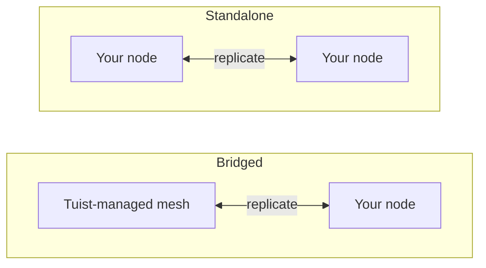

---
{
  "title": "საკუთარ სერვერზე განთავსება",
  "titleTemplate": ":title | კეში | სახელმძღვანელოები | Tuist",
  "description": "შეიტყვეთ, როგორ განათავსოთ Tuist-ის ქეშის კვანძები საკუთარ სერვერზე და მოახდინოთ მათი რეპლიკაცია Tuist-ის მიერ მართულ ქსელთან."
}
---

# კეშის საკუთარ ინფრასტრუქტურაზე განთავსება {#self-host-cache}

Tuist-ის კეში მუშაობს როგორც **კვანძების ქსელი**, რომლებიც ერთმანეთთან ახდენენ არტიფაქტების რეპლიკაციას. შეგიძლიათ გაუშვათ თქვენი საკუთარი კეშის კვანძები თქვენს ინფრასტრუქტურაზე, რათა კეში მდებარეობდეს თქვენს დეველოპერებთან და CI-თან ახლოს, რაც ამცირებს ქსელურ მანძილს და ზოგავს იმ სიჩქარეს, რომლის მიწოდებაც კეშირებას უნდა მოჰყვეს.

საკუთარ ინფრასტრუქტურაზე განთავსებული კვანძი არის ერთი კონტეინერი (`ghcr.io/tuist/kura`), რომელიც ინახავს არტიფაქტებს ლოკალურ დისკზე და, როდესაც ის უერთდება პირის ქსელს, ურთიერთობს ამ ქსელის დანარჩენ ნაწილთან შიდა პირის პორტის მეშვეობით. Tuist მოქმედებს როგორც **სამართავი სიბრტყე**: ის ახდენს ტრაფიკის ავთენტიკაციას, უზრუნველყოფს მართული კეშის ტევადობას და ზომავს გამოყენებას. ის არასდროს ერევა თქვენს კვანძებში.

> [!NOTE]
> კეშის კვანძების საკუთარ ინფრასტრუქტურაზე განთავსება მოითხოვს **Enterprise გეგმას**.
>
> კვანძები უერთდებიან ან განთავსებულ Tuist სერვერს (`https://tuist.dev`) ან საკუთარ ინფრასტრუქტურაზე განთავსებულ Tuist სერვერს. Tuist სერვერის საკუთარ ინფრასტრუქტურაზე განთავსება მოითხოვს ცალკე სერვერის ლიცენზიას. იხილეთ <.localized_link href="/guides/server/self-host/server">სერვერის საკუთარ ინფრასტრუქტურაზე განთავსების სახელმძღვანელო</.localized_link>.

## ორი ტოპოლოგია {#topologies}

არსებობს საკუთარ ინფრასტრუქტურაზე განთავსებული კვანძების გაშვების ორი გზა და რომელსაც მიიღებთ, მთლიანად დამოკიდებულია იმაზე, მუშაობს თუ არა თქვენს ანგარიშზე ასევე **Tuist-ით მართული** კეშის რეგიონი.

### ხიდური: Tuist-ით განთავსებული ქსელი + თქვენი კვანძები {#topology-bridged}

თქვენს ანგარიშზე მუშაობს მინიმუმ ერთი Tuist-ით მართული კეშის რეგიონი და თქვენი საკუთარ ინფრასტრუქტურაზე განთავსებული კვანძები **უერთდებიან ამ ქსელს**. თქვენს კვანძებზე ჩაწერები მუდმივად ვრცელდება მართულ ქსელში და კვანძი თბება მართული ქსელის არსებული კეშიდან, როდესაც ის უერთდება. ეს ათავსებს დაბალი ლატენტობის კეშს თქვენს გამშვებებთან (რომლებიც ასრულებენ ჩაწერების უმეტესობას), ხოლო მათი ჩაწერები კვებავენ გაზიარებულ კეშს. გაითვალისწინეთ, რომ ახალი არტიფაქტები, რომლებიც იწერება მართულ ქსელში სხვაგან კვანძის შეერთების **შემდეგ**, ჯერ არ ვრცელდება მუდმივად მისკენ; ეს დაგეგმილი გაუმჯობესებაა.

ეს არის სწორი არჩევანი, როდესაც გსურთ ლოკალური კეშის სიჩქარე მართული, მუდმივად ჩართული გაზიარებული კეშის გარეშე.

### დამოუკიდებელი: მხოლოდ თქვენი კვანძები {#topology-standalone}

თქვენს ანგარიშზე **არ** მუშაობს მართული კეშის რეგიონი. თქვენი კვანძები ქმნიან თავიანთ იზოლირებულ ქსელს თქვენს ინფრასტრუქტურაზე. Tuist-მა კვლავ იცის, რომ თქვენი კვანძები არსებობენ (ამიტომ გამოყენება იზომება), მაგრამ **მონაცემები არ იცვლება Tuist-ით მართულ ქსელთან**, რადგან ასეთი არ არსებობს. პირის წევრობა და რეპლიკაცია ხდება მთლიანად თქვენს საკუთარ კვანძებში.



კონფიგურაციაში ძირითადი განსხვავება ის არის, რომ **ხიდური** ტოპოლოგია იყენებს **რეგისტრაციას**, სადაც კვანძი ქმნის თავის გასაღებების წყვილს გაშვებისას და Tuist გასცემს მის ქსელურ სერტიფიკატს, ხოლო **დამოუკიდებელ** ტოპოლოგიას არ აქვს Tuist-ის მიერ გაცემული ქსელური სერტიფიკატი. ერთი დამოუკიდებელი კვანძი შეიძლება მუშაობდეს პირის TLS-ის გამორთვით; მრავალკვანძიანი დამოუკიდებელი ქსელი იყენებს თქვენს მიერ მოწოდებულ პირის TLS მასალას.

## CLI ბოლოწერტილის კონფიგურაცია {#cli-endpoint}

Tuist-ის მართული კეში იყენებს `https://<account>.cache.tuist.dev`. საკუთარ ინფრასტრუქტურაზე განთავსებული Tuist სერვერის შემთხვევაში, CLI იღებს კეშის URL-ს სერვერის `TUIST_CACHE_ENDPOINTS` პარამეტრიდან. დააყენეთ ის თქვენი მთავარი კეშის სერვერის ან დატვირთვის ბალანსერის URL-ზე. თუ ის შეიცავს რამდენიმე URL-ს, გამოიყენება პირველი.

პირადი/მორგებული კეშის კვანძების **განთავსებულ Tuist სერვერთან** დაკავშირებისას, კონფიგურირეთ ცალსახა ბოლოწერტილი დეველოპერის გარსებში და CI-ში:

```sh
export TUIST_CACHE_ENDPOINT=https://cache.example.com
```

ეს გადაფარვა აქვს უპირატესობა ნებისმიერი ტიპის სერვერზე და არის არასავალდებულო საკუთარ ინფრასტრუქტურაზე განთავსებული Tuist სერვერისთვის. Xcode კეშის დემონისთვის, ხელახლა გაუშვით `tuist setup cache` მისი დაყენების შემდეგ, რათა LaunchAgent-მა მიიღოს განახლებული გარემო. რამდენიმე კვანძისთვის, გამოიყენეთ თქვენი დატვირთვის ბალანსერი ან DNS მარშრუტიზაციის სახელი.

## წინაპირობები {#prerequisites}


- Docker და Docker Compose (ან ნებისმიერი კონტეინერის გარემო)
- მოქმედი Tuist სერვერი (განთავსებული ან საკუთარ ინფრასტრუქტურაზე განთავსებული)
- დისკი კეშისთვის. ხიდური კვანძი ქაჩავს ანგარიშის **მთელ** ქსელს პირველი შეერთებისას, ამიტომ შესაბამისად შეარჩიეთ მონაცემთა ტომის ზომა.

## სამართავი სიბრტყის კლიენტის უზრუნველყოფა {#control-plane-client}

კვანძი იყენებს სამართავი სიბრტყის კლიენტის სარწმუნოებებს კეშის მოთხოვნების ავთენტიკაციისთვის (ტოკენის ინტროსპექცია), დაფისთვის ანგარიშგებისთვის და გამოყენების მიწოდებისთვის. ეს **არ არის** გზა, რომლითაც კლიენტები მიემართებიან თქვენს კვანძებთან საკუთარ ინფრასტრუქტურაზე განთავსებულ Tuist სერვერზე (იხილეთ [როგორ აღწევენ კლიენტები თქვენს კვანძებთან](#routing)).

სრულად საკუთარ ინფრასტრუქტურაზე განთავსებული განლაგებისთვის, შექმენით **UUID კლიენტის ID** და შემთხვევითი საიდუმლო, შემდეგ კი კონფიგურირეთ იგივე წყვილი Tuist სერვერზე და თითოეულ Kura კვანძზე:

```bash
KURA_CONTROL_PLANE_CLIENT_ID="$(uuidgen | tr '[:upper:]' '[:lower:]')"
KURA_CONTROL_PLANE_CLIENT_SECRET="$(openssl rand -base64 32)"
```

დააყენეთ ეს მნიშვნელობები როგორც `KURA_CONTROL_PLANE_CLIENT_ID` და `KURA_CONTROL_PLANE_CLIENT_SECRET` Tuist სერვერის გარემოში, შემდეგ კი გამოიყენეთ იგივე მნიშვნელობები ქვემოთ მოცემულ Kura კონფიგურაციაში. რეგისტრაციის გულისცემები მოიცავს `KURA_TENANT_ID`, ანგარიშის მუდმივ კეშის იდენტობას, რათა სერვერმა მიამაგროს კვანძი სწორ ანგარიშს მაშინაც კი, თუ ანგარიშს ეცვლება სახელი.

> [!WARNING]
> კლიენტის ID უნდა იყოს UUID `kura_` პრეფიქსის გარეშე. არა-UUID ID-ები იწვევენ ტოკენის ინტროსპექციის შეცდომას HTTP `400`-ით, მაშინაც კი, თუ სარწმუნოებები ემთხვევა ორივე სერვისზე.

თუ უერთდებით განთავსებულ `tuist.dev` სერვერს, ან თუ გსურთ ანგარიშისთვის სარწმუნოებები, რომლების როტაციაც შესაძლებელია UI-დან, გახსენით ანგარიშის **კეში** გვერდი, აირჩიეთ **სარწმუნოებების გენერირება** და დააკოპირეთ `client_id` პლუს ერთჯერადი `secret`. განთავსებულ სერვერზე, საკუთარ ინფრასტრუქტურაზე განთავსებული კვანძის სარწმუნოებების გენერირება მოითხოვს Enterprise გეგმას.

## მუდმივი არენდატორის არჩევა {#permanent-tenant}

`KURA_TENANT_ID` არის მუდმივი შენახვის და პირის იდენტობა, თავდაპირველად მიღებული ანგარიშის თავდაპირველი სახელიდან. ანგარიშისთვის, რომელსაც არასდროს შეცვლია სახელი, ის ემთხვევა მიმდინარე სახელს. **შეინარჩუნეთ მისი თავდაპირველი მნიშვნელობა ანგარიშის სახელის შეცვლის შემდეგ**, მათ შორის, როდესაც ამატებთ ჩამნაცვლებელ კვანძებს ან სხვა კვანძს იმავე ქსელში. მაგალითად, `original`-ის `renamed`-ად გადაკეთება ტოვებს `KURA_TENANT_ID=original` ყოველ კვანძზე. მისი შეცვლა ირჩევს სხვა ობიექტ-გასაღების სივრცეს; ანგარიშის სახელის შეცვლა არ გადააქვს შენახულ არტიფაქტებს ან პირის იდენტობას.

ჩაანაცვლეთ `<permanent-kura-tenant>` ქვემოთ მოცემულ მაგალითებში ამ მნიშვნელობით. გამოიყენეთ არენდატორი არსებული სწორად კონფიგურირებული კვანძიდან, ან `tenant_id`, რომელიც დაბრუნდა რეგისტრაციისას. საკუთარ ინფრასტრუქტურაზე განთავსებული Tuist სერვერის ოპერატორს შეუძლია შეამოწმოს ანგარიშის `kura_tenant_id` მონაცემთა ბაზის ველი. არ გამოიყვანოთ მნიშვნელობა გადაკეთებული ანგარიშის URL-დან.

მოქმედი დეპლოიმენტის დონის კონტროლ-პლეინის კრედენტიალით, რეგისტრაცია და პირების აღმოჩენა აბრუნებს **409 Conflict**-ს `error: "tenant_mismatch"`-ით და `expected_tenant_id`-ით, თუ კვანძი წარმოადგენს მიმდინარე ან შენარჩუნებულ სახელს, რომელიც განსხვავდება მისი მუდმივი არენდატორისგან. ისინი არ აკეთებენ კვანძის რეგისტრაციას და არ ცვლიან ჩუმად შენახვის იდენტობას სხვაზე. არასწორი კრედენტილები და უცნობი არენდატორები კვლავ აბრუნებენ **401 Unauthorized**-ს არენდატორის გამჟღავნების გარეშე. თუ კვანძმა უკვე ჩაწერა მონაცემები სხვა არენდატორით, გადახედეთ მის კონფიგურაციას და შენახვის ისტორიას მის შეცვლამდე; შეცდომის პასუხი არ ასრულებს შენახვის მიგრაციას.

## როგორ აღწევენ კლიენტები თქვენს კვანძებამდე {#routing}

დააკონფიგურირეთ ქეშის URL [ზემოთ](#cli-endpoint), რათა დეველოპერების მანქანებმა და CI-მ შეძლონ თქვენს კვანძებთან მიღწევა. დაშბორდზე თითოეული კვანძის მისამართისა და მზადყოფნის შესატყობინებლად, დააყენეთ `KURA_REGISTRATION_URL` და `KURA_ADVERTISED_HTTP_URL` კვანძზე.

## ხიდური კონფიგურაცია {#bridged-setup}

კვანძი რეგისტრირდება გაშვებისას: ის ადგილობრივად ქმნის გასაღებთა წყვილს (პირადი გასაღები არასდროს ტოვებს თქვენს ინფრასტრუქტურას), აგზავნის სერთიფიკატის ხელმოწერის მოთხოვნას და იღებს ხელმოწერილ სერთიფიკატს, ანგარიშის CA-ს და მართული ქსელის შლაუზის მისამართს. **თქვენ არ უნდა მოამარაგოთ TLS მასალა**. რეგისტრაცია წერს მას მიმაგრებულ ტომში.

```yaml
# docker-compose.yml
services:
  kura:
    image: ghcr.io/tuist/kura:<version>
    restart: unless-stopped
    ports:
      - "4000:4000"   # HTTP cache: your developers and CI point here
      - "7443:7443"   # mesh peer port
    environment:
      # Enroll and join the managed mesh
      KURA_ENROLL_ON_BOOT: "1"
      KURA_CONTROL_PLANE_URL: "https://tuist.dev"
      KURA_CONTROL_PLANE_CLIENT_ID: "<client_id>"
      KURA_CONTROL_PLANE_CLIENT_SECRET: "<secret>"
      KURA_TENANT_ID: "<permanent-kura-tenant>"

      # Report the node’s address and readiness to the dashboard
      KURA_REGISTRATION_URL: "https://tuist.dev/_internal/kura/mesh/registrations"
      KURA_ADVERTISED_HTTP_URL: "https://kura.acme.internal"   # where your CLI/CI reach the cache
      KURA_NODE_URL: "https://kura.acme.internal:7443"         # this node's peer identity on your network
      KURA_REGION: "office"

      # Ports and storage. KURA_PORT serves both the HTTP cache API and REAPI
      # gRPC (h2c) on one listener. Enrollment writes the TLS files into
      # KURA_INTERNAL_TLS_* on first boot.
      KURA_PORT: "4000"
      KURA_INTERNAL_PORT: "7443"
      KURA_INTERNAL_TLS_CA_CERT_PATH: "/tls/ca.pem"
      KURA_INTERNAL_TLS_CERT_PATH: "/tls/tls.crt"
      KURA_INTERNAL_TLS_KEY_PATH: "/tls/tls.key"
      KURA_DATA_DIR: "/var/cache/kura"
      KURA_TMP_DIR: "/var/cache/kura/tmp"
      KURA_OTEL_SERVICE_NAME: "kura-acme"
      KURA_OTEL_DEPLOYMENT_ENVIRONMENT: "onprem"

      # Authenticate the HTTP cache API. The Tuist hook ships in the image at
      # this path; it introspects each token against the control plane using the
      # control-plane client above, so only valid Tuist tokens for this account
      # can read or write. No JWT verifier secret is involved.
      KURA_AUTH_ENABLED: "1"
      KURA_AUTH_TUIST_URL: "https://tuist.dev"
    volumes:
      - kura-tls:/tls            # empty; enrollment populates it
      - kura-data:/var/cache/kura
volumes:
  kura-tls: {}
  kura-data: {}
```

რასაც თქვენ უზრუნველყოფთ: კონტროლ-პლეინის კლიენტი, ორი მისამართი (`KURA_NODE_URL`, `KURA_ADVERTISED_HTTP_URL`) თქვენს ქსელში და ორი ცარიელი ჩაწერადი ტომი. ყველაფერი სხვა (გასაღებთა წყვილი, სერთიფიკატი, ანგარიშის CA და მართული ქსელის მისამართი) ავტომატურად ნაწილდება გაშვებისას.

## დამოუკიდებელი კონფიგურაცია {#standalone-setup}

მართული რეგიონის არარსებობის შემთხვევაში არ არსებობს Tuist-ის მიერ გაცემული ქსელის CA, ამიტომ რეგისტრაცია არ მოქმედებს (რეგისტრაციის ბოლო წერტილი აბრუნებს `503 ca_unavailable`). კვანძი იყენებს თქვენს Tuist სერვერს ტოკენის ავთენტიკაციისთვის, დაშბორდის რეგისტრაციის პულსაციებისთვის და გამოყენების შესატყობინებლად.

```yaml
# docker-compose.yml for a single node connected to a self-hosted Tuist server
services:
  kura:
    image: ghcr.io/tuist/kura:<version>
    restart: unless-stopped
    ports:
      - "4000:4000"
      - "7443:7443"
    environment:
      KURA_TENANT_ID: "<permanent-kura-tenant>"
      KURA_NODE_URL: "http://kura-1.acme.internal:7443"
      KURA_PEERS: ""   # single node: disable static peer discovery
      KURA_REGION: "office"

      # Authenticate cache requests against the self-hosted Tuist server.
      # Use the same values configured on the Tuist server, or a per-account
      # credential from the Cache page.
      KURA_CONTROL_PLANE_CLIENT_ID: "<client_id>"
      KURA_CONTROL_PLANE_CLIENT_SECRET: "<secret>"
      KURA_AUTH_ENABLED: "1"
      KURA_AUTH_TUIST_URL: "https://tuist.acme.internal"

      # Register the client-facing cache URL with the Tuist server.
      KURA_REGISTRATION_URL: "https://tuist.acme.internal/_internal/kura/mesh/registrations"
      KURA_ADVERTISED_HTTP_URL: "https://kura.acme.internal"

      KURA_PORT: "4000"
      KURA_INTERNAL_PORT: "7443"
      KURA_DATA_DIR: "/var/cache/kura"
      KURA_TMP_DIR: "/var/cache/kura/tmp"
      KURA_OTEL_SERVICE_NAME: "kura-acme"
      KURA_OTEL_DEPLOYMENT_ENVIRONMENT: "onprem"
    volumes:
      - kura-data:/var/cache/kura
volumes:
  kura-data: {}
```

ერთი კვანძისთვის, დატოვეთ პირის TLS დაყენებული და დააყენეთ `KURA_PEERS` ცარიელ სტრიქონად. როდესაც `KURA_PEERS` დაყენებული არ არის, Kura იწყებს სტატიკურ პირთა აღმოჩენას `KURA_NODE_URL`-დან და პერიოდულად ამოწმებს ამ URL-ის `/_internal/status` ბოლო წერტილს. პირის TLS-ის გათიშვისას, `KURA_NODE_URL` უნდა იყენებდეს `http://` სქემას მაშინაც კი, როცა კვანძი ხელმისაწვდომია პირადი ქსელის სახელით.

`KURA_CONTROL_PLANE_URL` არ არის საჭირო ამ მაგალითში, რადგან ავტორიზაცია და გამოყენების მომხსენებელი ორივე იყენებს `KURA_AUTH_TUIST_URL`-ს, როგორც Tuist-ის საბაზისო URL-ს. `KURA_ADVERTISED_HTTP_URL` განსაზღვრავს კვანძის კლიენტისთვის ხელმისაწვდომ მისამართს დაშბორდზე. დააყენეთ `TUIST_CACHE_ENDPOINTS=https://kura.acme.internal` Tuist სერვერზე, რათა CLI იყენებდეს ამ მისამართს ქეშის მოთხოვნებისთვის.

### Kubernetes Helm-ით {#standalone-helm}

თუ თქვენი საკუთარ ინფრასტრუქტურაზე განთავსებული Tuist სერვერი მუშაობს Kubernetes-ზე, დააინსტალირეთ Kura დამოუკიდებელი Kura ჩარტით და გადაეცით იგივე კონტროლ-პლეინის პარამეტრები `extraEnv`-ის მეშვეობით. Tuist სერვერის ჩარტი არ აინსტალირებს ამ Kura ჩარტს, როგორც ქვეჩარტს.

ჯერ, დააკონფიგურირეთ Tuist სერვერის ჩარტი დეპლოიმენტის დონის Kura კრედენტიალით:

```yaml
# tuist-values.yaml
server:
  extraEnv:
    - name: KURA_CONTROL_PLANE_CLIENT_ID
      valueFrom:
        secretKeyRef:
          name: kura-control-plane
          key: client-id
    - name: KURA_CONTROL_PLANE_CLIENT_SECRET
      valueFrom:
        secretKeyRef:
          name: kura-control-plane
          key: client-secret
```

შემდეგ დააინსტალირეთ Kura იმავე სივრცეში იმავე Secret-ით:

```yaml
# kura-values.yaml
replicaCount: 1

config:
  tenantId: "<permanent-kura-tenant>"
  region: "office"

ingress:
  enabled: true
  className: nginx
  hosts:
    - host: kura.acme.internal
      paths:
        - path: /
          pathType: Prefix
  tls:
    - hosts:
        - kura.acme.internal
      secretName: kura-tls

extraEnv:
  - name: KURA_CONTROL_PLANE_CLIENT_ID
    valueFrom:
      secretKeyRef:
        name: kura-control-plane
        key: client-id
  - name: KURA_CONTROL_PLANE_CLIENT_SECRET
    valueFrom:
      secretKeyRef:
        name: kura-control-plane
        key: client-secret
  - name: KURA_AUTH_ENABLED
    value: "1"
  - name: KURA_AUTH_TUIST_URL
    value: "https://tuist.acme.internal"
  - name: KURA_REGISTRATION_URL
    value: "https://tuist.acme.internal/_internal/kura/mesh/registrations"
  - name: KURA_ADVERTISED_HTTP_URL
    value: "https://kura.acme.internal"
```

```bash
kubectl create namespace tuist
kubectl -n tuist create secret generic kura-control-plane \
  --from-literal=client-id="<client_id>" \
  --from-literal=client-secret="<secret>"

helm upgrade --install kura oci://ghcr.io/tuist/charts/kura \
  --namespace tuist \
  -f kura-values.yaml
```

თუ Kura მუშაობს Tuist სერვერისგან განსხვავებულ სივრცეში, შექმენით ან სინქრონიზაცია გაუკეთეთ `kura-control-plane` Secret-ს ორივე სივრცეში.

დატოვეთ `extension.enabled` დაყენებული არა, როდესაც იყენებთ გამოსახულებიდან ჩაშენებულ Tuist ჰუკს; ეს ჩარტის მნიშვნელობა განკუთვნილია ConfigMap-იდან მორგებული ჰუკის დასამაგრებლად. ჩარტი რენდერებს `KURA_NODE_URL`, `KURA_PEERS`, headless სერვისს, მდგრადობას და პრობებს თქვენთვის. `replicaCount: 1`-ით, გენერირებული პირის URL არის პოდის საკუთარი სტაბილური DNS სახელი, ამიტომ ის რჩება ხელმისაწვდომი კლასტერის შიგნით და არ წარმოქმნის ზემოთ აღწერილ ერთკვანძიან გაფრთხილებას. რამდენიმე რეპლიკისთვის, ჩარტი ქმნის პირთა სიას StatefulSet DNS-დან; ჩართეთ `peerTls` და მოამარაგეთ TLS Secret, თუ გსურთ mTLS შიდა პირთა სიბრტყეზე.

ერთზე მეტი დამოუკიდებელი კვანძის გასაშვებად, დაამატეთ თქვენი **საკუთარი პირის TLS**, რომელიც მიმაგრებულია `/tls`-ზე (CA პლიუს ფოთლის სერთიფიკატი და გასაღები თითოეული კვანძისთვის, საერთო CA-თი, რათა კვანძები ენდონ ერთმანეთს), გადაიყვანეთ `KURA_NODE_URL` `https://...:<KURA_INTERNAL_PORT>`-ზე და დაამატეთ `KURA_PEERS`:

```yaml
environment:
  KURA_NODE_URL: "https://kura-1.acme.internal:7443"
  KURA_PEERS: "https://kura-2.acme.internal:7443,https://kura-3.acme.internal:7443"
  KURA_INTERNAL_TLS_CA_CERT_PATH: "/tls/ca.pem"
  KURA_INTERNAL_TLS_CERT_PATH: "/tls/tls.crt"
  KURA_INTERNAL_TLS_KEY_PATH: "/tls/tls.key"
volumes:
  - ./tls:/tls:ro
```

## რა სჭირდება თითოეულ ტოპოლოგიას {#requirements-summary}

| თქვენ უზრუნველყოფთ | ხიდური | დამოუკიდებელი |
|---|---|---|
| კონტროლ-პლეინის კლიენტი (`client_id` / `secret`) | კი | კი |
| `KURA_NODE_URL` | კი | კი |
| `KURA_ADVERTISED_HTTP_URL` | კი | დაშბორდის რეგისტრაციისთვის; მარშრუტიზაცია ცალკეა (იხილეთ ქვემოთ) |
| მარშრუტიზაცია CLI-მდე | ავტომატური (რეგისტრაცია) | ავტომატური მზა რეგისტრაციის პულსაციებიდან |
| მონაცემები + დროებითი ტომი | კი | კი |
| `KURA_ENROLL_ON_BOOT` | კი | არა (დააბრუნებდა `ca_unavailable`-ს) |
| პირის TLS (`/tls` CA + ფოთოლი) | არა, რეგისტრაცია წერს მას | მხოლოდ მრავალკვანძიანი ქსელისთვის |
| `KURA_PEERS` (პირთა სია) | არა, რეგისტრაცია ავსებს შლუზს | ცარიელი ერთი კვანძისთვის; პირთა URL-ები ერთზე მეტი კვანძისთვის |

## აუცილებელი კონფიგურაცია {#required-config}

ეს ცვლადები აკონფიგურირებენ ყოველ კვანძს, ტოპოლოგიის მიუხედავად (პირის TLS არის გამონაკლისი, რომელიც აღნიშნულია ქვემოთ):

| ცვლადი | აღწერა |
|---|---|
| `KURA_TENANT_ID` | თქვენი ანგარიშის მუდმივი Kura ტენანტი. შეინახეთ მისი საწყისი მნიშვნელობა ანგარიშის სახელის შეცვლის შემდეგ; იხილეთ [მუდმივი ტენანტის არჩევა](#permanent-tenant). |
| `KURA_NODE_URL` | ამ კვანძის პირის URL თქვენს ქსელში. |
| `KURA_PEERS` | სტატიკური პირთა აღმოჩენის სია. დააყენეთ ის ცარიელ სტრიქონად ერთი დამოუკიდებელი კვანძისთვის; დააყენეთ ხელმისაწვდომი პირთა URL-ები მრავალკვანძიანი ქსელისთვის. |
| `KURA_REGION` | თავისუფალი ფორმატის რეგიონის ნიშნული (მაგ. `office`, `ci`). |
| `KURA_PORT` / `KURA_INTERNAL_PORT` | ქეშის პორტი (HTTP ქეშის API და REAPI gRPC ერთსა და იმავე მოსმენზე) და ქსელის პირის პორტი (`4000` / `7443`). |
| `KURA_DATA_DIR` / `KURA_TMP_DIR` | დისკზე არტიფაქტების შენახვა და დროებითი დირექტორია. |
| `KURA_INTERNAL_TLS_CA_CERT_PATH` / `KURA_INTERNAL_TLS_CERT_PATH` / `KURA_INTERNAL_TLS_KEY_PATH` | პირის TLS ფაილები. იწერება რეგისტრაციისას (ხიდური) ან მოწოდებულია თქვენგან (მრავალკვანძიანი დამოუკიდებელი). არ არის საჭირო ერთი კვანძისთვის; გამოტოვეთ ისინი და გამოიყენეთ `http://` `KURA_NODE_URL`. |
| `KURA_OTEL_SERVICE_NAME` / `KURA_OTEL_DEPLOYMENT_ENVIRONMENT` | სერვისის სახელი და გარემოს ნიშნული ტელემეტრიისთვის. |

ხიდურ კვანძებზე დამატებით იყენებენ `KURA_ENROLL_ON_BOOT`-ს, `KURA_CONTROL_PLANE_URL`-ს და კონტროლ-პლეინის კლიენტის სერთიფიკატებს. `KURA_REGISTRATION_URL` და `KURA_ADVERTISED_HTTP_URL` აკეთებენ კვანძის რეგისტრაციას, რათა ის გამოჩნდეს **ქეშის** გვერდზე და Kura-ით აღჭურვილი CLI კლიენტები შეძლონ მასთან მისვლა (იხილეთ [როგორ აღწევენ კლიენტები თქვენს კვანძებს](#routing)).

## შენახვა და გაწმენდა {#storage}

კვანძი ინახავს არტიფაქტებს `KURA_DATA_DIR`-ის ქვეშ CAS შენახვის ბიუჯეტამდე, რომლის დაყენებაც შესაძლებელია ოფციონალური ცვლადით:

| ცვლადი | აღწერა |
|---|---|
| `KURA_CAS_CAPACITY_BYTES` | კვანძის CAS შენახვის ბიუჯეტი ბაიტებში. უნდა იყოს დადებითი მთელი რიცხვი. როცა არ არის დაყენებული, ბიუჯეტი არის `KURA_DATA_DIR`-ის შემცველი ფაილური სისტემის ზომის 50%. |

მიუხედავად იმისა, დააყენებთ თუ არა, ბიუჯეტი შეზღუდულია `KURA_DATA_DIR`-ის შემცველი ფაილური სისტემის 80%-ით, რათა როტაციამ, რომელიც წერს ახალ სეგმენტს უძველესის გაწმენდამდე, ვერ შეავსოს დისკი. ბიუჯეტი მრგვალდება მთელ 512 MiB სეგმენტებამდე, მინიმუმ 2.5 GiB. კვანძი აფიქსირებს გადაწყვეტილ ბიუჯეტს გაშვებისას (`resolved CAS segment ring limits`).

გაწმენდა ავტომატურია. არტიფაქტები ინახება სეგმენტების რგოლში და ბიუჯეტის მიღწევისას უძველესი სეგმენტი იშლება. უფრო ძველი სეგმენტებიდან წაკითხული არტიფაქტები გადადიან მიმდინარეში, ამიტომ ხშირად გამოყენებული არტიფაქტები ინახება და გაწმენდა იქცევა როგორც უკანასკნელად გამოყენებულთან ახლოს.

მოათავსეთ `KURA_DATA_DIR` გამოყოფილ ტომზე. როგორც ნაგულისხმები ბიუჯეტი, ასევე ზედა ზღვარი არის ფაილური სისტემის მთლიანი ზომის პროცენტები, არა თავისუფალი ადგილის, ამიტომ იმავე ფაილურ სისტემაზე სხვა მონაცემებმა შეიძლება დატოვონ ნაკლები ადგილი, ვიდრე ბიუჯეტი ვარაუდობს.

## ქეშის მოთხოვნების აუთენტიკაცია {#cache-auth}

ნაგულისხმევად კვანძი ემსახურება HTTP ქეშის API-ს ყველას, ვისაც შეუძლია მასთან მიღწევა თქვენს ქსელში. იმისთვის, რომ მოითხოვოთ გამომძახებლებისგან მოქმედი Tuist ტოკენის წარდგენა, რათა მხოლოდ თქვენი ორგანიზაციის აუთენტიკირებულმა წევრებმა შეძლონ კითხვა და ჩაწერა, მიმართეთ კვანძი თქვენს Tuist სერვერზე. ზემოთ მოყვანილი დამოუკიდებელი კონფიგურაცია ამას აკეთებს.

| ცვლადი | მნიშვნელობა |
|---|---|
| `KURA_AUTH_ENABLED` | `1` |
| `KURA_AUTH_TUIST_URL` | თქვენი Tuist სერვერის URL |

ავტორიზაცია ხელახლა იყენებს თქვენს მიერ უკვე დაყენებულ კონტროლ-პლეინის კლიენტს (`KURA_CONTROL_PLANE_CLIENT_ID` / `KURA_CONTROL_PLANE_CLIENT_SECRET`) ტოკენების ინტროსპექციისთვის, ამიტომ დამატებითი სერთიფიკატი არ არის საჭირო. საკუთარ ჰოსტინგზე განთავსებული კვანძი მუშაობს **მხოლოდ ინტროსპექციის** რეჟიმში: ის არასდროს ინახავს სიმეტრიულ Guardian JWT ვერიფიკატორის საიდუმლოს, რომელსაც შეუძლია ნებისმიერი ტენანტისთვის ტოკენების გამოშვება და არასდროს ნაწილდება, ამიტომ ყოველი მოთხოვნა ავტორიზდება თქვენს სერვერთან. კვანძი, რომელსაც არ შეუძლია მასთან მიღწევა, უარყოფს მოთხოვნას ნაცვლად მომსახურებისა და არ არსებობს პარამეტრი, რომელიც ამას ცვლის. Tuist-ის მიერ მართული კვანძები იყენებენ იმავე ავტორიზაციას; ერთადერთი განსხვავებაა, რომ ისინი ასევე ინახავენ ვერიფიკაციის გასაღებს, რაც საშუალებას აძლევს მათ გადაწყვიტონ მოთხოვნების უმრავლესობა მხოლოდ ტოკენის საფუძველზე.

## ქსელი {#networking}

კვანძი აკეთებს **გამავალ** კავშირებს იმის მიხედვით, თუ რომელ ინტეგრაციებს ჩართავთ:

- თქვენი Tuist სერვერი ტოკენის ინტროსპექციისთვის (`KURA_AUTH_TUIST_URL`), რეგისტრაციის პულსაციებისთვის (`KURA_REGISTRATION_URL`), გამოყენებისთვის (`KURA_CONTROL_PLANE_URL` ან `KURA_AUTH_TUIST_URL`), და რეგისტრაცია ხიდურ ტოპოლოგიაში, და
- ხიდურ ტოპოლოგიაში, მართული ქსელის პირის შლუზი, რეპლიკაციისთვის.

თქვენი დეველოპერები და CI აღწევენ კვანძის `KURA_ADVERTISED_HTTP_URL`-ს (და, მრავალკვანძიანი ქსელისთვის, კვანძები ერთმანეთს აღწევენ პირის პორტზე). ეს მისამართები საჭიროა მხოლოდ **თქვენს ქსელში** ხელმისაწვდომობა. ისინი არ საჭიროებენ საჯარო ინტერნეტზე გამოქვეყნებას.

## როგორ იქცევა {#behavior}

- **ხიდური.** გაშვებისას კვანძი რეგისტრირდება, იღებს მართული ქსელის სრულ ქეშს და გადადის რგოლის მომსახურე წევრად. საწყისი მიღება ხდება ერთხელ და შეიძლება გრძელდებოდეს WAN-ზე, თქვენი ქეშის ზომის მიხედვით. ამის შემდეგ, კვანძზე ჩაწერები უწყვეტად ვრცელდება მართულ ქსელში. ახალი არტიფაქტები, რომლებიც ჩაიწერა სხვაგან მართულ ქსელში კვანძის შეერთების შემდეგ, ჯერ არ ვრცელდება უწყვეტად მასთან (დაგეგმილი გაუმჯობესება), ამიტომ განიხილეთ შეერთების დროს მიღება როგორც სნეპშოტი და არა ცოცხალი სარკე.
- **დამოუკიდებელი.** კვანძ(ებ)ი მუშაობენ როგორც იზოლირებული ქსელი თქვენს ინფრასტრუქტურაზე. რეპლიკაცია, თუ არსებობს, ხდება მხოლოდ თქვენს კვანძებს შორის. კონფიგურაციისას, Tuist-ის როლი შეზღუდულია კონტროლ-პლეინით: დაშბორდის ხილვადობა, ქეშის endpoint-ის რეკლამირება, გამოყენების გაზომვა და ტოკენის ინტროსპექცია. ის არასდროს ამზადებს, აუმჯობესებს, უერთდება პირებს ან აღწევს თქვენს კვანძებში.

## შემოწმება {#verify}

```bash
curl --fail-with-body http://localhost:4000/ready   # 200 once the node has joined and is serving
curl --fail-with-body http://localhost:4000/up      # liveness + mesh membership
```

ხიდური კვანძი აჩვენებს `state: joining`-ს, სანამ იღებს ქსელს და `state: serving`-ს, როცა დაეწევა. თქვენი კვანძი ასევე ჩანს **რეგისტრირებული კვანძების** ქვეშ ანგარიშის **ქეშის** გვერდზე, როგორც კი რეგისტრაციის პულსაციები იწყება.

დაშორებული ქეშის შესამოწმებლად, გაუშვით `tuist cache` არაქეშირებული, ქეშირებადი სამიზნეებით და დაადასტურეთ წარმატებული ატვირთვები Kura-ს ლოგებში. ნულოვანი გასვლის სტატუსი მხოლოდ არ ადასტურებს, რომ არტიფაქტები შეინახა.

## განახლება {#upgrading}

```bash
docker compose pull
docker compose up -d
```

კვანძები შექმნილია ერთი ვერსიის სხვაობის ფარგლებში პარალელურად მუშაობისთვის, ამიტომ რამდენიმე კვანძზე თანდათანობითი განახლება უსაფრთხოა.
