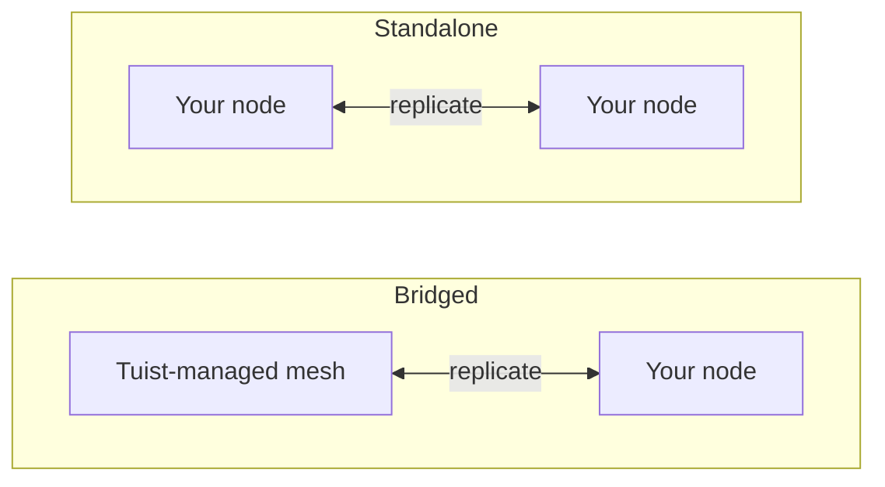

---
{
  "title": "საკუთარ სერვერზე განთავსება",
  "titleTemplate": ":title | კეში | სახელმძღვანელოები | Tuist",
  "description": "შეიტყვეთ, როგორ განათავსოთ Tuist-ის ქეშის კვანძები საკუთარ სერვერზე და მოახდინოთ რეპლიკაცია Tuist-ის მიერ მართულ ქსელთან."
}
---

# საკუთარ სერვერზე განთავსებული ქეში {#self-host-cache}

Tuist-ის ქეში მუშაობს როგორც **კვანძების ბადე**, რომლებიც ერთმანეთთან ახდენენ არტიფაქტების რეპლიკაციას. შეგიძლიათ გაუშვათ საკუთარი ქეშის კვანძები თქვენს ინფრასტრუქტურაზე, რათა ქეში მდებარეობდეს თქვენს დეველოპერებთან და CI-სთან ახლოს, რითაც შემცირდება ქსელური დაშორება, რომელიც წინააღმდეგ შემთხვევაში შეამცირებდა იმ სიჩქარეს, რომლის მიწოდებაც ქეშირებას უნდა მოჰყვეს.

საკუთარ სერვერზე განთავსებული კვანძი არის ერთი კონტეინერი (`ghcr.io/tuist/kura`), რომელიც ინახავს არტიფაქტებს ლოკალურ დისკზე და, როდესაც ის უერთდება პირის ბადეს, ელაპარაკება ამ ბადის დანარჩენ ნაწილს შიდა პირის პორტის მეშვეობით. Tuist ასრულებს **მართვის სიბრტყის** როლს: ის ახდენს ტრაფიკის ავთენტიკაციას, გამოყოფს მართული ქეშის სიმძლავრეს და ზომავს გამოყენებას. ის არასდროს უშვებს ხელს თქვენს კვანძებში.

> [!NOTE]
> ქეშის კვანძების საკუთარ სერვერზე განთავსებას სჭირდება **Enterprise გეგმა**.
>
> კვანძები უკავშირდებიან ან დაჰოსტებულ Tuist სერვერს (`https://tuist.dev`) ან საკუთარ სერვერზე განთავსებულ Tuist სერვერს. Tuist სერვერის საკუთარ სერვერზე განთავსებას სჭირდება ცალკეული სერვერის ლიცენზია. იხილეთ <.localized_link href="/guides/server/self-host/server">სერვერის საკუთარ სერვერზე განთავსების სახელმძღვანელო</.localized_link>.

## ორი ტოპოლოგია {#topologies}

არსებობს საკუთარ სერვერზე განთავსებული კვანძების გაშვების ორი გზა და რომელს მიიღებთ, მთლიანად დამოკიდებულია იმაზე, მუშაობს თუ არა თქვენს ანგარიშზე ასევე **Tuist-ის მიერ მართული** ქეშის რეგიონი.

### შეკრული: Tuist-ის მიერ დაჰოსტებული ბადე + თქვენი კვანძები {#topology-bridged}

თქვენს ანგარიშზე მუშაობს მინიმუმ ერთი Tuist-ის მიერ მართული ქეშის რეგიონი და თქვენი საკუთარ სერვერზე განთავსებული კვანძები **უერთდებიან ამ ბადეს**. ჩაწერები თქვენს კვანძებში უწყვეტად ვრცელდება მართულ ბადეში და კვანძი თბება მართული ბადის არსებული ქეშიდან, როდესაც ის უერთდება. ეს ათავსებს დაბალი ლატენტობის ქეშს თქვენს რანერებთან (რომლებიც ასრულებენ ჩაწერების უმეტესობას), ხოლო მათი ჩაწერები კვებავს საერთო ქეშს. გაითვალისწინეთ, რომ ახალი არტიფაქტები, რომლებიც იწერება მართული ბადის სხვა ადგილებში კვანძის შეერთების **შემდეგ**, ჯერ კიდევ არ ვრცელდება უწყვეტად მასზე; ეს დაგეგმილი გაუმჯობესებაა.

ეს არის სწორი არჩევანი, როდესაც გსურთ on-prem ქეშის სიჩქარე მართული, ყოველთვის ჩართული საერთო ქეშის დათმობის გარეშე.

### დამოუკიდებელი: მხოლოდ თქვენი კვანძები {#topology-standalone}

თქვენს ანგარიშზე **არ** მუშაობს მართული ქეშის რეგიონი. თქვენი კვანძები ქმნიან საკუთარ იზოლირებულ ბადეს თქვენს ინფრასტრუქტურაზე. Tuist-მა მაინც იცის, რომ თქვენი კვანძები არსებობენ (რათა გამოყენება იზომოს), მაგრამ **მონაცემები არ იცვლება Tuist-ის მიერ მართულ ბადესთან**, რადგან ასეთი არ არსებობს. პირის წევრობა და რეპლიკაცია ხდება მთლიანად თქვენს კვანძებში.



კონფიგურაციაში ძირითადი განსხვავება ის არის, რომ **შეკრული** ტოპოლოგია იყენებს **რეგისტრაციას**, სადაც კვანძი ქმნის თავის გასაღებების წყვილს ჩატვირთვისას და Tuist გასცემს მის ბადის სერტიფიკატს, ხოლო **დამოუკიდებელ** ტოპოლოგიას არ აქვს Tuist-ის მიერ გაცემული ბადის სერტიფიკატი. ერთი დამოუკიდებელი კვანძი შეიძლება მუშაობდეს გამორთული პირის TLS-ით; მრავალკვანძიანი დამოუკიდებელი ბადე იყენებს პირის TLS მასალას, რომელსაც თქვენ აწვდით.

## CLI ბოლოწერტილის კონფიგურაცია {#cli-endpoint}

Tuist-ის მართული ქეში იყენებს `https://<account>.cache.tuist.dev`-ს. საკუთარ სერვერზე განთავსებული Tuist სერვერით, CLI იღებს ქეშის URL-ს სერვერის `TUIST_CACHE_ENDPOINTS` პარამეტრიდან. დააყენეთ ის თქვენი მთავარი ქეშის სერვერის ან დატვირთვის ბალანსერის URL-ზე. თუ ის შეიცავს რამდენიმე URL-ს, გამოიყენება პირველი.

პირადი/მორგებული ქეშის კვანძების **დაჰოსტებულ Tuist სერვერთან** დაკავშირებისას, კონფიგურირეთ ცალსახა ბოლოწერტილი დეველოპერის გარსებში და CI-ში:

```sh
export TUIST_CACHE_ENDPOINT=https://cache.example.com
```

ეს გადაფარვა აქვს უპირატესობა ნებისმიერი ტიპის სერვერზე და არის არასავალდებულო საკუთარ სერვერზე განთავსებული Tuist სერვერისთვის. Xcode ქეშის დემონისთვის, ხელახლა გაუშვით `tuist setup cache` მისი დაყენების შემდეგ, რათა LaunchAgent-მა მიიღოს განახლებული გარემო. რამდენიმე კვანძისთვის, გამოიყენეთ თქვენი დატვირთვის ბალანსერი ან DNS მარშრუტიზაციის სახელი.

## წინაპირობები {#prerequisites}


- Docker და Docker Compose (ან ნებისმიერი კონტეინერის გარემო)
- მოქმედი Tuist სერვერი (დაჰოსტებული ან საკუთარ სერვერზე განთავსებული)
- დისკი ქეშისთვის. შეკრული კვანძი პირველი შეერთებისას იწევს ანგარიშის **მთელ** ბადეს, ამიტომ შეარჩიეთ მონაცემთა ტომის ზომა შესაბამისად.

## მართვის სიბრტყის კლიენტის მიწოდება {#control-plane-client}

კვანძი იყენებს მართვის სიბრტყის კლიენტის სარწმუნოებებს ქეშის მოთხოვნების ავთენტიკაციისთვის (ტოკენის ინტროსპექცია), სადაშბორდოზე ანგარიშგებისთვის და გამოყენების მიწოდებისთვის. ეს **არ არის** ის გზა, რომლითაც კლიენტები მიემართებიან თქვენს კვანძებთან საკუთარ სერვერზე განთავსებულ Tuist სერვერზე (იხილეთ [როგორ აღწევენ კლიენტები თქვენს კვანძებამდე](#routing)).

სრულად საკუთარ სერვერზე განთავსებული განლაგებისთვის, შექმენით **UUID კლიენტის ID** და შემთხვევითი საიდუმლო, შემდეგ კი კონფიგურირეთ იგივე წყვილი Tuist სერვერზე და თითოეულ Kura კვანძზე:

```bash
KURA_CONTROL_PLANE_CLIENT_ID="$(uuidgen | tr '[:upper:]' '[:lower:]')"
KURA_CONTROL_PLANE_CLIENT_SECRET="$(openssl rand -base64 32)"
```

დააყენეთ ეს მნიშვნელობები როგორც `KURA_CONTROL_PLANE_CLIENT_ID` და `KURA_CONTROL_PLANE_CLIENT_SECRET` Tuist სერვერის გარემოში, შემდეგ კი გამოიყენეთ იგივე მნიშვნელობები ქვემოთ მოცემულ Kura კონფიგურაციაში. რეგისტრაციის პულსები მოიცავს `KURA_TENANT_ID`-ს, ანგარიშის მუდმივ ქეშის იდენტობას, რათა სერვერმა მიამაგროს კვანძი სწორ ანგარიშს მაშინაც კი, თუ ანგარიში გადაერქვა.

> [!WARNING]
> კლიენტის ID უნდა იყოს UUID `kura_` პრეფიქსის გარეშე. არა-UUID ID-ები იწვევენ ტოკენის ინტროსპექციის შეცდომას HTTP `400`-ით, მაშინაც კი, თუ სარწმუნოებები ემთხვევა ორივე სერვისზე.

თუ უკავშირდებით დაჰოსტებულ `tuist.dev` სერვერს, ან თუ გსურთ ანგარიშისთვის სარწმუნოება, რომლის როტაციაც შესაძლებელია UI-დან, გახსენით ანგარიშის **Cache** გვერდი, აირჩიეთ **Generate credential** და დააკოპირეთ `client_id` პლუს ერთჯერადი `secret`. დაჰოსტებულ სერვერზე, საკუთარ სერვერზე განთავსებული კვანძის სარწმუნოების გენერირებას სჭირდება Enterprise გეგმა.

## მუდმივი არენდატორის არჩევა {#permanent-tenant}

`KURA_TENANT_ID` არის მუდმივი შენახვის და პირის იდენტობა, თავდაპირველად მიღებული ანგარიშის თავდაპირველი სახელიდან. ანგარიშისთვის, რომელსაც არასდროს შეცვლია სახელი, ის ემთხვევა მიმდინარე სახელს. **შეინარჩუნეთ მისი თავდაპირველი მნიშვნელობა ანგარიშის სახელის შეცვლის შემდეგ**, მათ შორის ჩანაცვლებითი კვანძების ან იმავე ბადის სხვა კვანძის დამატებისას. მაგალითად, `original`-ის `renamed`-ად გადაქვითვა ტოვებს `KURA_TENANT_ID=original`-ს თითოეულ კვანძზე. მისი შეცვლა ირჩევს სხვა ობიექტ-გასაღების სივრცეს; ანგარიშის სახელის შეცვლა არ ახდენს შენახული არტიფაქტების ან პირის იდენტობის მიგრაციას.

შეცვალეთ `<permanent-kura-tenant>` ქვემოთ მოცემულ მაგალითებში ამ მნიშვნელობით. გამოიყენეთ არენდატორი არსებული სწორად კონფიგურირებული კვანძიდან, ან `tenant_id`-დან, რომელიც დაბრუნდა რეგისტრაციისას. საკუთარ სერვერზე განთავსებული Tuist სერვერის ოპერატორს შეუძლია შეამოწმოს ანგარიშის `kura_tenant_id` მონაცემთა ბაზის ველი. არ გამოიტანოთ მნიშვნელობა გადაქვითული ანგარიშის URL-დან.

მოქმედი განლაგების დონის კონტროლის პლანის მონაცემებით, რეგისტრაცია და პირების აღმოჩენა აბრუნებს **409 Conflict**-ს `error: "tenant_mismatch"`-ით და `expected_tenant_id`-ით, თუ კვანძი წარადგენს მიმდინარე ან შენარჩუნებულ სახელს, რომელიც განსხვავდება მისი მუდმივი არენდატორისგან. ისინი არ ახდენენ კვანძის რეგისტრაციას ან ფარულად არ ცვლიან შენახვის იდენტობას. არასწორი მონაცემები და უცნობი არენდატორები კვლავ აბრუნებენ **401 Unauthorized**-ს არენდატორის გამჟღავნების გარეშე. თუ კვანძმა უკვე ჩაწერა მონაცემები სხვა არენდატორით, მისი შეცვლამდე გადახედეთ მის კონფიგურაციას და შენახვის ისტორიას; შეცდომის პასუხი არ ასრულებს შენახვის მიგრაციას.

## როგორ აღწევს კლიენტები თქვენს კვანძებამდე {#routing}

დააკონფიგურირეთ ქეშის URL [ზემოთ](#cli-endpoint), რათა დეველოპერების მანქანებმა და CI-მ შეძლონ თქვენს კვანძებთან მიღწევა. საჭაოში თითოეული კვანძის მისამართისა და მზადყოფნის შესატყობინებლად, კვანძზე დააყენეთ `KURA_REGISTRATION_URL` და `KURA_ADVERTISED_HTTP_URL`.

## ხიდური კონფიგურაცია {#bridged-setup}

კვანძი რეგისტრირდება ჩატვირთვისას: ის ლოკალურად ქმნის გასაღებების წყვილს (პირადი გასაღები არასდროს ტოვებს თქვენს ინფრასტრუქტურას), აგზავნის სერთიფიკატის ხელმოწერის მოთხოვნას და იღებს ხელმოწერილ სერთიფიკატს, ანგარიშის CA-ს და მართვადი ბადის შიგამავალი კარიბჭის მისამართს. **თქვენ არ უნდა მოაწოდოთ TLS მასალა**. რეგისტრაცია ჩაწერს მას მონტაჟებულ ტომში.

```yaml
# docker-compose.yml
services:
  kura:
    image: ghcr.io/tuist/kura:<version>
    restart: unless-stopped
    ports:
      - "4000:4000"   # HTTP cache: your developers and CI point here
      - "7443:7443"   # mesh peer port
    environment:
      # Enroll and join the managed mesh
      KURA_ENROLL_ON_BOOT: "1"
      KURA_CONTROL_PLANE_URL: "https://tuist.dev"
      KURA_CONTROL_PLANE_CLIENT_ID: "<client_id>"
      KURA_CONTROL_PLANE_CLIENT_SECRET: "<secret>"
      KURA_TENANT_ID: "<permanent-kura-tenant>"

      # Report the node’s address and readiness to the dashboard
      KURA_REGISTRATION_URL: "https://tuist.dev/_internal/kura/mesh/registrations"
      KURA_ADVERTISED_HTTP_URL: "https://kura.acme.internal"   # where your CLI/CI reach the cache
      KURA_NODE_URL: "https://kura.acme.internal:7443"         # this node's peer identity on your network
      KURA_REGION: "office"

      # Ports and storage. KURA_PORT serves both the HTTP cache API and REAPI
      # gRPC (h2c) on one listener. Enrollment writes the TLS files into
      # KURA_INTERNAL_TLS_* on first boot.
      KURA_PORT: "4000"
      KURA_INTERNAL_PORT: "7443"
      KURA_INTERNAL_TLS_CA_CERT_PATH: "/tls/ca.pem"
      KURA_INTERNAL_TLS_CERT_PATH: "/tls/tls.crt"
      KURA_INTERNAL_TLS_KEY_PATH: "/tls/tls.key"
      KURA_DATA_DIR: "/var/cache/kura"
      KURA_TMP_DIR: "/var/cache/kura/tmp"
      KURA_OTEL_SERVICE_NAME: "kura-acme"
      KURA_OTEL_DEPLOYMENT_ENVIRONMENT: "onprem"

      # Authenticate the HTTP cache API. The Tuist hook ships in the image at
      # this path; it introspects each token against the control plane using the
      # control-plane client above, so only valid Tuist tokens for this account
      # can read or write. No JWT verifier secret is involved.
      KURA_AUTH_ENABLED: "1"
      KURA_AUTH_TUIST_URL: "https://tuist.dev"
    volumes:
      - kura-tls:/tls            # empty; enrollment populates it
      - kura-data:/var/cache/kura
volumes:
  kura-tls: {}
  kura-data: {}
```

რასაც თქვენ უზრუნველყოფთ: კონტროლის პლანის კლიენტი, ორი მისამართი (`KURA_NODE_URL`, `KURA_ADVERTISED_HTTP_URL`) თქვენს ქსელში და ორი ცარიელი ჩაწერადი ტომი. ყველაფერი დანარჩენი (გასაღებების წყვილი, სერთიფიკატი, ანგარიშის CA და მართვადი ბადის მისამართი) ავტომატურად ნაწილდება ჩატვირთვისას.

## დამოუკიდებელი კონფიგურაცია {#standalone-setup}

მართვადი რეგიონის არარსებობის შემთხვევაში არ არსებობს Tuist-ის მიერ გაცემული ბადის CA, ამიტომ რეგისტრაცია არ ვრცელდება (რეგისტრაციის endpoint აბრუნებს `503 ca_unavailable`). კვანძი იყენებს თქვენს Tuist სერვერს ტოკენის აუთენტიფიკაციისთვის, საჭაოში რეგისტრაციის heartbeat-ებისთვის და გამოყენების ანგარიშგებისთვის.

```yaml
# docker-compose.yml for a single node connected to a self-hosted Tuist server
services:
  kura:
    image: ghcr.io/tuist/kura:<version>
    restart: unless-stopped
    ports:
      - "4000:4000"
      - "7443:7443"
    environment:
      KURA_TENANT_ID: "<permanent-kura-tenant>"
      KURA_NODE_URL: "http://kura-1.acme.internal:7443"
      KURA_PEERS: ""   # single node: disable static peer discovery
      KURA_REGION: "office"

      # Authenticate cache requests against the self-hosted Tuist server.
      # Use the same values configured on the Tuist server, or a per-account
      # credential from the Cache page.
      KURA_CONTROL_PLANE_CLIENT_ID: "<client_id>"
      KURA_CONTROL_PLANE_CLIENT_SECRET: "<secret>"
      KURA_AUTH_ENABLED: "1"
      KURA_AUTH_TUIST_URL: "https://tuist.acme.internal"

      # Register the client-facing cache URL with the Tuist server.
      KURA_REGISTRATION_URL: "https://tuist.acme.internal/_internal/kura/mesh/registrations"
      KURA_ADVERTISED_HTTP_URL: "https://kura.acme.internal"

      KURA_PORT: "4000"
      KURA_INTERNAL_PORT: "7443"
      KURA_DATA_DIR: "/var/cache/kura"
      KURA_TMP_DIR: "/var/cache/kura/tmp"
      KURA_OTEL_SERVICE_NAME: "kura-acme"
      KURA_OTEL_DEPLOYMENT_ENVIRONMENT: "onprem"
    volumes:
      - kura-data:/var/cache/kura
volumes:
  kura-data: {}
```

ერთი კვანძისთვის, დატოვეთ პირის TLS დაყენებული და დააყენეთ `KURA_PEERS` ცარიელ სტრიქონად. როდესაც `KURA_PEERS` დაყენებული არ არის, Kura იწყებს სტატიკურ პირთა აღმოჩენას `KURA_NODE_URL`-დან და პერიოდულად ამოწმებს ამ URL-ის `/_internal/status` endpoint-ს. პირის TLS-ის გათიშვისას, `KURA_NODE_URL` უნდა იყენებდეს `http://` სქემას მაშინაც კი, თუ კვანძი ხელმისაწვდომია პირადი ქსელის სახელით.

`KURA_CONTROL_PLANE_URL` არ არის საჭირო ამ მაგალითში, რადგან ავტორიზაცია და გამოყენების ანგარიშგება ორივე იყენებს `KURA_AUTH_TUIST_URL`-ს, როგორც Tuist-ის საბაზისო URL-ს. `KURA_ADVERTISED_HTTP_URL` განსაზღვრავს კვანძის კლიენტისთვის ხელმისაწვდომ მისამართს საჭაოში. დააყენეთ `TUIST_CACHE_ENDPOINTS=https://kura.acme.internal` Tuist სერვერზე, რათა CLI იყენებდეს ამ მისამართს ქეშის მოთხოვნებისთვის.

### Kubernetes Helm-ით {#standalone-helm}

თუ თქვენი საკუთარ სერვერზე განთავსებული Tuist სერვერი მუშაობს Kubernetes-ზე, დააინსტალირეთ Kura დამოუკიდებელი Kura chart-ით და გადაეცით იგივე კონტროლის პლანის პარამეტრები `extraEnv`-ის მეშვეობით. Tuist სერვერის chart არ აინსტალირებს ამ Kura chart-ს, როგორც subchart-ს.

ჯერ დააკონფიგურირეთ Tuist სერვერის chart განლაგების დონის Kura მონაცემებით:

```yaml
# tuist-values.yaml
server:
  extraEnv:
    - name: KURA_CONTROL_PLANE_CLIENT_ID
      valueFrom:
        secretKeyRef:
          name: kura-control-plane
          key: client-id
    - name: KURA_CONTROL_PLANE_CLIENT_SECRET
      valueFrom:
        secretKeyRef:
          name: kura-control-plane
          key: client-secret
```

შემდეგ დააინსტალირეთ Kura იმავე namespace-ში იმავე Secret-ით:

```yaml
# kura-values.yaml
replicaCount: 1

config:
  tenantId: "<permanent-kura-tenant>"
  region: "office"

ingress:
  enabled: true
  className: nginx
  hosts:
    - host: kura.acme.internal
      paths:
        - path: /
          pathType: Prefix
  tls:
    - hosts:
        - kura.acme.internal
      secretName: kura-tls

extraEnv:
  - name: KURA_CONTROL_PLANE_CLIENT_ID
    valueFrom:
      secretKeyRef:
        name: kura-control-plane
        key: client-id
  - name: KURA_CONTROL_PLANE_CLIENT_SECRET
    valueFrom:
      secretKeyRef:
        name: kura-control-plane
        key: client-secret
  - name: KURA_AUTH_ENABLED
    value: "1"
  - name: KURA_AUTH_TUIST_URL
    value: "https://tuist.acme.internal"
  - name: KURA_REGISTRATION_URL
    value: "https://tuist.acme.internal/_internal/kura/mesh/registrations"
  - name: KURA_ADVERTISED_HTTP_URL
    value: "https://kura.acme.internal"
```

```bash
kubectl create namespace tuist
kubectl -n tuist create secret generic kura-control-plane \
  --from-literal=client-id="<client_id>" \
  --from-literal=client-secret="<secret>"

helm upgrade --install kura oci://ghcr.io/tuist/charts/kura \
  --namespace tuist \
  -f kura-values.yaml
```

თუ Kura მუშაობს სხვა namespace-ში, ვიდრე Tuist სერვერი, შექმენით ან სინქრონიზაცია გაუკეთეთ `kura-control-plane` Secret-ს ორივე namespace-ში.

დატოვეთ `extension.enabled` დაუყენებელი, როდესაც იყენებთ გამოსახულებიდან ჩაშენებულ Tuist hook-ს; ეს chart-ის მნიშვნელობა განკუთვნილია ConfigMap-იდან მორგებული hook-ის მონტაჟისთვის. Chart აგენერირებს `KURA_NODE_URL`-ს, `KURA_PEERS`-ს, headless სერვისს, მდგრადობას და probes-ებს თქვენთვის. `replicaCount: 1`-ით, გენერირებული პირის URL არის pod-ის საკუთარი სტაბილური DNS სახელი, ამიტომ ის რჩება ხელმისაწვდომი კლასტერის შიგნით და არ წარმოქმნის ზემოთ აღწერილ ერთკვანძიან გაფრთხილებას. მრავალი რეპლიკისთვის, chart აგენერირებს პირთა სიას StatefulSet DNS-დან; ჩართეთ `peerTls` და მოაწოდეთ TLS Secret, თუ გსურთ mTLS შიდა პირთა სიბრტყეზე.

ერთზე მეტი დამოუკიდებელი კვანძის გასაშვებად, დაამატეთ თქვენი **საკუთარი პირის TLS**, რომელიც მონტაჟებულია `/tls`-ზე (CA და თითოეული კვანძისთვის ფოთლის სერთიფიკატი და გასაღები, იზიარებენ CA-ს, რათა კვანძებმა ერთმანეთს ენდონ), გადაიყვანეთ `KURA_NODE_URL` `https://...:<KURA_INTERNAL_PORT>`-ზე და დაამატეთ `KURA_PEERS`:

```yaml
environment:
  KURA_NODE_URL: "https://kura-1.acme.internal:7443"
  KURA_PEERS: "https://kura-2.acme.internal:7443,https://kura-3.acme.internal:7443"
  KURA_INTERNAL_TLS_CA_CERT_PATH: "/tls/ca.pem"
  KURA_INTERNAL_TLS_CERT_PATH: "/tls/tls.crt"
  KURA_INTERNAL_TLS_KEY_PATH: "/tls/tls.key"
volumes:
  - ./tls:/tls:ro
```

## რა სჭირდება თითოეულ ტოპოლოგიას {#requirements-summary}

| თქვენ უზრუნველყოფთ | ხიდური | დამოუკიდებელი |
|---|---|---|
| კონტროლის პლანის კლიენტი (`client_id` / `secret`) | კი | კი |
| `KURA_NODE_URL` | კი | კი |
| `KURA_ADVERTISED_HTTP_URL` | კი | საჭაოში რეგისტრაციისთვის; მარშრუტიზაცია ცალკეა (იხილეთ ქვემოთ) |
| CLI-მდე მარშრუტიზაცია | ავტომატური (რეგისტრაცია) | ავტომატური მზა რეგისტრაციის heartbeat-ებიდან |
| მონაცემები + დროებითი ტომი | კი | კი |
| `KURA_ENROLL_ON_BOOT` | კი | არა (დააბრუნებდა `ca_unavailable`-ს) |
| პირის TLS (`/tls` CA + ფოთოლი) | არა, რეგისტრაცია წერს მას | მხოლოდ მრავალკვანძიანი ბადისთვის |
| `KURA_PEERS` (პირთა სია) | არა, რეგისტრაცია ავსებს შლუზს | ცარიელი ერთი კვანძისთვის; პირთა URL-ები ერთზე მეტი კვანძისთვის |

## სავალდებულო კონფიგურაცია {#required-config}

ეს ცვლადები აკონფიგურირებენ თითოეულ კვანძს, ტოპოლოგიის მიუხედავად (პირის TLS არის გამონაკლისი, რომელიც აღნიშნულია ქვემოთ):

| ცვლადი | აღწერა |
|---|---|
| `KURA_TENANT_ID` | თქვენი ანგარიშის მუდმივი Kura მომხმარებელი. შეინარჩუნეთ მისი საწყისი მნიშვნელობა ანგარიშის სახელის შეცვლის შემდეგ; იხილეთ [აირჩიეთ მუდმივი მომხმარებელი](#permanent-tenant). |
| `KURA_NODE_URL` | ამ კვანძის პირის URL თქვენს ქსელში. |
| `KURA_PEERS` | სტატიკური პირთა აღმოჩენის სია. დააყენეთ ის ცარიელ სტრიქონად ერთი დამოუკიდებელი კვანძისთვის; დააყენეთ ხელმისაწვდომი პირთა URL-ები მრავალკვანძიანი ბადისთვის. |
| `KURA_REGION` | თავისუფალი ფორმატის რეგიონის ლეიბლი (მაგ. `office`, `ci`). |
| `KURA_PORT` / `KURA_INTERNAL_PORT` | ქეშის პორტი (HTTP ქეშის API და REAPI gRPC განთავსებულია ერთ მოსმენზე) და ბადის პირის პორტი (`4000` / `7443`). |
| `KURA_DATA_DIR` / `KURA_TMP_DIR` | დისკზე არტიფაქტების შენახვა და სამუშაო დირექტორია. |
| `KURA_INTERNAL_TLS_CA_CERT_PATH` / `KURA_INTERNAL_TLS_CERT_PATH` / `KURA_INTERNAL_TLS_KEY_PATH` | პირის TLS ფაილები. იწერება რეგისტრაციის მიერ (ხიდური) ან მოწოდებულია თქვენს მიერ (მრავალკვანძიანი დამოუკიდებელი). არ არის საჭირო ერთი კვანძისთვის; გამოტოვეთ ისინი და გამოიყენეთ `http://` `KURA_NODE_URL`. |
| `KURA_OTEL_SERVICE_NAME` / `KURA_OTEL_DEPLOYMENT_ENVIRONMENT` | სერვისის სახელი და გარემოს ლეიბლი ტელემეტრიისთვის. |

ხიდური კვანძები ასევე აყენებენ `KURA_ENROLL_ON_BOOT`-ს, `KURA_CONTROL_PLANE_URL`-ს და კონტროლის პლანის კლიენტის სერთიფიკატებს. `KURA_REGISTRATION_URL` და `KURA_ADVERTISED_HTTP_URL` აკეთებენ კვანძის რეგისტრაციას, რათა ის გამოჩნდეს **Cache** გვერდზე და რათა Kura-ით აღჭურვილი CLI კლიენტები მიიმართონ მასთან (იხილეთ [როგორ აღწევენ კლიენტები თქვენს კვანძებს](#routing)).

## შენახვა და გათავისუფლება {#storage}

კვანძი ინახავს არტიფაქტებს `KURA_DATA_DIR`-ის ქვეშ CAS შენახვის ბიუჯეტამდე, რომლის დაყენებაც შეგიძლიათ არასავალდებულო ცვლადით:

| ცვლადი | აღწერა |
|---|---|
| `KURA_CAS_CAPACITY_BYTES` | კვანძის CAS შენახვის ბიუჯეტი ბაიტებში. უნდა იყოს დადებითი მთელი რიცხვი. როცა არ არის დაყენებული, ბიუჯეტი არის `KURA_DATA_DIR`-ის შემცველი ფაილური სისტემის ზომის 50%. |

მიუხედავად იმისა, დააყენებთ თუ არა, ბიუჯეტი შეზღუდულია `KURA_DATA_DIR`-ის შემცველი ფაილური სისტემის 80%-ით, რათა როტაციამ, რომელიც წერს ახალ სეგმენტს უძველესის გათავისუფლებამდე, ვერ შეავსოს დისკი. ბიუჯეტი მრგვალდება მთელ 512 MiB სეგმენტებამდე, მინიმუმ 2.5 GiB. კვანძი იწერს გადაწყვეტილ ბიუჯეტს გაშვებისას (`resolved CAS segment ring limits`).

გათავისუფლება ავტომატურია. არტიფაქტები ინახება სეგმენტების რგოლში და როცა ბიუჯეტი მიღწეულია, უძველესი სეგმენტი თავისუფლდება. უფრო ძველი სეგმენტებიდან წაკითხული არტიფაქტები გადადიან მიმდინარეში, ამიტომ ხშირად გამოყენებული არტიფაქტები ნარჩუნდება და გათავისუფლება ქცევით ახლოსაა უახლესად გამოუყენებელთან.

მოათავსეთ `KURA_DATA_DIR` გამოყოფილ ტომზე. როგორც ნაგულისხმები ბიუჯეტი, ასევე ზღვარი არის ფაილური სისტემის მთლიანი ზომის პროცენტული მაჩვენებელი, არა თავისუფალი ადგილის, ამიტომ იმავე ფაილურ სისტემაზე სხვა მონაცემებმა შეიძლება დატოვონ ნაკლები ადგილი, ვიდრე ბიუჯეტი ვარაუდობს.

## ქეშის მოთხოვნების ავთენტიკაცია {#cache-auth}

ნაგულისხმევად კვანძი ემსახურება თავის HTTP ქეშის API-ს ყველას, ვისაც შეუძლია მასთან მიღწევა თქვენს ქსელში. იმისთვის, რომ მოითხოვოთ გამომძახებლებისგან მოქმედი Tuist ტოკენის წარდგენა, რათა მხოლოდ თქვენი ორგანიზაციის ავთენტიფიცირებულმა წევრებმა შეძლონ კითხვა და ჩაწერა, მიმართეთ კვანძი თქვენს Tuist სერვერზე. ზემოთ მოცემული დამოუკიდებელი კონფიგურაცია ამას აკეთებს.

| ცვლადი | მნიშვნელობა |
|---|---|
| `KURA_AUTH_ENABLED` | `1` |
| `KURA_AUTH_TUIST_URL` | თქვენი Tuist სერვერის URL |

ავტორიზაცია ხელახლა იყენებს თქვენს მიერ უკვე დაყენებულ კონტროლის პლანის კლიენტს (`KURA_CONTROL_PLANE_CLIENT_ID` / `KURA_CONTROL_PLANE_CLIENT_SECRET`) ტოკენების შესამოწმებლად, ამიტომ დამატებითი სერთიფიკატი არ არის საჭირო. თვითმასპინძელი კვანძი მუშაობს **მხოლოდ შემოწმების** რეჟიმში: ის არასდროს ინახავს სიმეტრიულ Guardian JWT ვერიფიკატორის საიდუმლოს, რომელსაც შეეძლო ნებისმიერი მომხმარებლისთვის ტოკენების გამოშვება და რომელიც არასდროს არ არის გაზიარებული, ამიტომ ყოველი მოთხოვნა ავტორიზებულია თქვენს სერვერთან. კვანძი, რომელსაც არ შეუძლია მასთან მიღწევა, უარყოფს მომსახურების ნაცვლად და არ არსებობს პარამეტრი, რომელიც ამას ცვლის. Tuist-ის მიერ მართული კვანძები იყენებენ იმავე ავტორიზაციას; ერთადერთი განსხვავებაა, რომ ისინი ასევე ინახავენ ვერიფიკაციის გასაღებს, რაც საშუალებას აძლევს მათ გადაწყვიტონ მოთხოვნების უმეტესობა მხოლოდ ტოკენის საფუძველზე.

## ქსელური კავშირი {#networking}

კვანძი აკეთებს **გამომავალ** კავშირებს იმის მიხედვით, თუ რომელ ინტეგრაციებს ჩართავთ:

- თქვენი Tuist სერვერი ტოკენების შესამოწმებლად (`KURA_AUTH_TUIST_URL`), რეგისტრაციის heartbeat-ებისთვის (`KURA_REGISTRATION_URL`), გამოყენებისთვის (`KURA_CONTROL_PLANE_URL` ან `KURA_AUTH_TUIST_URL`), და რეგისტრაციისთვის ხიდურ ტოპოლოგიაში, და
- ხიდურ ტოპოლოგიაში, მართული ბადის პირის შლუზი, რეპლიკაციისთვის.

თქვენი დეველოპერები და CI აღწევენ კვანძის `KURA_ADVERTISED_HTTP_URL`-ს (და, მრავალკვანძიანი ბადისთვის, კვანძები ერთმანეთს აღწევენ პირის პორტზე). ამ მისამართებს მხოლოდ **თქვენს ქსელში** უნდა ჰქონდეთ ხელმისაწვდომობა. მათ არ სჭირდებათ საჯარო ინტერნეტზე გახსნა.

## როგორ მუშაობს {#behavior}

- **ხიდური.** გაშვებისას კვანძი რეგისტრირდება, იღებს მართული ბადის სრულ ქეშს და გადადის რგოლის მომსახურე წევრად. საწყისი მიღება ხდება ერთხელ და შეიძლება დრო დასჭირდეს WAN-ზე, თქვენი ქეშის ზომის მიხედვით. ამის შემდეგ, კვანძზე ჩაწერები უწყვეტად ვრცელდება მართულ ბადაზე. ახალი არტიფაქტები, რომლებიც დაიწერა სხვაგან მართულ ბადაში კვანძის შეერთების შემდეგ, ჯერ არ ვრცელდება მასზე უწყვეტად (დაგეგმილი გაუმჯობესება), ამიტომ შეერთების დროს მიღება განიხილეთ როგორც სნეპშოტი და არა ცოცხალი სარკე.
- **დამოუკიდებელი.** კვანძ(ებ)ი მუშაობენ როგორც იზოლირებული ბადე თქვენს ინფრასტრუქტურაზე. რეპლიკაცია, თუ არსებობს, ხდება მხოლოდ თქვენს საკუთარ კვანძებს შორის. როცა კონფიგურირებულია, Tuist-ის როლი შემოიფარგლება კონტროლის პლანით: საჭაოში ხილვადობა, ქეშის endpoint-ების რეკლამირება, გამოყენების გაზომვა და ტოკენების შემოწმება. ის არასდროს ამზადებს, ანახლებს, უკავშირდება ან აღწევს თქვენს კვანძებში.

## შემოწმება {#verify}

```bash
curl --fail-with-body http://localhost:4000/ready   # 200 once the node has joined and is serving
curl --fail-with-body http://localhost:4000/up      # liveness + mesh membership
```

ხიდური კვანძი აჩვენებს `state: joining`-ს, სანამ იღებს ბადეს და `state: serving`-ს, როცა აევსება. თქვენი კვანძი ასევე ჩანს **რეგისტრირებული კვანძების** ქვეშ ანგარიშის **Cache** გვერდზე, როცა რეგისტრაციის heartbeat-ები იწყება.

დაშორებული ქეშირების შესამოწმებლად, გაუშვით `tuist cache` არაქეშირებული, ქეშირებადი სამიზნეებით და დაადასტურეთ წარმატებული ატვირთვები Kura-ს ლოგებში. ნულოვანი გასვლის სტატუსი მარტო არ ადასტურებს, რომ არტიფაქტები შეინახა.

## განახლება {#upgrading}

```bash
docker compose pull
docker compose up -d
```

კვანძები შექმნილია ისე, რომ ერთი ვერსიის სხვაობის ფარგლებში გვერდიგვერდ იმუშაონ, ამიტომ რამდენიმე კვანძზე ეტაპობრივი განახლება უსაფრთხოა.
