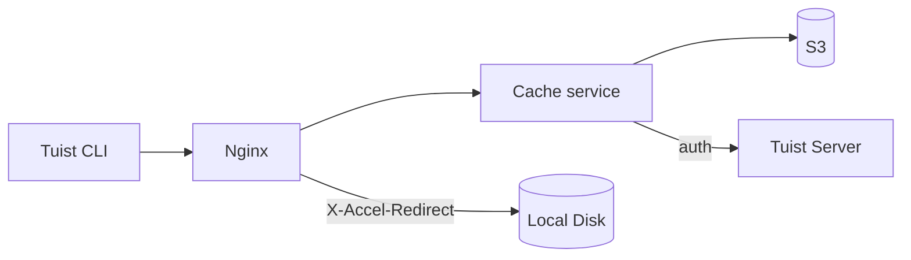
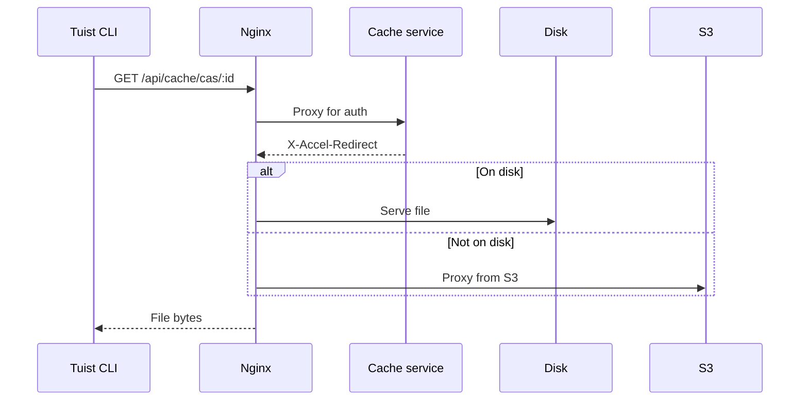
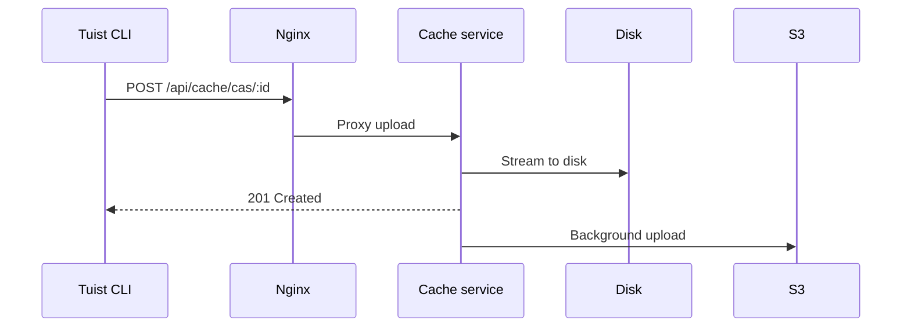

---
{
  "title": "아키텍처",
  "titleTemplate": ":title | 캐시 | 가이드 | Tuist",
  "description": "Tuist 캐시 서비스의 아키텍처에 대해 알아봅니다."
}
---

# 캐시 아키텍처 {#cache-architecture}

> [!NOTE]
> 이 페이지는 Tuist 캐시 서비스 아키텍처에 대한 기술 개요를 제공합니다. 주로 서비스의 내부 동작을 이해해야 하는 **셀프 호스팅 사용자**와 **기여자**를 대상으로 합니다. 캐시를 사용하기만 하는 일반 사용자는 이 내용을 읽을 필요가 없습니다.

Tuist 캐시 서비스는 빌드 아티팩트를 위한 콘텐츠 주소 저장소(CAS)와 캐시 메타데이터를 위한 키-값 저장소를 제공하는 독립형 서비스입니다.

## 개요 {#overview}

이 서비스는 로컬 SQLite 메타데이터와 함께 2계층 스토리지 아키텍처를 사용합니다:

- **로컬 디스크**: 낮은 지연 시간의 캐시 히트를 위한 기본 스토리지
- **S3**: 아티팩트를 영구적으로 저장하고 제거 후 복구를 가능하게 하는 내구성 있는 스토리지
- **SQLite**: 아티팩트 접근 추적, 고아 파일 정리, 백그라운드 작업 및 키-값 캐시 데이터를 위한 로컬 메타데이터

## 컴포넌트 {#components}

### Nginx {#nginx}

Nginx는 진입점 역할을 하며 `X-Accel-Redirect`을 사용하여 효율적인 파일 전송을 처리합니다:

- **다운로드**: 캐시 서비스가 인증을 검증한 후 `X-Accel-Redirect` 헤더를 반환합니다. Nginx는 디스크에서 직접 파일을 제공하거나 S3에서 프록시합니다.
- **업로드**: Nginx가 요청을 캐시 서비스로 프록시하며, 캐시 서비스는 데이터를 디스크로 스트리밍합니다.

### 콘텐츠 주소 저장소 {#cas}

아티팩트는 샤딩된 디렉토리 구조로 로컬 디스크에 저장됩니다:

- **경로**: `{account}/{project}/cas/{shard1}/{shard2}/{artifact_id}`
- **샤딩**: 아티팩트 ID의 첫 네 글자가 2단계 샤드를 생성합니다(예: `ABCD1234` → `AB/CD/ABCD1234`)

### SQLite 메타데이터 {#sqlite}

캐시 서비스는 두 개의 SQLite 데이터베이스를 사용합니다:

- **기본 메타데이터 DB**: `cache_artifacts`, 고아 파일 스캔 커서, Oban 작업 및 기타 서비스 메타데이터를 저장합니다.
- **키-값 DB**: 전용 SQLite 파일에 `key_value_entries`와 `key_value_entry_hashes`를 저장합니다.

키-값 저장소는 아티팩트 메타데이터와 고아 파일 정리 상태에 영향을 주지 않고 SQLite 증분 자동 압축을 사용할 수 있도록 자체 데이터베이스로 분리되었습니다.

### S3 통합 {#s3}

S3는 내구성 있는 스토리지를 제공합니다:

- **백그라운드 업로드**: 디스크에 작성된 후 아티팩트는 매분 실행되는 백그라운드 워커를 통해 S3 업로드 대기열에 추가됩니다
- **온디맨드 하이드레이션**: 로컬 아티팩트가 없을 때 요청은 사전 서명된 S3 URL을 통해 즉시 처리되며, 아티팩트는 로컬 디스크로의 백그라운드 다운로드를 위해 대기열에 추가됩니다

### 디스크 제거 {#eviction}

서비스는 여러 백그라운드 프로세스를 사용하여 디스크 공간을 관리합니다:

- **CAS 디스크 제거**는 `cache_artifacts`를 기반으로 한 LRU 의미 체계를 사용합니다
- 디스크 사용량이 85%를 초과하면 사용량이 70%로 떨어질 때까지 가장 오래된 아티팩트가 삭제됩니다
- 로컬 제거 후에도 아티팩트는 S3에 남아 있습니다
- **KV 제거**는 보존 정책에 따라 오래된 키-값 항목을 제거하며, 구성된 크기 예산을 초과하여 증가할 때 전용 KV 데이터베이스를 축소할 수도 있습니다

### 고아 파일 정리 {#orphan-cleanup}

서비스는 디스크 아티팩트를 위한 고아 파일 정리 워커도 실행합니다:

- 디스크에는 존재하지만 해당 `cache_artifacts` 행이 없는 파일을 찾기 위해 스토리지 트리를 스캔합니다.
- 이는 파일이 디스크에 기록되었지만 SQLite 버퍼 플러시가 완료되기 전에 메타데이터 기록이 손실될 경우 발생할 수 있습니다.
- 진행 중인 업로드와의 경합을 피하기 위해 안전 기간보다 최신인 파일은 무시됩니다.
- 고아 파일이 삭제되고 나중에 다시 요청되면 다음 캐시 미스로 인해 다시 업로드되므로 시스템이 자체 복구됩니다.

### 인증 {#authentication}

캐시는 `/api/projects` 엔드포인트를 호출하고 결과를 캐싱하여(성공 시 10분, 실패 시 3초) 인증을 Tuist 서버에 위임합니다.

## 요청 흐름 {#request-flows}

### 다운로드 {#download-flow}

### 업로드 {#upload-flow}

## API 엔드포인트 {#api-endpoints}

| 엔드포인트 | 메서드 | 설명 |
|----------|--------|-------------|
| `/up` | GET | 헬스 체크 |
| `/metrics` | GET | Prometheus 메트릭 |
| `/api/cache/cas/:id` | GET | CAS 아티팩트 다운로드 |
| `/api/cache/cas/:id` | POST | CAS 아티팩트 업로드 |
| `/api/cache/keyvalue/:cas_id` | GET | 키-값 항목 가져오기 |
| `/api/cache/keyvalue` | PUT | 키-값 항목 저장 |
| `/api/cache/module/:id` | HEAD | 모듈 아티팩트 존재 여부 확인 |
| `/api/cache/module/:id` | GET | 모듈 아티팩트 다운로드 |
| `/api/cache/module/start` | POST | 멀티파트 업로드 시작 |
| `/api/cache/module/part` | POST | 파트 업로드 |
| `/api/cache/module/complete` | POST | 멀티파트 업로드 완료 |
