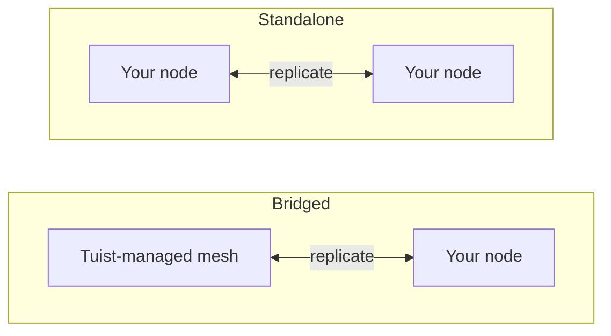

---
{
  "title": "셀프 호스팅",
  "titleTemplate": ":title | 캐시 | 가이드 | Tuist",
  "description": "Tuist 캐시 노드를 셀프 호스팅하고 Tuist에서 호스팅하는 메시와 복제하는 방법을 알아보세요."
}
---

# 셀프 호스트 캐시 {#self-host-cache}

Tuist의 캐시는 아티팩트를 서로 복제하는 **노드 메쉬**로 작동합니다. 인프라에 자체 캐시 노드를 실행하여 개발자와 CI 근처에 캐시를 배치하면, 캐싱이 제공하려는 속도를 저해하던 네트워크 거리를 줄일 수 있습니다.

셀프 호스트 노드는 로컬 디스크에 아티팩트를 저장하고 피어 메쉬에 가입하면 내부 피어 포트를 통해 나머지 메쉬와 통신하는 단일 컨테이너(`ghcr.io/tuist/kura`)입니다. Tuist는 트래픽을 인증하고 관리형 캐시 용량을 프로비저닝하며 사용량을 측정하는 **컨트롤 플레인** 역할을 합니다. Tuist는 노드 내부에 직접 접근하지 않습니다.

> [!NOTE]
> 캐시 노드를 셀프 호스팅하려면 **Enterprise 요금제**가 필요합니다.
>
> 노드는 호스팅된 Tuist 서버(`https://tuist.dev`) 또는 셀프 호스트 Tuist 서버 중 하나에 연결됩니다. Tuist 서버 자체를 셀프 호스팅하려면 별도의 서버 라이선스가 필요합니다. <.localized_link href="/guides/server/self-host/server">서버 셀프 호스팅 가이드</.localized_link>를 참조하세요.

## 두 가지 토폴로지 {#topologies}

셀프 호스트 노드를 실행하는 방법은 두 가지이며, 어떤 방식을 사용할지는 계정이 **Tuist 관리형** 캐시 리전을 함께 실행하는지에 따라 결정됩니다.

### 브리징: Tuist 호스팅 메쉬 + 사용자 노드 {#topology-bridged}

계정에서 최소 하나의 Tuist 관리형 캐시 리전을 실행 중이며, 셀프 호스트 노드가 해당 메쉬에 **가입**합니다. 노드에 대한 쓰기 작업은 관리형 메쉬로 지속적으로 전파되며, 노드가 가입할 때 관리형 메쉬의 기존 캐시로부터 워밍업됩니다. 이렇게 하면 대부분의 쓰기를 수행하는 러너 옆에 저지연 캐시가 배치되고, 그 쓰기 작업이 공유 캐시에 공급됩니다. 관리형 메쉬의 다른 곳에서 노드 가입 **이후**에 작성된 새로운 아티팩트는 아직 해당 노드로 지속적으로 전파되지 않는다는 점에 유의하세요. 이는 향후 개선 예정 사항입니다.

공유되고 항상 활성화된 관리형 캐시를 포기하지 않고 온프레미스 캐시의 속도를 원할 때 적합한 선택입니다.

### 독립형: 사용자 노드만 사용 {#topology-standalone}

계정에서 관리형 캐시 리전을 **실행하지 않습니다**. 노드는 인프라에서 자체 격리 메쉬를 형성합니다. Tuist는 노드의 존재를 인지하므로(사용량이 측정됨) **Tuist 관리형 메쉬와 데이터가 교환되지 않습니다**. 그러한 메쉬가 없기 때문입니다. 피어 멤버십과 복제는 전적으로 사용자 노드 내에서 발생합니다.



구성상의 주요 차이점은 **브리징** 토폴로지가 부팅 시 노드가 키 쌍을 생성하고 Tuist가 메쉬 인증서를 발급하는 **등록(enrollment)** 방식을 사용하는 반면, **독립형** 토폴로지는 Tuist에서 발급한 메쉬 인증서가 없다는 점입니다. 단일 독립형 노드는 피어 TLS를 비활성화한 상태로 실행할 수 있으며, 다중 노드 독립형 메쉬는 사용자가 제공하는 피어 TLS 자료를 사용합니다.

## CLI 엔드포인트 구성 {#cli-endpoint}

Tuist의 관리형 캐시는 `https://<account>.cache.tuist.dev`를 사용합니다. 셀프 호스트 Tuist 서버에서는 CLI가 서버의 `TUIST_CACHE_ENDPOINTS` 설정에서 캐시 URL을 가져옵니다. 이를 주 캐시 서버 또는 로드 밸런서의 URL로 설정하세요. 여러 URL이 포함된 경우 첫 번째 URL이 사용됩니다.

개인/カスタム 캐시 노드를 **호스팅된 Tuist 서버**에 연결할 때는 개발자 셸과 CI에서 명시적 엔드포인트를 구성하세요:

```sh
export TUIST_CACHE_ENDPOINT=https://cache.example.com
```

이 재정의는 두 서버 유형 모두에서 우선 적용되며, 셀프 호스트 Tuist 서버에서는 선택 사항입니다. Xcode 캐시 데몬의 경우, LaunchAgent가 업데이트된 환경을 수신하도록 설정 후 `tuist setup cache`를 다시 실행하세요. 여러 노드의 경우 로드 밸런서 또는 DNS 라우팅 이름을 사용하세요.

## 필수 조건 {#prerequisites}


- Docker 및 Docker Compose(또는 모든 컨테이너 런타임)
- 실행 중인 Tuist 서버(호스팅 또는 셀프 호스트)
- 캐시용 디스크. 브리징 노드는 처음 가입할 때 계정의 **전체** 메쉬를 가져오므로 이에 맞게 데이터 볼륨 크기를 조정하세요.

## 컨트롤 플레인 클라이언트 제공 {#control-plane-client}

노드는 컨트롤 플레인 클라이언트 자격 증명을 사용하여 캐시 요청(토큰 인트로스펙션)을 인증하고, 대시보드에 보고하며, 사용량을 전달합니다. 이는 셀프 호스트 Tuist 서버에서 클라이언트가 노드로 라우팅되는 방식이 **아닙니다**([클라이언트가 노드에 도달하는 방법](#routing) 참조).

완전히 셀프 호스팅된 배포의 경우, **UUID 클라이언트 ID**와 무작위 시크릿을 생성한 다음, Tuist 서버와 각 Kura 노드에 동일한 쌍을 구성하세요:

```bash
KURA_CONTROL_PLANE_CLIENT_ID="$(uuidgen | tr '[:upper:]' '[:lower:]')"
KURA_CONTROL_PLANE_CLIENT_SECRET="$(openssl rand -base64 32)"
```

해당 값을 Tuist 서버 환경에서 `KURA_CONTROL_PLANE_CLIENT_ID` 및 `KURA_CONTROL_PLANE_CLIENT_SECRET`로 설정한 다음, 아래 Kura 구성에서 동일한 값을 사용하세요. 등록 하트비트에는 계정의 영구 캐시 식별자인 `KURA_TENANT_ID`가 포함되어 있어, 계정 이름 변경 후에도 서버가 노드를 올바른 계정에 연결할 수 있습니다.

> [!WARNING]
> 클라이언트 ID는 `kura_` 접두사가 없는 UUID여야 합니다. UUID가 아닌 ID는 두 서비스 간 자격 증명이 일치하더라도 HTTP `400` 오류로 토큰 인트로스펙션이 실패합니다.

호스팅된 `tuist.dev` 서버에 연결하거나 UI에서 회전할 수 있는 계정별 자격 증명을 원하는 경우, 계정의 **Cache** 페이지를 열고 **Generate credential**을 선택한 후 `client_id`와 일회용 `secret`를 복사하세요. 호스팅된 서버에서는 셀프 호스트 노드 자격 증명 생성에 Enterprise 요금제가 필요합니다.

## 영구 테넌트 선택 {#permanent-tenant}

`KURA_TENANT_ID`는 영구 스토리지 및 피어 식별자로, 처음에는 계정의 원래 핸들에서 파생됩니다. 이름이 변경된 적이 없는 계정의 경우 현재 핸들과 일치합니다. 대체 노드를 추가하거나 같은 메쉬에 다른 노드를 추가할 때를 포함하여, 계정 이름 변경 후에도 **원래 값을 유지**하세요. 예를 들어, `original`를 `renamed`로 변경해도 모든 노드에서 `KURA_TENANT_ID=original`는 그대로 유지됩니다. 이를 변경하면 다른 객체 키 네임스페이스가 선택되며, 계정 이름 변경은 저장된 아티팩트나 피어 식별자를 이전하지 않습니다.

아래 예제의 `<permanent-kura-tenant>`를 이 값으로 교체하세요. 기존에 올바르게 구성된 노드의 테넌트를 재사용하거나 등록 시 반환된 `tenant_id`를 사용하세요. 셀프 호스트 Tuist 서버 운영자는 계정의 `kura_tenant_id` 데이터베이스 필드를 검사할 수 있습니다. 이름이 변경된 계정의 URL에서 값을 추론하지 마세요.

유효한 배포 수준 제어 평면 자격 증명을 사용할 때, 노드가 영구 테넌트와 다른 현재 또는 기존 핸들을 제공하면 등록 및 피어 검색에서 `error: "tenant_mismatch"` 및 `expected_tenant_id`와 함께 **409 Conflict**를 반환합니다. 이 경우 노드가 등록되거나 스토리지 식별자가 자동으로 대체되지 않습니다. 잘못된 자격 증명과 알 수 없는 테넌트는 여전히 테넌트를 노출하지 않고 **401 Unauthorized**를 반환합니다. 노드가 이미 다른 테넌트로 데이터를 기록한 경우, 변경하기 전에 구성과 스토리지 기록을 검토하세요. 오류 응답은 스토리지 마이그레이션을 수행하지 않습니다.

## 클라이언트가 노드에 도달하는 방법 {#routing}

개발자 머신과 CI가 노드에 도달할 수 있도록 [위](#cli-endpoint)의 캐시 URL을 구성하세요. 대시보드에 각 노드의 주소와 준비 상태를 보고하려면 노드에서 `KURA_REGISTRATION_URL` 및 `KURA_ADVERTISED_HTTP_URL`를 설정하세요.

## 브릿지 설정 {#bridged-setup}

노드는 부팅 시 등록됩니다: 로컬에서 키 쌍을 생성하고(비공개 키는 인프라 외부로 나가지 않음), 인증서 서명 요청을 보내며, 서명된 인증서, 계정 CA 및 관리형 메쉬의 게이트웨이 주소를 받습니다. **TLS 자료를 직접 제공할 필요가 없습니다**. 등록 과정에서 마운트된 볼륨에 이를 기록합니다.

```yaml
# docker-compose.yml
services:
  kura:
    image: ghcr.io/tuist/kura:<version>
    restart: unless-stopped
    ports:
      - "4000:4000"   # HTTP cache: your developers and CI point here
      - "7443:7443"   # mesh peer port
    environment:
      # Enroll and join the managed mesh
      KURA_ENROLL_ON_BOOT: "1"
      KURA_CONTROL_PLANE_URL: "https://tuist.dev"
      KURA_CONTROL_PLANE_CLIENT_ID: "<client_id>"
      KURA_CONTROL_PLANE_CLIENT_SECRET: "<secret>"
      KURA_TENANT_ID: "<permanent-kura-tenant>"

      # Report the node’s address and readiness to the dashboard
      KURA_REGISTRATION_URL: "https://tuist.dev/_internal/kura/mesh/registrations"
      KURA_ADVERTISED_HTTP_URL: "https://kura.acme.internal"   # where your CLI/CI reach the cache
      KURA_NODE_URL: "https://kura.acme.internal:7443"         # this node's peer identity on your network
      KURA_REGION: "office"

      # Ports and storage. KURA_PORT serves both the HTTP cache API and REAPI
      # gRPC (h2c) on one listener. Enrollment writes the TLS files into
      # KURA_INTERNAL_TLS_* on first boot.
      KURA_PORT: "4000"
      KURA_INTERNAL_PORT: "7443"
      KURA_INTERNAL_TLS_CA_CERT_PATH: "/tls/ca.pem"
      KURA_INTERNAL_TLS_CERT_PATH: "/tls/tls.crt"
      KURA_INTERNAL_TLS_KEY_PATH: "/tls/tls.key"
      KURA_DATA_DIR: "/var/cache/kura"
      KURA_TMP_DIR: "/var/cache/kura/tmp"
      KURA_OTEL_SERVICE_NAME: "kura-acme"
      KURA_OTEL_DEPLOYMENT_ENVIRONMENT: "onprem"

      # Authenticate the HTTP cache API. The Tuist hook ships in the image at
      # this path; it introspects each token against the control plane using the
      # control-plane client above, so only valid Tuist tokens for this account
      # can read or write. No JWT verifier secret is involved.
      KURA_AUTH_ENABLED: "1"
      KURA_AUTH_TUIST_URL: "https://tuist.dev"
    volumes:
      - kura-tls:/tls            # empty; enrollment populates it
      - kura-data:/var/cache/kura
volumes:
  kura-tls: {}
  kura-data: {}
```

제공해야 할 사항: 제어 평면 클라이언트, 네트워크상의 두 주소(`KURA_NODE_URL`, `KURA_ADVERTISED_HTTP_URL`), 그리고 두 개의 빈 쓰기 가능 볼륨입니다. 나머지 항목(키 쌍, 인증서, 계정 CA 및 관리형 메쉬 주소)은 부팅 시 자동으로 프로비저닝됩니다.

## 스탠드얼론 설정 {#standalone-setup}

관리되는 리전이 없으면 Tuist에서 발급한 메쉬 CA가 없으므로 등록이 적용되지 않습니다(등록 엔드포인트는 `503 ca_unavailable`를 반환함). 노드는 토큰 인증, 대시보드 등록 하트비트 및 사용량 보고를 위해 Tuist 서버를 사용합니다.

```yaml
# docker-compose.yml for a single node connected to a self-hosted Tuist server
services:
  kura:
    image: ghcr.io/tuist/kura:<version>
    restart: unless-stopped
    ports:
      - "4000:4000"
      - "7443:7443"
    environment:
      KURA_TENANT_ID: "<permanent-kura-tenant>"
      KURA_NODE_URL: "http://kura-1.acme.internal:7443"
      KURA_PEERS: ""   # single node: disable static peer discovery
      KURA_REGION: "office"

      # Authenticate cache requests against the self-hosted Tuist server.
      # Use the same values configured on the Tuist server, or a per-account
      # credential from the Cache page.
      KURA_CONTROL_PLANE_CLIENT_ID: "<client_id>"
      KURA_CONTROL_PLANE_CLIENT_SECRET: "<secret>"
      KURA_AUTH_ENABLED: "1"
      KURA_AUTH_TUIST_URL: "https://tuist.acme.internal"

      # Register the client-facing cache URL with the Tuist server.
      KURA_REGISTRATION_URL: "https://tuist.acme.internal/_internal/kura/mesh/registrations"
      KURA_ADVERTISED_HTTP_URL: "https://kura.acme.internal"

      KURA_PORT: "4000"
      KURA_INTERNAL_PORT: "7443"
      KURA_DATA_DIR: "/var/cache/kura"
      KURA_TMP_DIR: "/var/cache/kura/tmp"
      KURA_OTEL_SERVICE_NAME: "kura-acme"
      KURA_OTEL_DEPLOYMENT_ENVIRONMENT: "onprem"
    volumes:
      - kura-data:/var/cache/kura
volumes:
  kura-data: {}
```

단일 노드의 경우 피어 TLS를 설정하지 않고 `KURA_PEERS`를 빈 문자열로 설정하세요. `KURA_PEERS`가 설정되지 않으면 Kura는 `KURA_NODE_URL`에서 정적 피어 검색을 초기화하고 해당 URL의 `/_internal/status` 엔드포인트를 주기적으로 확인합니다. 피어 TLS가 비활성화된 경우, 노드가 사설 네트워크 이름으로 접근 가능하더라도 `KURA_NODE_URL`는 `http://` 스키마를 사용해야 합니다.

인증과 사용량 리포터 모두 `KURA_AUTH_TUIST_URL`를 Tuist 기본 URL로 사용하므로 이 예제에서는 `KURA_CONTROL_PLANE_URL`가 필요하지 않습니다. `KURA_ADVERTISED_HTTP_URL`는 대시보드에서 노드의 클라이언트 facing 주소를 식별합니다. CLI가 캐시 요청에 해당 주소를 사용하도록 Tuist 서버에서 `TUIST_CACHE_ENDPOINTS=https://kura.acme.internal`를 설정하세요.

### Helm을 사용한 Kubernetes {#standalone-helm}

셀프 호스트 Tuist 서버가 Kubernetes에서 실행되는 경우, 스탠드얼론 Kura 차트로 Kura를 설치하고 `extraEnv`를 통해 동일한 제어 평면 설정을 전달하세요. Tuist 서버 차트는 이 Kura 차트를 서브차트로 설치하지 않습니다.

먼저, 배포 수준의 Kura 자격 증명으로 Tuist 서버 차트를 구성하세요:

```yaml
# tuist-values.yaml
server:
  extraEnv:
    - name: KURA_CONTROL_PLANE_CLIENT_ID
      valueFrom:
        secretKeyRef:
          name: kura-control-plane
          key: client-id
    - name: KURA_CONTROL_PLANE_CLIENT_SECRET
      valueFrom:
        secretKeyRef:
          name: kura-control-plane
          key: client-secret
```

그런 다음 동일한 네임스페이스에 동일한 Secret을 사용하여 Kura를 설치하세요:

```yaml
# kura-values.yaml
replicaCount: 1

config:
  tenantId: "<permanent-kura-tenant>"
  region: "office"

ingress:
  enabled: true
  className: nginx
  hosts:
    - host: kura.acme.internal
      paths:
        - path: /
          pathType: Prefix
  tls:
    - hosts:
        - kura.acme.internal
      secretName: kura-tls

extraEnv:
  - name: KURA_CONTROL_PLANE_CLIENT_ID
    valueFrom:
      secretKeyRef:
        name: kura-control-plane
        key: client-id
  - name: KURA_CONTROL_PLANE_CLIENT_SECRET
    valueFrom:
      secretKeyRef:
        name: kura-control-plane
        key: client-secret
  - name: KURA_AUTH_ENABLED
    value: "1"
  - name: KURA_AUTH_TUIST_URL
    value: "https://tuist.acme.internal"
  - name: KURA_REGISTRATION_URL
    value: "https://tuist.acme.internal/_internal/kura/mesh/registrations"
  - name: KURA_ADVERTISED_HTTP_URL
    value: "https://kura.acme.internal"
```

```bash
kubectl create namespace tuist
kubectl -n tuist create secret generic kura-control-plane \
  --from-literal=client-id="<client_id>" \
  --from-literal=client-secret="<secret>"

helm upgrade --install kura oci://ghcr.io/tuist/charts/kura \
  --namespace tuist \
  -f kura-values.yaml
```

Kura가 Tuist 서버와 다른 네임스페이스에서 실행되는 경우, `kura-control-plane` Secret을 생성하거나 두 네임스페이스 모두에 동기화하세요.

이미지에 포함된 Tuist 훅을 사용할 때는 `extension.enabled`를 설정하지 않은 상태로 두세요. 해당 차트 값은 ConfigMap에서 custom hook을 마운트하기 위한 것입니다. 차트는 `KURA_NODE_URL`, `KURA_PEERS`, 헤드리스 서비스, 지속성 저장소 및 프로브를 자동으로 렌더링합니다. `replicaCount: 1`인 경우, 생성된 피어 URL은 Pod 자체의 안정적인 DNS 이름이므로 클러스터 내부에서 계속 접근 가능하며 위에서 설명한 단일 노드 경고를 발생시키지 않습니다. 여러 복제본의 경우 차트는 StatefulSet DNS에서 피어 목록을 생성합니다. 내부 피어 플레인에서 mTLS를 사용하려면 `peerTls`를 활성화하고 TLS Secret을 제공하세요.

두 개 이상의 스탠드얼론 노드를 실행하려면, `/tls`에 마운트된 **자체 피어 TLS**(노드 간 신뢰를 위해 공유 CA를 사용하는 CA와 노드당 리프 인증서 및 키)를 추가하고, `KURA_NODE_URL`를 `https://...:<KURA_INTERNAL_PORT>`로 변경한 후 `KURA_PEERS`를 추가하세요:

```yaml
environment:
  KURA_NODE_URL: "https://kura-1.acme.internal:7443"
  KURA_PEERS: "https://kura-2.acme.internal:7443,https://kura-3.acme.internal:7443"
  KURA_INTERNAL_TLS_CA_CERT_PATH: "/tls/ca.pem"
  KURA_INTERNAL_TLS_CERT_PATH: "/tls/tls.crt"
  KURA_INTERNAL_TLS_KEY_PATH: "/tls/tls.key"
volumes:
  - ./tls:/tls:ro
```

## 각 토폴로지가 요구하는 사항 {#requirements-summary}

| 제공 항목 | 브릿지 | 스탠드얼론 |
|---|---|---|
| 제어 평면 클라이언트(`client_id` / `secret`) | 예 | 예 |
| `KURA_NODE_URL` | 예 | 예 |
| `KURA_ADVERTISED_HTTP_URL` | 예 | 대시보드 등록용; 라우팅은 별도(아래 참조) |
| CLI로의 라우팅 | 자동(등록) | 준비된 등록 하트비트로부터 자동 |
| 데이터 + 임시 볼륨 | 예 | 예 |
| `KURA_ENROLL_ON_BOOT` | 예 | 아니요(`ca_unavailable` 반환) |
| 피어 TLS(`/tls` CA + 리프) | 아니요, 등록 시 기록됨 | 다중 노드 메쉬만 해당 |
| `KURA_PEERS`(피어 목록) | 아니요, 등록 시 게이트웨이 시드 생성 | 단일 노드의 경우 비워 두세요. 다중 노드의 경우 피어 URL을 설정하세요. |

## 필수 구성 {#required-config}

이 변수들은 토폴로지와 관계없이 모든 노드를 구성합니다(피어 TLS는 아래에 명시된 예외 사항입니다).

| 변수 | 설명 |
|---|---|
| `KURA_TENANT_ID` | 계정의 영구 Kura 테넌트입니다. 계정 이름을 변경한 후에도 원래 값을 유지하세요. [영구 테넌트 선택](#permanent-tenant)을 참조하세요. |
| `KURA_NODE_URL` | 네트워크 상에서 이 노드의 피어 URL입니다. |
| `KURA_PEERS` | 정적 피어 검색 목록입니다. 단일 스탠드얼론 노드의 경우 빈 문자열로 설정하고, 다중 노드 메쉬의 경우 접근 가능한 피어 URL을 설정하세요. |
| `KURA_REGION` | 자유 형식의 지역 라벨(예: `office`, `ci`). |
| `KURA_PORT` / `KURA_INTERNAL_PORT` | 캐시 포트(HTTP 캐시 API와 REAPI gRPC가 하나의 리스너에서 공동 호스팅됨) 및 메쉬 피어 포트(`4000` / `7443`). |
| `KURA_DATA_DIR` / `KURA_TMP_DIR` | 디스크 기반 아티팩트 저장소 및 임시 디렉터리입니다. |
| `KURA_INTERNAL_TLS_CA_CERT_PATH` / `KURA_INTERNAL_TLS_CERT_PATH` / `KURA_INTERNAL_TLS_KEY_PATH` | 피어 TLS 파일입니다. 브릿지 토폴로지에서는 등록 시 기록되며, 다중 노드 스탠드얼론 토폴로지에서는 사용자가 제공합니다. 단일 노드에는 필요하지 않으므로 이를 생략하고 `http://` `KURA_NODE_URL`를 사용하세요. |
| `KURA_OTEL_SERVICE_NAME` / `KURA_OTEL_DEPLOYMENT_ENVIRONMENT` | 텔레메트리용 서비스 이름 및 환경 라벨입니다. |

브릿지 노드는 추가로 `KURA_ENROLL_ON_BOOT`, `KURA_CONTROL_PLANE_URL` 및 제어 평면 클라이언트 자격 증명을 설정합니다. `KURA_REGISTRATION_URL`와 `KURA_ADVERTISED_HTTP_URL`는 노드를 등록하여 **캐시** 페이지에 표시되게 하고 Kura가 활성화된 CLI 클라이언트가 해당 노드로 라우팅되도록 합니다([클라이언트가 노드에 도달하는 방법](#routing) 참조).

## 저장소 및 제거 {#storage}

노드는 `KURA_DATA_DIR` 아래에 CAS 저장소 예산까지 아티팩트를 저장하며, 이는 선택적 변수로 설정할 수 있습니다.

| 변수 | 설명 |
|---|---|
| `KURA_CAS_CAPACITY_BYTES` | 노드의 CAS 저장소 예산(바이트 단위)입니다. 양의 정수여야 합니다. 설정하지 않으면 예산은 `KURA_DATA_DIR`를 포함하는 파일 시스템 크기의 50%가 됩니다. |

설정 여부와 상관없이 예산은 `KURA_DATA_DIR`를 포함하는 파일 시스템의 80%로 제한되므로, 가장 오래된 세그먼트를 제거하기 전에 새 세그먼트를 기록하는 회전 과정에서 디스크가 가득 차는 것을 방지합니다. 예산은 최소 2.5 GiB로 전체 512 MiB 세그먼트 단위로 반올림됩니다. 노드는 시작 시 해결된 예산을 로그로 기록합니다(`resolved CAS segment ring limits`).

제거는 자동으로 수행됩니다. 아티팩트는 세그먼트 링에 저장되며, 예산에 도달하면 가장 오래된 세그먼트가 제거됩니다. 이전 세그먼트에서 읽은 아티팩트는 현재 세그먼트로 승격되므로 자주 사용되는 아티팩트는 유지되고 제거 동작은 LRU(Least Recently Used)와 유사하게 작동합니다.

`KURA_DATA_DIR`를 전용 볼륨에 배치하세요. 기본 예산과上限 모두 파일 시스템의 총 크기 대비 비율이며 여유 공간 대비 비율이 아니므로, 동일한 파일 시스템의 다른 데이터로 인해 예산이 가정하는 것보다 공간이 부족해질 수 있습니다.

## 캐시 요청 인증 {#cache-auth}

기본적으로 노드는 네트워크에서 접근 가능한 모든 대상에게 HTTP 캐시 API를 제공합니다. 조직의 인증된 멤버만 읽고 쓸 수 있도록 호출자가 유효한 Tuist 토큰을 제시하도록 요구하려면 노드를 Tuist 서버로 지정하세요. 위의 스탠드얼론 설정이 이를 수행합니다.

| 변수 | 값 |
|---|---|
| `KURA_AUTH_ENABLED` | `1` |
| `KURA_AUTH_TUIST_URL` | Tuist 서버 URL |

인증은 이미 설정한 제어 평면 클라이언트(`KURA_CONTROL_PLANE_CLIENT_ID` / `KURA_CONTROL_PLANE_CLIENT_SECRET`)를 재사용하여 토큰을 검사하므로 추가 자격 증명이 필요하지 않습니다. 셀프 호스트 노드는 **검사만 수행**합니다. 모든 테넌트에 대해 토큰을 발행할 수 있는 대칭 Guardian JWT 검증기 비밀 키를 보유하지 않으며 이는 절대 공유되지 않으므로 모든 요청은 서버에 대해 승인됩니다. 이에 접근할 수 없는 노드는 제공 대신 거부하며, 이를 변경하는 설정은 없습니다. Tuist 관리 노드도 동일한 인증을 실행하며, 유일한 차이점은 검증 키도 보유하여 대부분의 요청을 토큰만으로 처리할 수 있다는 점입니다.

## 네트워킹 {#networking}

노드는 활성화한 통합에 따라 **아웃바운드** 연결을 수행합니다.

- 토큰 검사(`KURA_AUTH_TUIST_URL`), 등록 하트비트(`KURA_REGISTRATION_URL`), 사용량(`KURA_CONTROL_PLANE_URL` 또는 `KURA_AUTH_TUIST_URL`), 그리고 브릿지 토폴로지에서의 등록을 위한 Tuist 서버, 그리고
- 브릿지 토폴로지에서는 복제를 위한 관리형 메쉬의 피어 게이트웨이.

개발자와 CI는 노드의 `KURA_ADVERTISED_HTTP_URL`에 접근합니다(다중 노드 메쉬의 경우 노드 간에는 피어 포트로 서로 접근). 이러한 주소는 **네트워크 내부**에서만 접근 가능하면 됩니다. 공개 인터넷에 노출될 필요는 없습니다.

## 동작 방식 {#behavior}

- **브릿지.** 부팅 시 노드는 등록하고, 관리형 메쉬의 전체 캐시를 가져온 후, 링의 서비스 멤버로 전환됩니다. 초기 가져오기는 한 번 발생하며 캐시 크기에 따라 WAN 환경에서 시간이 걸릴 수 있습니다. 그 이후에는 노드의 쓰기 작업이 관리형 메쉬로 지속적으로 전파됩니다. 노드가 가입한 후 관리형 메쉬의 다른 곳에서 작성된 새 아티팩트는 아직 지속적으로 전파되지 않으므로(계획된 개선 사항), 가입 시점의 가져오기를 실시간 미러링이 아닌 스냅샷으로 취급하세요.
- **스탠드얼론.** 노드는 인프라에서 격리된 메쉬로 실행됩니다. 복제가 있다면 자체 노드 간에만 발생합니다. 구성된 경우 Tuist의 역할은 제어 평면으로 제한됩니다. 대시보드 가시성, 캐시 엔드포인트 광고, 사용량 계측 및 토큰 검사가 이에 해당합니다. Tuist는 노드를 프로비저닝, 업그레이드, 피어링하거나 노드 내부에 접근하지 않습니다.

## 확인 {#verify}

```bash
curl --fail-with-body http://localhost:4000/ready   # 200 once the node has joined and is serving
curl --fail-with-body http://localhost:4000/up      # liveness + mesh membership
```

브릿지 노드는 메쉬를 가져오는 동안 `state: joining`를 보고하고, 동기화가 완료되면 `state: serving`를 보고합니다. 등록 하트비트가 시작되면 노드는 계정의 **캐시** 페이지에서 **등록된 노드** 아래에도 표시됩니다.

원격 캐싱을 확인하려면 캐시되지 않은 캐시 가능 타겟으로 `tuist cache`를 실행하고 Kura 로그에서 업로드 성공을 확인하세요. 종료 상태가 0인 것만으로 아티팩트가 저장되었음을 확인하지는 않습니다.

## 업그레이드 {#upgrading}

```bash
docker compose pull
docker compose up -d
```

노드는 한 버전 차이를 두고 병렬로 실행되도록 설계되었으므로, 여러 노드에 대한 롤링 업그레이드가 안전합니다.
