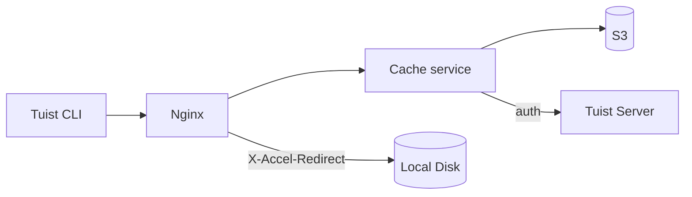
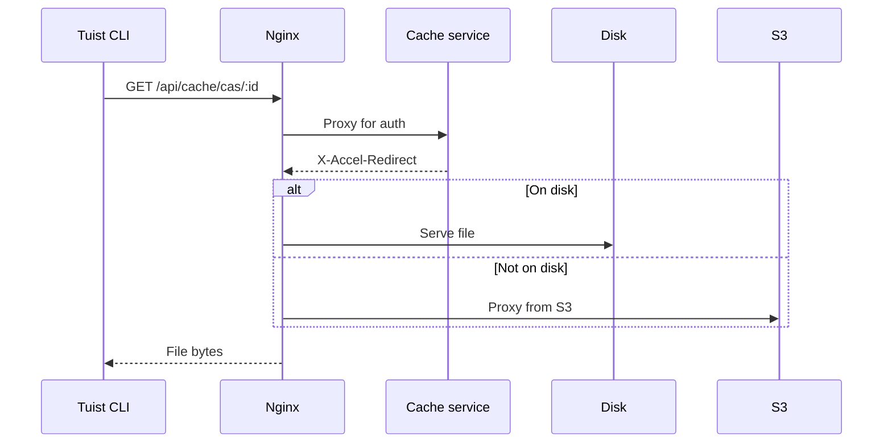
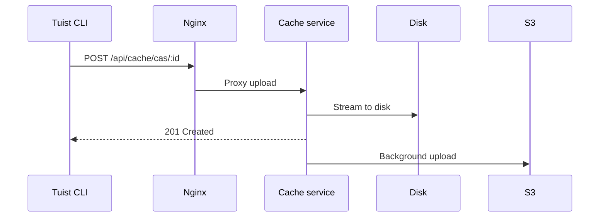

---
{
  "title": "Архитектура",
  "titleTemplate": ":title | Кэш | Руководства | Tuist",
  "description": "Узнайте об архитектуре сервиса кэширования Tuist."
}
---

# Архитектура кэша {#cache-architecture}

> [!NOTE]
> На этой странице представлен технический обзор архитектуры сервиса кэширования Tuist. Она предназначена в первую очередь для **пользователей, использующих самостоятельный хостинг**, и **контрибьюторов**, которым необходимо понимать внутреннее устройство сервиса. Обычным пользователям, которые хотят только использовать кэш, читать её не нужно.

Сервис кэширования Tuist — это отдельный сервис, который предоставляет хранилище с адресацией по содержимому (CAS) для артефактов сборки и хранилище ключ-значение для метаданных кэша.

## Обзор {#overview}

Сервис использует двухуровневую архитектуру хранения плюс локальные метаданные SQLite:

- **Локальный диск**: основное хранилище для быстрого доступа к данным из кэша
- **S3**: надёжное хранилище, которое сохраняет артефакты и позволяет восстанавливать их после удаления с диска
- **SQLite**: локальные метаданные для отслеживания доступа к артефактам, очистки orphan-файлов, фоновых задач и данных кэша ключ-значение

## Компоненты {#components}

### Nginx {#nginx}

Nginx выступает в качестве точки входа и обеспечивает эффективную доставку файлов с помощью `X-Accel-Redirect`:

- **Загрузки**: сервис кэширования проверяет аутентификацию, затем возвращает заголовок `X-Accel-Redirect`. Nginx отдаёт файл напрямую с диска или проксирует его из S3.
- **Выгрузки**: Nginx проксирует запросы к сервису кэширования, который потоково записывает данные на диск.

### Хранилище с адресацией по содержимому {#cas}

Артефакты хранятся на локальном диске в шардированной структуре каталогов:

- **Путь**: `{account}/{project}/cas/{shard1}/{shard2}/{artifact_id}`
- **Шардирование**: первые четыре символа идентификатора артефакта образуют двухуровневый шард (например, `ABCD1234` → `AB/CD/ABCD1234`)

### Метаданные SQLite {#sqlite}

Сервис кэширования использует две базы данных SQLite:

- **Основная БД метаданных**: хранит `cache_artifacts`, курсоры сканирования orphan-файлов, задачи Oban и другие метаданные сервиса.
- **БД ключ-значение**: хранит `key_value_entries` и `key_value_entry_hashes` в выделенном файле SQLite.

Хранилище ключ-значение вынесено в отдельную базу данных, чтобы можно было использовать инкрементальное автовакуумирование SQLite без влияния на метаданные артефактов и состояние очистки orphan-файлов.

### Интеграция с S3 {#s3}

S3 обеспечивает надёжное хранение:

- **Фоновые выгрузки**: после записи на диск артефакты ставятся в очередь на загрузку в S3 через фоновый воркер, который запускается каждую минуту
- **Гидратация по запросу**: если локальный артефакт отсутствует, запрос немедленно обслуживается через предподписанный URL S3, пока артефакт ставится в очередь на фоновую загрузку на локальный диск

### Удаление с диска {#eviction}

Сервис управляет дисковым пространством с помощью нескольких фоновых процессов:

- **Удаление CAS с диска** использует семантику LRU на основе `cache_artifacts`
- Когда использование диска превышает 85%, самые старые артефакты удаляются до тех пор, пока использование не снизится до 70%
- Артефакты остаются в S3 после удаления с локального диска
- **Удаление KV** удаляет старые записи ключ-значение по сроку хранения и также может уменьшать размер выделенной БД KV, когда она превышает настроенный лимит размера

### Очистка orphan-файлов {#orphan-cleanup}

Сервис также запускает воркер очистки orphan-файлов для артефактов на диске:

- Он сканирует дерево хранилища в поисках файлов, которые существуют на диске, но не имеют соответствующей строки в `cache_artifacts`.
- Это может произойти, если файл записан на диск, но запись метаданных потеряна до завершения сброса буфера SQLite.
- Файлы, созданные позже безопасного интервала, игнорируются, чтобы избежать конфликта с выполняющимися загрузками.
- Если orphan-файл удалён и позже запрошен снова, следующий промах кэша приведёт к его повторной загрузке, поэтому система самовосстанавливается.

### Аутентификация {#authentication}

Кэш делегирует аутентификацию серверу Tuist, вызывая конечную точку `/api/projects` и кэшируя результаты (10 минут при успехе, 3 секунды при ошибке).

## Потоки запросов {#request-flows}

### Загрузка {#download-flow}

### Загрузка на сервер {#upload-flow}

## Конечные точки API {#api-endpoints}

| Конечная точка | Метод | Описание |
|----------|--------|-------------|
| `/up` | GET | Проверка работоспособности |
| `/metrics` | GET | Метрики Prometheus |
| `/api/cache/cas/:id` | GET | Скачать артефакт CAS |
| `/api/cache/cas/:id` | POST | Загрузить артефакт CAS |
| `/api/cache/keyvalue/:cas_id` | GET | Получить запись ключ-значение |
| `/api/cache/keyvalue` | PUT | Сохранить запись ключ-значение |
| `/api/cache/module/:id` | HEAD | Проверить наличие артефакта модуля |
| `/api/cache/module/:id` | GET | Скачать артефакт модуля |
| `/api/cache/module/start` | POST | Начать многокомпонентную загрузку |
| `/api/cache/module/part` | POST | Загрузить часть |
| `/api/cache/module/complete` | POST | Завершить многокомпонентную загрузку |
