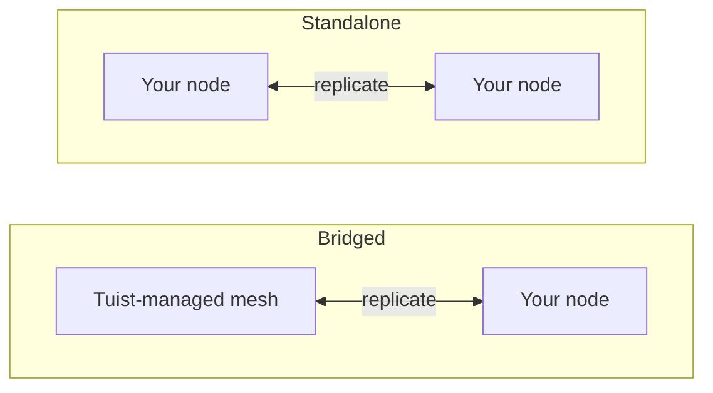

---
{
  "title": "Самостоятельное размещение",
  "titleTemplate": ":title | Кэш | Руководства | Tuist",
  "description": "Узнайте, как самостоятельно размещать узлы кэша Tuist и реплицировать данные с помощью сети, управляемой Tuist."
}
---

# Самостоятельное размещение кэша {#self-host-cache}

Кэш Tuist работает как **сеть узлов**, которые реплицируют артефакты друг другу. Вы можете запустить собственные узлы кэша на своей инфраструктуре, чтобы кэш находился рядом с вашими разработчиками и CI, сокращая сетевое расстояние, которое в противном случае снижало бы скорость, которую должно обеспечивать кэширование.

Узел самостоятельного размещения — это один контейнер (`ghcr.io/tuist/kura`), который хранит артефакты на локальном диске и при присоединении к одноранговой сети взаимодействует с остальной частью этой сети через внутренний порт для пиров. Tuist выступает в роли **плоскости управления**: он аутентифицирует трафик, выделяет емкость управляемого кэша и учитывает использование. Он никогда не получает прямого доступа к вашим узлам.

> [!NOTE]
> Для самостоятельного размещения узлов кэша требуется план **Enterprise**.
>
> Узлы подключаются либо к хостинговому серверу Tuist (`https://tuist.dev`), либо к самостоятельно размещенному серверу Tuist. Для самостоятельного размещения самого сервера Tuist требуется отдельная лицензия на сервер. См. <.localized_link href="/guides/server/self-host/server">руководство по самостоятельному размещению сервера</.localized_link>.

## Две топологии {#topologies}

Существует два способа запуска узлов самостоятельного размещения, и выбор зависит исключительно от того, использует ли ваша учетная запись также регион кэша, **управляемый Tuist**.

### Мостовая: сеть Tuist + ваши узлы {#topology-bridged}

Ваша учетная запись использует как минимум один регион кэша, управляемый Tuist, а ваши узлы самостоятельного размещения **присоединяются к этой сети**. Запись данных на ваши узлы непрерывно распространяется в управляемую сеть, а при присоединении узел прогревается из существующего кэша управляемой сети. Это обеспечивает низкую задержку кэша рядом с вашими раннерами (которые выполняют большую часть записи), при этом их данные записываются в общий кэш. Обратите внимание, что новые артефакты, записанные в других местах управляемой сети **после** присоединения узла, пока не распространяются обратно к нему непрерывно; это запланированное улучшение.

Это правильный выбор, если вам нужна скорость локального кэша без отказа от общего постоянно работающего управляемого кэша.

### Автономная: только ваши узлы {#topology-standalone}

Ваша учетная запись **не использует** управляемый регион кэша. Ваши узлы формируют собственную изолированную сеть на вашей инфраструктуре. Tuist по-прежнему знает о существовании ваших узлов (поэтому использование учитывается), но **обмен данными с любой сетью, управляемой Tuist, не происходит**, поскольку такой сети нет. Членство в сети пиров и репликация происходят полностью внутри ваших собственных узлов.



Ключевое различие в конфигурации заключается в том, что топология **мостового типа** использует **регистрацию**, при которой узел генерирует свою пару ключей при запуске, а Tuist выдает его сертификат для сети, тогда как топология **автономного типа** не имеет сертификата сети, выданного Tuist. Один автономный узел может работать с отключенным TLS для пиров; многouзловая автономная сеть использует материалы TLS для пиров, которые вы предоставляете.

## Настройка конечной точки CLI {#cli-endpoint}

Управляемый кэш Tuist использует `https://<account>.cache.tuist.dev`. При использовании самостоятельно размещенного сервера Tuist CLI получает URL-адрес кэша из настройки сервера `TUIST_CACHE_ENDPOINTS`. Установите его равным URL-адресу вашего основного сервера кэша или балансировщика нагрузки. Если он содержит несколько URL-адресов, используется первый.

При подключении частных/пользовательских узлов кэша к **хостинговому серверу Tuist** настройте явную конечную точку в оболочках разработчиков и CI:

```sh
export TUIST_CACHE_ENDPOINT=https://cache.example.com
```

Это переопределение имеет приоритет для любого типа сервера и является необязательным для самостоятельно размещенного сервера Tuist. Для демона кэша Xcode повторно выполните `tuist setup cache` после установки значения, чтобы LaunchAgent получил обновленную среду. Для нескольких узлов используйте имя балансировщика нагрузки или маршрутизации DNS.

## Предварительные требования {#prerequisites}


- Docker и Docker Compose (или любая среда выполнения контейнеров)
- Работающий сервер Tuist (хостинговый или самостоятельно размещенный)
- Диск для кэша. Мостовой узел при первом присоединении загружает **всю** сеть учетной записи, поэтому размер тома данных должен быть соответствующим.

## Предоставьте клиент плоскости управления {#control-plane-client}

Узел использует учетные данные клиента плоскости управления для аутентификации запросов к кэшу (интроспекция токена), отчетности на панели управления и передачи данных об использовании. Это **не** способ маршрутизации клиентов к вашим узлам на самостоятельно размещенном сервере Tuist (см. [Как клиенты достигают ваших узлов](#routing)).

Для полностью самостоятельно размещенного развертывания сгенерируйте **UUID идентификатора клиента** и случайный секрет, затем настройте одну и ту же пару на сервере Tuist и на каждом узле Kura:

```bash
KURA_CONTROL_PLANE_CLIENT_ID="$(uuidgen | tr '[:upper:]' '[:lower:]')"
KURA_CONTROL_PLANE_CLIENT_SECRET="$(openssl rand -base64 32)"
```

Установите эти значения как `KURA_CONTROL_PLANE_CLIENT_ID` и `KURA_CONTROL_PLANE_CLIENT_SECRET` в среде сервера Tuist, затем используйте те же значения в конфигурации Kura ниже. Регистрационные heartbeat-запросы включают `KURA_TENANT_ID`, постоянный идентификатор кэша учетной записи, чтобы сервер мог привязать узел к правильной учетной записи даже после переименования учетной записи.

> [!WARNING]
> Идентификатор клиента должен быть UUID без префикса `kura_`. Идентификаторы, не являющиеся UUID, приводят к сбою интроспекции токена с HTTP-ошибкой `400`, даже если учетные данные совпадают в обоих сервисах.

Если вы подключаетесь к хостинговому серверу `tuist.dev` или хотите получить учетные данные для каждой учетной записи, которые можно ротировать из интерфейса, откройте страницу **Cache** учетной записи, выберите **Generate credential** и скопируйте `client_id` плюс одноразовый `secret`. На хостинговом сервере для генерации учетных данных узла самостоятельного размещения требуется план Enterprise.

## Выберите постоянного арендатора {#permanent-tenant}

`KURA_TENANT_ID` — это постоянное хранилище и идентичность пира, изначально полученная из оригинального имени учетной записи. Для учетной записи, которая никогда не переименовывалась, оно совпадает с текущим именем. **Сохраняйте его исходное значение после переименования учетной записи**, в том числе при добавлении заменяющих узлов или другого узла в ту же сеть. Например, переименование `original` в `renamed` оставляет `KURA_TENANT_ID=original` на каждом узле. Изменение этого значения выбирает другое пространство имен ключей объектов; переименование учетной записи не переносит сохраненные артефакты или идентичность пира.

Замените `<permanent-kura-tenant>` в примерах ниже этим значением. Используйте арендатора из существующего правильно настроенного узла или `tenant_id`, возвращенный при регистрации. Оператор самостоятельно размещенного сервера Tuist может проверить поле базы данных `kura_tenant_id` учетной записи. Не выводите значение из URL-адреса переименованной учетной записи.

При наличии действительных учетных данных уровня развертывания для панели управления регистрация и обнаружение пиров возвращают **409 Conflict** с `error: "tenant_mismatch"` и `expected_tenant_id`, если узел предоставляет текущее или сохраненное имя, отличающееся от его постоянного арендатора. Они не регистрируют узел и не подменяют silently другую идентичность хранилища. Недействительные учетные данные и неизвестные арендаторы по-прежнему возвращают **401 Unauthorized** без раскрытия арендатора. Если узел уже записал данные с другим арендатором, проверьте его конфигурацию и историю хранения перед изменением; ответ об ошибке не выполняет миграцию хранилища.

## Как клиенты достигают ваших узлов {#routing}

Настройте URL кэша [выше](#cli-endpoint), чтобы машины разработчиков и CI могли достигать ваших узлов. Чтобы сообщать адрес и готовность каждого узла в панели управления, установите на узле `KURA_REGISTRATION_URL` и `KURA_ADVERTISED_HTTP_URL`.

## Настройка моста {#bridged-setup}

Узел регистрируется при запуске: он локально генерирует пару ключей (закрытый ключ никогда не покидает вашу инфраструктуру), отправляет запрос на подпись сертификата и получает подписанный сертификат, CA учетной записи и адрес шлюза управляемой сети. **Вы не предоставляете никаких материалов TLS**. Регистрация записывает их в смонтированный том.

```yaml
# docker-compose.yml
services:
  kura:
    image: ghcr.io/tuist/kura:<version>
    restart: unless-stopped
    ports:
      - "4000:4000"   # HTTP cache: your developers and CI point here
      - "7443:7443"   # mesh peer port
    environment:
      # Enroll and join the managed mesh
      KURA_ENROLL_ON_BOOT: "1"
      KURA_CONTROL_PLANE_URL: "https://tuist.dev"
      KURA_CONTROL_PLANE_CLIENT_ID: "<client_id>"
      KURA_CONTROL_PLANE_CLIENT_SECRET: "<secret>"
      KURA_TENANT_ID: "<permanent-kura-tenant>"

      # Report the node’s address and readiness to the dashboard
      KURA_REGISTRATION_URL: "https://tuist.dev/_internal/kura/mesh/registrations"
      KURA_ADVERTISED_HTTP_URL: "https://kura.acme.internal"   # where your CLI/CI reach the cache
      KURA_NODE_URL: "https://kura.acme.internal:7443"         # this node's peer identity on your network
      KURA_REGION: "office"

      # Ports and storage. KURA_PORT serves both the HTTP cache API and REAPI
      # gRPC (h2c) on one listener. Enrollment writes the TLS files into
      # KURA_INTERNAL_TLS_* on first boot.
      KURA_PORT: "4000"
      KURA_INTERNAL_PORT: "7443"
      KURA_INTERNAL_TLS_CA_CERT_PATH: "/tls/ca.pem"
      KURA_INTERNAL_TLS_CERT_PATH: "/tls/tls.crt"
      KURA_INTERNAL_TLS_KEY_PATH: "/tls/tls.key"
      KURA_DATA_DIR: "/var/cache/kura"
      KURA_TMP_DIR: "/var/cache/kura/tmp"
      KURA_OTEL_SERVICE_NAME: "kura-acme"
      KURA_OTEL_DEPLOYMENT_ENVIRONMENT: "onprem"

      # Authenticate the HTTP cache API. The Tuist hook ships in the image at
      # this path; it introspects each token against the control plane using the
      # control-plane client above, so only valid Tuist tokens for this account
      # can read or write. No JWT verifier secret is involved.
      KURA_AUTH_ENABLED: "1"
      KURA_AUTH_TUIST_URL: "https://tuist.dev"
    volumes:
      - kura-tls:/tls            # empty; enrollment populates it
      - kura-data:/var/cache/kura
volumes:
  kura-tls: {}
  kura-data: {}
```

Что вы предоставляете: клиент панели управления, два адреса (`KURA_NODE_URL`, `KURA_ADVERTISED_HTTP_URL`) в вашей сети и два пустых тома для записи. Все остальное (пара ключей, сертификат, CA учетной записи и адрес управляемой сети) предоставляется автоматически при запуске.

## Автономная настройка {#standalone-setup}

При отсутствии управляемого региона нет выданного Tuist CA сети, поэтому регистрация не применяется (конечная точка регистрации возвращает `503 ca_unavailable`). Узел использует ваш сервер Tuist для аутентификации токенов, отправки сигналов готовности для регистрации в панели управления и отчетности об использовании.

```yaml
# docker-compose.yml for a single node connected to a self-hosted Tuist server
services:
  kura:
    image: ghcr.io/tuist/kura:<version>
    restart: unless-stopped
    ports:
      - "4000:4000"
      - "7443:7443"
    environment:
      KURA_TENANT_ID: "<permanent-kura-tenant>"
      KURA_NODE_URL: "http://kura-1.acme.internal:7443"
      KURA_PEERS: ""   # single node: disable static peer discovery
      KURA_REGION: "office"

      # Authenticate cache requests against the self-hosted Tuist server.
      # Use the same values configured on the Tuist server, or a per-account
      # credential from the Cache page.
      KURA_CONTROL_PLANE_CLIENT_ID: "<client_id>"
      KURA_CONTROL_PLANE_CLIENT_SECRET: "<secret>"
      KURA_AUTH_ENABLED: "1"
      KURA_AUTH_TUIST_URL: "https://tuist.acme.internal"

      # Register the client-facing cache URL with the Tuist server.
      KURA_REGISTRATION_URL: "https://tuist.acme.internal/_internal/kura/mesh/registrations"
      KURA_ADVERTISED_HTTP_URL: "https://kura.acme.internal"

      KURA_PORT: "4000"
      KURA_INTERNAL_PORT: "7443"
      KURA_DATA_DIR: "/var/cache/kura"
      KURA_TMP_DIR: "/var/cache/kura/tmp"
      KURA_OTEL_SERVICE_NAME: "kura-acme"
      KURA_OTEL_DEPLOYMENT_ENVIRONMENT: "onprem"
    volumes:
      - kura-data:/var/cache/kura
volumes:
  kura-data: {}
```

Для одного узла оставьте настройки TLS пира незаданными и установите `KURA_PEERS` в пустую строку. Когда `KURA_PEERS` не задан, Kura инициализирует статическое обнаружение пиров из `KURA_NODE_URL` и периодически проверяет конечную точку `/_internal/status` этого URL. При отключенном TLS пира `KURA_NODE_URL` должен использовать схему `http://`, даже если узел доступен через имя частной сети.

`KURA_CONTROL_PLANE_URL` не требуется в этом примере, потому что авторизация и отчет об использовании используют `KURA_AUTH_TUIST_URL` как базовый URL Tuist. `KURA_ADVERTISED_HTTP_URL` определяет адрес узла, обращенный к клиенту, в панели управления. Установите `TUIST_CACHE_ENDPOINTS=https://kura.acme.internal` на сервере Tuist, чтобы CLI использовал этот адрес для запросов к кэшу.

### Kubernetes с Helm {#standalone-helm}

Если ваш самостоятельно размещенный сервер Tuist работает на Kubernetes, установите Kura с помощью автономной диаграммы Kura и передайте те же настройки панели управления через `extraEnv`. Диаграмма сервера Tuist не устанавливает эту диаграмму Kura как поддиаграмму.

Сначала настройте диаграмму сервера Tuist с учетными данными Kura уровня развертывания:

```yaml
# tuist-values.yaml
server:
  extraEnv:
    - name: KURA_CONTROL_PLANE_CLIENT_ID
      valueFrom:
        secretKeyRef:
          name: kura-control-plane
          key: client-id
    - name: KURA_CONTROL_PLANE_CLIENT_SECRET
      valueFrom:
        secretKeyRef:
          name: kura-control-plane
          key: client-secret
```

Затем установите Kura в том же пространстве имен с тем же секретом:

```yaml
# kura-values.yaml
replicaCount: 1

config:
  tenantId: "<permanent-kura-tenant>"
  region: "office"

ingress:
  enabled: true
  className: nginx
  hosts:
    - host: kura.acme.internal
      paths:
        - path: /
          pathType: Prefix
  tls:
    - hosts:
        - kura.acme.internal
      secretName: kura-tls

extraEnv:
  - name: KURA_CONTROL_PLANE_CLIENT_ID
    valueFrom:
      secretKeyRef:
        name: kura-control-plane
        key: client-id
  - name: KURA_CONTROL_PLANE_CLIENT_SECRET
    valueFrom:
      secretKeyRef:
        name: kura-control-plane
        key: client-secret
  - name: KURA_AUTH_ENABLED
    value: "1"
  - name: KURA_AUTH_TUIST_URL
    value: "https://tuist.acme.internal"
  - name: KURA_REGISTRATION_URL
    value: "https://tuist.acme.internal/_internal/kura/mesh/registrations"
  - name: KURA_ADVERTISED_HTTP_URL
    value: "https://kura.acme.internal"
```

```bash
kubectl create namespace tuist
kubectl -n tuist create secret generic kura-control-plane \
  --from-literal=client-id="<client_id>" \
  --from-literal=client-secret="<secret>"

helm upgrade --install kura oci://ghcr.io/tuist/charts/kura \
  --namespace tuist \
  -f kura-values.yaml
```

Если Kura работает в другом пространстве имен, чем сервер Tuist, создайте или синхронизируйте секрет `kura-control-plane` в обоих пространствах имен.

Оставьте `extension.enabled` незаданным при использовании встроенного хука Tuist из образа; это значение диаграммы предназначено для монтирования пользовательского хука из ConfigMap. Диаграмма сама рендерит `KURA_NODE_URL`, `KURA_PEERS`, headless-сервис, постоянство и пробы. При `replicaCount: 1` сгенерированный URL пира — это собственное стабильное DNS-имя пода, поэтому он остается доступным внутри кластера и не вызывает предупреждения для одного узла, описанного выше. Для нескольких реплик диаграмма генерирует список пиров из DNS StatefulSet; включите `peerTls` и предоставьте секрет TLS, если вам нужен mTLS на внутренней плоскости пиров.

Чтобы запустить более одного автономного узла, добавьте свой **собственный TLS пира**, смонтированный в `/tls` (CA плюс листовой сертификат и ключ для каждого узла, использующие общий CA, чтобы узлы доверяли друг другу), переключите `KURA_NODE_URL` на `https://...:<KURA_INTERNAL_PORT>` и добавьте `KURA_PEERS`:

```yaml
environment:
  KURA_NODE_URL: "https://kura-1.acme.internal:7443"
  KURA_PEERS: "https://kura-2.acme.internal:7443,https://kura-3.acme.internal:7443"
  KURA_INTERNAL_TLS_CA_CERT_PATH: "/tls/ca.pem"
  KURA_INTERNAL_TLS_CERT_PATH: "/tls/tls.crt"
  KURA_INTERNAL_TLS_KEY_PATH: "/tls/tls.key"
volumes:
  - ./tls:/tls:ro
```

## Требования каждой топологии {#requirements-summary}

| Вы предоставляете | Мост | Автономный |
|---|---|---|
| Клиент панели управления (`client_id` / `secret`) | Да | Да |
| `KURA_NODE_URL` | Да | Да |
| `KURA_ADVERTISED_HTTP_URL` | Да | Для регистрации в панели управления; маршрутизация отдельная (см. ниже) |
| Маршрутизация к CLI | Автоматически (регистрация) | Автоматически из готовых сигналов регистрации |
| Том данных + временный том | Да | Да |
| `KURA_ENROLL_ON_BOOT` | Да | Нет (вернет `ca_unavailable`) |
| TLS пира (`/tls` CA + листовой) | Нет, регистрация записывает его | Только для многoузловой сети |
| `KURA_PEERS` (список пиров) | Нет, регистрация заполняет шлюз | Пусто для одного узла; URL-адреса пиров для более чем одного узла |

## Требуемая конфигурация {#required-config}

Эти переменные настраивают каждый узел, независимо от топологии (TLS пира является исключением, отмеченным ниже):

| Переменная | Описание |
|---|---|
| `KURA_TENANT_ID` | Постоянный арендатор Kura вашей учетной записи. Сохраните его исходное значение после переименования учетной записи; см. [Выбор постоянного арендатора](#permanent-tenant). |
| `KURA_NODE_URL` | URL пира этого узла в вашей сети. |
| `KURA_PEERS` | Статический список обнаружения пиров. Установите пустую строку для одного автономного узла; установите доступные URL-адреса пиров для многoузловой сети. |
| `KURA_REGION` | Произвольная метка региона (например, `office`, `ci`). |
| `KURA_PORT` / `KURA_INTERNAL_PORT` | Порт кэша (HTTP API кэша и REAPI gRPC совместно размещены на одном слушателе) и порт пира сети (`4000` / `7443`). |
| `KURA_DATA_DIR` / `KURA_TMP_DIR` | Хранилище артефактов на диске и временная директория. |
| `KURA_INTERNAL_TLS_CA_CERT_PATH` / `KURA_INTERNAL_TLS_CERT_PATH` / `KURA_INTERNAL_TLS_KEY_PATH` | Файлы TLS пира. Записываются при регистрации (мост) или предоставляются вами (многoузловой автономный режим). Не нужны для одного узла; опустите их и используйте `http://` `KURA_NODE_URL`. |
| `KURA_OTEL_SERVICE_NAME` / `KURA_OTEL_DEPLOYMENT_ENVIRONMENT` | Имя сервиса и метка окружения для телеметрии. |

Мостовые узлы дополнительно устанавливают `KURA_ENROLL_ON_BOOT`, `KURA_CONTROL_PLANE_URL` и учетные данные клиента панели управления. `KURA_REGISTRATION_URL` и `KURA_ADVERTISED_HTTP_URL` регистрируют узел, чтобы он отображался на странице **Кэш** и чтобы CLI-клиенты с включенной Kura могли маршрутизироваться к нему (см. [Как клиенты достигают ваших узлов](#routing)).

## Хранение и вытеснение {#storage}

Узел хранит артефакты в `KURA_DATA_DIR` в пределах бюджета хранилища CAS, который можно задать с помощью необязательной переменной:

| Переменная | Описание |
|---|---|
| `KURA_CAS_CAPACITY_BYTES` | Бюджет хранилища CAS узла в байтах. Должен быть положительным целым числом. Если не задан, бюджет составляет 50% от размера файловой системы, содержащей `KURA_DATA_DIR`. |

Независимо от того, задаете вы его или нет, бюджет ограничен 80% файловой системы, содержащей `KURA_DATA_DIR`, чтобы ротация, которая записывает новый сегмент перед вытеснением самого старого, не могла заполнить диск. Бюджет округляется до целых сегментов по 512 МиБ, минимум 2,5 ГиБ. Узел логирует разрешенный бюджет при запуске (`resolved CAS segment ring limits`).

Вытеснение происходит автоматически. Артефакты хранятся в кольце сегментов, и как только бюджет достигнут, самый старый сегмент вытесняется. Артефакты, читаемые из старых сегментов, переносятся в текущий, поэтому часто используемые артефакты сохраняются, а вытеснение работает близко к принципу «наименее недавно использованный».

Разместите `KURA_DATA_DIR` на выделенном томе. И бюджет по умолчанию, и лимит являются процентами от общего размера файловой системы, а не от свободного места, поэтому другие данные на той же файловой системе могут оставить меньше места, чем предполагает бюджет.

## Аутентификация запросов к кэшу {#cache-auth}

По умолчанию узел обслуживает свой HTTP API кэша для любого, кто может достичь его в вашей сети. Чтобы требовать от callers предъявления действительного токена Tuist, так что только аутентифицированные члены вашей организации могли читать и писать, направьте узел на ваш сервер Tuist. Приведенная выше автономная настройка делает это.

| Переменная | Значение |
|---|---|
| `KURA_AUTH_ENABLED` | `1` |
| `KURA_AUTH_TUIST_URL` | URL вашего сервера Tuist |

Авторизация повторно использует уже настроенный клиент панели управления (`KURA_CONTROL_PLANE_CLIENT_ID` / `KURA_CONTROL_PLANE_CLIENT_SECRET`) для интроспекции токенов, поэтому дополнительные учетные данные не нужны. Самостоятельно размещенный узел работает только в режиме **интроспекции**: он никогда не хранит симметричный секрет верификатора Guardian JWT, который мог бы выпускать токены для любого арендатора и никогда не передается, поэтому каждый запрос авторизуется через ваш сервер. Узел, который не может достичь его, отказывает в обслуживании, а не обслуживает запрос, и нет настройки, которая это меняет. Узлы, управляемые Tuist, используют ту же авторизацию; единственное отличие в том, что они также хранят ключ верификации, что позволяет им обрабатывать большинство запросов только по токену.

## Сеть {#networking}

Узел устанавливает **исходящие** соединения в зависимости от того, какие интеграции вы включаете:

- ваш сервер Tuist для интроспекции токенов (`KURA_AUTH_TUIST_URL`), сигналов регистрации (`KURA_REGISTRATION_URL`), использования (`KURA_CONTROL_PLANE_URL` или `KURA_AUTH_TUIST_URL`) и регистрации в мостовой топологии, а также
- в мостовой топологии — шлюз пира управляемой сети для репликации.

Ваши разработчики и CI достигают `KURA_ADVERTISED_HTTP_URL` узла (а в многoузловой сети узлы достигают друг друга через порт пира). Эти адреса должны быть доступны только **внутри вашей сети**. Их не нужно открывать для публичного интернета.

## Как это работает {#behavior}

- **Мост.** При загрузке узел регистрируется, загружает полный кэш управляемой сети и переходит в состояние обслуживающего члена кольца. Первоначальная загрузка происходит один раз и может занять время через WAN, в зависимости от размера вашего кэша. После этого записи на узле непрерывно распространяются в управляемую сеть. Новые артефакты, записанные elsewhere в управляемой сети после присоединения узла, пока не распространяются на него непрерывно (запланированное улучшение), поэтому рассматривайте загрузку при присоединении как снимок, а не как живое зеркало.
- **Автономный.** Узел(ы) работают как изолированная сеть на вашей инфраструктуре. Репликация, если она есть, происходит только между вашими собственными узлами. При настройке роль Tuist ограничивается панелью управления: видимость в панели, реклама конечных точек кэша, учет использования и интроспекция токенов. Он никогда не предоставляет ресурсы, не обновляет, не соединяется с вашими узлами и не проникает в них.

## Проверка {#verify}

```bash
curl --fail-with-body http://localhost:4000/ready   # 200 once the node has joined and is serving
curl --fail-with-body http://localhost:4000/up      # liveness + mesh membership
```

Мостовой узел сообщает `state: joining` во время загрузки сети и `state: serving` после синхронизации. Ваш узел также появляется в разделе **Зарегистрированные узлы** на странице **Кэш** учетной записи, как только начинаются сигналы регистрации.

Чтобы проверить удаленное кэширование, запустите `tuist cache` с целями, которые можно кэшировать, но еще не кэшированы, и подтвердите успешную загрузку в логах Kura. Нулевой код выхода сам по себе не подтверждает, что артефакты были сохранены.

## Обновление {#upgrading}

```bash
docker compose pull
docker compose up -d
```

Узлы спроектированы для совместной работы с разницей в одну версию, поэтому поэтапное обновление нескольких узлов безопасно.
