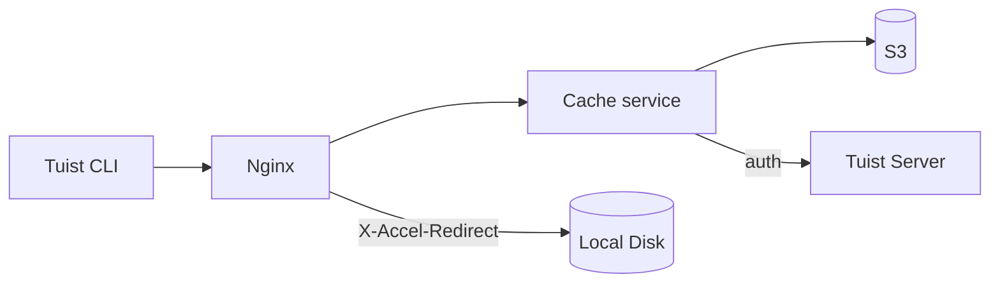
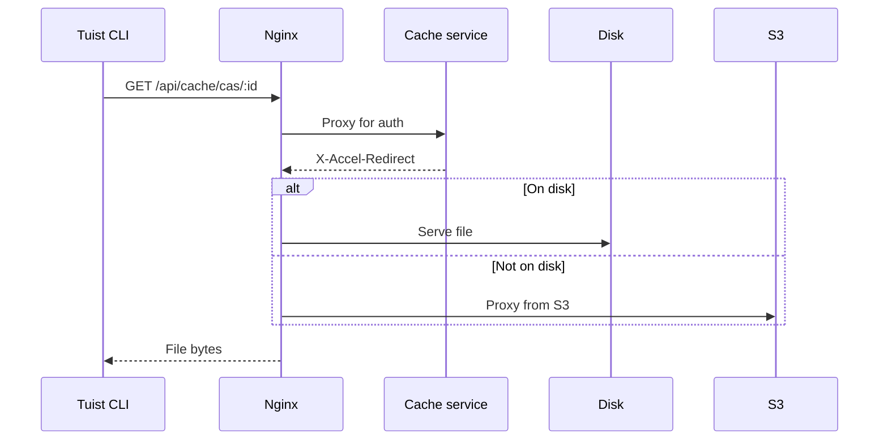
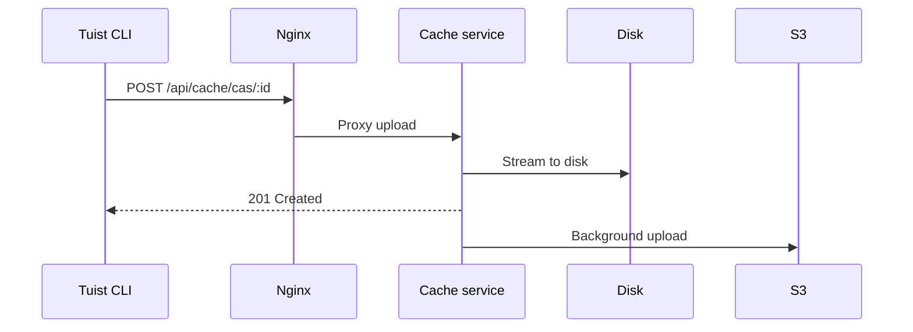

---
{
  "title": "Mimari",
  "titleTemplate": ":title | Önbellek | Kılavuzlar | Tuist",
  "description": "Tuist önbellek hizmetinin mimarisi hakkında bilgi edinin."
}
---

# Önbellek Mimarisi {#cache-architecture}

> [!NOTE]
> Bu sayfa, Tuist önbellek hizmeti mimarisinin teknik bir özetini sunar. Hizmetin iç işleyişini anlaması gereken **kendi sunucularında barındıran kullanıcılar** ve **katkıda bulunanlar** için tasarlanmıştır. Önbelleği yalnızca kullanmak isteyen genel kullanıcıların bunu okumasına gerek yoktur.

Tuist önbellek hizmeti, yapı yapıtları için İçerik Adreslenebilir Depolama (CAS) ve önbellek meta verileri için bir anahtar-değer deposu sağlayan bağımsız bir hizmettir.

## Genel Bakış {#overview}

Hizmet, iki katmanlı bir depolama mimarisi ve yerel SQLite meta verileri kullanır:

- **Yerel disk**: Düşük gecikmeli önbellek isabetleri için birincil depolama
- **S3**: Yapıtları kalıcı olarak saklayan ve silindikten sonra kurtarmaya olanak tanıyan dayanıklı depolama
- **SQLite**: Yapıt erişim izleme, sahipsiz dosya temizliği, arka plan işleri ve anahtar-değer önbellek verileri için yerel meta veriler

## Bileşenler {#components}

### Nginx {#nginx}

Nginx giriş noktası olarak görev yapar ve `X-Accel-Redirect` kullanarak verimli dosya teslimatını yönetir:

- **İndirmeler**: Önbellek hizmeti kimlik doğrulamayı doğrular, ardından bir `X-Accel-Redirect` başlığı döndürür. Nginx dosyayı doğrudan diskten veya S3 üzerinden vekil sunucu olarak sunar.
- **Yükleme**: Nginx istekleri önbellek hizmetine vekil olarak iletir; hizmet veriyi diske aktarır.

### İçerik Adreslenebilir Depolama {#cas}

Yapıtlar, parçalara ayrılmış bir dizin yapısında yerel diskte depolanır:

- **Yol**: `{account}/{project}/cas/{shard1}/{shard2}/{artifact_id}`
- **Parçalama**: Yapıt kimliğinin ilk dört karakteri iki düzeyli bir parça oluşturur (ör. `ABCD1234` → `AB/CD/ABCD1234`)

### SQLite Meta Verileri {#sqlite}

Önbellek hizmeti iki SQLite veritabanı kullanır:

- **Birincil meta veri veritabanı**: `cache_artifacts`, sahipsiz tarama imleçlerini, Oban işlerini ve diğer hizmet meta verilerini saklar.
- **Anahtar-değer veritabanı**: `key_value_entries` ve `key_value_entry_hashes` öğelerini ayrılmış bir SQLite dosyasında saklar.

Anahtar-değer deposu, yapıt meta verilerini ve sahipsiz temizleme durumunu etkilemeden SQLite artımlı otomatik vakumlama kullanabilmesi için kendi veritabanına ayrılır.

### S3 Entegrasyonu {#s3}

S3 dayanıklı depolama sağlar:

- **Arka plan yüklemeleri**: Diske yazıldıktan sonra yapıtlar, her dakika çalışan bir arka plan işçisi aracılığıyla S3’e yüklenmek üzere sıraya alınır
- **Talebe bağlı yükleme**: Yerel bir yapıt eksik olduğunda istek, yapıt yerel diske arka planda indirilmek üzere sıraya alınırken imzalı bir S3 URL’si aracılığıyla anında sunulur

### Disk Silme {#eviction}

Hizmet, birden çok arka plan işlemi kullanarak disk alanını yönetir:

- **CAS disk silme**, `cache_artifacts` tarafından desteklenen LRU semantiğini kullanır
- Disk kullanımı %85’i aştığında, kullanım %70’e düşene kadar en eski yapıtlar silinir
- Yerel silmeden sonra yapıtlar S3’te kalır
- **KV silme**, eski anahtar-değer girdilerini tutma süresine göre kaldırır ve ayrılmış KV veritabanı yapılandırılmış boyut bütçesini aştığında onu da küçültebilir

### Sahipsiz Temizliği {#orphan-cleanup}

Hizmet ayrıca diskteki yapıtlar için bir sahipsiz temizlik işçisi çalıştırır:

- Diskte var olan ancak karşılık gelen bir `cache_artifacts` satırı bulunmayan dosyalar için depolama ağacını tarar.
- Bu durum, bir dosya diske yazıldığında ancak SQLite arabellek boşaltması tamamlanmadan önce meta veri yazımı kaybolduğunda gerçekleşebilir.
- Devam eden yüklemelerle çakışmayı önlemek için güvenlik penceresinden daha yeni olan dosyalar yoksayılır.
- Bir sahipsiz dosya silinir ve daha sonra tekrar istenirse, sonraki önbellek ıskalaması onun yeniden yüklenmesine neden olur; böylece sistem kendini onarır.

### Kimlik Doğrulama {#authentication}

Önbellek, kimlik doğrulamayı `/api/projects` uç noktasını çağırarak ve sonuçları önbelleğe alarak (başarı için 10 dakika, hata için 3 saniye) Tuist sunucusuna devreder.

## İstek Akışları {#request-flows}

### İndirme {#download-flow}

### Yükleme {#upload-flow}

## API Uç Noktaları {#api-endpoints}

| Uç Nokta | Yöntem | Açıklama |
|----------|--------|-------------|
| `/up` | GET | Sağlık kontrolü |
| `/metrics` | GET | Prometheus metrikleri |
| `/api/cache/cas/:id` | GET | CAS yapıtını indir |
| `/api/cache/cas/:id` | POST | CAS yapıtını yükle |
| `/api/cache/keyvalue/:cas_id` | GET | Anahtar-değer girdisini al |
| `/api/cache/keyvalue` | PUT | Anahtar-değer girdisini sakla |
| `/api/cache/module/:id` | HEAD | Modül yapıtının var olup olmadığını denetle |
| `/api/cache/module/:id` | GET | Modül yapıtını indir |
| `/api/cache/module/start` | POST | Çok parçalı yüklemeyi başlat |
| `/api/cache/module/part` | POST | Parça yükle |
| `/api/cache/module/complete` | POST | Çok parçalı yüklemeyi tamamla |
