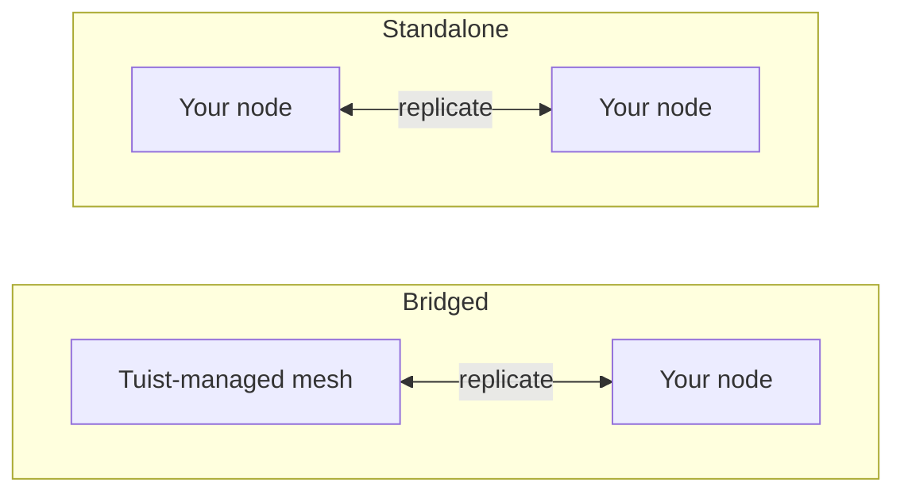

---
{
  "title": "Kendi Sunucunuzda Barındırma",
  "titleTemplate": ":title | Önbellek | Kılavuzlar | Tuist",
  "description": "Tuist önbellek düğümlerini kendi sunucunuzda nasıl barındıracağınızı ve Tuist tarafından barındırılan ağ ile nasıl çoğaltma yapacağınızı öğrenin."
}
---

# Kendiniz Barındırılan Önbellek {#self-host-cache}

Tuist önbelleği, yapıtları birbirine çoğaltan bir **düğüm ağı** olarak çalışır. Önbelleğin geliştiricilerinizin ve CI sistemlerinizin yanında konumlanması için kendi önbellek düğümlerinizi altyapınızda çalıştırabilir; bu sayede, önbellekleme hızının azalmasına neden olacak ağ mesafesini kısaltmış olursunuz.

Kendiniz barındırılan bir düğüm, yapıtları yerel diske depolayan tek bir kapsayıcıdır (`ghcr.io/tuist/kura`) ve bir eş ağa katıldığında, dahili eş bağlantı noktası üzerinden ağın geri kalanıyla iletişim kurar. Tuist, **kontrol düzlemi** olarak hareket eder: trafiği kimlik doğrular, yönetilen önbellek kapasitesini sağlar ve kullanımı ölçer. Düğümlerinize asla doğrudan erişmez.

> [!NOTE]
> Önbellek düğümlerini kendiniz barındırmak için bir **Enterprise planı** gerekir.
>
> Düğümler, ya barındırılan Tuist sunucusuna (`https://tuist.dev`) ya da kendiniz barındırdığınız bir Tuist sunucusuna bağlanır. Tuist sunucusunu kendiniz barındırmak ayrı bir sunucu lisansı gerektirir. <.localized_link href="/guides/server/self-host/server">Sunucu kendiniz barındırma kılavuzuna</.localized_link> bakın.

## İki topoloji {#topologies}

Kendiniz barındırılan düğümleri çalıştırmanın iki yolu vardır ve hangisini kullanacağınız tamamen hesabınızın aynı zamanda bir **Tuist tarafından yönetilen** önbellek bölgesi çalıştırıp çalıştırmadığına bağlıdır.

### Köprülenmiş: Tuist tarafından barındırılan ağ + sizin düğümleriniz {#topology-bridged}

Hesabınız en az bir Tuist tarafından yönetilen önbellek bölgesi çalıştırır ve kendiniz barındırdığınız düğümler **bu ağa katılır**. Düğümlerinize yapılan yazma işlemleri sürekli olarak yönetilen ağa yayılır ve bir düğüm katıldığında, yönetilen ağın mevcut önbelleğinden ısınır. Bu durum, düşük gecikmeli bir önbelleği çalışanlarınızın (yazma işlemlerinin çoğunu bunlar yapar) yanına yerleştirirken, yazma işlemleri paylaşılan önbelleğe beslenir. Bir düğüm katıldıktan **sonra** yönetilen ağın başka yerlerinde yazılan yeni yapıtların henüz sürekli olarak o düğüme geri yayılmadığını unutmayın; bu planlanan bir geliştirmedir.

Paylaşılan, her zaman açık yönetilen önbellekten vazgeçmeden şirket içi bir önbelleğin hızını istediğinizde bu doğru seçimdir.

### Bağımsız: yalnızca sizin düğümleriniz {#topology-standalone}

Hesabınız **hiçbir** yönetilen önbellek bölgesi çalıştırmaz. Düğümleriniz altyapınızda kendi izole ağınızı oluşturur. Tuist yine de düğümlerinizin var olduğunu bilir (böylece kullanım ölçülür), ancak böyle bir ağ olmadığı için **Tuist tarafından yönetilen hiçbir ağla veri alışverişi yapılmaz**. Eş üyeliği ve çoğaltma tamamen kendi düğümleriniz içinde gerçekleşir.



Yapılandırmadaki temel fark, **köprülenmiş** topolojinin, düğümün önyüklemede anahtar çiftini oluşturduğu ve Tuist'in ağ sertifikasını verdiği **kayıt** işlemini kullanmasıdır; oysa **bağımsız** topolojide Tuist tarafından verilen bir ağ sertifikası yoktur. Tek bir bağımsız düğüm, eş TLS'si devre dışı bırakılmış şekilde çalışabilir; çok düğümlü bağımsız bir ağ ise sizin sağladığınız eş TLS malzemesini kullanır.

## CLI uç noktasını yapılandırın {#cli-endpoint}

Tuist’in yönetilen önbelleği `https://<account>.cache.tuist.dev` kullanır. Kendiniz barındırdığınız bir Tuist sunucusuyla, CLI önbellek URL’sini sunucunun `TUIST_CACHE_ENDPOINTS` ayarından alır. Bunu ana önbellek sunucunuzun veya yük dengeleyicinizin URL’sine ayarlayın. Birden fazla URL içeriyorsa ilk olanı kullanılır.

Özel/özel önbellek düğümlerini **barındırılan Tuist sunucusuna** bağlarken, geliştirici kabuklarında ve CI’da açık bir uç nokta yapılandırın:

```sh
export TUIST_CACHE_ENDPOINT=https://cache.example.com
```

Bu geçersiz kılma, her iki sunucu türünde de önceliklidir ve kendiniz barındırdığınız bir Tuist sunucusu için isteğe bağlıdır. Xcode önbellek arka plan programı için, LaunchAgent’in güncellenmiş ortamı alması amacıyla bunu ayarladıktan sonra `tuist setup cache` komutunu yeniden çalıştırın. Birden fazla düğüm için yük dengeleyicinizi veya DNS yönlendirme adınızı kullanın.

## Önkoşullar {#prerequisites}


- Docker ve Docker Compose (veya herhangi bir kapsayıcı çalışma zamanı)
- Çalışan bir Tuist sunucusu (barındırılan veya kendiniz barındırdığınız)
- Önbellek için disk alanı. Köprülenmiş bir düğüm, ilk katılımda hesabın **tüm** ağını çeker, bu nedenle veri biriminizi buna göre boyutlandırın.

## Bir kontrol düzlemi istemcisi sağlayın {#control-plane-client}

Bir düğüm, önbellek isteklerini kimlik doğrulamak (token introspection), panoya rapor vermek ve kullanım verilerini iletmek için bir kontrol düzlemi istemci kimlik bilgisi kullanır. Bu, istemcilerin kendi kendine barındırılan bir Tuist sunucusunda düğümlerinize nasıl yönlendirildiği **değildir** (bkz. [İstemciler düğümlerinize nasıl ulaşır](#routing)).

Tamamen kendiniz barındırdığınız bir dağıtım için bir **UUID istemci kimliği** ve rastgele bir gizli dizi oluşturun, ardından aynı çifti Tuist sunucusunda ve her Kura düğümünde yapılandırın:

```bash
KURA_CONTROL_PLANE_CLIENT_ID="$(uuidgen | tr '[:upper:]' '[:lower:]')"
KURA_CONTROL_PLANE_CLIENT_SECRET="$(openssl rand -base64 32)"
```

Bu değerleri Tuist sunucu ortamında `KURA_CONTROL_PLANE_CLIENT_ID` ve `KURA_CONTROL_PLANE_CLIENT_SECRET` olarak ayarlayın, ardından aşağıdaki Kura yapılandırmasında aynı değerleri kullanın. Kayıt kalp atışları, hesabın kalıcı önbellek kimliği olan `KURA_TENANT_ID` bilgisini içerir, böylece sunucu hesap yeniden adlandırıldıktan sonra bile düğümü doğru hesaba ekleyebilir.

> [!WARNING]
> İstemci kimliği, `kura_` ön eki olmadan bir UUID olmalıdır. UUID olmayan kimlikler, her iki hizmette de kimlik bilgileri eşleşse bile token introspeksiyonunun HTTP `400` hatasıyla başarısız olmasına neden olur.

Barındırılan `tuist.dev` sunucusuna bağlanıyorsanız veya UI’dan döndürülebilen hesap başına bir kimlik bilgisi istiyorsanız, hesabın **Önbellek** sayfasını açın, **Kimlik bilgisi oluştur** seçeneğini belirleyin ve `client_id` ile tek seferlik `secret` bilgisini kopyalayın. Barındırılan sunucuda, kendiniz barındırılan düğüm kimlik bilgisi oluşturmak için Enterprise planı gerekir.

## Kalıcı kiracıyı seçin {#permanent-tenant}

`KURA_TENANT_ID`, kalıcı depolama ve eş kimliğidir ve başlangıçta hesabın orijinal kullanıcı adından türetilir. Hiçbir zaman yeniden adlandırılmamış bir hesap için geçerli kullanıcı adıyla eşleşir. **Hesap yeniden adlandırıldıktan sonra orijinal değerini koruyun**; bu, yedek düğümler eklerken veya aynı ağa başka bir düğüm eklerken de geçerlidir. Örneğin, `original` adını `renamed` olarak değiştirmek, her düğümde `KURA_TENANT_ID=original` bırakır. Bunu değiştirmek farklı bir nesne-anahtarı ad alanı seçer; hesabı yeniden adlandırmak depolanan yapıtları veya eş kimliğini taşımaz.

Aşağıdaki örneklerdeki `<permanent-kura-tenant>` ifadesini bu değerle değiştirin. Mevcut doğru yapılandırılmış bir düğümden kiracıyı yeniden kullanın veya kayıt işlemi tarafından döndürülen `tenant_id` değerini kullanın. Kendiniz barındırdığınız bir Tuist sunucusunun operatörü, hesabın `kura_tenant_id` veritabanı alanını inceleyebilir. Değeri yeniden adlandırılmış bir hesabın URL’sinden tahmin etmeyin.

Geçerli bir dağıtım düzeyinde kontrol düzlemi kimlik bilgisiyle, düğüm kalıcı kiracısından farklı bir geçerli veya saklanmış kullanıcı adı sağlarsa kayıt ve eş keşfi **409 Çakışma** yanıtını `error: "tenant_mismatch"` ve `expected_tenant_id` ile döndürür. Düğümü kaydetmezler veya sessizce farklı bir depolama kimliğiyle değiştirmezler. Geçersiz kimlik bilgileri ve bilinmeyen kiracılar, bir kiracıyı ifşa etmeden yine de **401 Yetkisiz** yanıtını döndürür. Bir düğüm zaten farklı bir kiracıyla veri yazdıysa, bunu değiştirmeden önce yapılandırmasını ve depolama geçmişini gözden geçirin; hata yanıtı bir depolama taşıması gerçekleştirmez.

## İstemciler düğümlerinize nasıl ulaşır {#routing}

Geliştirici makinelerinin ve CI’nın düğümlerinize ulaşabilmesi için önbellek URL’sini [yukarıda](#cli-endpoint) yapılandırın. Her düğümün adresini ve hazır durumunu panoda bildirmek için düğümde `KURA_REGISTRATION_URL` ve `KURA_ADVERTISED_HTTP_URL` ayarlarını yapın.

## Köprülenmiş kurulum {#bridged-setup}

Düğüm önyüklemede kayıt olur: yerel olarak bir anahtar çifti oluşturur (özel anahtar altyapınızdan asla ayrılmaz), bir sertifika imzalama isteği gönderir ve imzalı sertifikasını, hesap CA’sını ve yönetilen ağın ağ geçidi adresini alır. **Herhangi bir TLS materyali sağlamazsınız**. Kayıt işlemi bunu monte edilen birime yazar.

```yaml
# docker-compose.yml
services:
  kura:
    image: ghcr.io/tuist/kura:<version>
    restart: unless-stopped
    ports:
      - "4000:4000"   # HTTP cache: your developers and CI point here
      - "7443:7443"   # mesh peer port
    environment:
      # Enroll and join the managed mesh
      KURA_ENROLL_ON_BOOT: "1"
      KURA_CONTROL_PLANE_URL: "https://tuist.dev"
      KURA_CONTROL_PLANE_CLIENT_ID: "<client_id>"
      KURA_CONTROL_PLANE_CLIENT_SECRET: "<secret>"
      KURA_TENANT_ID: "<permanent-kura-tenant>"

      # Report the node’s address and readiness to the dashboard
      KURA_REGISTRATION_URL: "https://tuist.dev/_internal/kura/mesh/registrations"
      KURA_ADVERTISED_HTTP_URL: "https://kura.acme.internal"   # where your CLI/CI reach the cache
      KURA_NODE_URL: "https://kura.acme.internal:7443"         # this node's peer identity on your network
      KURA_REGION: "office"

      # Ports and storage. KURA_PORT serves both the HTTP cache API and REAPI
      # gRPC (h2c) on one listener. Enrollment writes the TLS files into
      # KURA_INTERNAL_TLS_* on first boot.
      KURA_PORT: "4000"
      KURA_INTERNAL_PORT: "7443"
      KURA_INTERNAL_TLS_CA_CERT_PATH: "/tls/ca.pem"
      KURA_INTERNAL_TLS_CERT_PATH: "/tls/tls.crt"
      KURA_INTERNAL_TLS_KEY_PATH: "/tls/tls.key"
      KURA_DATA_DIR: "/var/cache/kura"
      KURA_TMP_DIR: "/var/cache/kura/tmp"
      KURA_OTEL_SERVICE_NAME: "kura-acme"
      KURA_OTEL_DEPLOYMENT_ENVIRONMENT: "onprem"

      # Authenticate the HTTP cache API. The Tuist hook ships in the image at
      # this path; it introspects each token against the control plane using the
      # control-plane client above, so only valid Tuist tokens for this account
      # can read or write. No JWT verifier secret is involved.
      KURA_AUTH_ENABLED: "1"
      KURA_AUTH_TUIST_URL: "https://tuist.dev"
    volumes:
      - kura-tls:/tls            # empty; enrollment populates it
      - kura-data:/var/cache/kura
volumes:
  kura-tls: {}
  kura-data: {}
```

Sizin sağladıklarınız: kontrol düzlemi istemcisi, ağınız üzerindeki iki adres (`KURA_NODE_URL`, `KURA_ADVERTISED_HTTP_URL`) ve iki boş yazılabilir birim. Diğer her şey (anahtar çifti, sertifika, hesap CA’sı ve yönetilen ağın adresi) önyüklemede otomatik olarak sağlanır.

## Bağımsız kurulum {#standalone-setup}

Yönetilen bir bölge olmadığında Tuist tarafından verilen bir ağ CA’sı yoktur, bu nedenle kayıt uygulanmaz (kayıt uç noktası `503 ca_unavailable` döndürür). Düğüm, token kimlik doğrulaması, pano kayıt kalp atışları ve kullanım raporlaması için Tuist sunucunuzu kullanır.

```yaml
# docker-compose.yml for a single node connected to a self-hosted Tuist server
services:
  kura:
    image: ghcr.io/tuist/kura:<version>
    restart: unless-stopped
    ports:
      - "4000:4000"
      - "7443:7443"
    environment:
      KURA_TENANT_ID: "<permanent-kura-tenant>"
      KURA_NODE_URL: "http://kura-1.acme.internal:7443"
      KURA_PEERS: ""   # single node: disable static peer discovery
      KURA_REGION: "office"

      # Authenticate cache requests against the self-hosted Tuist server.
      # Use the same values configured on the Tuist server, or a per-account
      # credential from the Cache page.
      KURA_CONTROL_PLANE_CLIENT_ID: "<client_id>"
      KURA_CONTROL_PLANE_CLIENT_SECRET: "<secret>"
      KURA_AUTH_ENABLED: "1"
      KURA_AUTH_TUIST_URL: "https://tuist.acme.internal"

      # Register the client-facing cache URL with the Tuist server.
      KURA_REGISTRATION_URL: "https://tuist.acme.internal/_internal/kura/mesh/registrations"
      KURA_ADVERTISED_HTTP_URL: "https://kura.acme.internal"

      KURA_PORT: "4000"
      KURA_INTERNAL_PORT: "7443"
      KURA_DATA_DIR: "/var/cache/kura"
      KURA_TMP_DIR: "/var/cache/kura/tmp"
      KURA_OTEL_SERVICE_NAME: "kura-acme"
      KURA_OTEL_DEPLOYMENT_ENVIRONMENT: "onprem"
    volumes:
      - kura-data:/var/cache/kura
volumes:
  kura-data: {}
```

Tek bir düğüm için eş TLS’yi ayarlamayın ve `KURA_PEERS` değerini boş bir dize olarak ayarlayın. `KURA_PEERS` ayarlanmadığında Kura, statik eş keşfini `KURA_NODE_URL` üzerinden başlatır ve periyodik olarak o URL’nin `/_internal/status` uç noktasını kontrol eder. Eş TLS devre dışıyken, düğüm özel bir ağ adı üzerinden erişilebilir olsa bile `KURA_NODE_URL` `http://` şemasını kullanmalıdır.

Bu örnekte `KURA_CONTROL_PLANE_URL` gerekli değildir çünkü yetkilendirme ve kullanım raporlayıcısı ikisi de Tuist temel URL’si olarak `KURA_AUTH_TUIST_URL` kullanır. `KURA_ADVERTISED_HTTP_URL`, düğümün panodaki istemciye yönelik adresini tanımlar. CLI’nın önbellek istekleri için bu adresi kullanması için Tuist sunucusunda `TUIST_CACHE_ENDPOINTS=https://kura.acme.internal` ayarını yapın.

### Helm ile Kubernetes {#standalone-helm}

Kendiniz barındırdığınız Tuist sunucusu Kubernetes üzerinde çalışıyorsa, Kura’yı bağımsız Kura chart’ı ile yükleyin ve aynı kontrol düzlemi ayarlarını `extraEnv` üzerinden iletin. Tuist sunucu chart’ı bu Kura chart’ını alt chart olarak yüklemez.

Önce, Tuist sunucu chart’ını dağıtım düzeyindeki Kura kimlik bilgisiyle yapılandırın:

```yaml
# tuist-values.yaml
server:
  extraEnv:
    - name: KURA_CONTROL_PLANE_CLIENT_ID
      valueFrom:
        secretKeyRef:
          name: kura-control-plane
          key: client-id
    - name: KURA_CONTROL_PLANE_CLIENT_SECRET
      valueFrom:
        secretKeyRef:
          name: kura-control-plane
          key: client-secret
```

Ardından Kura’yı aynı ad alanında aynı Secret ile yükleyin:

```yaml
# kura-values.yaml
replicaCount: 1

config:
  tenantId: "<permanent-kura-tenant>"
  region: "office"

ingress:
  enabled: true
  className: nginx
  hosts:
    - host: kura.acme.internal
      paths:
        - path: /
          pathType: Prefix
  tls:
    - hosts:
        - kura.acme.internal
      secretName: kura-tls

extraEnv:
  - name: KURA_CONTROL_PLANE_CLIENT_ID
    valueFrom:
      secretKeyRef:
        name: kura-control-plane
        key: client-id
  - name: KURA_CONTROL_PLANE_CLIENT_SECRET
    valueFrom:
      secretKeyRef:
        name: kura-control-plane
        key: client-secret
  - name: KURA_AUTH_ENABLED
    value: "1"
  - name: KURA_AUTH_TUIST_URL
    value: "https://tuist.acme.internal"
  - name: KURA_REGISTRATION_URL
    value: "https://tuist.acme.internal/_internal/kura/mesh/registrations"
  - name: KURA_ADVERTISED_HTTP_URL
    value: "https://kura.acme.internal"
```

```bash
kubectl create namespace tuist
kubectl -n tuist create secret generic kura-control-plane \
  --from-literal=client-id="<client_id>" \
  --from-literal=client-secret="<secret>"

helm upgrade --install kura oci://ghcr.io/tuist/charts/kura \
  --namespace tuist \
  -f kura-values.yaml
```

Kura, Tuist sunucusundan farklı bir ad alanında çalışıyorsa, `kura-control-plane` Secret’ını her iki ad alanına da oluşturun veya senkronize edin.

Görüntüden gelen paketli Tuist hook’unu kullanırken `extension.enabled` ayarını boş bırakın; bu chart değeri, bir ConfigMap’ten özel bir hook bağlamak içindir. Chart sizin için `KURA_NODE_URL`, `KURA_PEERS`, headless hizmeti, kalıcılığı ve prob’ları oluşturur. `replicaCount: 1` ile oluşturulan eş URL’si pod’un kendi kararlı DNS adıdır, bu nedenle küme içinde erişilebilir kalır ve yukarıda açıklanan tek düğüm uyarısını üretmez. Birden fazla kopya için chart, StatefulSet DNS’inden eş listesini oluşturur; iç eş düzleminde mTLS istediğinizde `peerTls` seçeneğini etkinleştirin ve bir TLS Secret sağlayın.

Birden fazla bağımsız düğüm çalıştırmak için, `/tls` konumuna monte edilen **kendi eş TLS’nizi** ekleyin (düğümlerin birbirine güvenmesi için ortak bir CA paylaşan, düğüm başına bir CA artı bir leaf sertifika ve anahtar), `KURA_NODE_URL` değerini `https://...:<KURA_INTERNAL_PORT>` olarak değiştirin ve `KURA_PEERS` ekleyin:

```yaml
environment:
  KURA_NODE_URL: "https://kura-1.acme.internal:7443"
  KURA_PEERS: "https://kura-2.acme.internal:7443,https://kura-3.acme.internal:7443"
  KURA_INTERNAL_TLS_CA_CERT_PATH: "/tls/ca.pem"
  KURA_INTERNAL_TLS_CERT_PATH: "/tls/tls.crt"
  KURA_INTERNAL_TLS_KEY_PATH: "/tls/tls.key"
volumes:
  - ./tls:/tls:ro
```

## Her topolojinin gerektirdikleri {#requirements-summary}

| Sizin sağladıklarınız | Köprülenmiş | Bağımsız |
|---|---|---|
| Kontrol düzlemi istemcisi (`client_id` / `secret`) | Evet | Evet |
| `KURA_NODE_URL` | Evet | Evet |
| `KURA_ADVERTISED_HTTP_URL` | Evet | Pano kaydı için; yönlendirme ayrıdır (aşağıya bakın) |
| CLI’ya yönlendirme | Otomatik (kayıt) | Hazır kayıt kalp atışlarından otomatik |
| Veri + geçici birim | Evet | Evet |
| `KURA_ENROLL_ON_BOOT` | Evet | Hayır (`ca_unavailable` döndürür) |
| Eş TLS’si (`/tls` CA + leaf) | Hayır, kayıt bunu yazar | Yalnızca çok düğümlü bir ağ için |
| `KURA_PEERS` (eş listesi) | Hayır, kayıt ağ geçidini tohumlar | Tek düğüm için boş; birden fazla düğüm için eş URL’leri |

## Gerekli yapılandırma {#required-config}

Bu değişkenler topolojiden bağımsız olarak her düğümü yapılandırır (eş TLS aşağıda belirtilen istisnadır):

| Değişken | Açıklama |
|---|---|
| `KURA_TENANT_ID` | Hesabınızın kalıcı Kura kiracısı. Hesabı yeniden adlandırdıktan sonra orijinal değerini koruyun; bkz. [Kalıcı kiracıyı seçin](#permanent-tenant). |
| `KURA_NODE_URL` | Bu düğümün ağınız üzerindeki eş URL’si. |
| `KURA_PEERS` | Statik eş keşif listesi. Tek bir bağımsız düğüm için boş bir dize olarak ayarlayın; çok düğümlü bir ağ için erişilebilir eş URL’lerini ayarlayın. |
| `KURA_REGION` | Serbest biçimli bir bölge etiketi (ör. `office`, `ci`). |
| `KURA_PORT` / `KURA_INTERNAL_PORT` | Önbellek bağlantı noktası (HTTP önbellek API’si ve REAPI gRPC tek bir dinleyicide birlikte barındırılır) ve ağ eş bağlantı noktası (`4000` / `7443`). |
| `KURA_DATA_DIR` / `KURA_TMP_DIR` | Disk üzerindeki yapıt depolama ve geçici dizin. |
| `KURA_INTERNAL_TLS_CA_CERT_PATH` / `KURA_INTERNAL_TLS_CERT_PATH` / `KURA_INTERNAL_TLS_KEY_PATH` | Eş TLS dosyaları. Kayıt tarafından yazılır (köprülenmiş) veya sizin tarafınızdan sağlanır (çok düğümlü bağımsız). Tek düğüm için gerekli değildir; bunları atlayın ve bir `http://` `KURA_NODE_URL` kullanın. |
| `KURA_OTEL_SERVICE_NAME` / `KURA_OTEL_DEPLOYMENT_ENVIRONMENT` | Telemetri için hizmet adı ve ortam etiketi. |

Köprülenmiş düğümler ayrıca `KURA_ENROLL_ON_BOOT`, `KURA_CONTROL_PLANE_URL` ve kontrol düzlemi istemci kimlik bilgilerini ayarlar. `KURA_REGISTRATION_URL` ve `KURA_ADVERTISED_HTTP_URL`, düğümün **Önbellek** sayfasında görünmesini ve Kura etkin CLI istemcilerinin ona yönlendirilmesini sağlar (bkz. [İstemciler düğümlerinize nasıl ulaşır](#routing)).

## Depolama ve tahliye {#storage}

Bir düğüm, yapıtları isteğe bağlı bir değişkenle ayarlayabileceğiniz bir CAS depolama bütçesine kadar `KURA_DATA_DIR` altında saklar:

| Değişken | Açıklama |
|---|---|
| `KURA_CAS_CAPACITY_BYTES` | Düğümün bayt cinsinden CAS depolama bütçesi. Pozitif bir tamsayı olmalıdır. Ayarlanmadığında, bütçe `KURA_DATA_DIR` barındıran dosya sisteminin boyutunun %50’sidir. |

Ayarlasanız da ayarlamasanız da, bütçe `KURA_DATA_DIR` barındıran dosya sisteminin %80’i ile sınırlıdır; böylece en eski segmenti tahliye etmeden önce yeni bir segment yazan döndürme işlemi diski dolduramaz. Bütçe, minimum 2,5 GiB olmak üzere tam 512 MiB segmentlere yuvarlanır. Düğüm, başlangıçta çözümlenen bütçeyi günlüğe kaydeder (`resolved CAS segment ring limits`).

Tahliye otomatiktir. Yapıtlar bir segment halkasında saklanır ve bütçeye ulaşıldığında en eski segment tahliye edilir. Eski segmentlerden okunan yapıtlar geçerli olanına yükseltilir, böylece sık kullanılan yapıtlar korunur ve tahliye davranışı en son kullanılanlara yakın olur.

`KURA_DATA_DIR` konumunu özel bir birime yerleştirin. Hem varsayılan bütçe hem de üst sınır, dosya sisteminin boş alanının değil toplam boyutunun yüzdesidir; bu nedenle aynı dosya sistemindeki diğer veriler, bütçenin varsaydığından daha az alan bırakabilir.

## Önbellek isteklerinin kimlik doğrulaması {#cache-auth}

Varsayılan olarak bir düğüm, ağınızda ona ulaşabilen herkese HTTP önbellek API’sini sunar. Yalnızca kuruluşunuzun kimliği doğrulanmış üyelerinin okuma ve yazma yapabilmesi için arayanların geçerli bir Tuist belirteci sunmasını zorunlu kılmak amacıyla düğümü Tuist sunucunuza işaretleyin. Yukarıdaki bağımsız kurulum bunu yapar.

| Değişken | Değer |
|---|---|
| `KURA_AUTH_ENABLED` | `1` |
| `KURA_AUTH_TUIST_URL` | Tuist sunucu URL’niz |

Yetkilendirme, belirteçleri incelemek için zaten ayarladığınız kontrol düzlemi istemcisini (`KURA_CONTROL_PLANE_CLIENT_ID` / `KURA_CONTROL_PLANE_CLIENT_SECRET`) yeniden kullanır, bu nedenle ek bir kimlik bilgisine gerek yoktur. Kendi kendine barındırılan bir düğüm **yalnızca inceleme** modunda çalışır: herhangi bir kiracı için belirteç basabilecek ve asla paylaşılmayan simetrik Guardian JWT doğrulayıcı gizli anahtarını asla tutmaz, bu nedenle her istek sunucunuza karşı yetkilendirilir. Ona ulaşamayan bir düğüm hizmet vermek yerine reddeder ve bunu değiştiren bir ayar yoktur. Tuist tarafından yönetilen düğümler aynı yetkilendirmeyi çalıştırır; tek fark, doğrulama anahtarını da tutmalarıdır, bu da çoğu isteği yalnızca belirteçten çözümlemelerini sağlar.

## Ağ {#networking}

Bir düğüm, hangi entegrasyonları etkinleştirdiğinize bağlı olarak **giden** bağlantılar kurar:

- belirteç incelemesi (`KURA_AUTH_TUIST_URL`), kayıt kalp atışları (`KURA_REGISTRATION_URL`), kullanım (`KURA_CONTROL_PLANE_URL` veya `KURA_AUTH_TUIST_URL`) ve köprülenmiş topolojide kayıt için Tuist sunucunuz ve
- köprülenmiş topolojide, çoğaltma için yönetilen ağın eş ağ geçidi.

Geliştiricileriniz ve CI, düğümün `KURA_ADVERTISED_HTTP_URL` adresine ulaşır (ve çok düğümlü bir ağ için düğümler eş bağlantı noktasında birbirine ulaşır). Bu adreslerin yalnızca **ağınız içinde** erişilebilir olması gerekir. Genel internete açık olmaları gerekmez.

## Nasıl davranır {#behavior}

- **Köprülenmiş.** Başlangıçta düğüm kaydolur, yönetilen ağın tam önbelleğini çeker ve halkanın hizmet veren bir üyesine geçer. İlk çekme bir kez gerçekleşir ve önbelleğinizin boyutuna bağlı olarak WAN üzerinden biraz zaman alabilir. O andan itibaren, düğümdeki yazmalar sürekli olarak yönetilen ağa yayılır. Düğüm katıldıktan sonra yönetilen ağın başka yerlerinde yazılan yeni yapıtlar henüz sürekli olarak ona yayılmaz (planlanan bir geliştirme), bu nedenle katılım sırasındaki çekmeyi canlı bir yansıma yerine bir anlık görüntü olarak değerlendirin.
- **Bağımsız.** Düğüm(ler) altyapınızda izole bir ağ olarak çalışır. Çoğaltma, varsa, yalnızca kendi düğümleriniz arasında gerçekleşir. Yapılandırıldığında Tuist’in rolü kontrol düzlemiyle sınırlıdır: pano görünürlüğü, önbellek uç noktası reklamı, kullanım ölçümü ve belirteç incelemesi. Asla düğümlerinizi sağlamaz, yükseltmez, eşleştirmez veya içlerine erişmez.

## Doğrulama {#verify}

```bash
curl --fail-with-body http://localhost:4000/ready   # 200 once the node has joined and is serving
curl --fail-with-body http://localhost:4000/up      # liveness + mesh membership
```

Köprülenmiş bir düğüm, ağı çekerken `state: joining` durumunu ve yakaladıktan sonra `state: serving` durumunu bildirir. Kayıt kalp atışları başladığında düğümünüz ayrıca hesabın **Önbellek** sayfasındaki **Kayıtlı düğümler** altında görünür.

Uzak önbelleğe almayı doğrulamak için önbelleğe alınmamış, önbelleklenebilir hedeflerle `tuist cache` komutunu çalıştırın ve Kura günlüklerinde başarılı yüklemeleri onaylayın. Sıfır çıkış durumu alone yapıtların depolandığını doğrulamaz.

## Yükseltme {#upgrading}

```bash
docker compose pull
docker compose up -d
```

Düğümler, tek bir sürüm farkı boyunca yan yana çalışacak şekilde tasarlanmıştır; bu nedenle birden fazla düğümde kademeli yükseltme yapmak güvenlidir.
