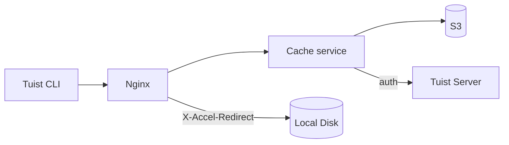
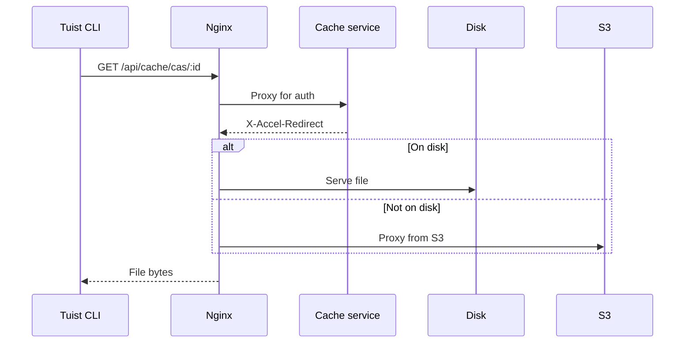
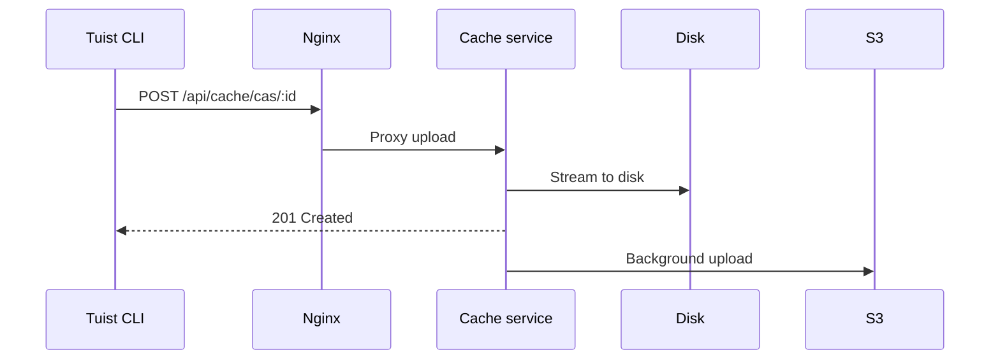

---
{
  "title": "架構",
  "titleTemplate": ":title | Cache | Guides | Tuist",
  "description": "了解 Tuist cache 服務的架構。"
}
---

# 快取架構 {#cache-architecture}

> [!NOTE]
> 此頁提供 Tuist 快取服務架構的技術概覽。主要對象為需要理解服務內部運作的 **自託管用戶** 及 **貢獻者**。只想使用快取的一般用戶無需閱讀此內容。

Tuist 快取服務是一項獨立服務，為構建產物提供內容定址儲存（CAS），並為快取元數據提供鍵值儲存。

## 概覽 {#overview}

該服務採用兩層儲存架構，並搭配本地 SQLite 元數據：

- **本地磁碟**：低延遲快取命中的主要儲存
- **S3**：持久化儲存，可保留產物並在逐出後恢復
- **SQLite**：本地元數據，用於追蹤產物存取、清理孤立檔案、執行背景工作，以及儲存鍵值快取數據

## 元件 {#components}

### Nginx {#nginx}

Nginx 作為入口點，並使用 `X-Accel-Redirect` 高效交付檔案：

- **下載**：快取服務驗證身份認證後，會傳回 `X-Accel-Redirect` 標頭。Nginx 直接從磁碟提供檔案，或從 S3 代理。
- **上傳**：Nginx 將請求代理至快取服務，後者將數據串流寫入磁碟。

### 內容定址儲存 {#cas}

產物以分片目錄結構儲存在本地磁碟上：

- **路徑**：`{account}/{project}/cas/{shard1}/{shard2}/{artifact_id}`
- **分片**：取產物 ID 的前四個字元建立兩級分片（例如 `ABCD1234` → `AB/CD/ABCD1234`）

### SQLite 元數據 {#sqlite}

快取服務使用兩個 SQLite 資料庫：

- **主要元數據資料庫**：儲存 `cache_artifacts`、孤立檔案掃描遊標、Oban 工作及其他服務元數據。
- **鍵值資料庫**：在專用的 SQLite 檔案中儲存 `key_value_entries` 和 `key_value_entry_hashes`。

鍵值儲存拆分至獨立資料庫，以便使用 SQLite 增量自動真空機制，而不影響產物元數據和孤立檔案清理狀態。

### S3 整合 {#s3}

S3 提供持久化儲存：

- **背景上傳**：寫入磁碟後，產物會透過每分鐘執行的背景工作排隊上傳至 S3
- **按需載入**：當本地缺少產物時，系統會立即透過預簽名的 S3 URL 提供請求，同時將該產物排隊背景下載至本地磁碟

### 磁碟逐出 {#eviction}

服務透過多個背景程序管理磁碟空間：

- **CAS 磁碟逐出** 使用由 `cache_artifacts` 支援的 LRU 語義
- 當磁碟使用量超過 85% 時，會刪除最舊的產物，直至使用量降至 70%
- 產物在本地逐出後仍保留於 S3
- **KV 逐出** 會根據保留策略移除舊的鍵值條目，並在專用 KV 資料庫超過設定的大小預算時進行縮減

### 孤立檔案清理 {#orphan-cleanup}

服務亦會運行孤立檔案清理工作，處理磁碟上的產物：

- 它會掃描儲存樹，找出存在於磁碟但沒有對應 `cache_artifacts` 記錄的檔案。
- 若檔案已寫入磁碟，但在 SQLite 緩衝區刷新完成前元數據寫入遺失，便會出現此情況。
- 為避免與進行中的上傳競爭，會忽略新於安全時間窗口的檔案。
- 若孤立檔案被刪除後再次被請求，下一次快取未命中會使其重新上傳，從而讓系統自我修復。

### 身份認證 {#authentication}

快取服務透過呼叫 `/api/projects` 端點並將結果快取（成功時 10 分鐘，失敗時 3 秒），將身份認證委派給 Tuist 伺服器。

## 請求流程 {#request-flows}

### 下載 {#download-flow}

### 上傳 {#upload-flow}

## API 端點 {#api-endpoints}

| 端點 | 方法 | 描述 |
|----------|--------|-------------|
| `/up` | GET | 健康檢查 |
| `/metrics` | GET | Prometheus 指標 |
| `/api/cache/cas/:id` | GET | 下載 CAS 產物 |
| `/api/cache/cas/:id` | POST | 上傳 CAS 產物 |
| `/api/cache/keyvalue/:cas_id` | GET | 取得鍵值條目 |
| `/api/cache/keyvalue` | PUT | 儲存鍵值條目 |
| `/api/cache/module/:id` | HEAD | 檢查模組產物是否存在 |
| `/api/cache/module/:id` | GET | 下載模組產物 |
| `/api/cache/module/start` | POST | 開始多部分上傳 |
| `/api/cache/module/part` | POST | 上傳部分 |
| `/api/cache/module/complete` | POST | 完成多部分上傳 |
