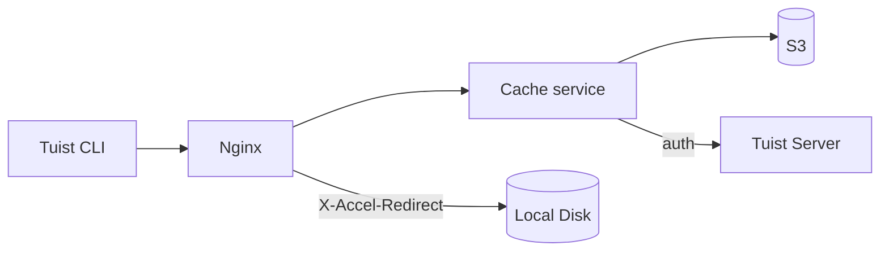
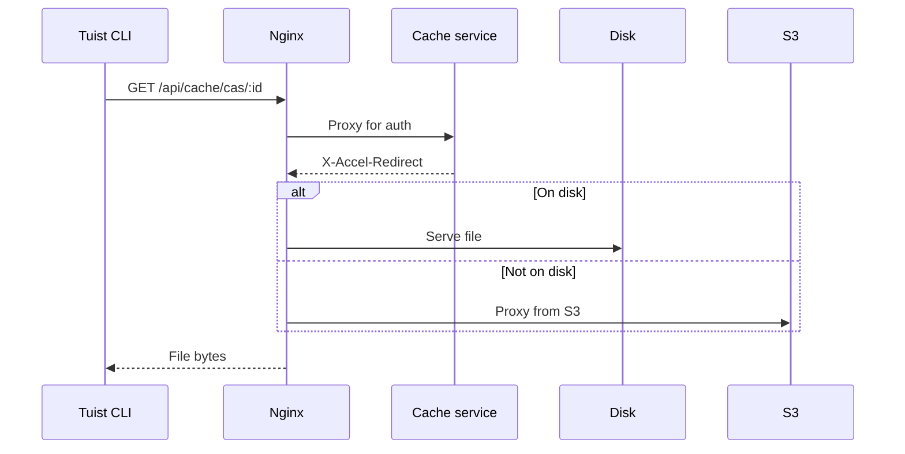
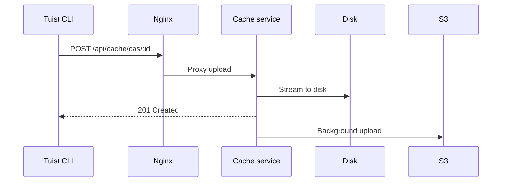

---
{
  "title": "架構",
  "titleTemplate": ":title | Cache | Guides | Tuist",
  "description": "了解 Tuist cache 服務的架構。"
}
---

# 快取架構 {#cache-architecture}

> [!NOTE]
> 本頁提供 Tuist 快取服務架構的技術概覽，主要供需要理解服務內部運作的**自行託管使用者**與**貢獻者**閱讀。只想使用快取的一般使用者無需閱讀此內容。

Tuist 快取服務是一項獨立服務，為建置產物提供內容定址儲存（CAS），並為快取中繼資料提供鍵值儲存。

## 概覽 {#overview}

該服務採用兩層儲存架構，並搭配本機 SQLite 中繼資料：

- **本機磁碟**：低延遲快取命中的主要儲存
- **S3**：持久化儲存，可保留產物並在驅逐後恢復
- **SQLite**：用於追蹤產物存取、清理孤兒檔案、執行背景工作，以及儲存鍵值快取資料的本機中繼資料

## 元件 {#components}

### Nginx {#nginx}

Nginx 作為入口點，並使用 `X-Accel-Redirect` 高效交付檔案：

- **下載**：快取服務驗證認證後，回傳 `X-Accel-Redirect` 標頭。Nginx 會直接從磁碟提供檔案，或從 S3 代理。
- **上傳**：Nginx 將請求代理至快取服務，由服務將資料串流寫入磁碟。

### 內容定址儲存 {#cas}

產物以分片目錄結構儲存於本機磁碟：

- **路徑**：`{account}/{project}/cas/{shard1}/{shard2}/{artifact_id}`
- **分片**：取產物 ID 的前四個字元建立兩層分片（例如 `ABCD1234` → `AB/CD/ABCD1234`）

### SQLite 中繼資料 {#sqlite}

快取服務使用兩個 SQLite 資料庫：

- **主要中繼資料資料庫**：儲存 `cache_artifacts`、孤兒掃描游標、Oban 工作及其他服務中繼資料。
- **鍵值資料庫**：在專屬的 SQLite 檔案中儲存 `key_value_entries` 與 `key_value_entry_hashes`。

鍵值儲存拆分至獨立資料庫，以便使用 SQLite 增量自動真空，而不影響產物中繼資料與孤兒清理狀態。

### S3 整合 {#s3}

S3 提供持久化儲存：

- **背景上傳**：寫入磁碟後，產物會透過每分鐘執行的背景工作排隊上傳至 S3
- **按需載入**：當本機缺少產物時，會立即透過預簽名的 S3 URL 回應請求，同時將產物排隊背景下載至本機磁碟

### 磁碟驅逐 {#eviction}

服務透過多個背景程序管理磁碟空間：

- **CAS 磁碟驅逐** 使用以 `cache_artifacts` 為基礎的 LRU 語意
- 當磁碟使用率超過 85% 時，會刪除最舊的產物，直至使用率降至 70%
- 本機驅逐後，產物仍保留於 S3
- **KV 驅逐** 會依據保留策略移除舊的鍵值項目，並在專屬 KV 資料庫超過設定的大小預算時縮減其體積

### 孤兒清理 {#orphan-cleanup}

服務亦會執行磁碟產物的孤兒清理工作：

- 它會掃描儲存樹，找出存在於磁碟但沒有對應 `cache_artifacts` 記錄的檔案。
- 若檔案已寫入磁碟，但在 SQLite 緩衝區刷新完成前遺失中繼資料寫入，就會發生這種情況。
- 為避免與進行中的上傳競爭，會忽略新於安全時間窗口的檔案。
- 若孤兒檔案被刪除而後再次被請求，下一次快取未命中會使其重新上傳，系統因而能自我修復。

### 認證 {#authentication}

快取服務透過呼叫 `/api/projects` 端點並將結果快取（成功時 10 分鐘，失敗時 3 秒），將認證委派給 Tuist 伺服器。

## 請求流程 {#request-flows}

### 下載 {#download-flow}

### 上傳 {#upload-flow}

## API 端點 {#api-endpoints}

| 端點 | 方法 | 描述 |
|----------|--------|-------------|
| `/up` | GET | 健康檢查 |
| `/metrics` | GET | Prometheus 指標 |
| `/api/cache/cas/:id` | GET | 下載 CAS 產物 |
| `/api/cache/cas/:id` | POST | 上傳 CAS 產物 |
| `/api/cache/keyvalue/:cas_id` | GET | 取得鍵值項目 |
| `/api/cache/keyvalue` | PUT | 儲存鍵值項目 |
| `/api/cache/module/:id` | HEAD | 檢查模組產物是否存在 |
| `/api/cache/module/:id` | GET | 下載模組產物 |
| `/api/cache/module/start` | POST | 開始分段上傳 |
| `/api/cache/module/part` | POST | 上傳分段 |
| `/api/cache/module/complete` | POST | 完成分段上傳 |
