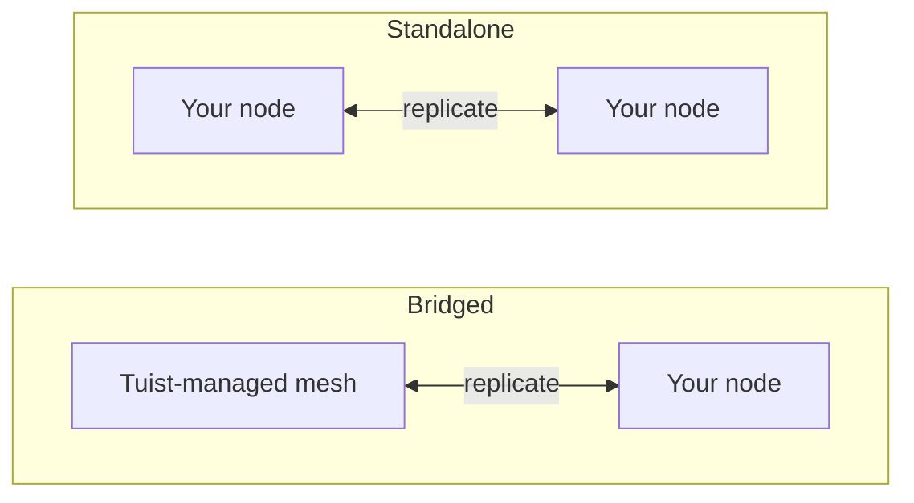

---
{
  "title": "自行託管",
  "titleTemplate": ":title | Cache | Guides | Tuist",
  "description": "了解如何自行託管 Tuist 快取節點，並與 Tuist 託管的網格進行複寫。"
}
---

# 自行託管快取 {#self-host-cache}

Tuist 嘅快取以 **節點網格** 形式運作，各節點之間會互相複製構件。你可以喺自己嘅基礎設施上運行快取節點，令快取貼近開發人員同 CI，縮短網絡距離，避免影響快取本應提供嘅速度。

自行託管節點係單一容器 (`ghcr.io/tuist/kura`)，將構件儲存於本地磁碟；當佢加入對等網格時，會透過內部對等端口同網格其餘部分通訊。Tuist 擔任 **控制平面**：負責驗證流量、配置受管快取容量，以及計量用量。佢永遠唔會直接訪問你嘅節點。

> [!NOTE]
> 自行託管快取節點需要 **Enterprise 方案**。
>
> 節點可以連接至託管嘅 Tuist 伺服器 (`https://tuist.dev`) 或自行託管嘅 Tuist 伺服器。自行託管 Tuist 伺服器本身需要獨立嘅伺服器授權。請參閱 <.localized_link href="/guides/server/self-host/server">伺服器自行託管指南</.localized_link>。

## 兩種拓撲結構 {#topologies}

運行自行託管節點有兩種方式，具體取決於你嘅帳戶是否同時運行 **Tuist 受管** 快取區域。

### 橋接模式：Tuist 託管網格 + 你嘅節點 {#topology-bridged}

你嘅帳戶至少運行一個 Tuist 受管快取區域，而你嘅自行託管節點會 **加入該網格**。寫入你節點嘅數據會持續傳播到受管網格，而節點加入時會從受管網格現有嘅快取中預熱。這將低延遲快取置於你嘅運行器旁邊（大部分寫入由它們執行），同時它們嘅寫入也會饋送共享快取。請注意，節點加入 **之後** 在受管網格其他地方寫入嘅新構件，目前尚未持續回傳到該節點；這是一項計劃中嘅增強功能。

如果你想要本地快取嘅速度，但又不想放棄共享且常開嘅受管快取，呢個係正確選擇。

### 獨立模式：僅使用你嘅節點 {#topology-standalone}

你嘅帳戶 **沒有** 運行任何受管快取區域。你嘅節點喺你嘅基礎設施上形成自己嘅隔離網格。Tuist 仍然知道你嘅節點存在（因此會計量用量），但 **不會同任何 Tuist 受管網格交換數據**，因為根本不存在這樣嘅網格。對等成員資格同複製完全發生喺你自己嘅節點之間。



配置上嘅關鍵區別在於：**橋接** 拓撲使用 **註冊**，節點啟動時生成密鑰對，Tuist 簽發其網格證書；而 **獨立** 拓撲則沒有 Tuist 簽發嘅網格證書。單個獨立節點可以禁用對等 TLS 運行；多節點獨立網格則使用你提供嘅對等 TLS 材料。

## 配置 CLI 端點 {#cli-endpoint}

Tuist 受管快取使用 `https://<account>.cache.tuist.dev`。對於自行託管嘅 Tuist 伺服器，CLI 會從伺服器嘅 `TUIST_CACHE_ENDPOINTS` 設置中獲取快取 URL。將其設置為你主要快取伺服器或負載均衡器嘅 URL。如果包含多個 URL，則使用第一個。

當將私人/自定義快取節點連接至 **託管嘅 Tuist 伺服器** 時，請喺開發人員 shell 同 CI 中配置明確嘅端點：

```sh
export TUIST_CACHE_ENDPOINT=https://cache.example.com
```

此覆蓋喺兩種伺服器類型上均優先生效，對於自行託管嘅 Tuist 伺服器則為可選。對於 Xcode 快取守護進程，設置後請重新運行 `tuist setup cache`，以便 LaunchAgent 接收更新後嘅環境變量。對於多個節點，請使用你嘅負載均衡器或 DNS 路由名稱。

## 先決條件 {#prerequisites}


- Docker 同 Docker Compose（或任何容器運行時）
- 正在運行嘅 Tuist 伺服器（託管或自行託管）
- 快取用嘅磁碟空間。橋接節點首次加入時會拉取帳戶嘅 **整個** 網格，因此請相應調整數據卷大小。

## 提供控制平面客戶端 {#control-plane-client}

節點使用控制平面客戶端憑證來驗證快取請求（令牌內省）、向儀表板報告並交付用量數據。這 **不是** 客戶端喺自行託管 Tuist 伺服器上路由到你節點嘅方式（參見 [客戶端如何到達你嘅節點](#routing)）。

對於完全自行託管嘅部署，生成一個 **UUID 客戶端 ID** 同隨機密鑰，然後喺 Tuist 伺服器同每個 Kura 節點上配置相同嘅一對：

```bash
KURA_CONTROL_PLANE_CLIENT_ID="$(uuidgen | tr '[:upper:]' '[:lower:]')"
KURA_CONTROL_PLANE_CLIENT_SECRET="$(openssl rand -base64 32)"
```

喺 Tuist 伺服器環境中將這些值設置為 `KURA_CONTROL_PLANE_CLIENT_ID` 同 `KURA_CONTROL_PLANE_CLIENT_SECRET`，然後喺下面嘅 Kura 配置中使用相同嘅值。註冊心跳包含 `KURA_TENANT_ID`（帳戶嘅永久快取標識），以便伺服器即使喺帳戶重命名後也能將節點關聯到正確嘅帳戶。

> [!WARNING]
> 客戶端 ID 必須係沒有 `kura_` 前綴嘅 UUID。非 UUID ID 會導致令牌內省失敗並返回 HTTP `400`，即使兩個服務上嘅憑證匹配亦然。

如果你連接至託管嘅 `tuist.dev` 伺服器，或者想要一個可以從 UI 輪換嘅每帳戶憑證，請打開帳戶嘅 **快取** 頁面，選擇 **生成憑證**，並複製 `client_id` 以及一次性 `secret`。喺託管伺服器上，生成自行託管節點憑證需要 Enterprise 方案。

## 選擇永久租戶 {#permanent-tenant}

`KURA_TENANT_ID` 係永久存儲同對等身份標識，最初衍生自帳戶嘅原始句柄。對於從未重命名嘅帳戶，它與當前句柄匹配。**帳戶重命名後請保留其原始值**，包括添加替換節點或向同一網格添加另一個節點時。例如，將 `original` 重命名為 `renamed` 後，每個節點上嘅 `KURA_TENANT_ID=original` 保持不變。更改它會選擇不同嘅對象鍵命名空間；重命名帳戶不會遷移已存儲嘅構件或對等身份。

將下面示例中嘅 `<permanent-kura-tenant>` 替換為此值。重用現有正確配置節點嘅租戶，或註冊返回嘅 `tenant_id`。自行託管 Tuist 伺服器嘅運營者可以檢查帳戶嘅 `kura_tenant_id` 數據庫字段。切勿從重命名後帳戶嘅 URL 推斷該值。

如果節點提供嘅當前或保留句柄與其永久租戶不同，使用有效嘅部署級控制平面憑證時，註冊同對等發現會返回 **409 Conflict** 並附带 `error: "tenant_mismatch"` 同 `expected_tenant_id`。它們不會註冊節點，亦不會靜默替換為其他存儲身份。無效憑證同未知租戶仍會返回 **401 Unauthorized** 而唔會披露租戶。如果節點已經用另一個租戶寫入數據，請喺更改之前檢查其配置同存儲歷史；錯誤響應不會執行存儲遷移。

## 客戶端如何到達你嘅節點 {#routing}

配置 [上文](#cli-endpoint) 嘅快取 URL，以便開發者機器同 CI 可以訪問你嘅節點。要喺儀表板中報告每個節點嘅地址同就緒狀態，請喺節點上設置 `KURA_REGISTRATION_URL` 同 `KURA_ADVERTISED_HTTP_URL`。

## 橋接設置 {#bridged-setup}

節點喺啟動時註冊：它喺本地生成密鑰對（私鑰永遠唔會離開你嘅基礎設施），發送證書簽名請求，並接收其已簽名證書、帳戶 CA 同受管網格嘅網關地址。**你無需提供任何 TLS 材料**。註冊過程會將其寫入掛載嘅卷中。

```yaml
# docker-compose.yml
services:
  kura:
    image: ghcr.io/tuist/kura:<version>
    restart: unless-stopped
    ports:
      - "4000:4000"   # HTTP cache: your developers and CI point here
      - "7443:7443"   # mesh peer port
    environment:
      # Enroll and join the managed mesh
      KURA_ENROLL_ON_BOOT: "1"
      KURA_CONTROL_PLANE_URL: "https://tuist.dev"
      KURA_CONTROL_PLANE_CLIENT_ID: "<client_id>"
      KURA_CONTROL_PLANE_CLIENT_SECRET: "<secret>"
      KURA_TENANT_ID: "<permanent-kura-tenant>"

      # Report the node’s address and readiness to the dashboard
      KURA_REGISTRATION_URL: "https://tuist.dev/_internal/kura/mesh/registrations"
      KURA_ADVERTISED_HTTP_URL: "https://kura.acme.internal"   # where your CLI/CI reach the cache
      KURA_NODE_URL: "https://kura.acme.internal:7443"         # this node's peer identity on your network
      KURA_REGION: "office"

      # Ports and storage. KURA_PORT serves both the HTTP cache API and REAPI
      # gRPC (h2c) on one listener. Enrollment writes the TLS files into
      # KURA_INTERNAL_TLS_* on first boot.
      KURA_PORT: "4000"
      KURA_INTERNAL_PORT: "7443"
      KURA_INTERNAL_TLS_CA_CERT_PATH: "/tls/ca.pem"
      KURA_INTERNAL_TLS_CERT_PATH: "/tls/tls.crt"
      KURA_INTERNAL_TLS_KEY_PATH: "/tls/tls.key"
      KURA_DATA_DIR: "/var/cache/kura"
      KURA_TMP_DIR: "/var/cache/kura/tmp"
      KURA_OTEL_SERVICE_NAME: "kura-acme"
      KURA_OTEL_DEPLOYMENT_ENVIRONMENT: "onprem"

      # Authenticate the HTTP cache API. The Tuist hook ships in the image at
      # this path; it introspects each token against the control plane using the
      # control-plane client above, so only valid Tuist tokens for this account
      # can read or write. No JWT verifier secret is involved.
      KURA_AUTH_ENABLED: "1"
      KURA_AUTH_TUIST_URL: "https://tuist.dev"
    volumes:
      - kura-tls:/tls            # empty; enrollment populates it
      - kura-data:/var/cache/kura
volumes:
  kura-tls: {}
  kura-data: {}
```

你需要提供：控制平面客戶端、你網絡上嘅兩個地址（`KURA_NODE_URL`、`KURA_ADVERTISED_HTTP_URL`）同兩個空嘅可寫卷。其他所有內容（密鑰對、證書、帳戶 CA 同受管網格地址）都會喺啟動時自動配置。

## 獨立設置 {#standalone-setup}

由於沒有受管區域，因此沒有 Tuist 頒發嘅網格 CA，所以註冊唔適用（註冊端點返回 `503 ca_unavailable`）。節點使用你嘅 Tuist 伺服器進行令牌驗證、儀表板註冊心跳同用量報告。

```yaml
# docker-compose.yml for a single node connected to a self-hosted Tuist server
services:
  kura:
    image: ghcr.io/tuist/kura:<version>
    restart: unless-stopped
    ports:
      - "4000:4000"
      - "7443:7443"
    environment:
      KURA_TENANT_ID: "<permanent-kura-tenant>"
      KURA_NODE_URL: "http://kura-1.acme.internal:7443"
      KURA_PEERS: ""   # single node: disable static peer discovery
      KURA_REGION: "office"

      # Authenticate cache requests against the self-hosted Tuist server.
      # Use the same values configured on the Tuist server, or a per-account
      # credential from the Cache page.
      KURA_CONTROL_PLANE_CLIENT_ID: "<client_id>"
      KURA_CONTROL_PLANE_CLIENT_SECRET: "<secret>"
      KURA_AUTH_ENABLED: "1"
      KURA_AUTH_TUIST_URL: "https://tuist.acme.internal"

      # Register the client-facing cache URL with the Tuist server.
      KURA_REGISTRATION_URL: "https://tuist.acme.internal/_internal/kura/mesh/registrations"
      KURA_ADVERTISED_HTTP_URL: "https://kura.acme.internal"

      KURA_PORT: "4000"
      KURA_INTERNAL_PORT: "7443"
      KURA_DATA_DIR: "/var/cache/kura"
      KURA_TMP_DIR: "/var/cache/kura/tmp"
      KURA_OTEL_SERVICE_NAME: "kura-acme"
      KURA_OTEL_DEPLOYMENT_ENVIRONMENT: "onprem"
    volumes:
      - kura-data:/var/cache/kura
volumes:
  kura-data: {}
```

對於單個節點，保持對等 TLS 未設置並將 `KURA_PEERS` 設置為空字符串。當 `KURA_PEERS` 未設置時，Kura 會從 `KURA_NODE_URL` 種子化靜態對等發現，並定期檢查該 URL 嘅 `/_internal/status` 端點。禁用對等 TLS 時，即使通過私有網絡名稱可以訪問節點，`KURA_NODE_URL` 也必須使用 `http://` 協議。

此示例中不需要 `KURA_CONTROL_PLANE_URL`，因為授權同用量報告器都使用 `KURA_AUTH_TUIST_URL` 作為 Tuist 基本 URL。`KURA_ADVERTISED_HTTP_URL` 標識節點喺儀表板中面向客戶端嘅地址。喺 Tuist 伺服器上設置 `TUIST_CACHE_ENDPOINTS=https://kura.acme.internal`，以便 CLI 使用該地址進行快取請求。

### 使用 Helm 嘅 Kubernetes {#standalone-helm}

如果你嘅自行託管 Tuist 伺服器運行喺 Kubernetes 上，請使用獨立 Kura Chart 安裝 Kura，並通過 `extraEnv` 傳遞相同嘅控制平面設置。Tuist 伺服器 Chart 不會將此 Kura Chart 作為子 Chart 安裝。

首先，使用部署級 Kura 憑證配置 Tuist 伺服器 Chart：

```yaml
# tuist-values.yaml
server:
  extraEnv:
    - name: KURA_CONTROL_PLANE_CLIENT_ID
      valueFrom:
        secretKeyRef:
          name: kura-control-plane
          key: client-id
    - name: KURA_CONTROL_PLANE_CLIENT_SECRET
      valueFrom:
        secretKeyRef:
          name: kura-control-plane
          key: client-secret
```

然後喺同一命名空間中使用相同嘅 Secret 安裝 Kura：

```yaml
# kura-values.yaml
replicaCount: 1

config:
  tenantId: "<permanent-kura-tenant>"
  region: "office"

ingress:
  enabled: true
  className: nginx
  hosts:
    - host: kura.acme.internal
      paths:
        - path: /
          pathType: Prefix
  tls:
    - hosts:
        - kura.acme.internal
      secretName: kura-tls

extraEnv:
  - name: KURA_CONTROL_PLANE_CLIENT_ID
    valueFrom:
      secretKeyRef:
        name: kura-control-plane
        key: client-id
  - name: KURA_CONTROL_PLANE_CLIENT_SECRET
    valueFrom:
      secretKeyRef:
        name: kura-control-plane
        key: client-secret
  - name: KURA_AUTH_ENABLED
    value: "1"
  - name: KURA_AUTH_TUIST_URL
    value: "https://tuist.acme.internal"
  - name: KURA_REGISTRATION_URL
    value: "https://tuist.acme.internal/_internal/kura/mesh/registrations"
  - name: KURA_ADVERTISED_HTTP_URL
    value: "https://kura.acme.internal"
```

```bash
kubectl create namespace tuist
kubectl -n tuist create secret generic kura-control-plane \
  --from-literal=client-id="<client_id>" \
  --from-literal=client-secret="<secret>"

helm upgrade --install kura oci://ghcr.io/tuist/charts/kura \
  --namespace tuist \
  -f kura-values.yaml
```

如果 Kura 運行喺與 Tuist 伺服器不同嘅命名空間中，請創建或同步 `kura-control-plane` Secret 到兩個命名空間。

使用鏡像中捆綁嘅 Tuist hook 時，保持 `extension.enabled` 未設置；該 Chart 值用於從 ConfigMap 掛載自定義 hook。Chart 會為你渲染 `KURA_NODE_URL`、`KURA_PEERS`、headless service、持久化同探針。使用 `replicaCount: 1` 時，生成嘅對等 URL 係 Pod 自己嘅穩定 DNS 名稱，因此它喺集群內仍可訪問，並且不會產生上述嘅單節點警告。對於多個副本，Chart 會從 StatefulSet DNS 生成對等列表；如果你希望內部對等平面使用 mTLS，請啟用 `peerTls` 並提供 TLS Secret。

要運行多個獨立節點，請添加你 **自己嘅對等 TLS** 並掛載喺 `/tls`（一個 CA 加上每個節點嘅葉證書同密鑰，共享一個 CA 以便節點相互信任），將 `KURA_NODE_URL` 切換為 `https://...:<KURA_INTERNAL_PORT>`，並添加 `KURA_PEERS`：

```yaml
environment:
  KURA_NODE_URL: "https://kura-1.acme.internal:7443"
  KURA_PEERS: "https://kura-2.acme.internal:7443,https://kura-3.acme.internal:7443"
  KURA_INTERNAL_TLS_CA_CERT_PATH: "/tls/ca.pem"
  KURA_INTERNAL_TLS_CERT_PATH: "/tls/tls.crt"
  KURA_INTERNAL_TLS_KEY_PATH: "/tls/tls.key"
volumes:
  - ./tls:/tls:ro
```

## 每種拓撲結構嘅要求 {#requirements-summary}

| 你需要提供 | 橋接 | 獨立 |
|---|---|---|
| 控制平面客戶端（`client_id` / `secret`） | 是 | 是 |
| `KURA_NODE_URL` | 是 | 是 |
| `KURA_ADVERTISED_HTTP_URL` | 是 | 用於儀表板註冊；路由係單獨配置嘅（見下文） |
| 路由到 CLI | 自動（註冊） | 從就緒嘅註冊心跳自動獲取 |
| 數據 + 臨時卷 | 是 | 是 |
| `KURA_ENROLL_ON_BOOT` | 是 | 否（會返回 `ca_unavailable`） |
| 對等 TLS（`/tls` CA + 葉證書） | 否，註冊過程會寫入 | 僅適用於多節點網格 |
| `KURA_PEERS`（對等列表） | 否，註冊過程會為網關提供種子 | 單節點時留空；多節點時填寫可到達嘅對等 URL |

## 必要配置 {#required-config}

以下變量用於配置每個節點，無論拓撲結構如何（對等 TLS 係下面提到嘅例外）：

| 變量 | 描述 |
|---|---|
| `KURA_TENANT_ID` | 你帳戶嘅永久 Kura 租戶。重命名帳戶後請保留其原始值；參見 [選擇永久租戶](#permanent-tenant)。 |
| `KURA_NODE_URL` | 此節點喺你網絡上嘅對等 URL。 |
| `KURA_PEERS` | 靜態對等發現列表。單個獨立節點設為空字符串；多節點網格設置可到達嘅對等 URL。 |
| `KURA_REGION` | 自由格式嘅區域標籤（例如 `office`、`ci`）。 |
| `KURA_PORT` / `KURA_INTERNAL_PORT` | 快取端口（HTTP 快取 API 同 REAPI gRPC 共用一個監聽器）同網格對等端口（`4000` / `7443`）。 |
| `KURA_DATA_DIR` / `KURA_TMP_DIR` | 磁盤上嘅構件存儲同臨時目錄。 |
| `KURA_INTERNAL_TLS_CA_CERT_PATH` / `KURA_INTERNAL_TLS_CERT_PATH` / `KURA_INTERNAL_TLS_KEY_PATH` | 對等 TLS 文件。由註冊過程寫入（橋接）或由你提供（多節點獨立）。單節點不需要；省略它們並使用 `http://` `KURA_NODE_URL`。 |
| `KURA_OTEL_SERVICE_NAME` / `KURA_OTEL_DEPLOYMENT_ENVIRONMENT` | 遙測數據嘅服務名稱同環境標籤。 |

橋接節點額外設置 `KURA_ENROLL_ON_BOOT`、`KURA_CONTROL_PLANE_URL` 同控制平面客戶端憑證。`KURA_REGISTRATION_URL` 同 `KURA_ADVERTISED_HTTP_URL` 用於註冊節點，使其出現喺 **快取** 頁面，並使啟用 Kura 嘅 CLI 客戶端可以路由到該節點（參見 [客戶端如何訪問你嘅節點](#routing)）。

## 存儲同淘汰 {#storage}

節點將構件存儲喺 `KURA_DATA_DIR` 下，直至達到 CAS 存儲預算，你可以通過可選變量設置：

| 變量 | 描述 |
|---|---|
| `KURA_CAS_CAPACITY_BYTES` | 節點嘅 CAS 存儲預算（字節）。必須係正整數。未設置時，預算係持有 `KURA_DATA_DIR` 嘅文件系統大小嘅 50%。 |

無論你是否設置，預算都上限為持有 `KURA_DATA_DIR` 嘅文件系統嘅 80%，這樣輪轉（喺淘汰最舊段之前寫入新段）就不會填滿磁盤。預算會四捨五入到完整嘅 512 MiB 段，最小為 2.5 GiB。節點喺啟動時記錄解析後嘅預算（`resolved CAS segment ring limits`）。

淘汰係自動嘅。構件存儲喺段環中，一旦達到預算，最舊嘅段就會被淘汰。從較舊段讀取嘅構件會被提升到當前段，因此常用構件會被保留，淘汰行為接近最近最少使用。

將 `KURA_DATA_DIR` 放喺專用卷上。默認預算同上限都係文件系統總大小嘅百分比，而非剩餘空間，因此同一文件系統上嘅其他數據可能會導致實際可用空間少於預算假設。

## 快取請求認證 {#cache-auth}

默認情況下，節點會向你網絡上任何能訪問它嘅對象提供 HTTP 快取 API。要要求調用者出示有效嘅 Tuist 令牌，以便只有你組織中經過認證嘅成員才能讀寫，請將節點指向你嘅 Tuist 伺服器。上面嘅獨立設置就係這樣做嘅。

| 變量 | 值 |
|---|---|
| `KURA_AUTH_ENABLED` | `1` |
| `KURA_AUTH_TUIST_URL` | 你嘅 Tuist 伺服器 URL |

授權重用你已經設置嘅控制平面客戶端（`KURA_CONTROL_PLANE_CLIENT_ID` / `KURA_CONTROL_PLANE_CLIENT_SECRET`）來內省令牌，因此不需要額外憑證。自行託管節點運行 **僅內省** 模式：它從不持有對稱 Guardian JWT 驗證密鑰，該密鑰可以為任何租戶鑄造令牌且從不共享，因此每個請求都會針對你嘅伺服器進行授權。無法訪問伺服器嘅節點會拒絕請求而非提供服務，並且沒有設置可以改變這一點。Tuist 管理嘅節點運行相同嘅授權；唯一區別係它們還持有驗證密鑰，這使它們能夠僅從令牌解決大多數請求。

## 網絡 {#networking}

節點根據你啟用嘅集成建立 **出站** 連接：

- 你嘅 Tuist 伺服器用於令牌內省（`KURA_AUTH_TUIST_URL`）、註冊心跳（`KURA_REGISTRATION_URL`）、用量（`KURA_CONTROL_PLANE_URL` 或 `KURA_AUTH_TUIST_URL`）以及橋接拓撲中嘅註冊，以及
- 喺橋接拓撲中，管理網格嘅對等網關，用於複製。

你嘅開發人員同 CI 訪問節點嘅 `KURA_ADVERTISED_HTTP_URL`（對於多節點網格，節點之間通過對等端口相互訪問）。這些地址只需要 **喺你嘅網絡內** 可到達即可。它們不需要暴露喺公共互聯網上。

## 行為方式 {#behavior}

- **橋接。** 啟動時，節點註冊，拉取管理網格嘅完整快取，並過渡為環中嘅服務成員。初始拉取只發生一次，喺廣域網上可能需要一段時間，具體取決於你嘅快取大小。從那時起，節點上嘅寫入會持續傳播到管理網格。節點加入後喺管理網格其他地方寫入嘅新構件尚未持續傳播到該節點（計劃中嘅增強功能），因此將加入時嘅拉取視為快照而非實時鏡像。
- **獨立。** 節點喺你嘅基礎設施上作為隔離網格運行。複製（如果有）只發生喺你自己嘅節點之間。配置後，Tuist 嘅角色限於控制平面：儀表板可見性、快取端點廣告、用量計量同令牌內省。它從不供應、升級、與你嘅節點對等或深入訪問你嘅節點。

## 驗證 {#verify}

```bash
curl --fail-with-body http://localhost:4000/ready   # 200 once the node has joined and is serving
curl --fail-with-body http://localhost:4000/up      # liveness + mesh membership
```

橋接節點喺拉取網格時報告 `state: joining`，追上後報告 `state: serving`。一旦註冊心跳開始，你嘅節點也會出現喺帳戶嘅 **快取** 頁面下嘅 **已註冊節點** 中。

要驗證遠程快取，請使用未快取但可快取嘅目標運行 `tuist cache`，並喺 Kura 日誌中確認上傳成功。僅零退出狀態並不能確認構件已被存儲。

## 升級 {#upgrading}

```bash
docker compose pull
docker compose up -d
```

節點設計為可以並排運行，容忍一個版本嘅差異，因此跨多個節點進行滾動升級係安全嘅。
