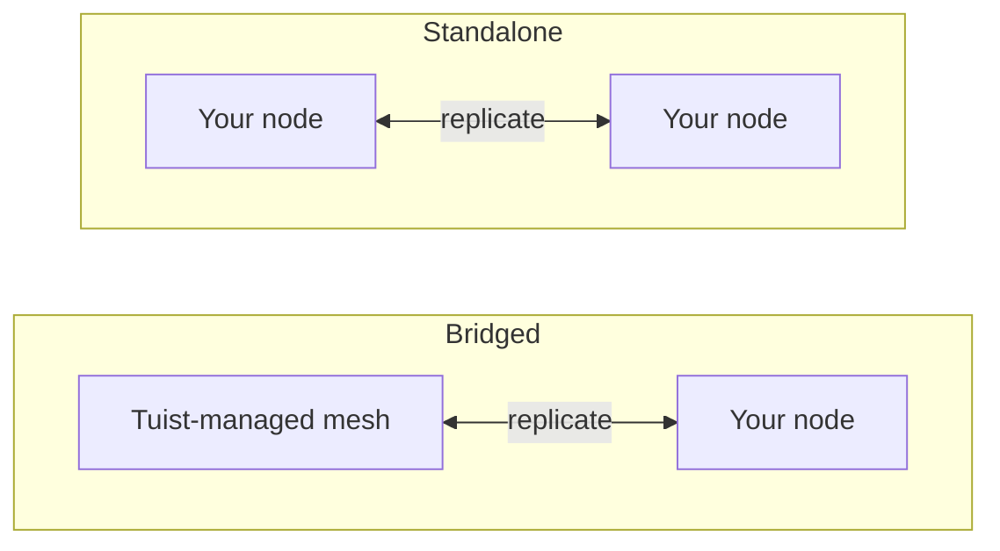

---
{
  "title": "自行託管",
  "titleTemplate": ":title | Cache | Guides | Tuist",
  "description": "了解如何自行託管 Tuist 快取節點，並與 Tuist 託管的網格進行複製。"
}
---

# 自行託管快取 {#self-host-cache}

Tuist 的快取以 **節點網格** 的形式運作，各節點會互相複製構件。你可以在自己的基礎設施上運行快取節點，讓快取靠近開發人員和 CI，縮短網絡距離，避免影響快取本應提供的速度。

自行託管的節點是單一容器（`ghcr.io/tuist/kura`），將構件儲存在本地磁碟；當它加入對等網格時，會透過內部對等埠與網格中的其他節點通訊。Tuist 擔任 **控制平面**：負責驗證流量、配置受管快取容量，並計量用量。它絕不會直接存取你的節點。

> [!NOTE]
> 自行託管快取節點需要 **Enterprise 方案**。
>
> 節點可以連接至託管的 Tuist 伺服器（`https://tuist.dev`）或自行託管的 Tuist 伺服器。自行託管 Tuist 伺服器本身需要獨立的伺服器授權。請參閱 <.localized_link href="/guides/server/self-host/server">伺服器自行託管指南</.localized_link>。

## 兩種拓撲 {#topologies}

有兩種方式運行自行託管節點，具體取決於你的帳戶是否同時運行 **Tuist 受管** 的快取區域。

### 橋接：Tuist 託管網格 + 你的節點 {#topology-bridged}

你的帳戶至少運行一個 Tuist 受管快取區域，而你的自行託管節點會 **加入該網格**。對你節點的寫入會持續傳播到受管網格，節點在加入時會從受管網格的現有快取中預熱。這樣可以在你的執行器（大部分寫入由此產生）旁邊放置低延遲快取，同時將它們的寫入饋送到共享快取。請注意，在節點加入 **之後**，受管網格中其他地方寫入的新構件尚未持續回傳給該節點；這是計劃中的增強功能。

如果你希望獲得本地快取的速度，同時又不放棄共享且始終在線的受管快取，這就是合適的選擇。

### 獨立：僅使用你的節點 {#topology-standalone}

你的帳戶 **沒有** 運行受管快取區域。你的節點在你的基礎設施上形成自己的隔離網格。Tuist 仍然知道你的節點存在（因此會計量用量），但 **不會與任何 Tuist 受管網格交換數據**，因為根本不存在這樣的網格。對等成員資格和複製完全在你的節點之間進行。



配置上的關鍵區別在於，**橋接** 拓撲使用 **註冊**，節點在啟動時生成密鑰對，Tuist 簽發其網格證書；而 **獨立** 拓撲沒有 Tuist 簽發的網格證書。單個獨立節點可以在禁用對等 TLS 的情況下運行；多節點獨立網格則使用你提供的對等 TLS 材料。

## 配置 CLI 端點 {#cli-endpoint}

Tuist 的受管快取使用 `https://<account>.cache.tuist.dev`。對於自行託管的 Tuist 伺服器，CLI 會從伺服器的 `TUIST_CACHE_ENDPOINTS` 設定中檢索快取 URL。將其設定為你的主要快取伺服器或負載均衡器的 URL。如果包含多個 URL，則使用第一個。

將私有/自定義快取節點連接到 **託管的 Tuist 伺服器** 時，在開發人員 shell 和 CI 中配置明確的端點：

```sh
export TUIST_CACHE_ENDPOINT=https://cache.example.com
```

此覆蓋在任何伺服器類型上都優先生效，對於自行託管的 Tuist 伺服器則是可選的。對於 Xcode 快取守護進程，在設定後重新運行 `tuist setup cache`，以便 LaunchAgent 接收更新後的環境。對於多個節點，請使用你的負載均衡器或 DNS 路由名稱。

## 先決條件 {#prerequisites}


- Docker 和 Docker Compose（或任何容器運行時）
- 正在運行的 Tuist 伺服器（託管或自行託管）
- 快取所需的磁碟空間。橋接節點在首次加入時會拉取帳戶的 **整個** 網格，因此請相應調整數據卷的大小。

## 提供控制平面客戶端 {#control-plane-client}

節點使用控制平面客戶端憑證來驗證快取請求（令牌內省）、向儀表板報告並交付用量數據。這 **不是** 客戶端在自行託管的 Tuist 伺服器上路由到你的節點的方式（請參閱 [客戶端如何到達你的節點](#routing)）。

對於完全自行託管的部署，生成一個 **UUID 客戶端 ID** 和隨機密鑰，然後在 Tuist 伺服器和每個 Kura 節點上配置相同的配對：

```bash
KURA_CONTROL_PLANE_CLIENT_ID="$(uuidgen | tr '[:upper:]' '[:lower:]')"
KURA_CONTROL_PLANE_CLIENT_SECRET="$(openssl rand -base64 32)"
```

在 Tuist 伺服器環境中將這些值設定為 `KURA_CONTROL_PLANE_CLIENT_ID` 和 `KURA_CONTROL_PLANE_CLIENT_SECRET`，然後在下方的 Kura 配置中使用相同的值。註冊心跳包含 `KURA_TENANT_ID`，即帳戶的永久快取身份，這樣即使帳戶更名後，伺服器也能將節點關聯到正確的帳戶。

> [!WARNING]
> 客戶端 ID 必須是不帶 `kura_` 前綴的 UUID。非 UUID ID 會導致令牌內省失敗並返回 HTTP `400`，即使兩個服務上的憑證匹配也是如此。

如果你連接的是託管的 `tuist.dev` 伺服器，或者希望獲得可從 UI 輪換的每帳戶憑證，請打開帳戶的 **Cache** 頁面，選擇 **Generate credential**，並複製 `client_id` 以及一次性 `secret`。在託管伺服器上，生成自行託管節點憑證需要 Enterprise 方案。

## 選擇永久租戶 {#permanent-tenant}

`KURA_TENANT_ID` 是永久存儲和對等身份，最初源自帳戶的原始句柄。對於從未更名的帳戶，它與當前句柄匹配。**在帳戶更名後保留其原始值**，包括在添加替換節點或向同一網格添加另一個節點時。例如，將 `original` 更名為 `renamed` 後，每個節點上的 `KURA_TENANT_ID=original` 保持不變。更改它會選擇不同的對象鍵命名空間；帳戶更名不會遷移已存儲的構件或對等身份。

將下面示例中的 `<permanent-kura-tenant>` 替換為此值。重用現有正確配置節點的租戶，或使用註冊返回的 `tenant_id`。自行託管 Tuist 伺服器的操作員可以檢查帳戶的 `kura_tenant_id` 數據庫字段。不要從更名後帳戶的 URL 推斷該值。

使用有效的部署級控制平面憑證時，如果節點提供的當前或保留句柄與其永久租戶不同，註冊和對等發現會返回 **409 Conflict** 並附帶 `error: "tenant_mismatch"` 和 `expected_tenant_id`。它們不會註冊該節點，也不會靜默替換為不同的存儲身份。無效的憑證和未知的租戶仍會返回 **401 Unauthorized** 且不披露租戶信息。如果節點已使用不同的租戶寫入數據，請在更改之前檢查其配置和存儲歷史；錯誤響應不會執行存儲遷移。

## 客戶端如何到達你的節點 {#routing}

配置 [上方](#cli-endpoint) 的快取 URL，以便開發者機器和 CI 能夠訪問你的節點。要在儀表板中報告每個節點的地址和就緒狀態，請在節點上設置 `KURA_REGISTRATION_URL` 和 `KURA_ADVERTISED_HTTP_URL`。

## 橋接設置 {#bridged-setup}

節點在啟動時註冊：它在本地生成密鑰對（私鑰永遠不會離開你的基礎設施），發送證書簽名請求，並接收其簽名證書、帳戶 CA 以及受管網格的網關地址。**你無需提供任何 TLS 材料**。註冊過程會將其寫入掛載的卷中。

```yaml
# docker-compose.yml
services:
  kura:
    image: ghcr.io/tuist/kura:<version>
    restart: unless-stopped
    ports:
      - "4000:4000"   # HTTP cache: your developers and CI point here
      - "7443:7443"   # mesh peer port
    environment:
      # Enroll and join the managed mesh
      KURA_ENROLL_ON_BOOT: "1"
      KURA_CONTROL_PLANE_URL: "https://tuist.dev"
      KURA_CONTROL_PLANE_CLIENT_ID: "<client_id>"
      KURA_CONTROL_PLANE_CLIENT_SECRET: "<secret>"
      KURA_TENANT_ID: "<permanent-kura-tenant>"

      # Report the node’s address and readiness to the dashboard
      KURA_REGISTRATION_URL: "https://tuist.dev/_internal/kura/mesh/registrations"
      KURA_ADVERTISED_HTTP_URL: "https://kura.acme.internal"   # where your CLI/CI reach the cache
      KURA_NODE_URL: "https://kura.acme.internal:7443"         # this node's peer identity on your network
      KURA_REGION: "office"

      # Ports and storage. KURA_PORT serves both the HTTP cache API and REAPI
      # gRPC (h2c) on one listener. Enrollment writes the TLS files into
      # KURA_INTERNAL_TLS_* on first boot.
      KURA_PORT: "4000"
      KURA_INTERNAL_PORT: "7443"
      KURA_INTERNAL_TLS_CA_CERT_PATH: "/tls/ca.pem"
      KURA_INTERNAL_TLS_CERT_PATH: "/tls/tls.crt"
      KURA_INTERNAL_TLS_KEY_PATH: "/tls/tls.key"
      KURA_DATA_DIR: "/var/cache/kura"
      KURA_TMP_DIR: "/var/cache/kura/tmp"
      KURA_OTEL_SERVICE_NAME: "kura-acme"
      KURA_OTEL_DEPLOYMENT_ENVIRONMENT: "onprem"

      # Authenticate the HTTP cache API. The Tuist hook ships in the image at
      # this path; it introspects each token against the control plane using the
      # control-plane client above, so only valid Tuist tokens for this account
      # can read or write. No JWT verifier secret is involved.
      KURA_AUTH_ENABLED: "1"
      KURA_AUTH_TUIST_URL: "https://tuist.dev"
    volumes:
      - kura-tls:/tls            # empty; enrollment populates it
      - kura-data:/var/cache/kura
volumes:
  kura-tls: {}
  kura-data: {}
```

你需要提供：控制平面客戶端、網絡上的兩個地址（`KURA_NODE_URL`、`KURA_ADVERTISED_HTTP_URL`）以及兩個空的可寫卷。其他所有內容（密鑰對、證書、帳戶 CA 和受管網格的地址）會在啟動時自動配置。

## 獨立設置 {#standalone-setup}

由於沒有受管區域，因此沒有 Tuist 頒發的網格 CA，所以註冊不適用（註冊端點返回 `503 ca_unavailable`）。節點使用你的 Tuist 伺服器進行令牌驗證、儀表板註冊心跳和用量報告。

```yaml
# docker-compose.yml for a single node connected to a self-hosted Tuist server
services:
  kura:
    image: ghcr.io/tuist/kura:<version>
    restart: unless-stopped
    ports:
      - "4000:4000"
      - "7443:7443"
    environment:
      KURA_TENANT_ID: "<permanent-kura-tenant>"
      KURA_NODE_URL: "http://kura-1.acme.internal:7443"
      KURA_PEERS: ""   # single node: disable static peer discovery
      KURA_REGION: "office"

      # Authenticate cache requests against the self-hosted Tuist server.
      # Use the same values configured on the Tuist server, or a per-account
      # credential from the Cache page.
      KURA_CONTROL_PLANE_CLIENT_ID: "<client_id>"
      KURA_CONTROL_PLANE_CLIENT_SECRET: "<secret>"
      KURA_AUTH_ENABLED: "1"
      KURA_AUTH_TUIST_URL: "https://tuist.acme.internal"

      # Register the client-facing cache URL with the Tuist server.
      KURA_REGISTRATION_URL: "https://tuist.acme.internal/_internal/kura/mesh/registrations"
      KURA_ADVERTISED_HTTP_URL: "https://kura.acme.internal"

      KURA_PORT: "4000"
      KURA_INTERNAL_PORT: "7443"
      KURA_DATA_DIR: "/var/cache/kura"
      KURA_TMP_DIR: "/var/cache/kura/tmp"
      KURA_OTEL_SERVICE_NAME: "kura-acme"
      KURA_OTEL_DEPLOYMENT_ENVIRONMENT: "onprem"
    volumes:
      - kura-data:/var/cache/kura
volumes:
  kura-data: {}
```

對於單個節點，保持對等 TLS 未設置並將 `KURA_PEERS` 設置為空字符串。當 `KURA_PEERS` 未設置時，Kura 會從 `KURA_NODE_URL` 種子化靜態對等發現，並定期檢查該 URL 的 `/_internal/status` 端點。禁用對等 TLS 時，即使可以通過私有網絡名稱訪問節點，`KURA_NODE_URL` 也必須使用 `http://` 方案。

在此示例中不需要 `KURA_CONTROL_PLANE_URL`，因為授權和用量報告器都使用 `KURA_AUTH_TUIST_URL` 作為 Tuist 基本 URL。`KURA_ADVERTISED_HTTP_URL` 標識儀表板中節點的客戶端面地址。在 Tuist 伺服器上設置 `TUIST_CACHE_ENDPOINTS=https://kura.acme.internal`，以便 CLI 使用該地址進行快取請求。

### 使用 Helm 的 Kubernetes {#standalone-helm}

如果你的自行託管 Tuist 伺服器運行在 Kubernetes 上，請使用獨立 Kura chart 安裝 Kura，並通過 `extraEnv` 傳遞相同的控制平面設置。Tuist 伺服器 chart 不會將此 Kura chart 作為子 chart 安裝。

首先，使用部署級 Kura 憑證配置 Tuist 伺服器 chart：

```yaml
# tuist-values.yaml
server:
  extraEnv:
    - name: KURA_CONTROL_PLANE_CLIENT_ID
      valueFrom:
        secretKeyRef:
          name: kura-control-plane
          key: client-id
    - name: KURA_CONTROL_PLANE_CLIENT_SECRET
      valueFrom:
        secretKeyRef:
          name: kura-control-plane
          key: client-secret
```

然後在同一命名空間中使用相同的 Secret 安裝 Kura：

```yaml
# kura-values.yaml
replicaCount: 1

config:
  tenantId: "<permanent-kura-tenant>"
  region: "office"

ingress:
  enabled: true
  className: nginx
  hosts:
    - host: kura.acme.internal
      paths:
        - path: /
          pathType: Prefix
  tls:
    - hosts:
        - kura.acme.internal
      secretName: kura-tls

extraEnv:
  - name: KURA_CONTROL_PLANE_CLIENT_ID
    valueFrom:
      secretKeyRef:
        name: kura-control-plane
        key: client-id
  - name: KURA_CONTROL_PLANE_CLIENT_SECRET
    valueFrom:
      secretKeyRef:
        name: kura-control-plane
        key: client-secret
  - name: KURA_AUTH_ENABLED
    value: "1"
  - name: KURA_AUTH_TUIST_URL
    value: "https://tuist.acme.internal"
  - name: KURA_REGISTRATION_URL
    value: "https://tuist.acme.internal/_internal/kura/mesh/registrations"
  - name: KURA_ADVERTISED_HTTP_URL
    value: "https://kura.acme.internal"
```

```bash
kubectl create namespace tuist
kubectl -n tuist create secret generic kura-control-plane \
  --from-literal=client-id="<client_id>" \
  --from-literal=client-secret="<secret>"

helm upgrade --install kura oci://ghcr.io/tuist/charts/kura \
  --namespace tuist \
  -f kura-values.yaml
```

如果 Kura 運行在與 Tuist 伺服器不同的命名空間中，請創建或將 `kura-control-plane` Secret 同步到這兩個命名空間。

使用鏡像中捆綁的 Tuist hook 時，保持 `extension.enabled` 未設置；該 chart 值用於從 ConfigMap 掛載自定義 hook。Chart 會為你渲染 `KURA_NODE_URL`、`KURA_PEERS`、無頭服務、持久化和探針。使用 `replicaCount: 1` 時，生成的對等 URL 是 Pod 自身的穩定 DNS 名稱，因此它在集群內仍可訪問，並且不會產生上述單節點警告。對於多個副本，chart 會從 StatefulSet DNS 生成對等列表；如果你希望在內部對等平面上使用 mTLS，請啟用 `peerTls` 並提供 TLS Secret。

要運行多個獨立節點，添加你自己的 **對等 TLS** 並掛載到 `/tls`（每個節點一個 CA 加上葉證書和密鑰，共享一個 CA 以便節點相互信任），將 `KURA_NODE_URL` 切換為 `https://...:<KURA_INTERNAL_PORT>`，並添加 `KURA_PEERS`：

```yaml
environment:
  KURA_NODE_URL: "https://kura-1.acme.internal:7443"
  KURA_PEERS: "https://kura-2.acme.internal:7443,https://kura-3.acme.internal:7443"
  KURA_INTERNAL_TLS_CA_CERT_PATH: "/tls/ca.pem"
  KURA_INTERNAL_TLS_CERT_PATH: "/tls/tls.crt"
  KURA_INTERNAL_TLS_KEY_PATH: "/tls/tls.key"
volumes:
  - ./tls:/tls:ro
```

## 每種拓撲結構的要求 {#requirements-summary}

| 你需要提供 | 橋接 | 獨立 |
|---|---|---|
| 控制平面客戶端（`client_id` / `secret`） | 是 | 是 |
| `KURA_NODE_URL` | 是 | 是 |
| `KURA_ADVERTISED_HTTP_URL` | 是 | 用於儀表板註冊；路由是分開的（見下文） |
| 路由到 CLI | 自動（註冊） | 來自就緒註冊心跳的自動路由 |
| 數據 + 臨時卷 | 是 | 是 |
| `KURA_ENROLL_ON_BOOT` | 是 | 否（將返回 `ca_unavailable`） |
| 對等 TLS（`/tls` CA + 葉證書） | 否，註冊過程會寫入 | 僅用於多節點網格 |
| `KURA_PEERS`（對等列表） | 否，註冊過程會為網關設定種子 | 單個節點時留空；多個節點時填寫可達的對等 URL |

## 必要配置 {#required-config}

這些變量配置每個節點，無論拓撲結構如何（對等 TLS 是下文提到的例外）：

| 變量 | 描述 |
|---|---|
| `KURA_TENANT_ID` | 你賬戶的永久 Kura 租戶。重命名賬戶後保留其原始值；請參閱[選擇永久租戶](#permanent-tenant)。 |
| `KURA_NODE_URL` | 此節點在你網絡上的對等 URL。 |
| `KURA_PEERS` | 靜態對等發現列表。單個獨立節點設為空字符串；多節點網格設為可達的對等 URL。 |
| `KURA_REGION` | 自由格式的區域標籤（例如 `office`、`ci`）。 |
| `KURA_PORT` / `KURA_INTERNAL_PORT` | 快取端口（HTTP 快取 API 和 REAPI gRPC 共用一個監聽器）和網格對等端口（`4000` / `7443`）。 |
| `KURA_DATA_DIR` / `KURA_TMP_DIR` | 磁盤上的構件存儲和臨時目錄。 |
| `KURA_INTERNAL_TLS_CA_CERT_PATH` / `KURA_INTERNAL_TLS_CERT_PATH` / `KURA_INTERNAL_TLS_KEY_PATH` | 對等 TLS 文件。由註冊過程寫入（橋接）或由你提供（多節點獨立）。單個節點不需要；省略它們並使用 `http://` `KURA_NODE_URL`。 |
| `KURA_OTEL_SERVICE_NAME` / `KURA_OTEL_DEPLOYMENT_ENVIRONMENT` | 用於遙測的服務名稱和環境標籤。 |

橋接節點還會設置 `KURA_ENROLL_ON_BOOT`、`KURA_CONTROL_PLANE_URL` 和控制平面客戶端憑證。`KURA_REGISTRATION_URL` 和 `KURA_ADVERTISED_HTTP_URL` 註冊節點，使其出現在 **快取** 頁面上，並使啟用 Kura 的 CLI 客戶端能夠路由到該節點（請參閱 [客戶端如何訪問你的節點](#routing)）。

## 存儲和驅逐 {#storage}

節點在 `KURA_DATA_DIR` 下存儲構件，直到達到 CAS 存儲預算，你可以通過可選變量設置該預算：

| 變量 | 描述 |
|---|---|
| `KURA_CAS_CAPACITY_BYTES` | 節點的 CAS 存儲預算（字節）。必須是正整數。未設置時，預算為持有 `KURA_DATA_DIR` 的文件系統大小的 50%。 |

無論你是否設置，預算上限均為持有 `KURA_DATA_DIR` 的文件系統大小的 80%，這樣輪換（在驅逐最舊段之前寫入新段）就不會填滿磁盤。預算會四捨五入為完整的 512 MiB 段，最小為 2.5 GiB。節點在啟動時記錄解析後的預算（`resolved CAS segment ring limits`）。

驅逐是自動的。構件存儲在段環中，一旦達到預算，最舊的段就會被驅逐。從較舊段讀取的構件會提升到當前段中，因此經常使用的構件會被保留，驅逐行為接近最近最少使用（LRU）。

將 `KURA_DATA_DIR` 放在專用卷上。默認預算和上限都是文件系統總大小的百分比，而不是剩餘空間，因此同一文件系統上的其他數據可能會導致可用空間少於預算假設的空間。

## 快取請求的身份驗證 {#cache-auth}

默認情況下，節點會向網絡上任何能訪問它的對象提供 HTTP 快取 API。為了要求調用者出示有效的 Tuist 令牌，以便只有你組織中經過身份驗證的成員才能讀寫，請將節點指向你的 Tuist 伺服器。上述獨立設置就是這樣做的。

| 變量 | 值 |
|---|---|
| `KURA_AUTH_ENABLED` | `1` |
| `KURA_AUTH_TUIST_URL` | 你的 Tuist 伺服器 URL |

授權重用你已設置的控制平面客戶端（`KURA_CONTROL_PLANE_CLIENT_ID` / `KURA_CONTROL_PLANE_CLIENT_SECRET`）來內省令牌，因此不需要額外的憑證。自託管節點僅運行**內省**：它從不持有對稱 Guardian JWT 驗證器密鑰，該密鑰可以為任何租戶鑄造令牌且從不共享，因此每個請求都針對你的伺服器進行授權。無法訪問該伺服器的節點會拒絕而不是提供服務，並且沒有設置可以改變這一點。Tuist 管理的節點運行相同的授權；唯一的區別是它們還持有驗證密鑰，這使它們能夠僅從令牌解決大多數請求。

## 網絡 {#networking}

節點根據你啟用的集成建立 **出站** 連接：

- 你的 Tuist 伺服器用於令牌內省（`KURA_AUTH_TUIST_URL`）、註冊心跳（`KURA_REGISTRATION_URL`）、用量（`KURA_CONTROL_PLANE_URL` 或 `KURA_AUTH_TUIST_URL`）以及橋接拓撲中的註冊，以及
- 在橋接拓撲中，管理網格的對等網關，用於複製。

你的開發人員和 CI 訪問節點的 `KURA_ADVERTISED_HTTP_URL`（對於多節點網格，節點之間通過對等端口相互訪問）。這些地址只需要在 **你的網絡內** 可達。它們不需要暴露給公共互聯網。

## 行為方式 {#behavior}

- **橋接。** 啟動時，節點註冊，拉取管理網格的完整快取，並過渡為環中的服務成員。初始拉取只發生一次，在廣域網上可能需要一段時間，具體取決於你的快取大小。從那時起，節點上的寫入會持續傳播到管理網格。節點加入後在管理網格其他地方寫入的新構件尚未持續傳播到該節點（計劃中的增強功能），因此將加入時的拉取視為快照而不是實時鏡像。
- **獨立。** 節點在你的基礎設施上作為隔離網格運行。如果有複製，也只發生在你自己的節點之間。配置後，Tuist 的角色僅限於控制平面：儀表板可見性、快取端點廣告、用量計量和令牌內省。它從不預置、升級、與你的節點對等或深入訪問你的節點。

## 驗證 {#verify}

```bash
curl --fail-with-body http://localhost:4000/ready   # 200 once the node has joined and is serving
curl --fail-with-body http://localhost:4000/up      # liveness + mesh membership
```

橋接節點在拉取網格時報告 `state: joining`，一旦趕上則報告 `state: serving`。一旦註冊心跳開始，你的節點也會出現在賬戶的 **快取** 頁面上的 **已註冊節點** 下。

要驗證遠程快取，請使用未快取的可快取目標運行 `tuist cache`，並在 Kura 日誌中確認上傳成功。僅零退出狀態並不能確認構件已存儲。

## 升級 {#upgrading}

```bash
docker compose pull
docker compose up -d
```

節點設計為可容忍一個版本的差異並行運行，因此跨多個節點的滾動升級是安全的。
