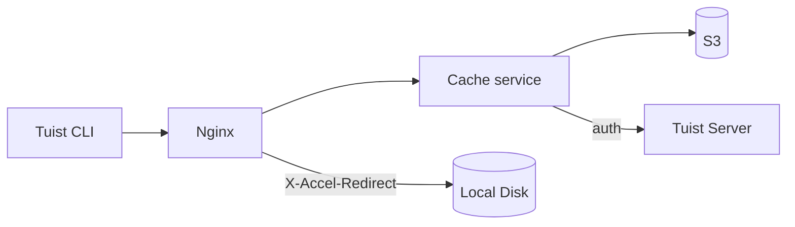
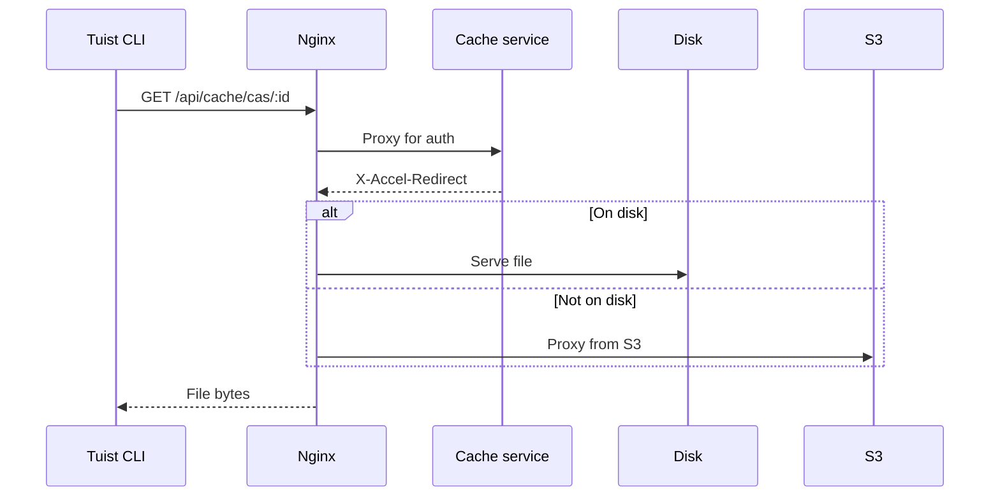
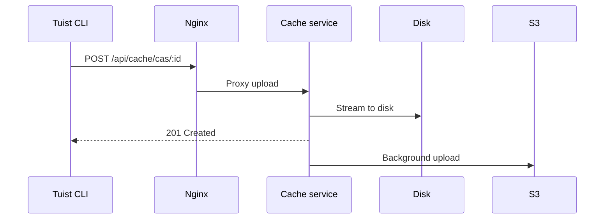

---
{
  "title": "架构",
  "titleTemplate": ":title | 缓存 | 指南 | Tuist",
  "description": "了解 Tuist 缓存服务的架构。"
}
---

# 缓存架构 {#cache-architecture}

> [!NOTE]
> 本页提供 Tuist 缓存服务架构的技术概览。主要面向需要理解服务内部工作原理的**自托管用户**和**贡献者**。仅希望使用缓存的普通用户无需阅读此内容。

Tuist 缓存服务是一项独立服务，为构建产物提供内容寻址存储（CAS），并为缓存元数据提供键值存储。

## 概览 {#overview}

该服务采用两层存储架构，并结合本地 SQLite 元数据：

- **本地磁盘**：用于低延迟缓存命中的主存储
- **S3**：持久化存储，可保留产物并在驱逐后恢复
- **SQLite**：本地元数据，用于跟踪产物访问、清理孤儿文件、执行后台作业以及存储键值缓存数据

## 组件 {#components}

### Nginx {#nginx}

Nginx 作为入口点，并使用 `X-Accel-Redirect` 高效交付文件：

- **下载**：缓存服务验证身份认证，然后返回 `X-Accel-Redirect` 标头。Nginx 直接从磁盘提供文件或通过 S3 代理。
- **上传**：Nginx 将请求代理到缓存服务，后者将数据流式写入磁盘。

### 内容寻址存储 {#cas}

产物以分片目录结构存储在本地磁盘上：

- **路径**：`{account}/{project}/cas/{shard1}/{shard2}/{artifact_id}`
- **分片**：取产物 ID 的前四个字符创建两级分片（例如，`ABCD1234` → `AB/CD/ABCD1234`）

### SQLite 元数据 {#sqlite}

缓存服务使用两个 SQLite 数据库：

- **主元数据数据库**：存储 `cache_artifacts`、孤儿扫描游标、Oban 作业以及其他服务元数据。
- **键值数据库**：在专用的 SQLite 文件中存储 `key_value_entries` 和 `key_value_entry_hashes`。

键值存储被拆分到独立的数据库中，以便可以使用 SQLite 增量自动清理，而不影响产物元数据和孤儿清理状态。

### S3 集成 {#s3}

S3 提供持久化存储：

- **后台上传**：写入磁盘后，产物会通过每分钟运行一次的后台工作器排队上传到 S3
- **按需回填**：当本地缺少某个产物时，请求会通过预签名的 S3 URL 立即得到响应，同时该产物会排队在后台下载到本地磁盘

### 磁盘驱逐 {#eviction}

该服务通过多个后台进程管理磁盘空间：

- **CAS 磁盘驱逐**使用由 `cache_artifacts` 支持的 LRU 策略
- 当磁盘使用率超过 85% 时，将删除最旧的产物，直到使用率降至 70%
- 产物在本地驱逐后仍保留在 S3 中
- **KV 驱逐**会根据保留策略移除旧的键值条目，并在专用 KV 数据库超出其配置的大小预算时对其进行收缩

### 孤儿清理 {#orphan-cleanup}

该服务还会运行一个用于磁盘产物的孤儿清理工作器：

- 它会扫描存储树，查找存在于磁盘但没有对应 `cache_artifacts` 记录的文件。
- 如果文件已写入磁盘，但在 SQLite 缓冲区刷新完成之前元数据写入丢失，就可能出现这种情况。
- 为避免与进行中的上传发生竞争，会忽略早于安全时间窗口的文件。
- 如果某个孤儿文件被删除后又再次被请求，下一次缓存未命中会使其重新上传，因此系统能够自我修复。

### 身份认证 {#authentication}

缓存通过调用 `/api/projects` 端点并将结果缓存（成功时缓存 10 分钟，失败时缓存 3 秒），将身份认证委托给 Tuist 服务器。

## 请求流程 {#request-flows}

### 下载 {#download-flow}

### 上传 {#upload-flow}

## API 端点 {#api-endpoints}

| 端点 | 方法 | 描述 |
|----------|--------|-------------|
| `/up` | GET | 健康检查 |
| `/metrics` | GET | Prometheus 指标 |
| `/api/cache/cas/:id` | GET | 下载 CAS 产物 |
| `/api/cache/cas/:id` | POST | 上传 CAS 产物 |
| `/api/cache/keyvalue/:cas_id` | GET | 获取键值条目 |
| `/api/cache/keyvalue` | PUT | 存储键值条目 |
| `/api/cache/module/:id` | HEAD | 检查模块产物是否存在 |
| `/api/cache/module/:id` | GET | 下载模块产物 |
| `/api/cache/module/start` | POST | 启动分片上传 |
| `/api/cache/module/part` | POST | 上传分片 |
| `/api/cache/module/complete` | POST | 完成分片上传 |
