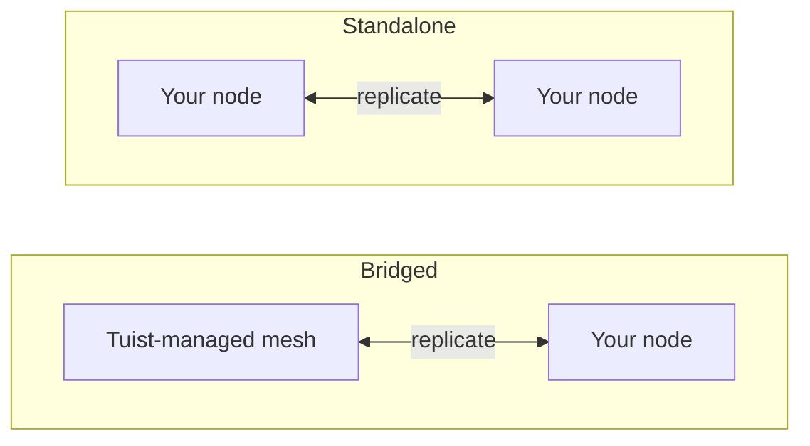

---
{
  "title": "自托管",
  "titleTemplate": ":title | Cache | Guides | Tuist",
  "description": "了解如何自托管 Tuist 缓存节点，并与 Tuist 托管的网格进行复制。"
}
---

# 自托管缓存 {#self-host-cache}

Tuist 的缓存以 **节点网格** 的形式运行，各节点之间相互复制构建产物。你可以在自己的基础设施上运行缓存节点，使缓存靠近开发者和 CI 环境，从而缩短网络距离，避免影响缓存本应提供的速度优势。

自托管节点是一个单独的容器（`ghcr.io/tuist/kura`），它将构建产物存储在本地磁盘上，并在加入对等网格时通过内部对等端口与网格中的其他节点通信。Tuist 充当 **控制平面**：负责流量认证、配置托管缓存容量以及计量使用情况。它永远不会直接访问你的节点。

> [!NOTE]
> 自托管缓存节点需要 **Enterprise 计划**。
>
> 节点可以连接到托管的 Tuist 服务器（`https://tuist.dev`）或自托管的 Tuist 服务器。自托管 Tuist 服务器本身需要单独的服务端许可证。请参阅 <.localized_link href="/guides/server/self-host/server">服务器自托管指南</.localized_link>。

## 两种拓扑结构 {#topologies}

运行自托管节点有两种方式，具体采用哪种方式完全取决于你的账户是否同时运行了 **Tuist 托管** 的缓存区域。

### 桥接模式：Tuist 托管网格 + 你的节点 {#topology-bridged}

你的账户至少运行一个 Tuist 托管的缓存区域，并且你的自托管节点会 **加入该网格**。写入你节点的数据会持续传播到托管网格中，当节点加入时，会从托管网格的现有缓存中预热数据。这样可以在你的运行器（主要执行写入操作）旁边放置低延迟缓存，同时它们的写入操作也会充实共享缓存。请注意，在节点加入 **之后**，托管网格中其他位置写入的新构建产物尚未持续回传到该节点；这是一项计划中的增强功能。

如果你希望获得本地缓存的速度，同时又不想放弃共享且始终在线的托管缓存，这是正确的选择。

### 独立模式：仅使用你的节点 {#topology-standalone}

你的账户 **没有** 运行任何托管缓存区域。你的节点在你的基础设施上形成自己隔离的网格。Tuist 仍然知道你的节点存在（因此会计量使用情况），但 **不会与任何 Tuist 托管网格交换数据**，因为不存在这样的网格。对等成员身份和复制完全在你的节点内部进行。



配置的关键区别在于，**桥接** 拓扑使用 **注册** 机制，节点在启动时生成密钥对，Tuist 颁发其网格证书；而 **独立** 拓扑没有 Tuist 颁发的网格证书。单个独立节点可以在禁用对等 TLS 的情况下运行；多节点独立网格则使用你提供的对等 TLS 材料。

## 配置 CLI 端点 {#cli-endpoint}

Tuist 的托管缓存使用 `https://<account>.cache.tuist.dev`。对于自托管 Tuist 服务器，CLI 会从服务器的 `TUIST_CACHE_ENDPOINTS` 设置中检索缓存 URL。将其设置为主缓存服务器或负载均衡器的 URL。如果包含多个 URL，则使用第一个。

将私有/自定义缓存节点连接到 **托管 Tuist 服务器** 时，请在开发者 Shell 和 CI 中配置显式端点：

```sh
export TUIST_CACHE_ENDPOINT=https://cache.example.com
```

此覆盖设置在两种服务器类型上均优先生效，对于自托管 Tuist 服务器则是可选的。对于 Xcode 缓存守护进程，设置后请重新运行 `tuist setup cache`，以便 LaunchAgent 接收更新后的环境变量。对于多个节点，请使用负载均衡器或 DNS 路由名称。

## 前提条件 {#prerequisites}


- Docker 和 Docker Compose（或任何容器运行时）
- 正在运行的 Tuist 服务器（托管或自托管）
- 缓存所需的磁盘空间。桥接节点在首次加入时会拉取账户的 **整个** 网格，因此请相应调整数据卷的大小。

## 提供控制平面客户端 {#control-plane-client}

节点使用控制平面客户端凭据来认证缓存请求（令牌内省）、向仪表板报告以及交付使用情况数据。这 **不是** 客户端在自托管 Tuist 服务器上路由到你的节点的方式（参见 [客户端如何访问你的节点](#routing)）。

对于完全自托管部署，生成一个 **UUID 客户端 ID** 和一个随机密钥，然后在 Tuist 服务器和每个 Kura 节点上配置相同的凭据对：

```bash
KURA_CONTROL_PLANE_CLIENT_ID="$(uuidgen | tr '[:upper:]' '[:lower:]')"
KURA_CONTROL_PLANE_CLIENT_SECRET="$(openssl rand -base64 32)"
```

在 Tuist 服务器环境中将这些值设置为 `KURA_CONTROL_PLANE_CLIENT_ID` 和 `KURA_CONTROL_PLANE_CLIENT_SECRET`，然后在下面的 Kura 配置中使用相同的值。注册心跳包含 `KURA_TENANT_ID`，即账户的永久缓存标识，因此即使账户重命名，服务器也能将节点附加到正确的账户。

> [!WARNING]
> 客户端 ID 必须是不带 `kura_` 前缀的 UUID。非 UUID ID 会导致令牌内省失败并返回 HTTP `400`，即使两个服务上的凭据匹配也是如此。

如果你连接到托管的 `tuist.dev` 服务器，或者希望拥有可以从 UI 轮换的每账户凭据，请打开账户的 **Cache** 页面，选择 **Generate credential**，然后复制 `client_id` 以及一次性 `secret`。在托管服务器上，生成自托管节点凭据需要 Enterprise 计划。

## 选择永久租户 {#permanent-tenant}

`KURA_TENANT_ID` 是永久存储和对等身份标识，最初源自账户的原始句柄。对于从未重命名的账户，它与当前句柄匹配。**在账户重命名后保留其原始值**，包括添加替换节点或向同一网格添加其他节点时。例如，将 `original` 重命名为 `renamed` 后，每个节点上的 `KURA_TENANT_ID=original` 保持不变。更改它会选择不同的对象键命名空间；重命名账户不会迁移已存储的构建产物或对等身份。

将下面示例中的 `<permanent-kura-tenant>` 替换为此值。重用现有正确配置节点中的租户，或使用注册返回的 `tenant_id`。自托管 Tuist 服务器的操作员可以检查账户的 `kura_tenant_id` 数据库字段。不要从重命名账户的 URL 推断该值。

使用有效的部署级控制平面凭据时，如果节点提供的当前或保留句柄与其永久租户不同，注册和对等发现将返回 **409 Conflict** 以及 `error: "tenant_mismatch"` 和 `expected_tenant_id`。它们不会注册该节点，也不会静默替换为其他存储身份。无效凭据和未知租户仍会返回 **401 Unauthorized**，且不披露租户信息。如果节点已使用其他租户写入数据，请在更改之前审查其配置和存储历史；错误响应不会执行存储迁移。

## 客户端如何访问你的节点 {#routing}

配置[上述](#cli-endpoint)缓存 URL，以便开发机器和 CI 能够访问你的节点。要在仪表板中报告每个节点的地址和就绪状态，请在节点上设置 `KURA_REGISTRATION_URL` 和 `KURA_ADVERTISED_HTTP_URL`。

## 桥接设置 {#bridged-setup}

节点在启动时注册：它在本地生成密钥对（私钥永远不会离开你的基础设施），发送证书签名请求，并接收其签名证书、账户 CA 以及托管网格的网关地址。**你无需提供任何 TLS 材料**。注册过程会将其写入挂载的卷中。

```yaml
# docker-compose.yml
services:
  kura:
    image: ghcr.io/tuist/kura:<version>
    restart: unless-stopped
    ports:
      - "4000:4000"   # HTTP cache: your developers and CI point here
      - "7443:7443"   # mesh peer port
    environment:
      # Enroll and join the managed mesh
      KURA_ENROLL_ON_BOOT: "1"
      KURA_CONTROL_PLANE_URL: "https://tuist.dev"
      KURA_CONTROL_PLANE_CLIENT_ID: "<client_id>"
      KURA_CONTROL_PLANE_CLIENT_SECRET: "<secret>"
      KURA_TENANT_ID: "<permanent-kura-tenant>"

      # Report the node’s address and readiness to the dashboard
      KURA_REGISTRATION_URL: "https://tuist.dev/_internal/kura/mesh/registrations"
      KURA_ADVERTISED_HTTP_URL: "https://kura.acme.internal"   # where your CLI/CI reach the cache
      KURA_NODE_URL: "https://kura.acme.internal:7443"         # this node's peer identity on your network
      KURA_REGION: "office"

      # Ports and storage. KURA_PORT serves both the HTTP cache API and REAPI
      # gRPC (h2c) on one listener. Enrollment writes the TLS files into
      # KURA_INTERNAL_TLS_* on first boot.
      KURA_PORT: "4000"
      KURA_INTERNAL_PORT: "7443"
      KURA_INTERNAL_TLS_CA_CERT_PATH: "/tls/ca.pem"
      KURA_INTERNAL_TLS_CERT_PATH: "/tls/tls.crt"
      KURA_INTERNAL_TLS_KEY_PATH: "/tls/tls.key"
      KURA_DATA_DIR: "/var/cache/kura"
      KURA_TMP_DIR: "/var/cache/kura/tmp"
      KURA_OTEL_SERVICE_NAME: "kura-acme"
      KURA_OTEL_DEPLOYMENT_ENVIRONMENT: "onprem"

      # Authenticate the HTTP cache API. The Tuist hook ships in the image at
      # this path; it introspects each token against the control plane using the
      # control-plane client above, so only valid Tuist tokens for this account
      # can read or write. No JWT verifier secret is involved.
      KURA_AUTH_ENABLED: "1"
      KURA_AUTH_TUIST_URL: "https://tuist.dev"
    volumes:
      - kura-tls:/tls            # empty; enrollment populates it
      - kura-data:/var/cache/kura
volumes:
  kura-tls: {}
  kura-data: {}
```

你需要提供：控制平面客户端、网络上的两个地址（`KURA_NODE_URL`、`KURA_ADVERTISED_HTTP_URL`）以及两个空的可写卷。其他所有内容（密钥对、证书、账户 CA 和托管网格的地址）都会在启动时自动配置。

## 独立设置 {#standalone-setup}

由于没有托管区域，因此不存在 Tuist 颁发的网格 CA，所以注册不适用（注册端点返回 `503 ca_unavailable`）。该节点使用你的 Tuist 服务器进行令牌身份验证、仪表板注册心跳和使用情况报告。

```yaml
# docker-compose.yml for a single node connected to a self-hosted Tuist server
services:
  kura:
    image: ghcr.io/tuist/kura:<version>
    restart: unless-stopped
    ports:
      - "4000:4000"
      - "7443:7443"
    environment:
      KURA_TENANT_ID: "<permanent-kura-tenant>"
      KURA_NODE_URL: "http://kura-1.acme.internal:7443"
      KURA_PEERS: ""   # single node: disable static peer discovery
      KURA_REGION: "office"

      # Authenticate cache requests against the self-hosted Tuist server.
      # Use the same values configured on the Tuist server, or a per-account
      # credential from the Cache page.
      KURA_CONTROL_PLANE_CLIENT_ID: "<client_id>"
      KURA_CONTROL_PLANE_CLIENT_SECRET: "<secret>"
      KURA_AUTH_ENABLED: "1"
      KURA_AUTH_TUIST_URL: "https://tuist.acme.internal"

      # Register the client-facing cache URL with the Tuist server.
      KURA_REGISTRATION_URL: "https://tuist.acme.internal/_internal/kura/mesh/registrations"
      KURA_ADVERTISED_HTTP_URL: "https://kura.acme.internal"

      KURA_PORT: "4000"
      KURA_INTERNAL_PORT: "7443"
      KURA_DATA_DIR: "/var/cache/kura"
      KURA_TMP_DIR: "/var/cache/kura/tmp"
      KURA_OTEL_SERVICE_NAME: "kura-acme"
      KURA_OTEL_DEPLOYMENT_ENVIRONMENT: "onprem"
    volumes:
      - kura-data:/var/cache/kura
volumes:
  kura-data: {}
```

对于单个节点，保持对等 TLS 未设置，并将 `KURA_PEERS` 设置为空字符串。当 `KURA_PEERS` 未设置时，Kura 会从 `KURA_NODE_URL` 初始化静态对等发现，并定期检查该 URL 的 `/_internal/status` 端点。禁用对等 TLS 时，即使可以通过私有网络名称访问节点，`KURA_NODE_URL` 也必须使用 `http://` 方案。

此示例中不需要 `KURA_CONTROL_PLANE_URL`，因为授权和使用情况报告器都使用 `KURA_AUTH_TUIST_URL` 作为 Tuist 基础 URL。`KURA_ADVERTISED_HTTP_URL` 用于在仪表板中标识节点面向客户端的地址。在 Tuist 服务器上设置 `TUIST_CACHE_ENDPOINTS=https://kura.acme.internal`，以便 CLI 使用该地址进行缓存请求。

### 使用 Helm 的 Kubernetes {#standalone-helm}

如果你的自托管 Tuist 服务器运行在 Kubernetes 上，请使用独立 Kura Chart 安装 Kura，并通过 `extraEnv` 传递相同的控制平面设置。Tuist 服务器 Chart 不会将此 Kura Chart 作为子 Chart 安装。

首先，使用部署级 Kura 凭据配置 Tuist 服务器 Chart：

```yaml
# tuist-values.yaml
server:
  extraEnv:
    - name: KURA_CONTROL_PLANE_CLIENT_ID
      valueFrom:
        secretKeyRef:
          name: kura-control-plane
          key: client-id
    - name: KURA_CONTROL_PLANE_CLIENT_SECRET
      valueFrom:
        secretKeyRef:
          name: kura-control-plane
          key: client-secret
```

然后在同一命名空间中使用相同的 Secret 安装 Kura：

```yaml
# kura-values.yaml
replicaCount: 1

config:
  tenantId: "<permanent-kura-tenant>"
  region: "office"

ingress:
  enabled: true
  className: nginx
  hosts:
    - host: kura.acme.internal
      paths:
        - path: /
          pathType: Prefix
  tls:
    - hosts:
        - kura.acme.internal
      secretName: kura-tls

extraEnv:
  - name: KURA_CONTROL_PLANE_CLIENT_ID
    valueFrom:
      secretKeyRef:
        name: kura-control-plane
        key: client-id
  - name: KURA_CONTROL_PLANE_CLIENT_SECRET
    valueFrom:
      secretKeyRef:
        name: kura-control-plane
        key: client-secret
  - name: KURA_AUTH_ENABLED
    value: "1"
  - name: KURA_AUTH_TUIST_URL
    value: "https://tuist.acme.internal"
  - name: KURA_REGISTRATION_URL
    value: "https://tuist.acme.internal/_internal/kura/mesh/registrations"
  - name: KURA_ADVERTISED_HTTP_URL
    value: "https://kura.acme.internal"
```

```bash
kubectl create namespace tuist
kubectl -n tuist create secret generic kura-control-plane \
  --from-literal=client-id="<client_id>" \
  --from-literal=client-secret="<secret>"

helm upgrade --install kura oci://ghcr.io/tuist/charts/kura \
  --namespace tuist \
  -f kura-values.yaml
```

如果 Kura 在与 Tuist 服务器不同的命名空间中运行，请创建或将 `kura-control-plane` Secret 同步到这两个命名空间。

使用镜像中捆绑的 Tuist hook 时，请将 `extension.enabled` 保持未设置状态；该 Chart 值用于从 ConfigMap 挂载自定义 hook。Chart 会为你渲染 `KURA_NODE_URL`、`KURA_PEERS`、无头服务、持久化和探针。使用 `replicaCount: 1` 时，生成的对等 URL 是 Pod 自身的稳定 DNS 名称，因此它在集群内仍可访问，并且不会产生上述单节点警告。对于多个副本，Chart 会从 StatefulSet DNS 生成对等列表；如果你希望内部对等平面使用 mTLS，请启用 `peerTls` 并提供 TLS Secret。

要运行多个独立节点，请添加挂载在 `/tls` 的**自有对等 TLS**（每个节点一个 CA 加上叶子证书和密钥，共享一个 CA 以便节点相互信任），将 `KURA_NODE_URL` 切换为 `https://...:<KURA_INTERNAL_PORT>`，并添加 `KURA_PEERS`：

```yaml
environment:
  KURA_NODE_URL: "https://kura-1.acme.internal:7443"
  KURA_PEERS: "https://kura-2.acme.internal:7443,https://kura-3.acme.internal:7443"
  KURA_INTERNAL_TLS_CA_CERT_PATH: "/tls/ca.pem"
  KURA_INTERNAL_TLS_CERT_PATH: "/tls/tls.crt"
  KURA_INTERNAL_TLS_KEY_PATH: "/tls/tls.key"
volumes:
  - ./tls:/tls:ro
```

## 每种拓扑结构的要求 {#requirements-summary}

| 你需要提供 | 桥接 | 独立 |
|---|---|---|
| 控制平面客户端（`client_id` / `secret`） | 是 | 是 |
| `KURA_NODE_URL` | 是 | 是 |
| `KURA_ADVERTISED_HTTP_URL` | 是 | 用于仪表板注册；路由是单独的（见下文） |
| 到 CLI 的路由 | 自动（注册） | 来自就绪注册心跳的自动路由 |
| 数据 + 临时卷 | 是 | 是 |
| `KURA_ENROLL_ON_BOOT` | 是 | 否（将返回 `ca_unavailable`） |
| 对等 TLS（`/tls` CA + 叶子） | 否，注册过程会写入 | 仅用于多节点网格 |
| `KURA_PEERS`（对等列表） | 否，注册过程会为网关提供种子 | 单节点时为空；多节点时填写对等 URL |

## 必需配置 {#required-config}

这些变量用于配置每个节点，无论拓扑结构如何（对等 TLS 是下文提到的例外）：

| 变量 | 描述 |
|---|---|
| `KURA_TENANT_ID` | 你账户的永久 Kura 租户。重命名账户后请保留其原始值；参见[选择永久租户](#permanent-tenant)。 |
| `KURA_NODE_URL` | 此节点在你网络上的对等 URL。 |
| `KURA_PEERS` | 静态对等发现列表。对于单个独立节点，将其设置为空字符串；对于多节点网格，设置可达的对等 URL。 |
| `KURA_REGION` | 自由形式的区域标签（例如 `office`、`ci`）。 |
| `KURA_PORT` / `KURA_INTERNAL_PORT` | 缓存端口（HTTP 缓存 API 和 REAPI gRPC 共存于一个监听器上）和网格对等端口（`4000` / `7443`）。 |
| `KURA_DATA_DIR` / `KURA_TMP_DIR` | 磁盘上的工件存储和临时目录。 |
| `KURA_INTERNAL_TLS_CA_CERT_PATH` / `KURA_INTERNAL_TLS_CERT_PATH` / `KURA_INTERNAL_TLS_KEY_PATH` | 对等 TLS 文件。由注册过程写入（桥接）或由你提供（多节点独立）。单节点不需要；省略它们并使用 `http://` `KURA_NODE_URL`。 |
| `KURA_OTEL_SERVICE_NAME` / `KURA_OTEL_DEPLOYMENT_ENVIRONMENT` | 用于遥测的服务名称和环境标签。 |

桥接节点还会设置 `KURA_ENROLL_ON_BOOT`、`KURA_CONTROL_PLANE_URL` 和控制平面客户端凭据。`KURA_REGISTRATION_URL` 和 `KURA_ADVERTISED_HTTP_URL` 用于注册节点，使其出现在**缓存**页面上，并使启用 Kura 的 CLI 客户端能够路由到该节点（参见[客户端如何访问你的节点](#routing)）。

## 存储和驱逐 {#storage}

节点在 `KURA_DATA_DIR` 下存储工件，直到达到 CAS 存储预算，你可以通过可选变量进行设置：

| 变量 | 描述 |
|---|---|
| `KURA_CAS_CAPACITY_BYTES` | 节点的 CAS 存储预算（以字节为单位）。必须是正整数。未设置时，预算为持有 `KURA_DATA_DIR` 的文件系统大小的 50%。 |

无论你是否设置，预算上限均为持有 `KURA_DATA_DIR` 的文件系统大小的 80%，这样轮换（在驱逐最旧段之前写入新段）就不会填满磁盘。预算会舍入为完整的 512 MiB 段，最小值为 2.5 GiB。节点会在启动时记录解析后的预算（`resolved CAS segment ring limits`）。

驱逐是自动的。工件存储在段环中，一旦达到预算，最旧的段就会被驱逐。从较旧段读取的工件会被提升到当前段中，因此常用工件会被保留，驱逐行为接近最近最少使用（LRU）。

将 `KURA_DATA_DIR` 放在专用卷上。默认预算和上限都是文件系统总大小的百分比，而不是剩余空间，因此同一文件系统上的其他数据可能会使可用空间少于预算假设的空间。

## 缓存请求的身份验证 {#cache-auth}

默认情况下，节点会向其网络上任何可达的对象提供 HTTP 缓存 API。为了要求调用者出示有效的 Tuist 令牌，以便只有你组织中经过身份验证的成员才能读写，请将节点指向你的 Tuist 服务器。上述独立设置就是这样做的。

| 变量 | 值 |
|---|---|
| `KURA_AUTH_ENABLED` | `1` |
| `KURA_AUTH_TUIST_URL` | 你的 Tuist 服务器 URL |

授权重用你已设置的控制平面客户端（`KURA_CONTROL_PLANE_CLIENT_ID` / `KURA_CONTROL_PLANE_CLIENT_SECRET`）来内省令牌，因此不需要额外的凭据。自托管节点运行**仅内省模式**：它从不持有对称 Guardian JWT 验证器密钥，该密钥可以为任何租户生成令牌且从不共享，因此每个请求都会针对你的服务器进行授权。无法访问服务器的节点会拒绝服务而不是提供服务，并且没有设置可以改变这一点。Tuist 管理的节点运行相同的授权；唯一的区别是它们还持有验证密钥，这使它们能够仅凭令牌处理大多数请求。

## 网络 {#networking}

节点会根据你启用的集成建立**出站**连接：

- 你的 Tuist 服务器用于令牌内省（`KURA_AUTH_TUIST_URL`）、注册心跳（`KURA_REGISTRATION_URL`）、用量（`KURA_CONTROL_PLANE_URL` 或 `KURA_AUTH_TUIST_URL`）以及桥接拓扑中的注册，以及
- 在桥接拓扑中，管理网格的对等网关，用于复制。

你的开发人员和 CI 通过节点的 `KURA_ADVERTISED_HTTP_URL` 访问（对于多节点网格，节点之间通过对等端口相互访问）。这些地址只需在**你的网络内**可达即可。它们不需要暴露给公共互联网。

## 行为方式 {#behavior}

- **桥接。** 启动时，节点会注册，拉取管理网格的完整缓存，并转换为环中的服务成员。初始拉取只发生一次，在广域网上可能需要一段时间，具体大小取决于你的缓存。此后，节点上的写入会持续传播到管理网格。节点加入后在管理网格其他地方写入的新工件尚未持续传播到该节点（计划中的增强功能），因此将加入时的拉取视为快照而非实时镜像。
- **独立。** 节点在你的基础设施上作为隔离网格运行。复制（如果有）仅发生在你自己的节点之间。配置后，Tuist 的角色仅限于控制平面：仪表板可见性、缓存端点广告、用量计量和令牌内省。它永远不会配置、升级、与你的节点对等或深入你的节点。

## 验证 {#verify}

```bash
curl --fail-with-body http://localhost:4000/ready   # 200 once the node has joined and is serving
curl --fail-with-body http://localhost:4000/up      # liveness + mesh membership
```

桥接节点在拉取网格时报告 `state: joining`，追上后报告 `state: serving`。一旦注册心跳开始，你的节点也会出现在账户的**缓存**页面下的**已注册节点**中。

要验证远程缓存，请使用未缓存的可缓存目标运行 `tuist cache`，并在 Kura 日志中确认上传成功。仅零退出状态并不能确认工件已存储。

## 升级 {#upgrading}

```bash
docker compose pull
docker compose up -d
```

节点设计为可容忍一个版本的差异并行运行，因此在多个节点上进行滚动升级是安全的。
