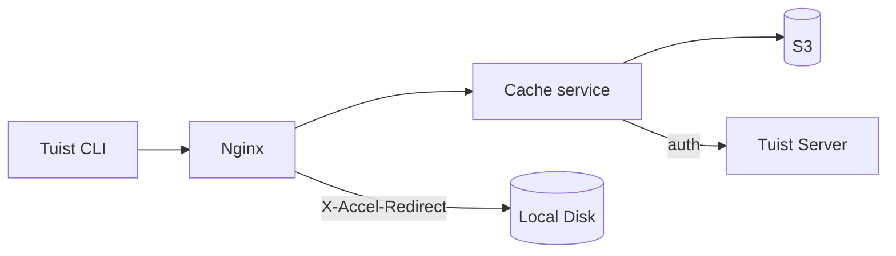
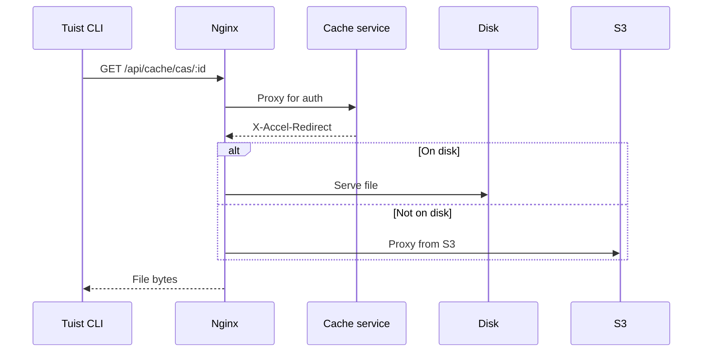
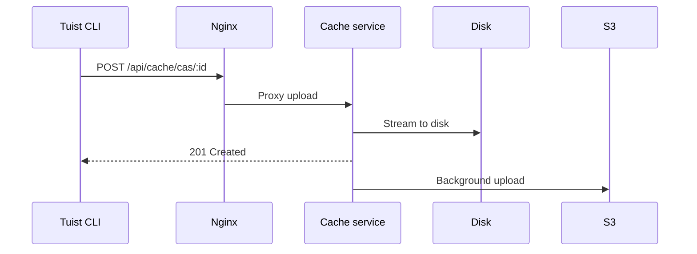

---
{
  "title": "架構",
  "titleTemplate": ":title | 快取 | 指南 | Tuist",
  "description": "了解 Tuist 快取服務的架構。"
}
---

# 快取架構 {#cache-architecture}

> [!NOTE]
> 本頁提供 Tuist 快取服務架構的技術概覽。主要對象為需要瞭解服務內部運作的**自行託管使用者**與**貢獻者**。若你只是要使用快取，無需閱讀本頁。

Tuist 快取服務是一項獨立服務，為建置產物提供內容定址儲存（CAS），並為快取中繼資料提供鍵值儲存。

## 概覽 {#overview}

服務採用兩層儲存架構，搭配本地 SQLite 中繼資料：

- **本地磁碟**：低延遲快取命中的主要儲存
- **S3**：持久化儲存，可保留產物並在清除後恢復
- **SQLite**：本地中繼資料，用於追蹤產物存取、清理孤立檔案、執行背景工作，以及儲存鍵值快取資料

## 元件 {#components}

### Nginx {#nginx}

Nginx 作為入口點，並透過 `X-Accel-Redirect` 高效交付檔案：

- **下載**：快取服務驗證身分後，回傳 `X-Accel-Redirect` 標頭。Nginx 直接從磁碟提供檔案，或從 S3 代理。
- **上傳**：Nginx 將請求代理至快取服務，由服務將資料串流寫入磁碟。

### 內容定址儲存 {#cas}

產物以分片目錄結構儲存在本地磁碟：

- **路徑**：`{account}/{project}/cas/{shard1}/{shard2}/{artifact_id}`
- **分片**：取產物 ID 的前四個字元建立兩層分片（例如 `ABCD1234` → `AB/CD/ABCD1234`）

### SQLite 中繼資料 {#sqlite}

快取服務使用兩個 SQLite 資料庫：

- **主要中繼資料資料庫**：儲存 `cache_artifacts`、孤立檔案掃描游標、Oban 工作與其他服務中繼資料。
- **鍵值資料庫**：在專屬 SQLite 檔案中儲存 `key_value_entries` 與 `key_value_entry_hashes`。

將鍵值儲存拆分為獨立資料庫，使其能使用 SQLite 增量自動真空，而不影響產物中繼資料與孤立檔案清理狀態。

### S3 整合 {#s3}

S3 提供持久化儲存：

- **背景上傳**：寫入磁碟後，產物會排入佇列，由每分鐘執行的背景工作上傳至 S3
- **按需載入**：當本地缺少產物時，會立即透過預簽章 S3 URL 回應請求，同時將產物排入佇列以便背景下載至本地磁碟

### 磁碟清除 {#eviction}

服務透過多個背景程序管理磁碟空間：

- **CAS 磁碟清除** 依據 `cache_artifacts` 採用 LRU 語意
- 當磁碟使用率超過 85% 時，會刪除最舊的產物，直到使用率降至 70%
- 本地清除後，產物仍保留在 S3
- **KV 清除** 依保留策略移除舊的鍵值項目，並在專用 KV 資料庫超過設定的大小預算時進行縮減

### 孤立檔案清理 {#orphan-cleanup}

服務也會執行針對磁碟產物的孤立檔案清理工作：

- 它會掃描儲存樹，找出存在於磁碟但沒有對應 `cache_artifacts` 資料列的檔案。
- 若檔案已寫入磁碟，但在 SQLite 緩衝區刷寫完成前遺失中繼資料寫入，就可能發生此情況。
- 為避免與進行中的上傳競爭，會忽略新於安全時間窗內的檔案。
- 若孤立檔案被刪除而後續再次被請求，下一次快取未命中會使其重新上傳，系統因此能自我修復。

### 身分驗證 {#authentication}

快取服務將身分驗證委派給 Tuist 伺服器，方法是呼叫 `/api/projects` 端點並快取結果（成功快取 10 分鐘，失敗快取 3 秒）。

## 請求流程 {#request-flows}

### 下載 {#download-flow}

### 上傳 {#upload-flow}

## API 端點 {#api-endpoints}

| 端點 | 方法 | 說明 |
|----------|--------|-------------|
| `/up` | GET | 健康檢查 |
| `/metrics` | GET | Prometheus 指標 |
| `/api/cache/cas/:id` | GET | 下載 CAS 產物 |
| `/api/cache/cas/:id` | POST | 上傳 CAS 產物 |
| `/api/cache/keyvalue/:cas_id` | GET | 取得鍵值項目 |
| `/api/cache/keyvalue` | PUT | 儲存鍵值項目 |
| `/api/cache/module/:id` | HEAD | 檢查模組產物是否存在 |
| `/api/cache/module/:id` | GET | 下載模組產物 |
| `/api/cache/module/start` | POST | 開始多部分上傳 |
| `/api/cache/module/part` | POST | 上傳片段 |
| `/api/cache/module/complete` | POST | 完成多部分上傳 |
