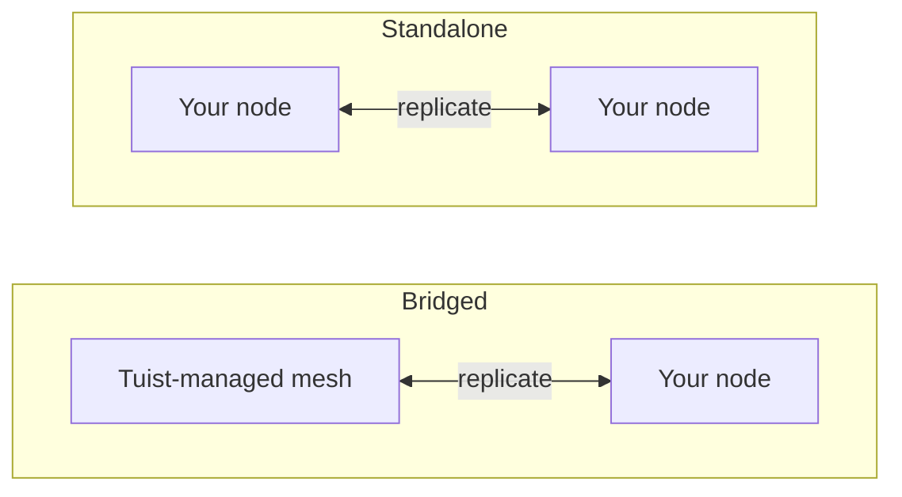

---
{
  "title": "自行託管",
  "titleTemplate": ":title | 快取 | 指南 | Tuist",
  "description": "了解如何自行託管 Tuist 快取節點，並與 Tuist 託管的網格進行複寫。"
}
---

# 自託管快取 {#self-host-cache}

Tuist 的快取以**節點網格**的形式運作，各節點之間會互相複製構件。你可以在自己的基礎設施上執行快取節點，讓快取靠近開發人員與 CI，縮短網路距離，避免影響快取本應提供的速度。

自託管節點是單一容器 (`ghcr.io/tuist/kura`)，將構件儲存在本機磁碟；加入對等網格後，會透過內部對等連接埠與網格中的其他節點通訊。Tuist 擔任**控制平面**：負責驗證流量、配置受管快取容量，並計量用量。它不會存取你的節點內部。

> [!NOTE]
> 自託管快取節點需要**Enterprise 方案**。
>
> 節點可連線至託管的 Tuist 伺服器 (`https://tuist.dev`) 或自託管的 Tuist 伺服器。自託管 Tuist 伺服器本身需要額外的伺服器授權。請參閱<.localized_link href="/guides/server/self-host/server">伺服器自託管指南</.localized_link>。

## 兩種拓撲 {#topologies}

執行自託管節點有兩種方式，具體取決於你的帳戶是否同時執行**Tuist 受管**的快取區域。

### 橋接：Tuist 託管網格 + 你的節點 {#topology-bridged}

你的帳號至少執行一個由 Tuist 管理的快取區域，而你自行託管的節點會**加入該網格**。對你節點的寫入會持續傳播到受管網格，且節點在加入時會從受管網格的現有快取中預熱。這能在你的執行器（負責大部分寫入）旁邊提供低延遲快取，同時將其寫入饋送到共用快取。請注意，在節點加入後於受管網格其他位置寫入的新構件，**尚未**持續傳播回該節點；這是規劃中的增強功能。

如果你希望享有本機快取的速度，又不想放棄共享且持續運作的受管快取，這就是合適的選擇。

### 獨立：僅使用你的節點 {#topology-standalone}

你的帳戶**沒有**執行任何受管快取區域。你的節點在你的基礎設施上形成獨立的網格。Tuist 仍知道你的節點存在（因此會計量用量），但**不會與任何 Tuist 受管網格交換資料**，因為不存在這樣的網格。對等成員資格與複製完全在你的節點之間進行。



設定上的關鍵差異在於：**橋接**拓撲使用**註冊**機制，節點在啟動時產生金鑰組，由 Tuist 簽發其網格憑證；而**獨立**拓撲沒有 Tuist 簽發的網格憑證。單一獨立節點可以在停用對等 TLS 的情況下執行；多節點獨立網格則使用你提供的對等 TLS 材料。

## 設定 CLI 端點 {#cli-endpoint}

Tuist 的受管快取使用 `https://<account>.cache.tuist.dev`。使用自託管 Tuist 伺服器時，CLI 會從伺服器的 `TUIST_CACHE_ENDPOINTS` 設定中取得快取 URL。將其設為你的主要快取伺服器或負載平衡器的 URL。若包含多個 URL，則使用第一個。

將私有／自訂快取節點連線至**託管的 Tuist 伺服器**時，請在開發者 shell 與 CI 中設定明確的端點：

```sh
export TUIST_CACHE_ENDPOINT=https://cache.example.com
```

此覆寫在任何伺服器類型上都具有優先權，對於自託管 Tuist 伺服器則是可選。針對 Xcode 快取守護程式，設定後請重新執行 `tuist setup cache`，讓 LaunchAgent 接收更新後的環境。若有多個節點，請使用你的負載平衡器或 DNS 路由名稱。

## 必要條件 {#prerequisites}


- Docker 與 Docker Compose（或任何容器執行環境）
- 正在執行的 Tuist 伺服器（託管或自託管）
- 快取所需的磁碟空間。橋接節點在首次加入時會拉取帳戶的**整個**網格，請據此調整資料卷的大小。

## 提供控制平面用戶端 {#control-plane-client}

節點使用控制平面用戶端憑證來驗證快取請求（權杖內省）、向儀表板回報，並傳遞用量資料。這**並非**在自行託管的 Tuist 伺服器上將用戶端路由至您節點的方式（請參閱[用戶端如何連線到您的節點](#routing)）。

若要進行完全自託管部署，請產生一組**UUID 用戶端 ID**與隨機密鑰，然後在 Tuist 伺服器與每個 Kura 節點上設定相同的配對：

```bash
KURA_CONTROL_PLANE_CLIENT_ID="$(uuidgen | tr '[:upper:]' '[:lower:]')"
KURA_CONTROL_PLANE_CLIENT_SECRET="$(openssl rand -base64 32)"
```

在 Tuist 伺服器環境中將這些值設為 `KURA_CONTROL_PLANE_CLIENT_ID` 與 `KURA_CONTROL_PLANE_CLIENT_SECRET`，然後在下方的 Kura 設定中使用相同的值。註冊心跳包含 `KURA_TENANT_ID`（帳戶的永久快取身分識別），因此即使帳戶更名，伺服器仍能將節點關聯到正確的帳戶。

> [!WARNING]
> 用戶端 ID 必須是不含 `kura_` 前綴的 UUID。非 UUID 的 ID 會導致權杖內省失敗並回傳 HTTP `400`，即使兩項服務的憑證相符亦然。

若要連線至託管的 `tuist.dev` 伺服器，或希望取得可從 UI 輪換的每帳戶憑證，請開啟帳戶的**快取**頁面，選擇**產生憑證**，並複製 `client_id` 以及一次性 `secret`。在託管伺服器上，產生自託管節點憑證需要 Enterprise 方案。

## 選擇永久租戶 {#permanent-tenant}

`KURA_TENANT_ID` 是永久的儲存與對等身分識別，最初衍生自帳戶的原始帳號。若帳戶從未更名，它會與目前的帳號相同。**帳戶更名後仍保留其原始值**，包括新增替換節點或將另一個節點加入同一網格時。例如，將 `original` 更名為 `renamed` 後，每個節點上的 `KURA_TENANT_ID=original` 仍保持不變。變更它會選擇不同的物件鍵命名空間；帳戶更名不會遷移已儲存的構件或對等身分識別。

將下方範例中的 `<permanent-kura-tenant>` 替換為此值。重複使用現有正確設定節點的租戶，或使用註冊回傳的 `tenant_id`。自託管 Tuist 伺服器的營運者可檢查帳戶的 `kura_tenant_id` 資料庫欄位。請勿從更名後帳戶的 URL 推斷該值。

使用有效的部署層級控制平面憑證時，若節點提供的目前或保留帳號與其永久租戶不同，註冊與對等發現會回傳 **409 Conflict**，並附上 `error: "tenant_mismatch"` 與 `expected_tenant_id`。它們不會註冊該節點，也不會靜默替換為不同的儲存身分識別。無效的憑證與未知的租戶仍會回傳 **401 Unauthorized**，且不會洩露租戶資訊。若節點已使用不同的租戶寫入資料，請在變更前檢視其設定與儲存歷史記錄；錯誤回應不會執行儲存遷移。

## 用戶端如何連線到您的節點 {#routing}

設定[上方](#cli-endpoint)的快取 URL，讓開發者機器與 CI 能夠存取您的節點。若要在儀表板中回報每個節點的位址與就緒狀態，請在節點上設定 `KURA_REGISTRATION_URL` 與 `KURA_ADVERTISED_HTTP_URL`。

## 橋接設定 {#bridged-setup}

節點會在啟動時註冊：它在本地產生金鑰組（私鑰絕不會離開您的基礎設施），傳送憑證簽署請求，並接收已簽署的憑證、帳戶 CA，以及受管網格的閘道位址。**您無需提供任何 TLS 材料**。註冊程序會將其寫入掛載的磁碟區。

```yaml
# docker-compose.yml
services:
  kura:
    image: ghcr.io/tuist/kura:<version>
    restart: unless-stopped
    ports:
      - "4000:4000"   # HTTP cache: your developers and CI point here
      - "7443:7443"   # mesh peer port
    environment:
      # Enroll and join the managed mesh
      KURA_ENROLL_ON_BOOT: "1"
      KURA_CONTROL_PLANE_URL: "https://tuist.dev"
      KURA_CONTROL_PLANE_CLIENT_ID: "<client_id>"
      KURA_CONTROL_PLANE_CLIENT_SECRET: "<secret>"
      KURA_TENANT_ID: "<permanent-kura-tenant>"

      # Report the node’s address and readiness to the dashboard
      KURA_REGISTRATION_URL: "https://tuist.dev/_internal/kura/mesh/registrations"
      KURA_ADVERTISED_HTTP_URL: "https://kura.acme.internal"   # where your CLI/CI reach the cache
      KURA_NODE_URL: "https://kura.acme.internal:7443"         # this node's peer identity on your network
      KURA_REGION: "office"

      # Ports and storage. KURA_PORT serves both the HTTP cache API and REAPI
      # gRPC (h2c) on one listener. Enrollment writes the TLS files into
      # KURA_INTERNAL_TLS_* on first boot.
      KURA_PORT: "4000"
      KURA_INTERNAL_PORT: "7443"
      KURA_INTERNAL_TLS_CA_CERT_PATH: "/tls/ca.pem"
      KURA_INTERNAL_TLS_CERT_PATH: "/tls/tls.crt"
      KURA_INTERNAL_TLS_KEY_PATH: "/tls/tls.key"
      KURA_DATA_DIR: "/var/cache/kura"
      KURA_TMP_DIR: "/var/cache/kura/tmp"
      KURA_OTEL_SERVICE_NAME: "kura-acme"
      KURA_OTEL_DEPLOYMENT_ENVIRONMENT: "onprem"

      # Authenticate the HTTP cache API. The Tuist hook ships in the image at
      # this path; it introspects each token against the control plane using the
      # control-plane client above, so only valid Tuist tokens for this account
      # can read or write. No JWT verifier secret is involved.
      KURA_AUTH_ENABLED: "1"
      KURA_AUTH_TUIST_URL: "https://tuist.dev"
    volumes:
      - kura-tls:/tls            # empty; enrollment populates it
      - kura-data:/var/cache/kura
volumes:
  kura-tls: {}
  kura-data: {}
```

您需要提供：控制平面用戶端、網路上的兩個位址（`KURA_NODE_URL`、`KURA_ADVERTISED_HTTP_URL`），以及兩個可寫入的空磁碟區。其他所有項目（金鑰組、憑證、帳戶 CA，以及受管網格的位址）都會在啟動時自動佈建。

## 獨立設定 {#standalone-setup}

由於沒有受管區域，因此沒有 Tuist 簽發的網格 CA，故不適用註冊流程（註冊端點會回傳 `503 ca_unavailable`）。節點會使用您的 Tuist 伺服器進行權杖驗證、儀表板註冊心跳，以及用量回報。

```yaml
# docker-compose.yml for a single node connected to a self-hosted Tuist server
services:
  kura:
    image: ghcr.io/tuist/kura:<version>
    restart: unless-stopped
    ports:
      - "4000:4000"
      - "7443:7443"
    environment:
      KURA_TENANT_ID: "<permanent-kura-tenant>"
      KURA_NODE_URL: "http://kura-1.acme.internal:7443"
      KURA_PEERS: ""   # single node: disable static peer discovery
      KURA_REGION: "office"

      # Authenticate cache requests against the self-hosted Tuist server.
      # Use the same values configured on the Tuist server, or a per-account
      # credential from the Cache page.
      KURA_CONTROL_PLANE_CLIENT_ID: "<client_id>"
      KURA_CONTROL_PLANE_CLIENT_SECRET: "<secret>"
      KURA_AUTH_ENABLED: "1"
      KURA_AUTH_TUIST_URL: "https://tuist.acme.internal"

      # Register the client-facing cache URL with the Tuist server.
      KURA_REGISTRATION_URL: "https://tuist.acme.internal/_internal/kura/mesh/registrations"
      KURA_ADVERTISED_HTTP_URL: "https://kura.acme.internal"

      KURA_PORT: "4000"
      KURA_INTERNAL_PORT: "7443"
      KURA_DATA_DIR: "/var/cache/kura"
      KURA_TMP_DIR: "/var/cache/kura/tmp"
      KURA_OTEL_SERVICE_NAME: "kura-acme"
      KURA_OTEL_DEPLOYMENT_ENVIRONMENT: "onprem"
    volumes:
      - kura-data:/var/cache/kura
volumes:
  kura-data: {}
```

對於單一節點，請不要設定對等 TLS，並將 `KURA_PEERS` 設為空字串。當 `KURA_PEERS` 未設定時，Kura 會從 `KURA_NODE_URL` 初始化靜態對等發現，並定期檢查該 URL 的 `/_internal/status` 端點。停用對等 TLS 時，即使透過私有網路名稱可存取該節點，`KURA_NODE_URL` 也必須使用 `http://` 協定。

此範例不需要 `KURA_CONTROL_PLANE_URL`，因為授權與用量回報器皆使用 `KURA_AUTH_TUIST_URL` 作為 Tuist 基礎 URL。`KURA_ADVERTISED_HTTP_URL` 用於在儀表板中識別節點的用戶端 facing 位址。在 Tuist 伺服器上設定 `TUIST_CACHE_ENDPOINTS=https://kura.acme.internal`，讓 CLI 使用該位址進行快取請求。

### 使用 Helm 的 Kubernetes {#standalone-helm}

若您的自託管 Tuist 伺服器執行於 Kubernetes 上，請使用獨立 Kura Chart 安裝 Kura，並透過 `extraEnv` 傳遞相同的控制平面設定。Tuist 伺服器 Chart 不會將此 Kura Chart 安裝為子 Chart。

首先，使用部署層級的 Kura 憑證設定 Tuist 伺服器 Chart：

```yaml
# tuist-values.yaml
server:
  extraEnv:
    - name: KURA_CONTROL_PLANE_CLIENT_ID
      valueFrom:
        secretKeyRef:
          name: kura-control-plane
          key: client-id
    - name: KURA_CONTROL_PLANE_CLIENT_SECRET
      valueFrom:
        secretKeyRef:
          name: kura-control-plane
          key: client-secret
```

然後在同一命名空間中使用相同的 Secret 安裝 Kura：

```yaml
# kura-values.yaml
replicaCount: 1

config:
  tenantId: "<permanent-kura-tenant>"
  region: "office"

ingress:
  enabled: true
  className: nginx
  hosts:
    - host: kura.acme.internal
      paths:
        - path: /
          pathType: Prefix
  tls:
    - hosts:
        - kura.acme.internal
      secretName: kura-tls

extraEnv:
  - name: KURA_CONTROL_PLANE_CLIENT_ID
    valueFrom:
      secretKeyRef:
        name: kura-control-plane
        key: client-id
  - name: KURA_CONTROL_PLANE_CLIENT_SECRET
    valueFrom:
      secretKeyRef:
        name: kura-control-plane
        key: client-secret
  - name: KURA_AUTH_ENABLED
    value: "1"
  - name: KURA_AUTH_TUIST_URL
    value: "https://tuist.acme.internal"
  - name: KURA_REGISTRATION_URL
    value: "https://tuist.acme.internal/_internal/kura/mesh/registrations"
  - name: KURA_ADVERTISED_HTTP_URL
    value: "https://kura.acme.internal"
```

```bash
kubectl create namespace tuist
kubectl -n tuist create secret generic kura-control-plane \
  --from-literal=client-id="<client_id>" \
  --from-literal=client-secret="<secret>"

helm upgrade --install kura oci://ghcr.io/tuist/charts/kura \
  --namespace tuist \
  -f kura-values.yaml
```

若 Kura 執行於與 Tuist 伺服器不同的命名空間，請在兩個命名空間中建立或同步 `kura-control-plane` Secret。

使用映像檔內建的 Tuist hook 時，請將 `extension.enabled` 保持未設定狀態；該 Chart 值是用於從 ConfigMap 掛載自訂 hook。Chart 會為您渲染 `KURA_NODE_URL`、`KURA_PEERS`、headless 服務、持久化儲存與探針。當 `replicaCount: 1` 時，產生的對等 URL 是 Pod 自身的穩定 DNS 名稱，因此在叢集內仍可存取，且不會產生上述的單一節點警告。對於多個複本，Chart 會從 StatefulSet DNS 產生對等清單；若您希望在內部對等平面上使用 mTLS，請啟用 `peerTls` 並提供 TLS Secret。

若要執行多個獨立節點，請加入您**自己的對等 TLS**並掛載至 `/tls`（每個節點使用一個 CA 加上葉憑證與金鑰，並共用同一個 CA 以便節點之間相互信任），將 `KURA_NODE_URL` 切換為 `https://...:<KURA_INTERNAL_PORT>`，並加入 `KURA_PEERS`：

```yaml
environment:
  KURA_NODE_URL: "https://kura-1.acme.internal:7443"
  KURA_PEERS: "https://kura-2.acme.internal:7443,https://kura-3.acme.internal:7443"
  KURA_INTERNAL_TLS_CA_CERT_PATH: "/tls/ca.pem"
  KURA_INTERNAL_TLS_CERT_PATH: "/tls/tls.crt"
  KURA_INTERNAL_TLS_KEY_PATH: "/tls/tls.key"
volumes:
  - ./tls:/tls:ro
```

## 每種拓撲所需項目 {#requirements-summary}

| 您需提供 | 橋接 | 獨立 |
|---|---|---|
| 控制平面用戶端（`client_id` / `secret`） | 是 | 是 |
| `KURA_NODE_URL` | 是 | 是 |
| `KURA_ADVERTISED_HTTP_URL` | 是 | 用於儀表板註冊；路由另行處理（見下文） |
| CLI 的路由 | 自動（透過註冊） | 透過就緒的註冊心跳自動處理 |
| 資料 + 暫存磁碟區 | 是 | 是 |
| `KURA_ENROLL_ON_BOOT` | 是 | 否（會回傳 `ca_unavailable`） |
| 對等 TLS（`/tls` CA + 葉憑證） | 否，註冊程序會寫入 | 僅限多節點網格 |
| `KURA_PEERS`（對等清單） | 否，註冊程序會為閘道器播種 | 單一節點時留空；多節點時填寫對等 URL |

## 必要設定 {#required-config}

這些變數會設定每個節點，無論拓撲為何（對等 TLS 是下述例外）：

| 變數 | 說明 |
|---|---|
| `KURA_TENANT_ID` | 您帳戶的永久 Kura 租戶。在重新命名帳戶後請保留其原始值；請參閱[選擇永久租戶](#permanent-tenant)。 |
| `KURA_NODE_URL` | 此節點在您網路上的對等 URL。 |
| `KURA_PEERS` | 靜態對等探索清單。單一獨立節點請設為空字串；多節點網格請設定可存取的對等 URL。 |
| `KURA_REGION` | 自由格式的地區標籤（例如 `office`、`ci`）。 |
| `KURA_PORT` / `KURA_INTERNAL_PORT` | 快取連接埠（HTTP 快取 API 與 REAPI gRPC 共用同一個監聽器）與網格對等連接埠（`4000` / `7443`）。 |
| `KURA_DATA_DIR` / `KURA_TMP_DIR` | 磁碟上的構件儲存與暫存目錄。 |
| `KURA_INTERNAL_TLS_CA_CERT_PATH` / `KURA_INTERNAL_TLS_CERT_PATH` / `KURA_INTERNAL_TLS_KEY_PATH` | 對等 TLS 檔案。由註冊程序寫入（橋接）或由您提供（多節點獨立）。單一節點不需要；請省略它們並使用 `http://` `KURA_NODE_URL`。 |
| `KURA_OTEL_SERVICE_NAME` / `KURA_OTEL_DEPLOYMENT_ENVIRONMENT` | 遙測的服務名稱與環境標籤。 |

橋接節點還會設定 `KURA_ENROLL_ON_BOOT`、`KURA_CONTROL_PLANE_URL` 以及控制平面用戶端憑證。`KURA_REGISTRATION_URL` 與 `KURA_ADVERTISED_HTTP_URL` 會註冊節點，使其出現在 **快取** 頁面，並讓啟用 Kura 的 CLI 用戶端能夠路由至該節點（請參閱 [用戶端如何存取您的節點](#routing)）。

## 儲存與淘汰 {#storage}

節點會在 `KURA_DATA_DIR` 下儲存構件，直到達到 CAS 儲存預算為止，您可以透過選用變數進行設定：

| 變數 | 說明 |
|---|---|
| `KURA_CAS_CAPACITY_BYTES` | 節點的 CAS 儲存預算（位元組）。必須為正整數。若未設定，預算為持有 `KURA_DATA_DIR` 之檔案系統大小的 50%。 |

無論您是否設定，預算上限皆為持有 `KURA_DATA_DIR` 之檔案系統大小的 80%，如此一來，輪替機制（在淘汰最舊區段前先寫入新區段）就不會填滿磁碟。預算會四捨五入為完整的 512 MiB 區段，最小值為 2.5 GiB。節點會在啟動時記錄解析後的預算（`resolved CAS segment ring limits`）。

淘汰是自動進行的。構件儲存在環狀區段中，一旦達到預算就會淘汰最舊的區段。從較舊區段讀取的構件會提升至目前區段，因此常用構件會被保留，淘汰行為接近最近最少使用（LRU）。

將 `KURA_DATA_DIR` 放在專用磁碟區上。預設預算與上限都是基於檔案系統的總大小百分比，而非可用空間，因此同一檔案系統上的其他資料可能會導致實際可用空間少於預算假設。

## 快取請求的驗證 {#cache-auth}

預設情況下，節點會對網路上任何能存取它的對象提供 HTTP 快取 API。若要求呼叫者出示有效的 Tuist 權杖，以便只有您組織中經過驗證的成員才能讀寫，請將節點指向您的 Tuist 伺服器。上述獨立設定即為此做法。

| 變數 | 值 |
|---|---|
| `KURA_AUTH_ENABLED` | `1` |
| `KURA_AUTH_TUIST_URL` | 您的 Tuist 伺服器 URL |

授權會重複使用您已設定的控制平面用戶端（`KURA_CONTROL_PLANE_CLIENT_ID` / `KURA_CONTROL_PLANE_CLIENT_SECRET`）來內省權杖，因此不需要額外憑證。自託管節點僅執行**內省**：它從未持有對稱的 Guardian JWT 驗證器密鑰，該密鑰可為任何租戶鑄造權杖且從不共享，因此每個請求都會針對您的伺服器進行授權。無法存取該伺服器的節點會拒絕服務而非提供服務，且沒有設定可以改變這一點。Tuist 管理的節點執行相同的授權；唯一的差別是它們也持有驗證金鑰，這讓它們能僅憑權杖就處理大多數請求。

## 網路 {#networking}

節點會根據您啟用的整合項目建立**出站**連線：

- 您的 Tuist 伺服器用於權杖內省（`KURA_AUTH_TUIST_URL`）、註冊心跳（`KURA_REGISTRATION_URL`）、用量（`KURA_CONTROL_PLANE_URL` 或 `KURA_AUTH_TUIST_URL`），以及在橋接拓撲中的註冊，以及
- 在橋接拓撲中，受管網格的對等閘道器，用於複寫。

您的開發人員與 CI 會存取節點的 `KURA_ADVERTISED_HTTP_URL`（對於多節點網格，節點之間則透過對等連接埠互相存取）。這些地址只需在**您的網路內**可存取即可。它們不需要暴露在公開網際網路上。

## 行為方式 {#behavior}

- **橋接。** 啟動時，節點會註冊、拉取受管網格的完整快取，並轉換為環狀結構中的服務成員。初始拉取只會發生一次，在廣域網路上可能需要一段時間，規模取決於您的快取大小。從那時起，節點上的寫入會持續傳播到受管網格。節點加入後，在受管網格其他地方寫入的新構件尚未持續傳播到該節點（這是計畫中的增強功能），因此請將加入時的拉取視為快照，而非即時鏡像。
- **獨立。** 節點在您基礎設施上作為隔離網格執行。若有複寫，僅發生在您自己的節點之間。設定後，Tuist 的角色限於控制平面：儀表板可見性、快取端點廣告、用量計量與權杖內省。它從不提供資源、升級、與您的節點成為對等節點，或深入存取您的節點。

## 驗證 {#verify}

```bash
curl --fail-with-body http://localhost:4000/ready   # 200 once the node has joined and is serving
curl --fail-with-body http://localhost:4000/up      # liveness + mesh membership
```

橋接節點在拉取網格期間回報 `state: joining`，並在同步完成後回報 `state: serving`。一旦註冊心跳開始，您的節點也會出現在帳戶的 **快取** 頁面下的 **已註冊節點** 中。

若要驗證遠端快取，請使用未快取且可快取的目標執行 `tuist cache`，並在 Kura 日誌中確認上傳成功。僅憑退出狀態為零並不能確認構件已儲存。

## 升級 {#upgrading}

```bash
docker compose pull
docker compose up -d
```

節點設計為可在單一版本差異下並行執行，因此在多個節點上進行滾動升級是安全的。
