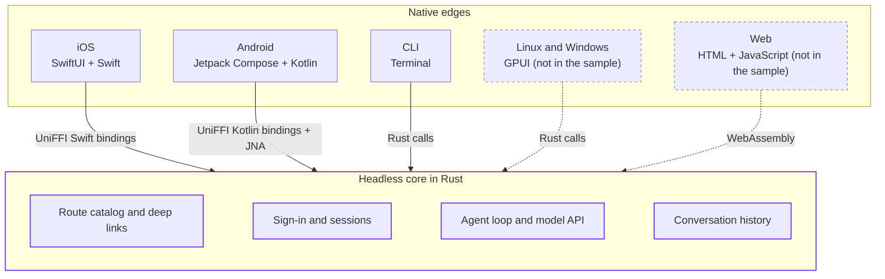

For a long time, building a client for every platform you cared about was expensive. You wrote every screen twice, fixed every bug twice, and either staffed a team per platform or decided which platforms your users would have to live without. So the industry did what it usually does and found ways to make that cost bearable.

[Electron](https://www.electronjs.org), [React Native](https://reactnative.dev), and more recently [Tauri](https://tauri.app) came out of that. They gave teams a dynamic runtime, hot reloading, and the whole ecosystem of web libraries, so one team could ship to several platforms at once. And it worked: [Slack](https://slack.com), [Linear](https://linear.app), [Discord](https://discord.com), [Notion](https://www.notion.com), and [Visual Studio Code](https://code.visualstudio.com) run on a web stack, and many of us have them open all day. [Raycast](https://www.raycast.com) went the same way to get to Windows. [Raycast 2.0](https://www.raycast.com/blog/a-technical-deep-dive-into-the-new-raycast) shares a React and TypeScript frontend between macOS and Windows and loads it in each platform's web view, and the team was open about why: hiring, the UI components the web already has, consistent extensions, and iteration speed. Those are good reasons.

Coding agents changed part of that math. Writing a [SwiftUI](https://developer.apple.com/xcode/swiftui/) view and then its [Jetpack Compose](https://developer.android.com/compose) twin used to be the expensive part, and today an agent writes most of it while you review. What's still expensive is compiling it, and if you've ever sat waiting on [Xcode](https://developer.apple.com/xcode/) or [Gradle](https://gradle.org), you know how much of a day goes into that. At Tuist we've spent years chipping away at that problem, with [caching](/en/docs/guides/features/cache), [selective testing](/en/docs/guides/features/selective-testing), [runners](/en/docs/guides/features/runners) to run the builds on, and now [Once](https://github.com/tuist/once), with remote execution coming next.

Once native builds are fast too, iteration speed becomes a much weaker argument for a web runtime. The other reasons, like the ecosystem or hiring, may still apply to you, and I don't expect anyone to rewrite a large codebase because the economics moved. But it got us thinking about how we'd build a multi-platform app if we started one today, so we wrote down the principles we'd follow and built a small sample app to see whether they hold up.

None of this is entirely new to us. Almost ten years ago we were exploring modular architectures for iOS apps and came up with microfeatures, which many teams adopted and which we later renamed [The Modular Architecture](/en/docs/guides/features/projects/tma-architecture). Tuist itself grew out of that work. This post takes the same ideas about boundaries and build graphs and stretches them across platforms.

We call this set of principles **native edges**. An app has two layers, and both ship inside it. The **headless core** holds the business logic and has no UI at all, and the **native edges** are what users see and touch, one per platform, each connecting the core to its platform. We stayed away from frontend and backend on purpose, because most people hear those words and think UI and server.

The principles are:

1. [Keep business logic in a headless core](#1-keep-business-logic-in-a-headless-core).
2. [Choose a core language that runs everywhere you ship](#2-choose-a-core-language-that-runs-everywhere-you-ship).
3. [Connect the edges to the core through a small, typed API](#3-connect-the-edges-to-the-core-through-a-small-typed-api).
4. [Make every screen reachable by an address](#4-make-every-screen-reachable-by-an-address).
5. [Model the whole app in one build graph](#5-model-the-whole-app-in-one-build-graph).

You don't have to take all of them. Some projects will have good reasons to keep a piece of logic in Swift, to share less, or to use different tools than we do, and that's fine.

## The sample app

To see whether the principles hold up end to end, we built [Native Edges](https://github.com/tuist/native-edges), a client-side agent. You sign in with your ChatGPT account and talk to an agent whose loop, tools, and conversation history live on your device, while the model runs in the cloud. There's an iOS app in SwiftUI, an Android app in Kotlin and Jetpack Compose, and a command-line tool in Rust, and all three sit on one headless core, also written in Rust. The core handles the device-code sign-in and token refresh, runs the agent loop and its requests to the model, provides the tools the agent uses to read earlier conversations, and stores the history in [SQLite](https://www.sqlite.org) through [Diesel](https://diesel.rs).

Here's the iOS app, built and launched on a simulator with `once run`. It signs in with a device code, lists the stored conversations, and asks the agent something that makes it go back to earlier ones. Then the CLI lists the app's routes and builds the URL for one conversation, and the simulator opens it:

<video data-theme-variant="light" autoplay muted loop playsinline controls preload="metadata" poster="/marketing/images/blog/2026/11/02/native-edges-ios-light-poster.webp" aria-label="The Native Edges iOS app signing in, answering a question from earlier conversations, and opening a conversation from a deep link">
  <source src="/marketing/images/blog/2026/11/02/native-edges-ios-light.mp4" type="video/mp4" />
</video>
<video data-theme-variant="dark" autoplay muted loop playsinline controls preload="metadata" poster="/marketing/images/blog/2026/11/02/native-edges-ios-dark-poster.webp" aria-label="The Native Edges iOS app signing in, answering a question from earlier conversations, and opening a conversation from a deep link">
  <source src="/marketing/images/blog/2026/11/02/native-edges-ios-dark.mp4" type="video/mp4" />
</video>

We'll keep coming back to the sample throughout the post. Here are its three edges, plus two more that the same core could support but the sample doesn't include:



## 1. Keep business logic in a headless core

The rule we follow is simple to say: put in the edge whatever only the platform can do, and put everything else in the core.

The edge is the layer users touch. For apps, that means a UI written in a framework that compiles for the platform and follows its conventions, which today is SwiftUI on Apple platforms and Jetpack Compose on Android. Anything you can only reach through the platform's frameworks belongs there too: the [Keychain](https://developer.apple.com/documentation/security/keychain-services) or the [Android Keystore](https://developer.android.com/privacy-and-security/keystore), presenting a browser for an [OAuth](https://oauth.net/2/) flow, registering for [push notifications](https://developer.apple.com/documentation/usernotifications), [Live Activities](https://developer.apple.com/documentation/activitykit), [share extensions](https://developer.apple.com/design/human-interface-guidelines/sharing-and-collaboration), or on-device [speech recognition](https://developer.apple.com/documentation/speech). These are the details users notice when an app gets them wrong, so we'd rather each platform own them.

A command-line tool is an edge too, one whose platform happens to be the terminal, and so is a web app, with the core compiled to [WebAssembly](https://webassembly.org) and the browser as its platform.

The core is the logic that's the same everywhere: which fields of a record can be edited, how a list is paginated, how an OAuth token is refreshed, how history is reconciled after a reconnect, or making sure a late response from a cancelled request doesn't overwrite newer results. Because the core has no UI and doesn't depend on any platform framework, you can cover most of the app's behavior with unit tests that run in seconds, without a simulator, an emulator, or UI automation, and those tests cover every platform at once. Each edge still needs some tests for rendering and platform integration, but far fewer than before.

[Ghostty](https://ghostty.org), the terminal emulator by [Mitchell Hashimoto](https://mitchellh.com), is one of my favorite examples of this split. Its core, [libghostty](https://ghostty.org/docs/about#libghostty), is written in Zig, exposes a C API, and handles terminal emulation, fonts, and rendering. On top of it sit a macOS app written in Swift with AppKit and SwiftUI and a Linux app that uses GTK. Ghostty's core does more than ours, since it includes rendering, but the idea is the same: one shared engine, and on each platform an app that feels like it belongs there.

## 2. Choose a core language that runs everywhere you ship

Look for a language with good toolchains and a good standard library on every platform you support, so you don't find out halfway through a feature that the API you need doesn't exist on one of them. [Rust](https://www.rust-lang.org) does well here. It compiles to iOS, Android, macOS, Linux, Windows, and WebAssembly, and its crates cover almost everything a client needs. The browser is a bit of a special case: the core runs there as WebAssembly, but on [`wasm32-unknown-unknown`](https://doc.rust-lang.org/rustc/platform-support/wasm32-unknown-unknown.html) parts of the standard library, like the file system and threads, don't work, so a web edge needs crates that go through the browser's APIs instead, like `fetch` for networking or IndexedDB for storage. [Zig](https://ziglang.org) is another good option, with explicit allocators and cross-compilation built into its toolchain, and [Go](https://go.dev) can work too, although it brings a garbage collector with it.

Memory is one of the main reasons we lean towards Rust and Zig. Neither has a garbage collector, so you decide when memory is allocated and freed, which matters in places with strict limits, like watches, embedded devices, or the app extensions and widgets the system kills when they use too much. It also means your app doesn't run a second garbage collector next to Swift's reference counting or the Android runtime's own collector. You still have to respect ownership rules at the boundary and measure memory on constrained targets, but you're the one in control.

A question we get a lot is why we don't use [Kotlin Multiplatform](https://kotlinlang.org/docs/multiplatform.html) on Apple platforms, or [Swift on Android](https://www.swift.org/android-workgroup/). Both work, and teams ship real apps with them. Our concern is that a language built for one platform brings its runtime and memory model along to the others, and its standard library and tooling tend to be most complete on the platform where it started. Rust and Zig don't have a home platform in that sense, and for a shared core that's what we want.

I also think the choice of language will matter less and less. As models write more of the code, the questions that remain are whether the language fits the job and whether agents are good at writing and reasoning about it. Rust does well on both: its compiler is strict and its error messages are detailed, so when an agent gets something wrong, it finds out right away and knows why.

If we picked a stack today, it would look like this:

| Platform | Native edge: UI | Native edge: platform services | Headless core |
| --- | --- | --- | --- |
| iOS, iPadOS, macOS | SwiftUI | [Swift](https://www.swift.org) | Rust |
| Android | Jetpack Compose | [Kotlin](https://kotlinlang.org) | Rust |
| Linux, Windows | [GPUI](https://www.gpui.rs) | Rust | Rust |
| Command line | Terminal | Rust | Rust |
| Web | HTML and JavaScript | Browser APIs | Rust compiled to WebAssembly |

For desktop outside macOS, we'd go with [GPUI](https://www.gpui.rs), the UI framework the [Zed](https://zed.dev) team built for their editor. GPUI draws its own UI on the GPU instead of using the operating system's toolkit, compiles to a native binary, and integrates with each platform, and there are component libraries for it, like [GPUI Component](https://github.com/longbridge/gpui-component), for building desktop apps in the spirit of Zed. Since GPUI is Rust too, on Linux and Windows the edge and the core share a language and need no bridge at all.

The command line is in the table because the terminal is a platform too, and developers can tell right away when a CLI starts fast, follows the terminal's conventions, and plays well with pipes and scripts. With a headless core, a CLI is a thin edge over logic you already have, so building one in Rust is cheap. Agents use a lot of software through CLIs, and I expect this edge to matter more and more as they do.

## 3. Connect the edges to the core through a small, typed API

The sample uses [UniFFI](https://github.com/mozilla/uniffi-rs), a tool from Mozilla that generates Swift and Kotlin bindings from annotations in the Rust code. The core marks what it exports, and the edges call typed functions and get typed values back, with no C headers or JSON in between:

```rust
#[derive(uniffi::Record)]
pub struct Destination {
    pub route: String,
    pub params: Params,
    pub url: String,
}

#[derive(Debug, uniffi::Error)]
#[uniffi(flat_error)]
pub enum CoreError {
    /// No session, or it expired: show the sign-in screen.
    Unauthorized { message: String },
    Failed { kind: String, message: String },
}

/// Resolves a deep link into its destination and parents.
#[uniffi::export]
pub fn open(url: String) -> Result<Vec<Destination>, CoreError> {
    // ...
}

/// Sends a message and waits for the agent's answer.
#[uniffi::export]
pub fn send(
    id: Option<String>,
    text: String,
) -> Result<Conversation, CoreError> {
    // ...
}
```

In Swift, these are ordinary functions, and the Rust error becomes a Swift error you can catch. `send` blocks while the agent works, so the sample runs it off the main actor with a small `background` helper of its own:

```swift
let stack = try EdgesCore.open(url: link)
let reply = try await background {
    try EdgesCore.send(id: id, text: text)
}
```

Kotlin gets the same API, with `CoreException.Unauthorized` in place of the Swift error case, and the CLI calls the Rust functions directly. Adding a capability means exporting a function in Rust, and the apps get it with compiler-checked types. The core returns plain values, like a conversation and the URLs it links to, and leaves it to each edge to decide how to present them: a pushed view on iOS, a back-stack entry on Android, or printed output in the terminal.

Sometimes the core needs something only the platform provides, so the API has to work in the other direction too. A token refresh rotates the session, and the new session has to land in the Keychain on iOS and in Keystore-backed encrypted storage on Android. For that we use the delegate pattern: the core declares what it needs as an interface, and each edge provides an implementation. In UniFFI, that's a Rust trait marked `with_foreign`, which Swift and Kotlin can implement:

```rust
/// Provided by the edge: the Keychain on iOS, the Keystore
/// on Android, and a private file in the terminal.
#[uniffi::export(with_foreign)]
pub trait SecureStorage: Send + Sync {
    fn read(&self, key: String) -> Option<String>;
    fn write(&self, key: String, value: String);
    fn delete(&self, key: String);
}
```

On iOS, the implementation is a small class over the Keychain, and the app hands it to the core at launch, along with a directory where the core keeps its SQLite database:

```swift
final class Keychain: SecureStorage {
    func read(key: String) -> String? { /* SecItemCopyMatching */ }
    func write(key: String, value: String) { /* SecItemAdd */ }
    func delete(key: String) { /* SecItemDelete */ }
}

let directory = URL.applicationSupportDirectory.path
_ = try launch(dataDir: directory, storage: Keychain())
```

Android passes a `Keystore` class that encrypts the value with an Android Keystore key, and the CLI passes one that writes files only you can read. The split of responsibilities is what we like here: the core decides what to store and when, such as a renewed session after a refresh, and the edge decides how the operating system protects it. The core's tests pass an in-memory implementation, so they don't need a Keychain or a simulator. We kept the trait simple for the sample, but in a production app `write` and `delete` should report failures so the core can handle them.

## 4. Make every screen reachable by an address

Core tests cover the shared rules, but sometimes you want to test how an edge and the core work together, like whether a screen renders the data the core returns or whether a tap triggers the right call. Whether you or an agent runs that test, you want to get to the screen in one step, not ten.

A CLI makes this easy, because every operation is a named command with options and arguments you can find in the code and run. Web apps are close, since every page has a URL that an agent can read from the route definitions and open. Mobile and desktop apps usually have neither, so getting to a screen means launching the app and tapping through every step in between, which is slow and breaks every time the UI changes. We think native apps deserve a **declarative navigation system** that does two things:

1. **Makes routes discoverable.** The app declares destinations as data, like an enum or a list of types, so someone reading the code, or an agent, can find every place the app can go.
2. **Lets you open any route directly.** A single entry point takes a route, usually as a URL, and builds the navigation state for it, so you can jump straight to a specific screen or record.

Navigation itself belongs to the platform. Each one has strong conventions for stacks, tabs, sheets, transitions, and Back behavior, and users expect them. What the core can own is the route catalog and URL parsing, so every edge agrees on which destinations exist and what a link means. In the sample, each route has an identifier, a URL pattern, and a parent, so a deep link opens on top of the screens you'd normally pass through, and Back works as if you had tapped your way there:

```rust
// Simplified from core/src/routes.rs.
pub static ROUTES: &[Route] = &[
    Route {
        id: "conversations",
        path: "conversations",
        parent: None,
    },
    Route {
        id: "new",
        path: "conversations/new",
        parent: Some("conversations"),
    },
    Route {
        id: "conversation",
        path: "conversations/{id}",
        parent: Some("conversations"),
    },
];
```

Every edge asks the core what a URL means, and tapping a row opens that row's URL, so taps and deep links go through the same code. That's what makes this useful for agents: one can list the routes with the CLI and then open a specific conversation on a simulator or an emulator with a single command:

```sh
edges routes
xcrun simctl openurl booted edges://conversations/011d032b115d6baa
adb shell am start -a android.intent.action.VIEW \
  -d edges://conversations/011d032b115d6baa
```

In the sample, each edge keeps its own database, so a link only opens a conversation that exists in that app. The same URLs can also arrive from notifications and shared links, so treat them as untrusted input: opening a route picks a screen, and the core and the server still check what the user can see.

Each platform already has tools for the edge side:

- **iOS and macOS:** model destinations as a `Codable` enum and drive a [`NavigationStack`](https://developer.apple.com/documentation/swiftui/navigationstack) from a [`NavigationPath`](https://developer.apple.com/documentation/swiftui/navigationpath), then turn incoming URLs into that path in [`onOpenURL`](https://developer.apple.com/documentation/swiftui/view/onopenurl(perform:)). Point-Free's [swift-navigation](https://github.com/pointfreeco/swift-navigation) models every destination, including sheets and alerts, as state, so opening a screen means constructing a value. On macOS, `open <url>` does what `simctl openurl` does on a simulator.
- **Android:** [Navigation Compose](https://developer.android.com/develop/ui/compose/navigation) supports type-safe routes declared as `@Serializable` classes, with deep links mapped to them. In [Navigation 3](https://developer.android.com/guide/navigation/navigation-3), the back stack is a list of keys that you own, and deep link matchers turn a URL into the initial back stack.
- **Desktop with GPUI:** GPUI declares actions with names and dispatches them by name, which is how Zed's command palette lists everything the editor can do. Routes can follow the same pattern, with a command-line flag like `--open <route>` as the entry point.

## 5. Model the whole app in one build graph

You can build all of this with the tools you already have, but we'd recommend **a build system that can model the entire graph**: the Rust core compiled for each platform, the Swift and Kotlin bindings generated from it, the apps that link them, and the tests for each of them.

Xcode and Gradle work well inside their own ecosystems, and they treat everything outside as foreign. Rust usually gets in as a script phase or a custom task that runs [Cargo](https://doc.rust-lang.org/cargo/), or as a prebuilt binary checked into the repository, and the outer build system sees one opaque step. Gradle can cache a custom task if you declare every input and output, but neither tool can schedule or cache the individual crates inside it, so the Rust side ends up rebuilding more than it should.

[Bazel](https://bazel.build) and [Buck2](https://buck2.build) can model all of this, which is why many teams use them. They also ask you to learn their rules and configure toolchains, and a lot of teams find the developer experience hard to live with. For the sample we used [Once](https://github.com/tuist/once), the build system we're building at Tuist, which models the same kind of typed graph with remote caching and keeps the configuration in a single TOML file. It's early and still in canary, so expect rough edges. Here's an excerpt of the sample's [`once.toml`](https://github.com/tuist/native-edges/blob/main/once.toml):

```toml
# The headless core, built once per edge.
[[target]]
name = "CoreIOS"
kind = "rust_library"
srcs = ["core/src/**/*.rs"]
deps = ["./CoreIOSDependencies"]

[target.attrs]
crate_name = "edges_core"
crate_root = "core/src/lib.rs"
target = "aarch64-apple-ios-sim"
crate_type = "staticlib"

# The terminal edge.
[[target]]
name = "CLI"
kind = "rust_binary"
srcs = ["cli/src/**/*.rs"]
deps = ["./Core", "./CoreDependencies"]

# The SwiftUI edge, and the Swift bindings it calls.
[[target]]
name = "SwiftBindings"
kind = "uniffi_bindings"
deps = ["bindgen/Bindgen", "./CoreIOS"]

[target.attrs]
language = "swift"

[[target]]
name = "IOS"
kind = "apple_application"
srcs = ["ios/Sources/**/*.swift"]
deps = ["./CoreIOS", "./SwiftBindings", "./SimulatorSDK"]

[target.attrs]
platform = "ios"
bundle_id = "dev.tuist.edges"
sdk_frameworks = ["Security"]

# The Jetpack Compose edge.
[[target]]
name = "Android"
kind = "android_binary"
srcs = ["android/src/**/*.kt"]
deps = ["./CoreAndroid", "./KotlinBindings", "./Compose"]

[target.attrs]
application_id = "dev.tuist.edges"
min_sdk_version = 26
```

Rust libraries, Apple applications, Android binaries, the bindings between them, and their tests all live in the same graph. Once resolves third-party crates from `Cargo.lock` into per-platform dependency targets, so each crate compiles separately with its own cache key, instead of one `cargo build` compiling everything at once.

The graph generates the bindings too, so nobody has to check them into the repository. Once doesn't have a built-in rule for UniFFI yet, so the sample adds one in a small [Starlark module](https://github.com/tuist/native-edges/blob/main/modules/uniffi.star) that builds `uniffi-bindgen` from source, runs it against the compiled core, and compiles the generated code into a Swift module for iOS and a Kotlin library for Android. Once caches that step like any other, keyed on the generator, its configuration, and the compiled core.

This graph is also what caching relies on. Each step gets a key computed from its inputs, so a change to a SwiftUI view doesn't recompile the Rust core, and you can share the results between your machine, your teammates', CI, and agents working in other worktrees. When the work a build does grows with the size of your change and not the size of your app, native iteration starts to feel close to the hot reloading that made web runtimes so attractive. Linking, installing, and launching still take time, but you stop paying for a full rebuild on top.

### Keep the graph fast

The shape of the graph matters as much as the build system. A build can only run in parallel what the graph lets it run in parallel, and Apple's [WWDC talk on build parallelization](https://developer.apple.com/videos/play/wwdc2022/110364/) calls the longest chain of dependencies the critical path: no extra cores or remote workers make the build shorter than that. So we keep the graph shallow and wide. We only add a dependency when we need it, put interfaces in their own modules so implementations compile side by side (Bruno Rocha explains the technique in [Reducing iOS Build Times by using Interface Modules](https://swiftrocks.com/reducing-ios-build-times-by-using-interface-targets)), and keep shared foundations small, because everything downstream rebuilds when they change. Spotify's account of [moving its iOS app to Bazel](https://engineering.atspotify.com/2023/10/switching-build-systems-seamlessly) shows what that buys you: with remote caching and the module isolation they did during the migration, their CI feedback loop went from 80 minutes to 20.

The same goes for deciding what each edge includes. A widget doesn't need the agent, and a web build pays for every kilobyte it ships, but if each edge builds the core with its own [Cargo features](https://doc.rust-lang.org/cargo/reference/features.html), the cache sees a different core per edge, and you end up building and keeping warm one graph per edge. Bazel's documentation on [configurations](https://bazel.build/extending/config#memory-performance-considerations) warns about the same growth. We'd rather split the core into crates, like storage, networking, and the agent, and let each edge depend on the ones it needs, the way Mozilla's [megazords](https://mozilla.github.io/application-services/book/design/megazords.html) link only the components an app uses. A crate's hash doesn't depend on who uses it, so adding or removing an edge doesn't invalidate anything shared. For dropping unused code from a binary, the linker's dead-code stripping does the job after the core is compiled and cached.

The sample's graph is small, but it has this shape: each edge depends only on its build of the core and its own platform libraries, and no edge depends on another.

## Adopting native edges

### Starting with one platform

We like to start with one platform and move logic into the core as soon as it looks reusable, without trying to design the core up front. A few signs that something belongs there: it doesn't import any platform framework, another platform would need the same behavior, or you'd want to test it without launching the app. Some typical candidates:

- The API client: routes, request and response types, validation, and error mapping.
- Authentication: building the sign-in URL, exchanging codes for tokens, and refreshing them.
- Pagination, search, and filtering rules for lists.
- Form validation, like which fields are required and what a valid date range looks like.
- The route catalog and deep-link parsing.
- Local caching and reconciling data after a reconnect.

When the second platform comes along, most of the work is building a new edge on top of a core that's already built and tested. And keep doing it as features change: when a Swift or Kotlin model starts making business decisions, that's your cue to move the logic into the core.

### If you already have clients

Most teams won't start from scratch, and that's the more interesting case. If you already have clients on several platforms, each in its own language and built with its own tools, I'd start by modeling them in one build graph connected to a remote cache. That makes builds faster before any code moves, and it makes adding a Rust core affordable later. Then pick one piece that's duplicated across your clients, like the API client, authentication, or validation rules, and move it into the core, and while you're at it, think about what your app would look like as a CLI or a set of commands an agent can run. You keep shipping your clients the whole time, and over time you'll notice the edges getting thinner and thinner until they're mostly UI and calls to platform APIs.

## What we're doing at Tuist

We're doing this ourselves. The native clients of [Atlas](/blog/2026/09/23/atlas-what-we-built-next), our internal operations platform, follow these principles: an iOS and macOS app in SwiftUI, an Android app in Kotlin, and a CLI, all on one Rust core. We've also started moving Tuist's own clients to the same model. When we looked across them, we found a lot of duplicated logic, most of it in Swift and some of it rewritten in Kotlin and other languages, and we're now moving that layer into a shared Rust core with the CLI and the apps as its edges. We'll write about it as the work progresses.

It would be a dream for us to see more apps built natively again, apps that use less memory, feel at home on their platform, and run faster. This is early work, and we kept the sample small on purpose. The [sample app](https://github.com/tuist/native-edges) and [Once](https://github.com/tuist/once) are on GitHub if you want to try the principles, and if you build something with them, we'd love to hear about it.
