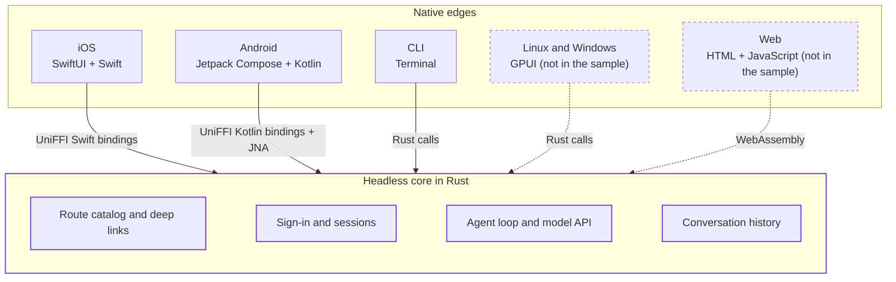

For a long time, building a client for each platform meant writing every screen and fixing every bug once per platform. You either had a team for each platform or picked which ones to leave out. The industry came up with ways to live with that cost.

[Electron](https://www.electronjs.org), [React Native](https://reactnative.dev), and more recently [Tauri](https://tauri.app) came out of that. They gave teams a dynamic runtime, hot reloading, and the libraries and packages of the web, so a single team could build for several platforms. [Slack](https://slack.com), [Linear](https://linear.app), [Discord](https://discord.com), [Notion](https://www.notion.com), and [Visual Studio Code](https://code.visualstudio.com) are all built on a web stack, and many of us use them every day. [Raycast](https://www.raycast.com) took the same route to bring its app to Windows. [Raycast 2.0](https://www.raycast.com/blog/a-technical-deep-dive-into-the-new-raycast) shares a React and TypeScript frontend across macOS and Windows, loaded in each platform's web view. The team gives four reasons for the choice: hiring, the UI components available on the web, consistent extensions, and iteration speed.

Coding agents have changed some of this. Building a [SwiftUI](https://developer.apple.com/xcode/swiftui/) view and its [Jetpack Compose](https://developer.android.com/compose) counterpart used to mean writing the same thing twice. Today an agent can write most of it while you review. Compiling it is still slow. Anyone who has waited on [Xcode](https://developer.apple.com/xcode/) or [Gradle](https://gradle.org) knows how much of a day that can take. Build speed is what we've worked on at Tuist for years: [caching](/en/docs/guides/features/cache), [selective testing](/en/docs/guides/features/selective-testing), [runners](/en/docs/guides/features/runners) to run the builds on, and now [Once](https://github.com/tuist/once), with remote execution coming next.

If native builds also get fast, iteration speed becomes a weaker reason to pick a web runtime. The other reasons, like the ecosystem or hiring, may still apply to you. A large codebase also won't get rewritten because the economics shifted. This post is how we'd build a multi-platform app if we started one today. We wrote down the principles we'd follow and built a small sample app to test them.

This builds on work we started almost ten years ago. We were exploring modular architectures for iOS apps and came up with microfeatures, which many teams adopted and which we later renamed [The Modular Architecture](/en/docs/guides/features/projects/tma-architecture). Tuist grew out of that work. Here we apply the same ideas about boundaries and build graphs across platforms.

We call this set of principles **native edges**. They split an app into two layers, and both ship inside the app. The **headless core** holds the business logic and has no UI. The **native edges** are the parts users see and touch. There's one per platform, and each connects the core to its platform. We avoid the terms frontend and backend because people usually read them as UI and server.

The principles are:

1. [Keep business logic in a headless core](#1-keep-business-logic-in-a-headless-core).
2. [Choose a core language that runs everywhere you ship](#2-choose-a-core-language-that-runs-everywhere-you-ship).
3. [Connect the edges to the core through a small, typed API](#3-connect-the-edges-to-the-core-through-a-small-typed-api).
4. [Make every screen reachable by an address](#4-make-every-screen-reachable-by-an-address).
5. [Model the whole app in one build graph](#5-model-the-whole-app-in-one-build-graph).
6. [Keep the graph shallow and wide](#6-keep-the-graph-shallow-and-wide).
7. [Compile only what each edge needs](#7-compile-only-what-each-edge-needs).

You can adopt some of them and skip others. Some projects will have good reasons to keep a piece of logic in Swift, share less, or use different tools than we do.

## The sample app

To try the principles end to end, we built [Native Edges](https://github.com/tuist/native-edges), a client-side agent. You sign in with your ChatGPT account and talk to an agent. The agent loop, its tools, and the conversation history are on your device, and the model runs in the cloud. There's an iOS app in SwiftUI, an Android app in Kotlin and Jetpack Compose, and a command-line tool in Rust. All three share one headless core, also written in Rust. The core handles the device-code sign-in and token refresh, the agent loop and its requests to the model, the tools the agent uses to read earlier conversations, and the history, which it stores in [SQLite](https://www.sqlite.org) through [Diesel](https://diesel.rs).

Here's the iOS app, built and launched on a simulator with `once run`. It signs in with a device code, lists the stored conversations, and asks the agent a question that makes it read earlier ones. Then the CLI lists the app's routes, builds the URL for one conversation, and the simulator opens it:

<video data-theme-variant="light" autoplay muted loop playsinline controls preload="metadata" poster="/marketing/images/blog/2026/11/02/native-edges-ios-light-poster.webp" aria-label="The Native Edges iOS app signing in, answering a question from earlier conversations, and opening a conversation from a deep link">
  <source src="/marketing/images/blog/2026/11/02/native-edges-ios-light.mp4" type="video/mp4" />
</video>
<video data-theme-variant="dark" autoplay muted loop playsinline controls preload="metadata" poster="/marketing/images/blog/2026/11/02/native-edges-ios-dark-poster.webp" aria-label="The Native Edges iOS app signing in, answering a question from earlier conversations, and opening a conversation from a deep link">
  <source src="/marketing/images/blog/2026/11/02/native-edges-ios-dark.mp4" type="video/mp4" />
</video>

We'll use the sample as the running example. The diagram below shows its three edges and two more that the same core could support but the sample doesn't include:



## 1. Keep business logic in a headless core

Put in the edge what only the platform can do, and put the rest in the core.

The edge is the user-facing layer. For apps, that means a UI written in a framework that compiles for the platform and follows its conventions: SwiftUI on Apple platforms, Jetpack Compose on Android. Anything that is only reachable through the platform's frameworks goes in the edge too: the [Keychain](https://developer.apple.com/documentation/security/keychain-services) or the [Android Keystore](https://developer.android.com/privacy-and-security/keystore), presenting a browser for an [OAuth](https://oauth.net/2/) flow, registering for [push notifications](https://developer.apple.com/documentation/usernotifications), [Live Activities](https://developer.apple.com/documentation/activitykit), [share extensions](https://developer.apple.com/design/human-interface-guidelines/sharing-and-collaboration), or on-device [speech recognition](https://developer.apple.com/documentation/speech). Users notice when an app ignores how their platform does these things.

A command-line tool is also an edge, one whose platform is the terminal. So is a web app, with the core compiled to [WebAssembly](https://webassembly.org) and the browser as the platform.

The core is the logic that is the same on every platform: which fields of a record can be edited, how a list is paginated, how an OAuth token is refreshed, how history is reconciled after a reconnect, or making sure a late response from a cancelled request doesn't overwrite newer results. The core has no UI and doesn't depend on any platform framework, so you can cover most of the app's behavior with unit tests that run in seconds without a simulator, an emulator, or UI automation. Those tests cover every platform at once. Each edge still needs some tests for rendering and platform integration, but far fewer.

[Ghostty](https://ghostty.org), the terminal emulator by [Mitchell Hashimoto](https://mitchellh.com), is a good example of this split. Its core, [libghostty](https://ghostty.org/docs/about#libghostty), is written in Zig, exposes a C API, and handles terminal emulation, fonts, and rendering. The macOS app on top of it is written in Swift with AppKit and SwiftUI, and the Linux app uses GTK. Ghostty's core does more than ours, since it includes rendering, but the split is the same: one shared engine, and an app on each platform that behaves like the other apps there.

## 2. Choose a core language that runs everywhere you ship

Look for a language with good toolchains and a good standard library on every platform you support, so you don't find out halfway through a feature that the API you need isn't available on one of them. [Rust](https://www.rust-lang.org) works well here. It compiles to iOS, Android, macOS, Linux, Windows, and WebAssembly, and its crates cover almost everything a client needs. In the browser, the core runs as WebAssembly, but the browser doesn't give it everything a native platform does: on [`wasm32-unknown-unknown`](https://doc.rust-lang.org/rustc/platform-support/wasm32-unknown-unknown.html), parts of the standard library, like the file system and threads, don't work. A web edge needs crates that go through the browser's APIs for those, like `fetch` for networking or IndexedDB for storage. [Zig](https://ziglang.org) is another option, with explicit allocators and cross-compilation built into its toolchain. [Go](https://go.dev) can work too, although it ships with a garbage collector.

Memory is one of the main reasons we lean towards Rust and Zig. Neither has a garbage collector, so you control allocations closely. That matters in places with strict limits, like watches, embedded devices, or app extensions and widgets that the system terminates when they use too much memory. It also means the app doesn't run a second garbage collector next to Swift's reference counting or the Android runtime's own collector. You still have to respect ownership rules at the boundary and measure memory on constrained targets.

People often ask us why we don't use [Kotlin Multiplatform](https://kotlinlang.org/docs/multiplatform.html) on Apple platforms or [Swift on Android](https://www.swift.org/android-workgroup/). Both work, and teams ship apps with them. We prefer Rust and Zig because a language built for one platform brings its runtime and memory model to the others, and its standard library and tooling are usually most complete on the platform it started on.

We also expect the choice of language to matter less over time. As models write more of the code, the questions become whether the language fits the job and whether agents are good at writing and reasoning about it. Rust does well there. Its compiler is strict and its error messages are detailed, so an agent gets fast, precise feedback when it gets something wrong.

If we picked a stack today, it would look like this:

| Platform | Native edge: UI | Native edge: platform services | Headless core |
| --- | --- | --- | --- |
| iOS, iPadOS, macOS | SwiftUI | [Swift](https://www.swift.org) | Rust |
| Android | Jetpack Compose | [Kotlin](https://kotlinlang.org) | Rust |
| Linux, Windows | [GPUI](https://www.gpui.rs) | Rust | Rust |
| Command line | Terminal | Rust | Rust |
| Web | HTML and JavaScript | Browser APIs | Rust compiled to WebAssembly |

For desktop outside macOS, we'd go with [GPUI](https://www.gpui.rs), the UI framework the [Zed](https://zed.dev) team built for their editor. GPUI draws its own UI on the GPU instead of using the operating system's toolkit. It compiles to a native binary and integrates with each platform, and there are component libraries for it, such as [GPUI Component](https://github.com/longbridge/gpui-component), for building desktop apps like Zed. GPUI is Rust too, so on Linux and Windows the edge and the core share a language and need no bridge.

The command line is in the table because the terminal is a platform too. Developers notice when a CLI starts fast, follows the terminal's conventions, and works well with pipes and scripts. With a headless core, a CLI is a thin edge over logic you already have, so it's cheap to build one in Rust. Agents often use software through CLIs, and we expect this edge to become more important as they do.

## 3. Connect the edges to the core through a small, typed API

The sample uses [UniFFI](https://github.com/mozilla/uniffi-rs), a tool from Mozilla that generates Swift and Kotlin bindings from annotations in the Rust code. The core marks what it exports, and the edges call typed functions and get typed values back:

```rust
#[derive(uniffi::Record)]
pub struct Destination {
    pub route: String,
    pub params: Params,
    pub url: String,
}

#[derive(Debug, uniffi::Error)]
#[uniffi(flat_error)]
pub enum CoreError {
    /// No session, or it expired: show the sign-in screen.
    Unauthorized { message: String },
    Failed { kind: String, message: String },
}

/// Resolves a deep link into its destination and parents.
#[uniffi::export]
pub fn open(url: String) -> Result<Vec<Destination>, CoreError> {
    // ...
}

/// Sends a message and waits for the agent's answer.
#[uniffi::export]
pub fn send(
    id: Option<String>,
    text: String,
) -> Result<Conversation, CoreError> {
    // ...
}
```

In Swift, these are ordinary functions, and the Rust error becomes a Swift error you can catch. `send` blocks while the agent works, so the sample runs it off the main actor with a small `background` helper of its own:

```swift
let stack = try EdgesCore.open(url: link)
let reply = try await background {
    try EdgesCore.send(id: id, text: text)
}
```

Kotlin gets the same API, with `CoreException.Unauthorized` in place of the Swift error case. The CLI calls the Rust functions directly. To add a capability, you export a function in Rust, and the apps get it with compiler-checked types. The core returns plain values, like a conversation and the URLs it links to. Each edge decides how to present them: a pushed view on iOS, a back-stack entry on Android, or printed output in the terminal.

Sometimes the core needs something only the platform provides, so the API also has to work in the other direction. A token refresh rotates the session, and the new session has to land in the Keychain on iOS and in Keystore-backed encrypted storage on Android. For that we use the delegate pattern: the core declares what it needs as an interface, and each edge provides an implementation. With UniFFI, that's a Rust trait marked `with_foreign`, which Swift and Kotlin can implement:

```rust
/// Provided by the edge: the Keychain on iOS, the Keystore
/// on Android, and a private file in the terminal.
#[uniffi::export(with_foreign)]
pub trait SecureStorage: Send + Sync {
    fn read(&self, key: String) -> Option<String>;
    fn write(&self, key: String, value: String);
    fn delete(&self, key: String);
}
```

On iOS, the implementation is a small class over the Keychain, and the app hands it to the core at launch, along with a directory where the core keeps its SQLite database:

```swift
final class Keychain: SecureStorage {
    func read(key: String) -> String? { /* SecItemCopyMatching */ }
    func write(key: String, value: String) { /* SecItemAdd */ }
    func delete(key: String) { /* SecItemDelete */ }
}

let directory = URL.applicationSupportDirectory.path
_ = try launch(dataDir: directory, storage: Keychain())
```

Android passes a `Keystore` class that encrypts the value with an Android Keystore key, and the CLI passes one that writes files only you can read. The core decides what to store and when, such as a renewed session after a refresh. The edge decides how the operating system protects it. The core's tests pass an in-memory implementation, so they don't need a Keychain or a simulator. The trait is simplified for the sample: in a production app, `write` and `delete` should report failures so the core can handle them.

## 4. Make every screen reachable by an address

Core tests cover the shared rules, but sometimes you want to test how an edge and the core work together: that a screen renders the data the core returns, or that an action in the UI triggers the right call. Whether you or an agent runs that test, you want to get to the screen in one step.

A CLI makes this easy, because every operation is a named command with options and arguments that you can find in the code and run. Web apps are close to that, since every page has a URL that an agent can read from the route definitions and open. Mobile and desktop apps usually have neither, so getting to a screen means launching the app and tapping through every step in between. That's slow, and it breaks whenever the UI changes. We think native apps should have a **declarative navigation system** that does two things:

1. **Makes routes discoverable.** Destinations are declared as data, like an enum or a list of types, so someone reading the code, or an agent, can find every place the app can go.
2. **Lets you open any route directly.** A single entry point takes a route, usually as a URL, and builds the navigation state for it, so you can jump straight to a specific screen or record.

Navigation itself belongs to the platform, since each one has its own conventions for stacks, tabs, sheets, transitions, and Back behavior. The core can own the route catalog and URL parsing, so every edge agrees on which destinations exist and what a link means. In the sample, each route has an identifier, a URL pattern, and a parent, so a deep link opens on top of the screens you'd normally pass through, and Back works as if you had tapped your way there:

```rust
// Simplified from core/src/routes.rs.
pub static ROUTES: &[Route] = &[
    Route {
        id: "conversations",
        path: "conversations",
        parent: None,
    },
    Route {
        id: "new",
        path: "conversations/new",
        parent: Some("conversations"),
    },
    Route {
        id: "conversation",
        path: "conversations/{id}",
        parent: Some("conversations"),
    },
];
```

Every edge asks the core what a URL means. Tapping a row opens that row's URL, so taps and deep links go through the same code. An agent can list the routes with the CLI and then open a specific conversation on a simulator or an emulator with a single command:

```sh
edges routes
xcrun simctl openurl booted edges://conversations/011d032b115d6baa
adb shell am start -a android.intent.action.VIEW \
  -d edges://conversations/011d032b115d6baa
```

In the sample, each edge keeps its own database, so a link only opens a conversation that exists in that app. The same URLs can also come from notifications and shared links, so treat them as untrusted input. A route says where to go. The core and the server still decide what the user is allowed to see.

Each platform already has tools for the edge side:

- **iOS and macOS:** model destinations as a `Codable` enum and drive a [`NavigationStack`](https://developer.apple.com/documentation/swiftui/navigationstack) from a [`NavigationPath`](https://developer.apple.com/documentation/swiftui/navigationpath), then turn incoming URLs into that path in [`onOpenURL`](https://developer.apple.com/documentation/swiftui/view/onopenurl(perform:)). Point-Free's [swift-navigation](https://github.com/pointfreeco/swift-navigation) models every destination, including sheets and alerts, as state, so opening a screen means constructing a value. On macOS, `open <url>` does what `simctl openurl` does on a simulator.
- **Android:** [Navigation Compose](https://developer.android.com/develop/ui/compose/navigation) supports type-safe routes declared as `@Serializable` classes, with deep links mapped to them. In [Navigation 3](https://developer.android.com/guide/navigation/navigation-3), the back stack is a list of keys that you own, and deep link matchers turn a URL into the initial back stack.
- **Desktop with GPUI:** GPUI's actions are declared with names and dispatched by name, which is how Zed's command palette lists everything the editor can do. Routes can follow the same pattern, with a command-line flag like `--open <route>` as the entry point.

## 5. Model the whole app in one build graph

You can build this architecture with the tools you already have, but we recommend **a build system that can model the entire graph**: the Rust core compiled for each platform, the Swift and Kotlin bindings generated from it, the apps that link them, and the tests for each of them.

Xcode and Gradle work well within their own ecosystems. Rust usually enters them as a script phase or a custom task that runs [Cargo](https://doc.rust-lang.org/cargo/), or as a prebuilt binary checked into the repository. The outer build system sees one opaque step. Gradle can cache a custom task if you declare every input and output, but neither tool can schedule or cache the individual crates inside it, so the Rust side ends up rebuilding more than it should.

[Bazel](https://bazel.build) and [Buck2](https://buck2.build) can model all of this, and that's why many teams use them. They also ask you to learn their rules and configure toolchains, and plenty of teams find the developer experience hard to live with. For the sample we used [Once](https://github.com/tuist/once), the build system we're building at Tuist. It models the same kind of typed graph with remote caching, configured in a single TOML file. It's early and still in canary. Here's an excerpt of the sample's [`once.toml`](https://github.com/tuist/native-edges/blob/main/once.toml):

```toml
# The headless core, built once per edge.
[[target]]
name = "CoreIOS"
kind = "rust_library"
srcs = ["core/src/**/*.rs"]
deps = ["./CoreIOSDependencies"]

[target.attrs]
crate_name = "edges_core"
crate_root = "core/src/lib.rs"
target = "aarch64-apple-ios-sim"
crate_type = "staticlib"

# The terminal edge.
[[target]]
name = "CLI"
kind = "rust_binary"
srcs = ["cli/src/**/*.rs"]
deps = ["./Core", "./CoreDependencies"]

# The SwiftUI edge, and the Swift bindings it calls.
[[target]]
name = "SwiftBindings"
kind = "uniffi_bindings"
deps = ["bindgen/Bindgen", "./CoreIOS"]

[target.attrs]
language = "swift"

[[target]]
name = "IOS"
kind = "apple_application"
srcs = ["ios/Sources/**/*.swift"]
deps = ["./CoreIOS", "./SwiftBindings", "./SimulatorSDK"]

[target.attrs]
platform = "ios"
bundle_id = "dev.tuist.edges"
sdk_frameworks = ["Security"]

# The Jetpack Compose edge.
[[target]]
name = "Android"
kind = "android_binary"
srcs = ["android/src/**/*.kt"]
deps = ["./CoreAndroid", "./KotlinBindings", "./Compose"]

[target.attrs]
application_id = "dev.tuist.edges"
min_sdk_version = 26
```

Rust libraries, Apple applications, Android binaries, the bindings between them, and their tests are all targets in the same graph. Third-party crates are resolved from `Cargo.lock` into per-platform dependency targets, so each crate compiles separately with its own cache key, instead of one `cargo build` compiling everything.

The graph generates the bindings too, so they don't need to be checked into the repository. Once has no built-in rule for UniFFI, so the sample adds one in a small [Starlark module](https://github.com/tuist/native-edges/blob/main/modules/uniffi.star). It builds `uniffi-bindgen` from source, runs it against the compiled core, and compiles the generated code into a Swift module for iOS and a Kotlin library for Android. The generation step is cached like any other, keyed on the generator, its configuration, and the compiled core.

This graph is also what caching relies on. Each step gets a key computed from its inputs, so a change to a SwiftUI view doesn't recompile the Rust core. The results can be shared between your machine, your teammates', CI, and agents working in other worktrees. When the work a build does scales with the size of the change instead of the size of the app, native iteration gets much closer to the hot reloading that made web runtimes attractive. Linking, installing, and launching the app still take time, but you no longer pay for a full rebuild on top.

## 6. Keep the graph shallow and wide

When teams think about build times, they usually think about the build system: whether it caches and whether it supports remote execution. The shape of the graph matters as much, and it's easy to overlook because it comes out of architecture decisions. A build system can only run in parallel what the graph lets it run in parallel. If your modules form a long chain where each one depends on the previous one, they compile one after another, and a machine with 16 cores or a fleet of remote workers will mostly sit idle. Apple's [WWDC talk on build parallelization](https://developer.apple.com/videos/play/wwdc2022/110364/) calls the longest path through the graph, measured in time, the critical path. No amount of hardware makes the build faster than that path.

The shape also decides how much an edit costs. Most of the builds you run in a day are incremental. When you change a target, the targets that depend on it may have to recompile or relink, depending on what changed and how the compiler and the build system handle it. A remote cache helps only if someone already built that exact state. The more targets sit downstream of the code you touch, the more work an edit can trigger.

Aim for **a shallow, wide graph**: many targets side by side, and few dependencies nested several levels down. Clean builds then run in parallel, and incremental builds stay small. A few practices help:

- **Only add a dependency when you need it.** Each dependency makes one target wait for another and rebuild when the other changes.
- **Depend on interfaces, not implementations.** Splitting a module into a small interface module and an implementation module lets features depend on the stable interface, so implementations compile in parallel and changing one doesn't recompile its consumers. Bruno Rocha, who now works on build tooling at Spotify, explains the technique in [Reducing iOS Build Times by using Interface Modules](https://swiftrocks.com/reducing-ios-build-times-by-using-interface-targets).
- **Keep shared foundations small and stable.** A module everything depends on is on everyone's critical path, and changing it invalidates most of the graph.
- **Check the build timeline as well as the total time.** Long stretches where a single task runs point to a chain you could break up, or to one expensive step, like a link, worth looking at.

Spotify's account of [moving its iOS app to Bazel](https://engineering.atspotify.com/2023/10/switching-build-systems-seamlessly) shows the build system and the graph's shape working together. Their CI feedback loop went from 80 minutes to 20. They credit remote caching and remote execution, along with the module isolation and app architecture work done during the migration, which let them build and test only the parts of the graph a change affected.

The sample's graph is small, but it has this shape. Each edge depends only on its build of the core and its own platform libraries. No edge depends on another, and the per-platform builds of the core don't depend on each other either. In a larger app, the same applies to features: give each one its own state instead of routing everything through a global model, and add a target only where there's a real boundary.

## 7. Compile only what each edge needs

Edges need different things from the core. A CLI doesn't need code that only a widget uses, and a widget doesn't need the whole business API. A web build pays for every kilobyte it ships. Linkers can strip some unused code, but you get much more control if the graph lets each edge include or leave out pieces of the core at compile time.

The way you do it matters for caching. A build system caches each target under a hash of its inputs, and the flags it's compiled with are part of those inputs. If the iOS app builds the core with one set of [Cargo features](https://doc.rust-lang.org/cargo/reference/features.html) and the CLI builds it with another, the core gets two hashes. The cache stores them as two different cores. Each one has to be built, cached, and kept warm on its own, and a change to the core invalidates both. Do that for every edge and you end up with one graph per edge instead of one graph for the whole app. Bazel's documentation on [configurations](https://bazel.build/extending/config#memory-performance-considerations) describes the same effect: every new configuration of a target is another node to build, and settings that vary through the graph can make it grow exponentially.

We make that choice with graph dependencies instead. Split the core into targets along real boundaries, like routing, storage, networking, and the agent, and let each edge pick the ones it depends on. Every target is built the same way no matter which edge asks for it, so it keeps one hash. A target's hash comes from its own sources and the targets it depends on. The targets that depend on it don't change it, and the core doesn't know which edges exist, so adding, removing, or copying an edge doesn't change the hash of anything it uses. A widget that only shows the latest conversation could depend on the storage target alone and never build or link the agent or the networking code. This is the old rule of physical design that John Lakos called levelization in [*Large-Scale C++ Software Design*](https://www.oreilly.com/library/view/large-scale-c-software/0201633620/) and Robert C. Martin described as the [acyclic and stable dependencies principles](https://en.wikipedia.org/wiki/Package_principles). Both say a component should depend only on components below it.

Splitting the core has two costs. First, an app should link a single Rust library, because each Rust static library brings its own copy of the standard library. Each edge gets a thin umbrella crate that depends on the crates it picks and links them into one library. Its hash differs per edge, but it holds only re-exports and the final link. Second, you have to decide how much the crates know about each other. In the graph below, the agent depends on storage and networking directly, which is the simplest option. If you want features to stay independent, so an edge can take the agent without storage, the agent declares a trait for what it needs and the umbrella crate passes in an implementation. That is dependency injection, done once per edge, in the crate that already picks the parts. It works the way `SecureStorage` works between the core and the platform.

Mozilla's [application-services](https://github.com/mozilla/application-services), where UniFFI comes from, has worked this way for years. Each component (logins, places, accounts) is its own crate, and a ["megazord"](https://mozilla.github.io/application-services/book/design/megazords.html) crate links them into one library per platform. An app that needs fewer components builds a custom megazord that doesn't depend on the ones it skips, and swaps it in through the dependency graph rather than through feature flags.

Try both approaches below. Turn on the widget, turn off the CLI, or edit a file in the storage crate, and see which nodes get a new hash and have to be built.

<.live_component module={TuistWeb.Marketing.Components.Posts.NativeEdges.EdgeGraphLab} id="edge-graph-lab" />

When you choose in the graph, an edge you add costs two small builds: the edge and its umbrella crate. Editing storage rebuilds storage, the agent that depends on it, and the edges above them. With flags per edge, every new edge brings its own copy of the core, and the same edit rebuilds every copy.

The sample does this at a small scale. The iOS app depends on the Swift bindings, and the Android app on the Kotlin bindings and [JNA](https://github.com/java-native-access/jna), which the bindings use to load the core. The CLI depends on neither. Platform differences are the one place where we use [conditional compilation](https://doc.rust-lang.org/reference/conditional-compilation.html), like `#[cfg(target_os = "android")]`, because the core is already built once per platform and that doesn't add any variants. If you only need to drop unused code from the final binary, let the linker do it with dead-code stripping (`-dead_strip` on Apple platforms, `--gc-sections` elsewhere). That happens when each edge links, after the core is compiled and cached, so it doesn't change any hash. Per-edge flags aren't forbidden, and sometimes they're the simplest option. Count each new combination as one more copy of that part of the graph to build and keep warm in the cache.

## Adopting native edges

### Starting with one platform

We like to start with one platform and move logic into the core as soon as it looks reusable, without designing the core up front. A few signs that something belongs there: it doesn't import any platform framework, another platform would need the same behavior, or you'd want to test it without launching the app. Typical candidates are:

- The API client: routes, request and response types, validation, and error mapping.
- Authentication: building the sign-in URL, exchanging codes for tokens, and refreshing them.
- Pagination, search, and filtering rules for lists.
- Form validation, like which fields are required and what a valid date range looks like.
- The route catalog and deep-link parsing.
- Local caching and reconciling data after a reconnect.

When you add the second platform, most of the work is building a new edge on top of a core that's already built and tested. Keep doing this as features change: when a Swift or Kotlin model starts making business decisions, move that logic into the core.

### If you already have clients

Most teams won't start from scratch. If you already have clients on several platforms, each written in its platform's language and built with its own tools, we'd start by modeling them in one build graph connected to a remote cache. That speeds up builds before any code moves, and it makes adding a Rust core affordable later. Then pick one piece that's duplicated across your clients, like the API client, authentication, or validation rules, and move it into the core. While you do it, think about what your app would look like as a CLI or a set of commands an agent can run. Each piece you move is one less thing to write twice. Over time the edges get thinner until they mostly contain UI and calls to platform APIs. You can keep releasing your clients while this happens.

### What we're doing at Tuist

The native clients of [Atlas](/blog/2026/09/23/atlas-what-we-built-next), our internal operations platform, are built on these principles: an iOS and macOS app in SwiftUI, an Android app in Kotlin, and a CLI, all on one Rust core. We've also started moving Tuist's own clients to the same model. Across them we found duplicated logic, most of it in Swift and some of it rewritten in Kotlin and other languages. We're moving that layer into a shared Rust core, with the CLI and the apps as its edges, and we'll write about it as the work progresses.

We'd like to see more apps built natively again: apps that use less memory, feel at home on their platform, and run faster. This is early work, and the sample is deliberately small. The [sample app](https://github.com/tuist/native-edges) and [Once](https://github.com/tuist/once) are on GitHub if you want to try the principles. If you build something with them, let us know.
